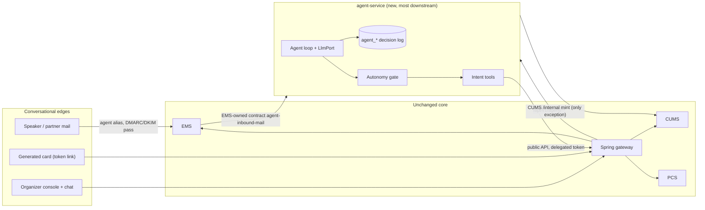
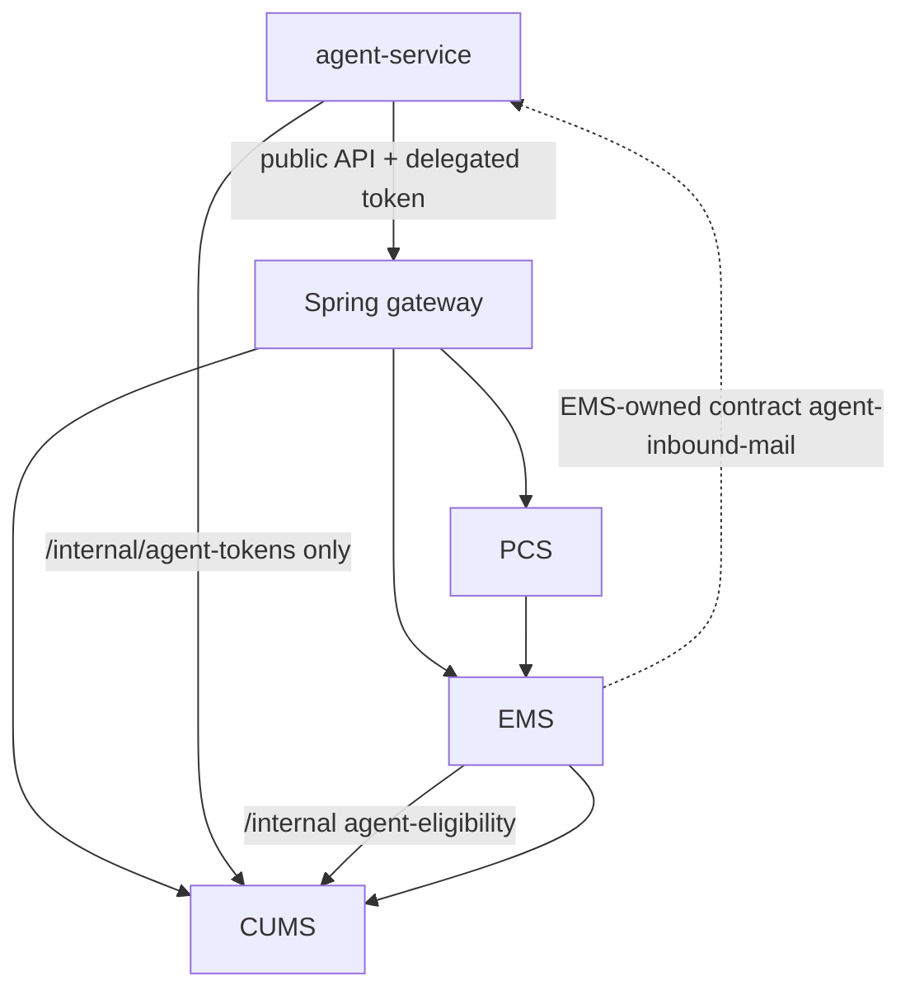
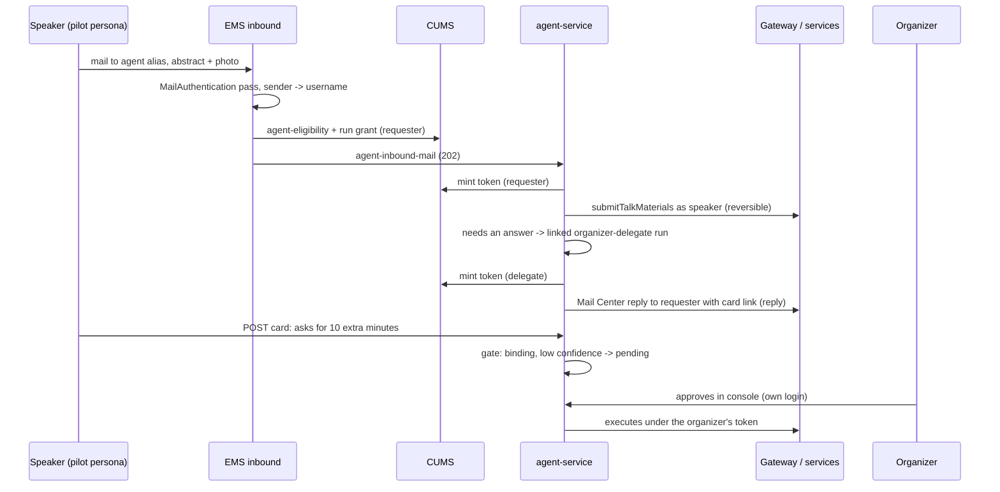

# Architecture Spine — BATbern agentic interaction

## Design Paradigm

**Ports and adapters, with the agent as a driving adapter.** The domain services and their public
OpenAPI ports stay as they are. The React frontend is one adapter on those ports; agent-service is
a second one. Whatever the agent does, a person with that principal's rights could do, and the
services enforce it the same way. **Intent in, confirmation out:** people state intent in mail or
chat, the agent turns it into tool calls, and a person sees UI only where a decision is needed.
Content arriving in a mail is data, never instructions: no AD may rely on the model obeying a
prompt.



## Invariants & Rules

### AD-1 — The core does not change for the agent [ADOPTED]

- **Binds:** all
- **Prevents:** agent work weakening rules the core already enforces.
- **Rule:** The 8-state event workflow, `SpeakerWorkflowService` as sole status writer, ADR-008
  authorization in the services, #1179 (no automatic audience mail), ADR-016 (no event bus, no
  polling) and the module map hold. An agent need the public API cannot serve is met by a new or
  extended public operation (contract-first, `@PreAuthorize`, an ownership rule where a
  non-organizer uses it), never by a back door. Undo is a compensating tool call through the gate,
  never a direct write.

### AD-2 — agent-service is a client of the public API, with one named exception

- **Binds:** agent-service, every tool, module map
- **Prevents:** a second write path that bypasses per-user authorization and ownership rules.
- **Rule:** agent-service calls other services only through the Spring gateway's public API with a
  delegated token (AD-3). It never reads or writes another service's tables and calls no
  `/internal/**` operation except CUMS `/internal/agent-tokens` (AD-3). Upstream services reach
  agent-service only through a contract they own (AD-4). The first story amends
  `docs/architecture/module-map.md` with this exception.



### AD-3 — One delegated token, minted only by CUMS, verified by one shared decoder

- **Binds:** CUMS, shared-kernel security, api-gateway, EMS, PCS, agent-service
- **Prevents:** a super-user agent, services inventing their own agent auth, any service able to
  forge an agent token, and ownership checks breaking for delegated users.
- **Rule:**
  - **Minting.** CUMS mints every delegated token through `/internal/agent-tokens`, signed RS256
    with a private key only CUMS holds. Verifiers use its public key.
  - **Claims.** Fixed: `iss=batbern-agent`, `sub` = Cognito sub, `custom:username`, `act` =
    `{run, principal}`, `exp` at most 5 minutes, no role claim. Roles always come from
    `role_assignments`.
  - **Run grants.** CUMS mints only against a run grant: a CUMS-issued credential bound to one run
    and one principal (AD-15), with a maximum lifetime. CUMS issues a grant only to the eligible
    principal of a verified trigger:
    - an EMS handoff (EMS requests the grant when it hands the mail over);
    - an organizer's live Cognito login (chat, console, approval);
    - the configured organizer delegate (AD-15).
  - **Re-minting.** agent-service mints a fresh token before every write, approval execution and
    card POST. A refusal stops the run.
  - **Decoding.** One decoder in shared-kernel accepts Cognito, Watch and agent tokens, and one
    shared resolver turns `act` into the recorded actor `agent:<run>` for `<username>`. The first
    story builds both and adopts them in the gateway, CUMS, EMS and PCS before any tool story
    starts.

### AD-4 — Inbound mail reaches the agent through an EMS-owned contract, only when authenticated

- **Binds:** EMS forwarding / mail center, agent-service
- **Prevents:** spoofed senders starting runs, a second inbound path, polling, or lost mail.
- **Rule:**
  - **The alias.** The agent address is a new alias kind in `ForwardingAlias` /
    `AliasMailProcessor`, open to any sender. Replies in a conversation the agent started
    (`replies+{token}@`) take the same path.
  - **Who gets through.** EMS hands a mail over only when `MailAuthentication` passes
    (DMARC/DKIM). EMS resolves the sender to a username itself (`PersonAddresses`). CUMS
    `agent-eligibility` must confirm that user.
  - **The contract.** EMS calls `agent-inbound-mail` through `ContractCalls`. Its spec is in
    `docs/api/internal/ems-internal.openapi.yml`; its implementers are in
    `batbern.contracts.agent-inbound-mail.implementers`.
  - **Payload.** The full message, references to its attachments in the inbound bucket, the
    authentication verdict, the resolved username, the run grant, and an idempotency key (the
    message id). agent-service answers 202 and runs asynchronously.
  - **Fallbacks.** Authentication fails, the sender is not eligible, the switch is off, or the
    contract call fails: EMS forwards the mail to the organizers as today. A run that fails later
    becomes a pending item for the organizers in the console.

### AD-5 — The agent never sends mail on its own

- **Binds:** agent-service tools
- **Prevents:** mail the Mail Center log, conversations and delivery status never see.
- **Rule:** Every outgoing mail is a tool call against a Mail Center operation. agent-service has
  no SES client. Agent mails carry `Auto-Submitted: auto-generated`. The agent never answers a mail
  that carries `Auto-Submitted` or comes from one of BATbern's own addresses.

### AD-6 — Intent tools are the agent's only capability, with a derived risk class

- **Binds:** agent-service tool layer
- **Prevents:** the model composing raw API calls, tools that understate their risk, and two tools
  giving one operation different classes.
- **Rule:**
  - **Tools.** The agent sees only intent tools, about 20 per principal kind, never the raw
    operations. Each tool is one intent and composes the public operations it needs.
  - **Classes, lowest to highest.** `read` < `reversible` < `reply` < `binding` < `audience`.
    - `reply`: one mail to the run's requester, about their own case, in their conversation.
    - Any other mail to a non-organizer is at least `binding`.
    - A mail that reaches more than one non-organizer is `audience`.
  - **Derivation.** The registry holds one table giving the class of each public operation a tool
    may call. A tool's class is the highest class among the operations it calls. The build fails
    for a tool declared lower than that, or one that calls an operation missing from the table.

### AD-7 — One autonomy gate decides, before every non-read call

- **Binds:** agent-service
- **Prevents:** per-tool or per-channel autonomy logic, autonomy that the inbound text can talk up,
  and #1179 broken by repetition.
- **Rule:**
  - **`reversible` and `reply`** run on their own, within the per-run and per-day caps
    (Operational envelope).
  - **`binding`** runs on its own only when confidence clears the threshold. Confidence is computed
    from matching precedents (AD-8) and the class. Neither the model's own statement nor anything in
    the inbound text can clear it alone. Below the threshold, the call becomes a pending approval.
  - **`audience`** is always a pending approval.
  - **Scheduled runs** never send mail without approval.
  - **Recipient count.** The gate counts distinct non-organizer recipients per run, and per day
    across runs. Above one, every further mail is treated as `audience`.
  - **Logging.** Verdicts, their inputs and their outcomes are logged (AD-9).

### AD-8 — The agent learns from what BATbern already owns, by retrieval

- **Binds:** agent-service
- **Prevents:** a hidden second copy of the domain data, and behaviour no one can trace back.
- **Rule:** Precedent comes from two sources only: the history of past events, read through `read`
  tools on the public API, and the agent decision log (organizer approvals, denials and undos). No
  fine-tuning and no separate vector store in the pilot. Every gate verdict cites the precedents it
  used.

### AD-9 — agent-service owns the agent decision log

- **Binds:** agent-service, oversight console, pilot evaluation
- **Prevents:** agent state spread across EMS tables, and an exchange that left no trace.
- **Rule:** Runs, inbound messages, model calls, steps, tool calls, gate verdicts, approvals, cards
  and undos live in agent-service's own `agent_*` tables under its own Flyway history. No other
  service reads them. The console reads them through `docs/api/agent-api.openapi.yml`
  (`/api/v1/agent/**`, routed by the gateway; Cognito organizer tokens or card tokens only). Every
  exchange is logged in full.

### AD-10 — CUMS owns the pilot rails; minting is the choke point

- **Binds:** CUMS, EMS, agent-service
- **Prevents:** checkpoints that cannot read the settings, mismatches between address and user, and
  a kill-switch that misses a path.
- **Rule:** CUMS owns `agent.enabled` and the allowlist (keyed by username); only the owner changes
  them. No grant or token is minted unless the switch is on and the principal is listed, so
  switching off stops every path within one token lifetime. EMS reads eligibility through CUMS
  `/internal/agent-eligibility` (downstream to upstream). agent-service has no read of its own:
  refusal to mint is the check.

### AD-11 — Generated UI speaks A2UI with a closed BATbern catalog, one renderer

- **Binds:** agent-service, web-frontend
- **Prevents:** runtime-generated code in production, a private dialect, and two renderers or
  catalogs that drift apart.
- **Rule:**
  - **The catalog.** The agent emits A2UI messages using only components of the BATbern catalog,
    defined once as JSON Schema 2020-12 in `docs/api/agent-ui-catalog.json`.
  - **Validation.** agent-service validates every message against the catalog and the vendored
    A2UI envelope schemas before storing or sending it.
  - **The renderer.** One renderer in web-frontend, Tailwind only, no MUI, with components built
    from the catalog JSON (no second hand-written catalog). It serves public card pages and the
    console. No catalog component renders Markdown or HTML.
  - **Protocol version.** Whichever version the first UI story proves end to end (AD-16).

### AD-12 — Cards are stored, immutable, and confirmed by POST of the stored action

- **Binds:** agent-service, web-frontend public route
- **Prevents:** mail scanners triggering actions, and a token holder changing what gets executed.
- **Rule:**
  - **Storage.** A card stores its catalog version, its pending action, and the input fields it
    declares. Any change makes a new card.
  - **The link.** A mail carries a signed, expiring token link. GET renders read-only.
  - **Confirming.** A POST executes the stored action, accepts only the declared input fields, and
    passes the gate again.
  - **The token is the credential.** The route is `permitAll` in the gateway and in agent-service
    (all profile chains), and the access-control DAST probe covers it.
  - **Versions.** The renderer supports the catalog version of every unexpired card.

### AD-13 — The organizer cockpit shrinks to an oversight console

- **Binds:** web-frontend organizer area
- **Prevents:** the old UI and the agent growing side by side, and organizers stranded when the
  kill-switch is off.
- **Rule:**
  - **No new screens.** No new organizer CRUD screen during the initiative. A new capability
    arrives as a tool and, where needed, a catalog component.
  - **The console** is the activity feed, pending approvals, the brief, and chat with generated
    views.
  - **Replaced screens.** During the pilot, a replaced screen is hidden from navigation, not
    deleted. Deletion needs the owner's go, and only after the pilot is opened beyond the
    allowlist.

### AD-14 — One agent loop, one model port

- **Binds:** agent-service
- **Prevents:** tools or channels calling the model outside the gate, the log and the budget.
- **Rule:**
  - **One caller.** Only the agent loop calls the model, through one port (`LlmPort`). Its
    production adapter uses `anthropic-java` with the API key from Secrets Manager.
  - **Tools** are deterministic code and never call the model.
  - **Logging.** Every model call (prompt, tool choice, tokens) is logged per run.
  - **The model id** is configuration.
  - **OpenAI in EMS.** The existing use (`BatbernAiService`) stays outside this rule and is not
    reused.

### AD-15 — One principal per run

- **Binds:** agent-service, CUMS grants, EMS audience operations
- **Prevents:** a speaker run silently becoming an organizer run, and an agent with an organizer's
  full reach.
- **Rule:**
  - **Principals.** Every run has exactly one principal, fixed by its grant:
    - **requester:** the speaker or partner whose mail or card started the run, with that
      person's rights only;
    - **organizer delegate:** the agent acting for the team, with the rights of the organizer the
      owner configures in CUMS, and subject to the gate;
    - **organizer:** a person in the console or chat.
  - **Requester runs.** When a requester run needs organizer work (answering, scheduling), it
    creates a linked organizer-delegate run, which is logged. That run's `reply` tool may mail only
    the requester.
  - **Approvals.** Approved `binding` and `audience` actions execute under the approving
    organizer's own live login, never under the delegate.
  - **Audience guard.** EMS's audience sends refuse any token carrying `act`.

### AD-16 — A2UI enters through a spike before any card story

- **Binds:** web-frontend, agent-service
- **Prevents:** stories building on a renderer version that does not work.
- **Rule:** The first UI story proves one custom catalog component and one user-action round trip
  (button → action message → gate → tool) with the pinned `@a2ui/react` and `@a2ui/web_core`. It
  records the proven protocol version as an amendment to this AD: v1.0 if it works, otherwise v0.9
  by explicit decision. No other card story starts before it.

## Operational Envelope

| Concern | Decision |
| --- | --- |
| Deployment | Every PR to develop deploys to production. agent-service ships **dark**: `agent.enabled` is off by default and the contract implementer list stays empty until the owner switches it on. It runs as its own ECS service with its own CDK stack, in the existing account |
| Pilot users | The organizers, on their own accounts, playing scripted speaker personas. The allowlist holds only them. No real speaker or partner is eligible until the owner decides |
| Tests | `LlmPort` has a scripted adapter for tests: the model is a process boundary, so this is within the mock rule. Integration tests use Testcontainers and the `SesRecorder`. No post-deploy test (Bruno, Playwright, nightly E2E) reaches the real model or sends mail through the agent |
| Local dev | Starts with `make dev-native-up`. Uses the scripted adapter unless a key is set in the local env. Mails go to `/dev/mails` |
| Limits | Per-run caps on steps, model tokens and `reply` mails, plus a daily token budget, all in agent-service configuration. Reaching one stops the run and hands it to the organizers |
| Failure | If the model or the contract is down, the mail goes to the organizers (AD-4). Loop protection as in AD-5 |
| Observability | Same logging, metrics and CloudWatch alarm pattern as the other services. Alarms on run failures, budget breaches and refused mints. No personal data in logs (#1202 rule) |
| Security | The access-control DAST probe covers `/api/v1/agent/**` and the card route. `EndpointAuthorizationGuardTest` runs in agent-service |
| Evaluation | The decision log is the dataset. Each scripted persona has a scenario with an expected outcome. The owner sets the measures and the go/no-go rule for opening the pilot (Deferred) |

## Consistency Conventions

| Concern | Convention |
| --- | --- |
| Tool names | camelCase verb plus object at intent level (`submitTalkMaterials`), one class per tool. The registry entry carries the principal kind(s) and the operations used |
| Catalog components | PascalCase in the catalog and the renderer (`PersonCard`, `Table`, `ConfirmAction`). The catalog version is bumped on any breaking change |
| Identifiers | ADR-003 meaningful IDs in every tool argument and card (`eventCode`, `username`). UUIDs only for agent-internal rows (run, card) |
| Attribution | `agent:<run>` acting for `<username>`, through the shared resolver (AD-3). Schedulers in agent-service log as `system:agent-<job>` and act only through a grant |
| Language | The agent writes in the person's profile language. DE and EN are first-class; other languages fall back to EN, as for mail templates. The renderer's fixed labels follow the 10-locale UI rule |
| Errors | agent-service's public API uses the shared `ErrorResponse`. A failed tool call is logged and reported to the person. Calls at `binding` and above are never retried blind |
| Configuration | Spring configuration properties. The pilot rails live in CUMS (AD-10). The API key lives only in Secrets Manager |

## Stack

| Name | Version |
| --- | --- |
| agent-service | Java 21, Spring Boot 4.0.9 (as the other services) |
| Model client | `com.anthropic:anthropic-java` 3.12.0, own loop, no beta tool runner |
| Model access | Anthropic API, key in AWS Secrets Manager |
| A2UI renderer | `@a2ui/react` 0.15.0 and `@a2ui/web_core` 0.15.0, pinned (pre-1.0; protocol version per AD-16) |
| Catalog format | JSON Schema 2020-12 |
| Java schema validation | A JSON Schema 2020-12 validator, chosen and its version pinned in the first agent-service story |

## Structural Seed

```text
services/agent-service/                 # new Spring Boot service, ECS Fargate
  .../agent/loop/                       # agent loop + LlmPort (AD-14)
  .../agent/tools/                      # one class per intent tool, registry, class table (AD-6)
  .../agent/gate/                       # autonomy gate (AD-7)
  .../agent/precedent/                  # retrieval over history + decision log (AD-8)
  .../agent/channels/                   # contract implementer (AD-4), chat, brief
  .../agent/cards/                      # card store + token links (AD-12)
  src/main/resources/db/migration/      # agent_* tables (AD-9)
shared-kernel/.../security/             # one decoder + actor resolver (AD-3)
docs/api/agent-api.openapi.yml          # console, chat, approvals, cards
docs/api/agent-ui-catalog.json          # BATbern A2UI catalog (AD-11)
docs/api/internal/ems-internal.openapi.yml   # + agent-inbound-mail
docs/api/internal/cums-internal.openapi.yml  # + agent-tokens, agent-eligibility
web-frontend/src/components/agent-ui/   # the one renderer
infrastructure/lib/stacks/              # + agent-service stack
```



## Deferred

- **Confidence scoring and threshold value.** AD-7 fixes the formula's inputs. The weights and the
  starting value are set in the first gate story, against the scripted personas.
- **Partner tools.** Covered by AD-2, AD-3, AD-6 and AD-15. Sliced once the speaker and organizer
  paths are proven.
- **Chat transport.** The streaming technique. Any choice fits AD-9's API.
- **Vector store.** Only if retrieval over the public API proves too slow or too coarse (AD-8).
- **Pilot measures and opening the pilot.** The owner's call, on the evidence in the decision log.
- **Deleting organizer screens.** One owner decision per screen, after the pilot opens (AD-13).
- **Infrastructure detail.** The CDK stack, agent-service's route to the gateway inside the VPC,
  and where the CUMS signing key is stored (Secrets Manager or KMS). The infrastructure story
  decides, within AD-2, AD-3 and AD-10.
