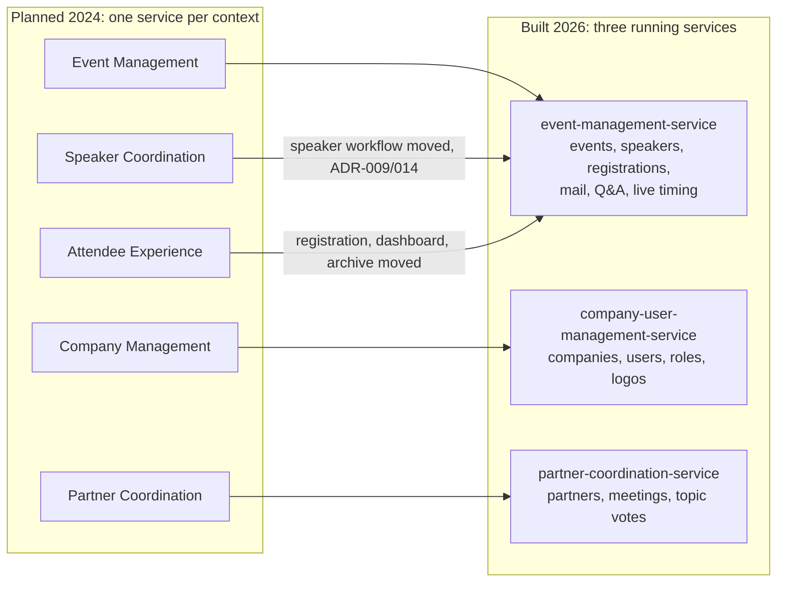
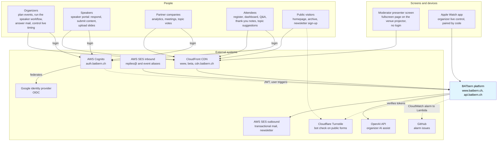
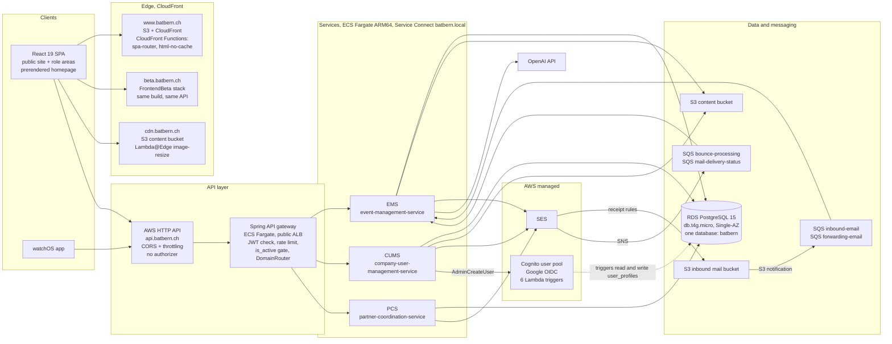
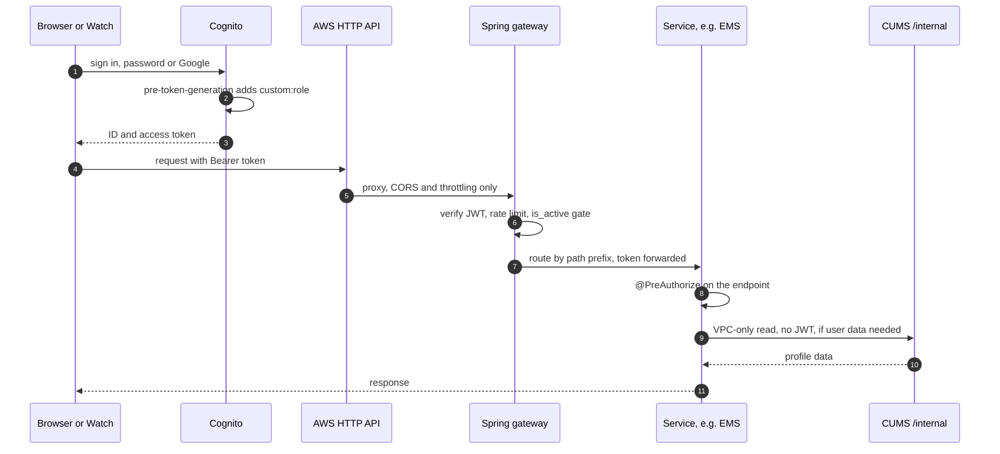
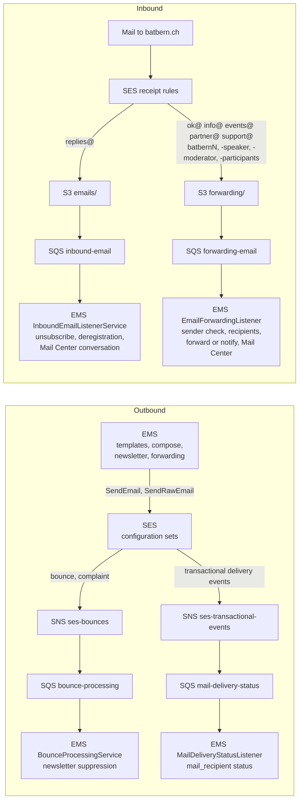
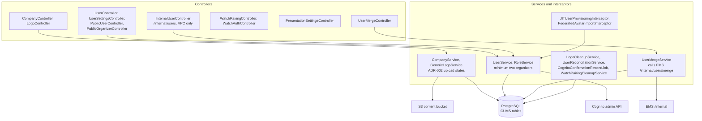
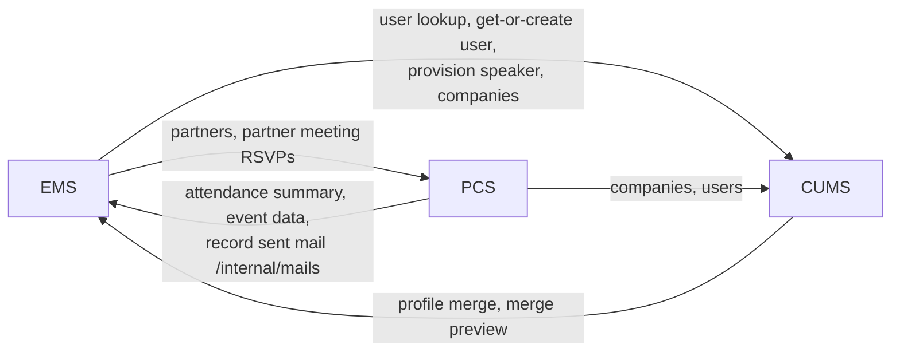

# System Overview

The BATbern platform runs the Berner Architekten Treffen conferences: event planning and the
speaker workflow for organizers, a self-service portal for speakers, coordination for partner
companies, and the public website with registration and the historical archive. This document is
the entry point. Details live in the numbered architecture documents and the ADRs listed in
[index.md](./index.md).

Statements in this document were checked against the code on 2026-11-04 (CDK in
`infrastructure/`, gateway routing in `api-gateway/.../routing/DomainRouter.java`, the service
packages and the Flyway migrations). Text that could not be checked is marked
"(not verified 2026-11-04)".

## Project Context

- **One monorepo** (`nissimbuchs/BATbern2`): a Gradle multi-project build (shared kernel, API
  gateway, five service modules) plus npm projects (web frontend, CDK infrastructure) and the
  watchOS app in `apps/BATbern-watch`. The original 2024 plan for a multi-repository layout
  ("DDD-Based Multi-Repository Approach") and the existing Angular codebase were not carried
  forward; the old site was retired and its data is migrated by Epic 3 tooling.
- **Production** is the AWS account 188701360969 in eu-central-1. CloudFormation stacks keep the
  `BATbern-staging-*` names; `isProduction: true` in `staging-config.ts` switches on production
  behaviour. There is no separate staging environment.
- **Local development** runs PostgreSQL in Docker and all services natively against the shared
  Cognito user pool (see [07-development-standards.md](./07-development-standards.md)).

### Domain boundaries, planned and as built

The 2024 design named four bounded contexts, each meant to become its own service. The code kept
the contexts as packages but consolidated the deployables
([ADR-014](./ADR-014-backend-service-consolidation.md), 2026-06-26):

The reasons given in 2024 for separate services (team ownership, independent deployment, a
Node.js option for content APIs) did not apply to a hobby-run conference with one developer; the
consolidation is recorded in ADR-014.

## Technical Summary

BATbern is a Spring Boot microservice backend behind a single Spring API gateway, with a React
single-page application served from CloudFront. Three services do the work: **EMS** owns events,
the speaker workflow, registrations, tasks, all mail (outbound, inbound, Mail Center, alias
forwarding), newsletter, Q&A, AI assist and the live-timing endpoints; **CUMS** owns companies,
user profiles, roles and logo uploads and provisions Cognito users; **PCS** owns partners,
partner meetings and topic voting. All three share one PostgreSQL database with table ownership
by convention and no cross-service foreign keys ([ADR-003](./ADR-003-meaningful-identifiers-public-apis.md),
see [03-data-architecture.md](./03-data-architecture.md)). Identity is Cognito with Google
federation. Authorization is enforced in the services, never in the gateways
([ADR-008](./ADR-008-simplified-api-gateway-routing.md)).

## C4 Model Architecture Diagrams

### Level 1: System Context Diagram

- **People:** all roles use one web application. Speakers, partners and attendees are roles on a
  single user profile ([ADR-007](./ADR-007-unified-user-profile.md)); SPEAKER is a role, not an
  entity ([ADR-009](./ADR-009-unified-speaker-workflow.md)).
- **Presenter screen:** a fullscreen page in the SPA (`PresentationPage`, Story 10.8a), public and
  without login. It reads presentation settings (app settings, Story 4.9), teaser images and
  the live-timing snapshot from EMS.
- **Apple Watch app:** pairs with an organizer account by code (CUMS `watch_pairings`), then reads
  the programme and drives live timing through `/api/v1/watch/**` and the live-timing endpoints
  in EMS. See [10-watch-app-development-patterns.md](./10-watch-app-development-patterns.md).
- **Cloudflare Turnstile:** the SPA embeds the widget; the gateway's `TurnstileVerificationFilter`
  verifies the token on the anonymous write endpoints listed in `turnstile.protected-endpoints`
  (newsletter subscribe, event registration, thank-the-organizers).
- **GitHub:** the monitoring stack's `github-issues` Lambda opens an issue for each alarm.

### Level 2: Container Diagram

**What the diagram reflects, and how it was checked:**

1. **Two gateways, one decision point.** The AWS HTTP API proxies `/{proxy+}`, does CORS (the
   only CORS layer) and throttling, and validates no tokens. The Spring gateway is Spring MVC
   (not Spring Cloud Gateway); it validates the Cognito JWT, applies rate limiting, Turnstile checks and the
   `is_active` account gate and forwards by path prefix. No role decisions in either
   ([ADR-008](./ADR-008-simplified-api-gateway-routing.md)).
2. **Service Connect, no internal ALBs.** Services find each other through ECS Service Connect
   (`batbern.local`, `domain-service-construct.ts`). Only the gateway has a load balancer.
3. **Sizes (CDK):** gateway 512 CPU / 1024 MB, EMS 256 / 2048, CUMS 256 / 1024, PCS 256 / 1024.
   Production runs on on-demand Fargate only; the 70/30 Spot split applies to
   non-production environments.
4. **One database.** PostgreSQL 15 on `db.t4g.micro`, Single-AZ. Each service has its own Flyway
   history table. ElastiCache Redis is defined in CDK but disabled (`numNodes: 0`); caching is
   Caffeine in process.
5. **Lambdas that exist** (all in `infrastructure/lib`):
   - Cognito triggers: `pre-signup`, `post-confirmation`, `pre-token-generation`,
     `pre-authentication`, `post-authentication` (VPC, database access) and the
     `custom-email-sender` (KMS-encrypted codes, mail via SES).
   - `image-resize` (Lambda@Edge on `cdn.batbern.ch`).
   - `transactional-event-logger` (SES stack) and `ses-event-logger` (inbound mail stack), which
     log SES events.
   - `github-issues` (monitoring stack).
   - `EcsScalerFunction` (auto-shutdown stack, development environment only; not in production).
   - CloudFront Functions (not Lambdas): `spa-router` and `html-no-cache`.
6. **No event bus.** Domain events stay in the service that raises them:
   `SpringDomainEventPublisher` in the shared kernel hands each one to Spring's
   `ApplicationEventPublisher`, which drives the EMS listeners. The EventBridge bus, its publisher
   and the `events:PutEvents` grants were removed in Story 17.2 part B (2026-11), because nothing
   consumed them. The only EventBridge use left is the EMS auto-publish rule grant on the default
   bus (`event-management-stack.ts`).
7. **The two stub services are gone from the code** (Story 17.2, 2026-11): the speaker and
   attendee stub modules, their CDK stack definitions, their entries in the CICD ECR list and the
   gateway route `/api/v1/content/**` were removed. In production the owner deletes the two
   orphaned stacks after the deploy; the two ECR repositories are retained by CloudFormation
   (`RemovalPolicy.RETAIN`, `isProduction`) until the owner deletes them by hand. See ADR-014.

### Request path and authorization

- **Authorization** lives only in the services: `@PreAuthorize` on every write endpoint, enforced
  by `EndpointAuthorizationGuardTest` in each service (#1147). Service-to-service reads use
  VPC-only `/internal/**` endpoints that the gateway does not route.
- **Identity:** one user profile per person, including people who only registered for an event
  ([ADR-007](./ADR-007-unified-user-profile.md)). Google sign-in through Cognito federation; the
  pre-signup trigger links a Google identity to an existing profile with the same email
  ([ADR-010](./ADR-010-federated-identity-via-cognito.md)).
- **Routing table** (from `DomainRouter`): `/api/v1/watch/pair` and `/watch/authenticate` go to
  CUMS, the rest of `/api/v1/watch` to EMS; `events`, `event-types`, `registrations`, `topics`,
  `tasks`, `notifications`, `materials`, `speaker-portal`, `attendee-portal`, `sessions`,
  `email-templates`, `analytics`, `newsletter`, `thanks`, `conversations`, `mails`, `ai`,
  `public/settings/features` and `public/events` go to EMS; `partners`, `partner-meetings` and
  `attendees/topics` go to PCS; `companies`, `users`, `logos`, the other
  `public` paths and `settings` go to CUMS; `admin` goes to EMS except the per-service
  test-fixture paths.

### Mail flows

- Inbound mail is IAM-only: SES writes to S3, S3 notifies SQS, the EMS task role consumes. No
  HTTP endpoint is involved (the earlier forwarding Lambda that called the public API was
  removed in 2026-10).
- The admin setting `mailcenter.notify-instead-of-forward` decides per alias group whether
  recipients get the forwarded copy or a notice linking to the **Mail Center** (Epic 16). See
  [06d-notification-system.md](./06d-notification-system.md) and
  [06-backend-architecture.md](./06-backend-architecture.md).

### Level 3: Component Diagram, Event Management Service

The packages below are under `services/event-management-service/src/main/java/ch/batbern/events/`.

```mermaid
flowchart TB
    subgraph api["API layer, controller/ and feature packages"]
        C1["Events and workflow<br/>EventController, EventWorkflowController,<br/>EventTypeController, AgendaConfigController,<br/>PublishingEngineController"]
        C2["Sessions and agenda<br/>SessionController, GlobalSessionController,<br/>SlotAssignmentController, TimetableController"]
        C3["Speaker workflow<br/>EventSpeakerPoolController, SpeakerStatusController,<br/>SpeakerInvitationController, SpeakerOutreachController,<br/>SpeakerReminderController, SessionSpeakerController"]
        C4["Speaker portal<br/>SpeakerPortal*Controller, MaterialsUploadController,<br/>SessionMaterialsController"]
        C5["Registrations<br/>EventController registration endpoints,<br/>ParticipantsController, DeregistrationController"]
        C6["Attendee contributions<br/>SelfNominationController, OrganizerThanksController,<br/>EventQnaController, SessionQnaController,<br/>AttendeeDashboardController"]
        C7["Tasks<br/>EventTaskController, TaskTemplateController"]
        C8["Mail<br/>EmailTemplateController, NewsletterController,<br/>mailcenter/MailConversationController,<br/>EventMailController"]
        C9["AI assist<br/>AiAssistController, AiPromptController,<br/>TopicSimilarityController"]
        C10["Live and Watch<br/>watch/LiveTimingController,<br/>WatchEventController, WatchWebSocketController"]
        C11["Admin and analytics<br/>AdminSettingsController, AnalyticsController,<br/>PublicSettingsController, NotificationController"]
    end

    subgraph app["Application services"]
        S1["EventWorkflowStateMachine<br/>8 event states"]
        S2["SpeakerWorkflowService<br/>8 speaker states, ADR-009"]
        S3["SlotAssignmentService,<br/>slotassignment/ conflict detection"]
        S4["publishing/ PublishingService,<br/>PublicEventShaper, CdnInvalidationService"]
        S5["RegistrationService,<br/>WaitlistPromotionService"]
        S6["EventTaskService"]
        S7["mailcenter/ compose, inbound,<br/>conversations, delivery status"]
        S8["forwarding/ alias forwarding"]
        S9["Newsletter*Service,<br/>EmailTemplateService"]
        S10["BatbernAiService,<br/>TrendingTopicsService"]
        S11["watch/ LiveTimingService,<br/>WatchSessionService"]
        S12["SessionQnaService,<br/>OrganizerThanksService"]
    end

    subgraph bg["Background"]
        J1["scheduler/ and scheduled/<br/>task activation, deadline and speaker reminders,<br/>auto-publishing, retention; ShedLock"]
        J2["listener/<br/>in-process domain event listeners"]
        J3["SQS listeners<br/>inbound, forwarding, bounces, delivery status"]
    end

    subgraph infra["Infrastructure"]
        DB[("PostgreSQL<br/>EMS tables")]
        CAF["Caffeine cache"]
        S3X["S3 content bucket"]
        SESX["SES"]
        OAIX["OpenAI"]
        CUMSX["CUMS /internal, UserApiClient"]
        PCSX["PCS /internal,<br/>PartnerMeetingRsvpClient"]
    end

    C1 --> S1 & S4
    C2 --> S3
    C3 --> S2
    C4 --> S2
    C5 --> S5
    C6 --> S12
    C7 --> S6
    C8 --> S7 & S9
    C9 --> S10
    C10 --> S11
    S1 --> J2
    S2 --> J2
    J2 --> S6
    J3 --> S7 & S8
    J1 --> S4 & S6 & S2
    S1 & S2 & S3 & S5 & S6 & S7 & S12 --> DB
    S4 --> CAF
    S4 --> S3X
    S7 & S8 & S9 & S5 --> SESX
    S10 --> OAIX
    S2 & S5 & S7 --> CUMSX
    S7 --> PCSX
```

- The **event workflow** has eight states (`EventWorkflowState` in the shared kernel and the
  `events.workflow_state` check constraint): CREATED, TOPIC_SELECTION, SPEAKER_IDENTIFICATION,
  SLOT_ASSIGNMENT, AGENDA_PUBLISHED, EVENT_LIVE, EVENT_COMPLETED, ARCHIVED. The 16-state draft
  was reduced to nine in V30 and AGENDA_FINALIZED removed in V84. See
  [06a-workflow-state-machines.md](./06a-workflow-state-machines.md).
- **Domain events** are in-process: `DomainEventPublisher` raises a Spring event that
  `listener/` (for example `SpeakerAcceptedEventListener`, `EventWorkflowTransitionListener`)
  consumes in the same JVM. There is no cross-service event bus (Story 17.2 part B).
- **Live timing** is REST polling with `If-None-Match` (Story 15.1,
  `GET /api/v1/events/{eventCode}/live-timing`, anonymous read, organizer-only actions). It
  replaced the STOMP broadcast. EMS still registers STOMP endpoints at `/ws` and
  `/api/v1/watch/ws`; whether any client still uses them in production (not verified
  2026-11-04).
- The **public events read model** has no table of its own: `PublicEventShaper` shapes the
  public view of events and sessions, served at `/api/v1/public/events`, and
  `CdnInvalidationService` invalidates the CloudFront paths after publishing.

### Level 3: Component Diagram, Company User Management Service

### Service interactions

All calls are synchronous HTTP over Service Connect. User data is read through CUMS `/internal/**`
endpoints without the end user's JWT where the caller needs data the user may not see
(`UserApiClientImpl`). No service reads another service's tables.

## Component Overview

### Event Management Service

**Responsibility:** the event lifecycle and everything that happens around an event: the 8-state
event workflow, sessions and agenda (slot assignment, per-event agenda configuration, timetable),
the topic backlog, the speaker pool and the 8-state speaker workflow
([ADR-009](./ADR-009-unified-speaker-workflow.md)), the speaker portal, registrations with
capacity and waitlist, organizer tasks, email templates, the newsletter, the Mail Center and alias
forwarding, notifications, analytics, the AI assist, post-event Q&A and thank-you notes,
self-nominations ([ADR-012](./ADR-012-self-nomination-proposals.md)), event photos and teaser
images, live timing for the presenter screen and the Watch, the public events read model and the
admin settings.

**Workflow components (as built):**
- **Event workflow state machine** (`EventWorkflowStateMachine`, `WorkflowTransitionValidator`):
  8 states, transitions validated, `EVENT_LIVE` and `EVENT_COMPLETED` set by
  `EventWorkflowScheduledService`.
- **Slot assignment** (`SlotAssignmentService`, `service/slotassignment/`): preference matching,
  conflict detection, reordering, timing history.
- **Speaker workflow** (`SpeakerWorkflowService`, `SpeakerStatusService`): IDENTIFIED, CONTACTED,
  READY, INVITED, ACCEPTED, CONTENT_SUBMITTED, QUALITY_REVIEWED, DECLINED. The slot capacity is
  checked at invitation.
- **Quality review** (`QualityReviewService`): organizer review of submitted content; content
  versions in `session_content_history`.
- **Reminders and tasks:** `SpeakerReminderScheduler` (tiered response and content reminders),
  `TaskActivationScheduler`, `TaskDeadlineReminderScheduler`.
- **Auto-publishing:** `PublishingScheduledService` with per-event `publishing_config`.

**Key interfaces** (all under `/api/v1`): `/events`, `/events/{eventCode}/workflow`,
`/events/{eventCode}/sessions`, `/events/{eventCode}/speaker-pool`, `/events/{eventCode}/speakers`,
`/events/{eventCode}/registrations`, `/events/{eventCode}/tasks`, `/events/{eventCode}/live-timing`,
`/events/{eventCode}/qna`, `/events/{eventCode}/thanks`, `/event-types`, `/topics`, `/tasks`,
`/speaker-portal/**`, `/attendee-portal/**`, `/registrations`, `/newsletter`, `/email-templates`,
`/conversations`, `/mails`, `/ai/**`, `/analytics`, `/thanks`, `/notifications`, `/watch/**`,
`/public/events`, `/admin/**`. Exact contracts: `docs/api/*.openapi.yml` and
[04-api-event-management.md](./04-api-event-management.md).

**Dependencies:** CUMS (users, companies, speaker provisioning), PCS (partners, meeting RSVPs),
SES, SQS (four queues), S3, CloudFront invalidation, OpenAI (when `AI_ENABLED`), shared kernel.

**Technology:** Java 21, Spring Boot 4.0.x, Spring Data JPA, Flyway (V1 to V144), Caffeine,
ShedLock, Spring WebSocket/STOMP (legacy endpoints), AWS SDK v2.

### Company User Management Service

**Responsibility:** companies and their logos, user profiles (one per person,
[ADR-007](./ADR-007-unified-user-profile.md)), role assignments, additional email addresses,
Cognito user provisioning and JIT provisioning on first login, Google avatar import, profile
merge (#1183, orchestrated here, data moved by EMS), the generic logo upload
([ADR-002](./ADR-002-generic-file-upload-service.md)), Watch pairing, and the VPC-only `/internal/users` reads for other services.

**Key interfaces:** `/api/v1/companies`, `/api/v1/logos`, `/api/v1/users`,
`/api/v1/users/me`, `/api/v1/public/organizers`, `/api/v1/public/users`, `/api/v1/watch/pair`, `/api/v1/watch/authenticate`,
`/internal/users`. See [04-api-company-management.md](./04-api-company-management.md) and
[04-api-user-management.md](./04-api-user-management.md).

**Dependencies:** Cognito admin API, S3, SES through the shared-kernel `EmailService`
(additional-email verification, profile claim), EMS (merge).

**Technology:** Java 21, Spring Boot 4.0.x, Flyway (V1 to V22), Caffeine (`companySearch`,
`userSearch`, 15-minute TTL), ShedLock.

### Partner Coordination Service

**Responsibility:** partners (referenced by company name, ADR-003), partnership level and cost,
organizer notes per partner, partner meetings (spring and autumn) with ICS invitations and RSVP
tracking, the topic suggestion backlog with partner votes, attendee topic suggestions ("topics
from the floor", source COMMUNITY), and partner analytics (attendance from EMS, XLSX export).

**Key interfaces** (from `partners-api` and `partner-meetings-api`): `/api/v1/partners`,
`/api/v1/partners/me`, `/api/v1/partners/{companyName}/contacts`, `/notes`,
`/analytics/dashboard`, `/analytics/export`, `/api/v1/partners/topics` (backlog, status, vote),
`/api/v1/partner-meetings` (with `/rsvps` and `/send-invite`), `/api/v1/attendees/topics`, and
the VPC-only `/internal/partner-meetings/rsvps`. See
[04-api-partner-coordination.md](./04-api-partner-coordination.md).

**Dependencies:** CUMS (companies, users), EMS (attendance summary, event data, and
`/internal/mails` to record partner mail in the Mail Center), SES (meeting invitations).

**Technology:** Java 21, Spring Boot 4.0.x, Flyway (V1 to V10).

### Speaker logic (former speaker service, removed)

> **Removed by Story 17.2 (2026-11) per [ADR-014](./ADR-014-backend-service-consolidation.md).**
> The stub module had no controllers and no entities; the module and its CDK stack definition
> are gone. Its ECR repository is retained (`RemovalPolicy.RETAIN`) until the owner deletes it by
> hand, see ADR-014. Its Flyway history table `flyway_schema_history_speaker_coordination` stays in the
> database.

**What moved to EMS:** the speaker pool and speaker workflow (ADR-009), invitations and
responses, reminders, content submission and quality review, materials upload and the speaker
portal. The `speakers` table was dropped in EMS V94; SPEAKER is a role on the user profile.

The pre-ADR-009 design described here earlier (an 11-state workflow with parallel paths, overflow
management with organizer voting, magic-link login, a `Speaker` entity) is listed under
[Not implemented](#not-implemented).

### Attendee logic (former attendee service, removed)

> **Removed by Story 17.2 (2026-11) per [ADR-014](./ADR-014-backend-service-consolidation.md).**
> The stub module had one Java file and no datasource; the module, its CDK stack definition and
> the gateway route `/api/v1/content/**` are gone. Its ECR repository is retained
> (`RemovalPolicy.RETAIN`) until the owner deletes it by hand, see ADR-014.

**What moved to EMS:** registration (3-step wizard, capacity, waitlist, deregistration), the
attendee dashboard (`/api/v1/attendee-portal`), the historical archive and content search
(full-text `tsvector` columns on `events`, `sessions`, `session_users`, `topics`), and the Epic 7
attendee contributions (self-nomination, thanks, Q&A). Topic suggestions from attendees are in PCS.

### Shared Kernel

Types (`EventWorkflowState`, `SpeakerWorkflowState`, identifiers), domain-event base classes and
the in-process `SpringDomainEventPublisher`, the services' Jackson `ObjectMapper`
(`SharedObjectMapperConfig`), security components (JWT role conversion with the local DB fallback,
audit logging), slug and username generation (`SlugGenerationService`), mail helpers and the test
fixtures shared by all services (for example the `EndpointAuthorizationGuard` used by each
service's guard test). It also carries the Flyway baseline `V1__Initial_baseline.sql`
(`uuid-ossp`, `update_updated_at_column()`).

### Frontend Application

**Responsibility:** one SPA for the public website (homepage, archive, event pages, registration,
newsletter) and the role-based areas for organizers, speakers, partners and attendees, plus the
fullscreen presenter page and the organizer live-control page.

**Key elements:**
- Role-based routing and navigation; data access only through the service layer in
  `src/services/` (no direct `fetch`).
- Server state with TanStack Query, client state with Zustand, i18next with 10 locales (`de`,
  `en`, `fr`, `it`, `rm`, `es`, `fi`, `nl`, `ja`, `gsw-BE`).
- Amplify for Cognito sign-in, including "Continue with Google".
- A service worker via `vite-plugin-pwa` (navigations NetworkFirst, `index.html` not precached).
- The homepage is prerendered at build time (`build:prerender`).

**Dependencies:** API (`api.batbern.ch`), CDN (`cdn.batbern.ch`), Cognito, Turnstile.

**Technology:** React 19, TypeScript 6, MUI 7, Vite 8, Zustand 5, TanStack Query 5. See
[05-frontend-architecture.md](./05-frontend-architecture.md).

### Watch App

watchOS / SwiftUI in `apps/BATbern-watch/`. Public programme browsing plus a paired organizer mode
for live session control. Pairing in CUMS, everything else in EMS. See
[10-watch-app-development-patterns.md](./10-watch-app-development-patterns.md).

`apps/` also contains `projectdoc` (a documentation-site generator) and `workhours` (a local
analysis script). Neither is part of the deployed platform.

## AI Assist

EMS calls the OpenAI API for organizer-triggered generation: event descriptions, theme images,
speaker abstract analysis, topic similarity and clustering, and trending topics
(`BatbernAiService`, `TopicSimilarityService`, `BatbernTopicClusterService`,
`TrendingTopicsService`). It is off unless `AI_ENABLED` is set, organizer-only and advisory.
Prompts are editable in `ai_prompts`; calls are logged in `ai_generation_log`. See
[09-aiml-architecture.md](./09-aiml-architecture.md).

## Technology Summary

| Area | Technology |
|---|---|
| Frontend | React 19, TypeScript 6, MUI 7, Vite 8, Zustand + TanStack Query, i18next, vite-plugin-pwa |
| Backend | Java 21, Spring Boot 4.0.x, Spring Security, Spring Data JPA, Flyway, Caffeine (in-process cache, no Redis), ShedLock |
| API contracts | OpenAPI specs in `docs/api/*.openapi.yml`, code generated for Java and TypeScript ([ADR-006](./ADR-006-openapi-contract-first-code-generation.md)) |
| Data | PostgreSQL 15 on RDS, one database; each service owns its tables via its own Flyway migrations |
| Runtime | ECS Fargate on ARM64, Service Connect, S3 + CloudFront, Cognito, SES, SQS |
| Infrastructure | AWS CDK 2 (TypeScript), `infrastructure/` |
| CI/CD | GitHub Actions; a PR against `develop` builds, deploys to production and runs Bruno and Playwright against it ([02-infrastructure-deployment.md](./02-infrastructure-deployment.md)) |

Exact versions: [tech-stack.md](./tech-stack.md) and [docs/versions.json](../versions.json).

## Not implemented

Named in the 2024 version of this document; none of it exists in the code.

- Multi-repository layout, one repository per service.
- Stripe payment system (registration is free; no payment code).
- Google Analytics or any analytics integration (`reportWebVitals.ts` has a TODO only).
- Spring Cloud Gateway with circuit breaking in the gateway; the gateway is Spring MVC.
- Cognito JWT authorizer on the AWS HTTP API.
- Internal ALB per domain service; Service Connect is used instead.
- Separate Quality Review Service and Notification Service; both are parts of EMS.
- Overflow management with organizer voting (removed from MVP; slot capacity is checked at invitation).
- An 11-state speaker workflow with parallel paths and a `Speaker` entity (replaced by ADR-009).
- `/api/v1/events/{id}/overflow`, `/timeline`, `/slots`, `/api/v1/organizers` endpoints.
- AI-powered content search and personalised recommendations (`/api/v1/content/search`,
  `/api/v1/recommendations`); archive search is PostgreSQL full-text.
- WebSocket real-time notifications for organizers as a guaranteed channel; in-app notifications
  are stored in `notifications` and read over REST (the STOMP client exists; see above).
- Route 53 health checks.

## Change Log

| Date | Version | Description | Author |
|------|---------|-------------|--------|
| 2024-12-20 | 1.0 | Initial full-stack architecture document | Winston (Architect) |
| 2026-11-04 | 2.0 | Rewritten to the system as built: monorepo, React 19, Spring Boot 4, EMS + CUMS + PCS with SCS/AES dormant (ADR-014), watch app, Mail Center, AI assist (#1211) | Doc audit |
| 2026-11-04 | 2.1 | C4 levels 1 to 3 and the component overview restored and corrected instead of removed; new diagrams for request path, mail flows, CUMS components and service interactions | Doc audit |
