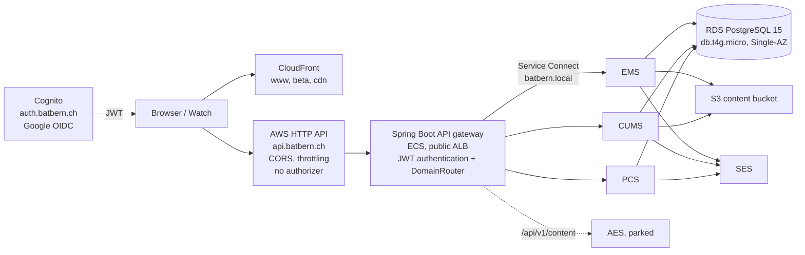

# System Overview

The BATbern platform runs the Berner Architekten Treffen conferences: event planning and the
speaker workflow for organizers, a self-service portal for speakers, coordination for partner
companies, and the public website with registration and the historical archive. This document is
the entry point. Details live in the numbered architecture documents and the ADRs listed in
[index.md](./index.md).

## Project Context

- **One monorepo** (`nissimbuchs/BATbern2`): a Gradle multi-project build (shared kernel, API
  gateway, five service modules) plus npm projects (web frontend, CDK infrastructure). The original
  2024 plan for a multi-repository layout and an Angular codebase was never followed.
- **Production** is the AWS account 188701360969 in eu-central-1. CloudFormation stacks keep the
  `BATbern-staging-*` names; `isProduction: true` in `staging-config.ts` switches on production
  behaviour. There is no separate staging environment.
- **Local development** runs PostgreSQL in Docker and all services natively against the shared
  Cognito user pool (see [07-development-standards.md](./07-development-standards.md)).

## Services

The backend was scaffolded as five domain services. [ADR-014](./ADR-014-backend-service-consolidation.md)
(2026-06-26) consolidated it around **two primary services plus partner coordination**; the other
two are dormant.

| Service | Status | Owns |
|---|---|---|
| **event-management-service (EMS)** | Primary | Events and the event workflow state machine, sessions, speaker pool and the speaker workflow ([ADR-009](./ADR-009-unified-speaker-workflow.md)), speaker portal, registrations and waitlist, tasks, notifications, email templates, newsletter, analytics, Mail Center and alias forwarding, AI assist, Watch endpoints, the public events read model, admin settings |
| **company-user-management-service (CUMS)** | Primary | Companies and logos, user profiles and roles, Cognito user provisioning, profile merge, public and presentation settings, Watch pairing, VPC-only `/internal/users` |
| **partner-coordination-service (PCS)** | Active, separate | Partners, partner meetings and invitations, topic backlog and voting, attendee topic suggestions |
| speaker-coordination-service | Dormant (ADR-014) | Nothing. 4 Java files, no controllers, no gateway routes |
| attendee-experience-service | Dormant (ADR-014) | Nothing. 1 Java file; parked at 0 tasks in CDK |

The runtime does not fully match ADR-014 yet: the speaker-coordination stack still runs one task,
and the gateway still routes `/api/v1/content` to the parked attendee-experience service. See the
"Operational state" section of ADR-014 and #1216.

**shared-kernel** holds the types, domain-event base classes, security components (JWT role
conversion, audit logging), mail helpers and test fixtures shared by all services (e.g. the `EndpointAuthorizationGuard` used by
each service's guard test).

## Clients

| Client | Where | Notes |
|---|---|---|
| **Web application** | `web-frontend/`, React 19 + TypeScript + MUI, built with Vite, served from S3 + CloudFront at www.batbern.ch | One SPA for the public website (homepage, archive, registration) and the role-based areas for organizers, speakers, partners and attendees. The homepage is prerendered at build time (`build:prerender`). UI in 10 locales |
| **Beta canary** | beta.batbern.ch, stack `BATbern-staging-FrontendBeta` | Same build, same production API and data; for previewing frontend-only changes (`scripts/deploy/publish-beta-frontend.sh`) |
| **Watch app** | `apps/BATbern-watch/`, watchOS / SwiftUI | Public programme browsing plus a paired organizer mode for live session control. Uses `/api/v1/watch/**` (pairing in CUMS, the rest in EMS). See [10-watch-app-development-patterns.md](./10-watch-app-development-patterns.md) |

`apps/` also contains `projectdoc` (a documentation-site generator) and `workhours` (a local
analysis script). Neither is part of the deployed platform.

## Request Path

- **Edge:** the AWS HTTP API proxies `/{proxy+}` to the gateway. It handles CORS (the only CORS
  layer) and throttling and validates no tokens ([ADR-008](./ADR-008-simplified-api-gateway-routing.md)).
- **Gateway:** a Spring MVC application (not Spring Cloud Gateway). It validates the Cognito JWT,
  applies rate limiting, Turnstile checks and the `is_active` account gate, and forwards by path
  prefix (`routing/DomainRouter.java`). It makes no role decisions.
- **Authorization** lives only in the services: `@PreAuthorize` on every write endpoint, enforced
  by `EndpointAuthorizationGuardTest` (#1147). Service-to-service reads use VPC-only `/internal/**`
  endpoints that the gateway denies.
- **Identity:** Cognito with Lambda triggers (pre-signup, pre-token-generation, custom email
  sender and others) and Google sign-in via OIDC federation
  ([ADR-010](./ADR-010-federated-identity-via-cognito.md)). One user profile per person, including
  people who only registered for an event ([ADR-007](./ADR-007-unified-user-profile.md)).

## Mail

- **Outbound:** SES with configuration sets for transactional mail and newsletters; bounce,
  complaint and delivery events come back through SNS/SQS into EMS.
- **Inbound:** the `InboundEmail` stack receives `replies@batbern.ch` and the forwarded aliases
  (`info@`, `events@`, `batbern{N}-speaker@` and others) into S3 and SQS. EMS consumes both queues:
  reply handling (unsubscribe, deregistration), alias forwarding, and the **Mail Center**
  (Epic 16), where organizers read and answer conversations. See
  [06d-notification-system.md](./06d-notification-system.md) and
  [06-backend-architecture.md](./06-backend-architecture.md).

## AI Assist

EMS calls the OpenAI API for organizer-triggered generation: event descriptions, theme images,
speaker abstract analysis and trending topics. It is off unless `AI_ENABLED` is set, organizer-only,
and advisory. See [09-aiml-architecture.md](./09-aiml-architecture.md).

## Technology Summary

| Area | Technology |
|---|---|
| Frontend | React 19, TypeScript 6, MUI 7, Vite 8, Zustand + TanStack Query, i18next |
| Backend | Java 21, Spring Boot 4.0.x, Spring Security, Spring Data JPA, Flyway, Caffeine (in-process cache, no Redis) |
| API contracts | OpenAPI specs in `docs/api/*.openapi.yml`, code generated for Java and TypeScript ([ADR-006](./ADR-006-openapi-contract-first-code-generation.md)) |
| Data | PostgreSQL 15 on RDS, one database; each service owns its tables via its own Flyway migrations |
| Runtime | ECS Fargate on ARM64, Service Connect, S3 + CloudFront, Cognito, SES, EventBridge (a bus CUMS and PCS have publish rights to; CDK defines no rules or consumers on it) |
| Infrastructure | AWS CDK 2 (TypeScript), `infrastructure/` |
| CI/CD | GitHub Actions; a PR against `develop` builds, deploys to production and runs Bruno and Playwright against it ([02-infrastructure-deployment.md](./02-infrastructure-deployment.md)) |

Exact versions: [tech-stack.md](./tech-stack.md) and [docs/versions.json](../versions.json).

## Change Log

| Date | Version | Description | Author |
|------|---------|-------------|--------|
| 2024-12-20 | 1.0 | Initial full-stack architecture document | Winston (Architect) |
| 2026-11-04 | 2.0 | Rewritten to the system as built: monorepo, React 19, Spring Boot 4, EMS + CUMS + PCS with SCS/AES dormant (ADR-014), watch app, Mail Center, AI assist (#1211) | Doc audit |
