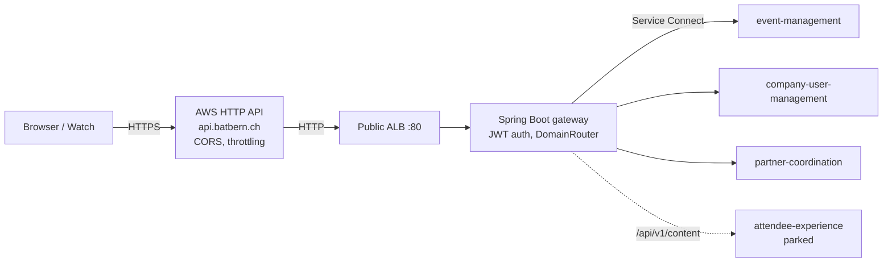

# Infrastructure & Deployment

Verified against `infrastructure/bin`, `infrastructure/lib` and `.github/workflows` on `develop`
(c4593449, 2026-11-04). Live AWS state (running task counts, actual capacity providers) was **not**
queried for this revision; where a statement depends on it, it says "per CDK".

Rewritten for #1211. The previous version described internal ALBs per service, a Cognito
authorizer on the HTTP API, a Spring Cloud Gateway route file, a tagged production workflow and
Grafana; none of these exist. They were removed rather than corrected line by line.

## Environments and Accounts

| Environment | Where | Notes |
|---|---|---|
| **Production** | AWS account 188701360969, eu-central-1, profile `batbern-staging` | Stacks are named `BATbern-staging-*`; `staging-config.ts` sets `isProduction: true`. Serves www.batbern.ch, batbern.ch, api.batbern.ch, cdn.batbern.ch, auth.batbern.ch, beta.batbern.ch |
| **Development** | Local machine | PostgreSQL in Docker, services and Vite dev server native; authenticates against the Cognito user pool in the production account. See [07-development-standards.md](./07-development-standards.md) |
| Management | Account 510187933511, profile `batbern-mgmt` | Domain registration and consolidated billing only |
| Former production | Account 422940799530 | Decommissioned (March 2026) |

There is no separate staging environment. Every deploy described below is a production deploy.

## CDK Stacks

`infrastructure/bin/batbern-infrastructure.ts` instantiates the stacks below with the prefix
`BATbern-{envName}`. In production all of them exist; for `development` the web stacks (DNS,
Cluster, services, API gateway, Frontend) are skipped.

| Stack | Contents |
|---|---|
| `DNS` (us-east-1) | `batbern.ch` hosted zone lookup, us-east-1 certificates for CloudFront and the Cognito domain |
| `Network` | VPC `10.1.0.0/16`, 2 AZs (the minimum for an RDS subnet group), public, private-with-egress and isolated subnets, **one** NAT gateway, S3 gateway endpoint only (interface endpoints rejected on cost) |
| `Secrets` | Secrets Manager and KMS, including the Watch JWT secret |
| `Database` | RDS PostgreSQL 15, `db.t4g.micro`, Single-AZ, 20 GB, deletion protection, 7-day automated backups. Redis is configured with 0 nodes, so there is no cache cluster |
| `Bastion` | SSM-reachable bastion for database access (development and the production account) |
| `Storage` | S3 buckets `batbern-content-*` (versioned in production, non-current versions expire after 90 days), `batbern-logs-*`, `batbern-backups-*`; CloudFront distribution for cdn.batbern.ch with the `image-resize` Lambda@Edge (origin request, cache key on `w`, `h`, `fit`) |
| `EventBus` | EventBridge bus. CUMS and PCS have publish rights; no rules or consumers are defined |
| `Monitoring` | SNS alarm topic, dashboards, the alarm-to-GitHub-issue Lambda. Alarm inventory: [08-operations-security.md](./08-operations-security.md) |
| `CICD` | ECR repositories, GitHub OIDC deploy role |
| `Cognito` | User pool, Lambda triggers (`infrastructure/lib/lambda/triggers`), Google OIDC federation, hosted UI on auth.batbern.ch ([ADR-010](./ADR-010-federated-identity-via-cognito.md)) |
| `SES` | Configuration sets (newsletter with bounce/complaint processing, transactional with delivery tracking), bounce queue, mail delivery status queue, each with a DLQ |
| `InboundEmail` | SES receipt rules, inbound S3 bucket, inbound and forwarding SQS queues, forwarder configuration set. See [Inbound mail](#inbound-mail) |
| `Cluster` | ECS cluster with the Service Connect namespace `batbern.local`; Container Insights disabled on cost |
| `EventManagement`, `CompanyManagement`, `PartnerCoordination`, `SpeakerCoordination`, `AttendeeExperience` | One Fargate service each (`domain-service-construct.ts`) |
| `ApiGatewayService` | The Spring Boot gateway as a Fargate service behind a public ALB |
| `ApiGateway` | AWS HTTP API on api.batbern.ch |
| `Frontend` | S3 website bucket, stable-snapshot bucket, CloudFront for www.batbern.ch and batbern.ch, `BucketDeployment` of `web-frontend/dist` |
| `FrontendBeta` | Second `FrontendStack` for beta.batbern.ch. Only synthesized with `--context betaFrontend=true` |
| `AutoShutdown` | Instantiated whenever the cluster exists, but creates resources **only for `development`**; in production the stack is empty |

The deploy order is encoded in `infrastructure/package.json` as layers, which the pipeline follows:

| Layer | Stacks |
|---|---|
| 0 Foundation | CICD, DNS, Monitoring, SES |
| 1 Infrastructure | Network, Secrets, EventBus, InboundEmail |
| 2 Data | Database, Storage (Bastion separately, non-critical) |
| 3 Application | Cognito, Cluster |
| 4 Services | EventManagement, SpeakerCoordination, PartnerCoordination, AttendeeExperience, CompanyManagement, ApiGatewayService |
| 5 Gateway | ApiGateway, Frontend |

## Compute

All services run on ECS Fargate, **ARM64**, in private subnets. Service-to-service traffic uses
ECS Service Connect (`http://{service-name}:8080` in `batbern.local`); there are no internal load
balancers. Only the gateway has an ALB (public, listener port 80), which the HTTP API integrates
with.

Sizing per CDK (`infrastructure/lib/stacks/*-stack.ts`):

| Service | CPU | Memory | Task count settings | Status |
|---|---|---|---|---|
| ApiGatewayService | 512 | 1024 MiB | desired 2, min 2, max 8 | active |
| EventManagement | 256 | 2048 MiB | desired 2 at creation, min 1, max 2 | primary |
| CompanyManagement | 256 | 1024 MiB | desired 1, min 1, max 2 | primary |
| PartnerCoordination | 256 | 1024 MiB | desired 1, min 1, max 2 | active |
| SpeakerCoordination | 256 | 1024 MiB | desired 1, min 1, max 2 | dormant, still runs one task (#1216) |
| AttendeeExperience | 256 | 1024 MiB | desired 0, auto scaling disabled | dormant, parked |

`minCapacity`, not `desiredCount`, decides the steady-state task count: `desiredCount` applies only
when a service is created, after that the scaler owns it (see the comment in
`domain-service-construct.ts`). Scaling targets 70% CPU and 85% memory.

**Capacity providers, per CDK:** `domain-service-construct.ts` adds the 70% `FARGATE_SPOT` / 30%
`FARGATE` strategy only when `isProd` is false. The production config sets `isProduction: true`,
so per CDK the domain services launch on regular Fargate, and the gateway service never had Spot
(the `ApplicationLoadBalancedFargateService` pattern conflicts with it). Older notes that describe
Spot interruptions in production predate this or were not re-checked against the live services.

Service logs go to CloudWatch `/aws/ecs/BATbern-staging/{service}` (one month in production for
the domain services, six months for the gateway).

## API Gateway Tiers



**Tier 1, AWS HTTP API** (`api-gateway-stack.ts`)

- Custom domain api.batbern.ch, stage `v1` with throttling (rate 1000, burst 2000).
- One catch-all route `/{proxy+}` for GET/POST/PUT/DELETE/PATCH to the gateway ALB.
- **No authorizer.** An `HttpJwtAuthorizer` object is still constructed in the stack but attached
  to no route ([ADR-008](./ADR-008-simplified-api-gateway-routing.md)).
- **The only CORS layer**: `corsPreflight` allows www.batbern.ch, batbern.ch and beta.batbern.ch,
  and exposes `X-Correlation-ID`, `X-Request-Id` and the rate-limit headers.

**Tier 2, Spring Boot gateway** (`api-gateway/`)

- A Spring MVC application (`spring-boot-starter-web`, OAuth2 resource server). It does **not**
  use Spring Cloud Gateway: `build.gradle` imports the Spring Cloud BOM but declares no Spring
  Cloud Gateway dependency.
- Validates the Cognito JWT, applies rate limiting, Turnstile verification on selected public
  endpoints, the `is_active` account gate, correlation IDs and security headers.
- Routes by path prefix in `routing/DomainRouter.java`; unknown paths get 404. Target URLs come
  from `*_SERVICE_URL` environment variables set to the Service Connect names.
- Denies `/internal/**`, which is reserved for VPC-only service-to-service calls.
- Makes **no authorization decisions**. Roles are checked only in the services: `@PreAuthorize`
  on every write endpoint, enforced by `EndpointAuthorizationGuardTest` per service (#1147).

## DNS, Certificates, CDN

- The `batbern.ch` hosted zone lives in the production account; the domain is registered in the
  management account.
- Certificates are pre-created and pinned by ARN in `staging-config.ts`: www + apex, cdn and beta
  and auth in us-east-1 (CloudFront, Cognito), api in eu-central-1.
- **www.batbern.ch / batbern.ch**: Frontend stack. The SPA build includes a prerendered homepage
  (`npm run build:prerender`, see `docs/plans/public-homepage-prerender.md`).
- **cdn.batbern.ch**: Storage stack, content bucket with image resizing at the edge.

## Beta Frontend Canary

`beta.batbern.ch` (`BATbern-staging-FrontendBeta`, bucket `batbern-frontend-beta-staging`) serves
the same SPA against the **same production API, Cognito and database**. It is for previewing
frontend-only changes on real infrastructure:

```bash
scripts/deploy/publish-beta-frontend.sh            # build, S3 sync, CloudFront invalidation
SKIP_BUILD=1 scripts/deploy/publish-beta-frontend.sh
```

The stack only synthesizes with `--context betaFrontend=true`, so a normal deploy never touches
it. Every action on beta acts on production data. Design: `docs/plans/beta-frontend-canary.md`.

## Mail Infrastructure

### Outbound

SES in eu-central-1. EMS, CUMS and PCS send through the transactional configuration set by
default; newsletters use the newsletter configuration set, whose bounce and complaint events flow
SNS → SQS → EMS (`BounceProcessingService`). Transactional delivery events flow into the mail
delivery status queue, which EMS consumes to update recipient status (Story 16.1b). Details:
[06d-notification-system.md](./06d-notification-system.md), `docs/guides/aws-ses-configuration.md`.

### Inbound mail

`InboundEmail` stack (Stories 10.17, 10.26, Epic 16):

1. SES receipt rules in eu-central-1 with an MX record for batbern.ch.
2. `replies@batbern.ch` → S3 `emails/` → inbound SQS queue → EMS (unsubscribe, deregistration,
   replies).
3. `ok@`, `info@`, `events@`, `partner@`, `support@` and the catch-all for `batbern{N}…@`
   addresses → S3 `forwarding/` → forwarding SQS queue → EMS `EmailForwardingListener`, which
   resolves recipients in-process and re-sends via SES. Spam and virus scanning is enabled on the
   forwarding rules.
4. EMS also stores conversations for the **Mail Center** (Epic 16); attachments live under
   `mail-attachments/` in the same bucket.

Retention: `emails/` and `forwarding/` 7 days, `mail-attachments/` 400 days. Queues have DLQs
with alarms. Access is IAM only (SES writes to S3, S3 notifies SQS, the EMS task role consumes);
no HTTP endpoint is involved. Whether a group of aliases is forwarded or answered in the Mail
Center is the admin setting `mailcenter.notify-instead-of-forward`
(`docs/operations/runbooks.md`).

## CI/CD Pipeline

> **Opening a PR against `develop` deploys that branch to production**, before review and before
> merge. Pushing another commit to the PR deploys again. Dependabot PRs are excluded.
> Full trigger matrix: `docs/deployment/cicd-pipeline-guide.md`.

### build.yml

Triggers: push to `develop` or `main`, pull request to `develop`, manual dispatch.

| Job | What it does |
|---|---|
| `verify-hooks` | Checks that the `.githooks/` install path and the Bruno collection list are wired (not a required check) |
| `build-shared-kernel` | Builds and tests the shared kernel |
| `build-services` | Matrix over all six modules (including the dormant ones) on **`ubuntu-24.04-arm`**; Gradle build and tests, then an ARM64 Docker image tagged `{sha7}-staging.{run}` pushed to ECR |
| `frontend-changes`, `test-frontend`, `frontend-static`, `build-frontend` | Frontend unit tests, static checks (including the generated API types) and build, skipped when the frontend did not change |
| `build-infrastructure` | CDK build and tests when `infrastructure/` changed |
| `sonarcloud` | Disabled (`if: false`) |
| `deploy-to-staging` | Calls `deploy-staging.yml` on a push to `develop` **or** a PR to `develop`, when all build jobs succeeded and neither the actor nor the PR author is Dependabot |

Required checks on `develop` are the `build-frontend`, `build-shared-kernel` and the six
`build-services (…)` contexts. Branch protection is API-managed:
`gh api repos/nissimbuchs/BATbern2/branches/develop/protection/required_status_checks`.

### deploy-staging.yml (the production deploy)

Runs with `concurrency: deploy-staging` (serialized, not cancelled). There is no `environment:`
approval gate.

1. **Detect changes** per service, frontend and infrastructure.
2. **Build the frontend** with `build:prerender`.
3. **Database snapshot** when infrastructure or a Flyway migration changed:
   `batbern-staging-pre-deploy-{timestamp}`. Afterwards only the newest three `pre-deploy`
   snapshots are kept; hand-named snapshots are never touched (#1032).
4. **Deploy**, one of:
   - *Fast path*: only service code changed (no infrastructure, frontend, Dockerfile or
     migration): `scripts/ci/update-ecs-task.sh` registers a new task definition with the new
     image and updates the ECS service, bypassing CloudFormation.
   - *Layered*: CDK layers 0 to 5 as above, or selective stack deploys for the changed services.
5. **Wait for ECS stability**, verify SES IAM permissions, run smoke tests, CORS validation and the
   anonymous access-control check, promote the images to `staging-current`, run header
   propagation tests.
6. **Bruno** API contract tests and the **Playwright `@smoke`** suite, as separate jobs.
7. Both green: promote `staging-current` → `staging-stable` and snapshot the frontend into the
   stable bucket. Either red: automatic rollback of the backend images to `staging-stable` and
   restore of the frontend from the stable bucket.

`auto-merge.yml` then merges the PR when its checks pass (never for Dependabot). Dependabot updates
reach production once a month through the batch PR (`dependabot-batch-merge.yml`).

### Deprecated: tagged production deploys

`deploy-production.yml` ("Deploy to Production (DEPRECATED)") and `promote-to-production.yml`
still target the decommissioned account 422940799530 and fail at the first AWS step. They are
kept on purpose (owner decision 2026-11-03); do not use them.

### Authentication

GitHub Actions assume `batbern-staging-github-actions-role` via OIDC; there are no long-lived AWS
keys. The role trusts `repo:nissimbuchs/BATbern2:*`; narrowing it (#998) was closed as not
planned.

### Manual CDK deploys

```bash
cd infrastructure
npm run deploy:staging:layer4-event-management   # one layer or stack, see package.json
AWS_PROFILE=batbern-staging npx cdk deploy BATbern-staging-FrontendBeta \
  --context environment=staging --context betaFrontend=true --require-approval never
```

Infrastructure PRs also deploy to production on open, so they must deploy cleanly before merge.

## Backups and Recovery

| What | How | Retention |
|---|---|---|
| RDS automated backups | `backupRetention` in `staging-config.ts` | 7 days, point-in-time restore within that window |
| RDS pre-deploy snapshots | `deploy-staging.yml`, on infrastructure or migration changes | newest 3 `batbern-staging-pre-deploy-*` kept (#1032) |
| Content bucket | S3 versioning in production | non-current versions expire after 90 days |
| Frontend | `staging-stable` snapshot bucket, restored automatically on a failed post-deploy test | last known-good build |
| Backend images | ECR tags `staging-current` / `staging-stable` | last known-good images |
| Infrastructure | CDK in `infrastructure/` | git |

No recovery time or recovery point objective has been formally set or measured. The RDS instance
is Single-AZ, so an AZ failure means a restore, not a failover. No database restore runbook
exists yet in `docs/operations/runbooks.md`.

## Monitoring

Alarms, dashboards, log levels and the alarm → GitHub issue loop are documented in
[08-operations-security.md](./08-operations-security.md). Monitoring is CloudWatch only (no
Grafana). There is no cost alarm and no AWS Budget, by decision (#978).
