# Infrastructure & Deployment

> **Revision 2026-11-04.** Rebuilt from the previous long version, keeping its structure and its
> diagrams, and corrected in place against `infrastructure/bin/batbern-infrastructure.ts`,
> `infrastructure/lib/**`, `.github/workflows/*.yml` and `api-gateway/` on `develop`.
> Live AWS state checked on 2026-11-04: all six ECS services run on plain `FARGATE` (no Spot);
> running tasks are gateway 2, EMS 1, CUMS 1, PCS 1, SCS 1, AES 0. Story 17.2 (2026-11) removed
> the two stubs (SCS, AES) from the code; their stacks are deleted by the owner after that deploy,
> which leaves four services.
>
> Statements that could not be checked are marked **(not verified 2026-11-04)**. Content that
> described things never built is shortened to "Not implemented" and listed again in
> [Historical / not implemented](#historical--not-implemented).

## Deployment Architecture Overview

### Multi-Environment Strategy

There are exactly two places the system runs: a developer machine and one AWS account that serves
production. There is **no separate staging environment**; the CloudFormation stacks are called
`BATbern-staging-*` for historical reasons only.

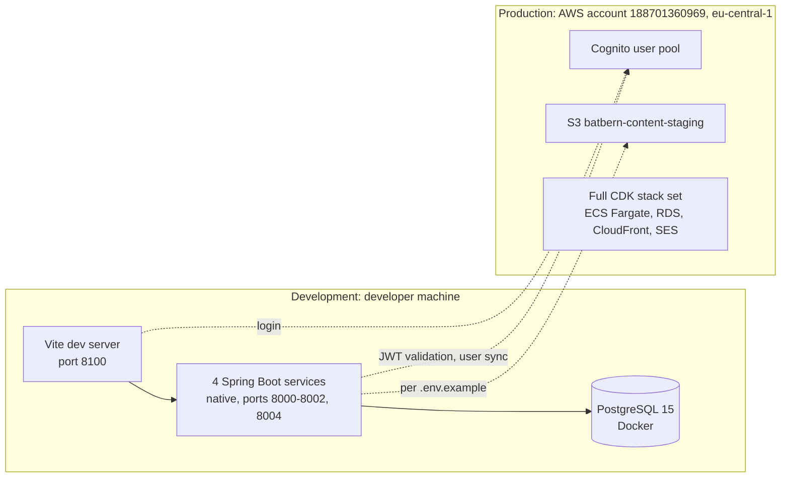

- Development authenticates against the **production** Cognito user pool. Writes during speaker
  invitation create real Cognito users there while the profile rows land only in the local DB
  (Pattern 3b, see `docs/architecture/06b-user-lifecycle-sync.md`).
- `.env.example` points the services at the production content bucket. A `local` Spring profile
  with mock AWS clients and MinIO also exists (`LocalAwsConfig`); which of the two a given
  developer uses depends on the profile (not verified 2026-11-04).
- Details of the local setup: [07-development-standards.md](./07-development-standards.md) and
  `docs/guides/local-development-setup.md`.

### AWS Account Architecture (Consolidated)

> **Environment consolidation (March 2026):** the former staging account was promoted to serve
> production traffic. Stacks keep their `BATbern-staging-*` names; `isProduction: true` in
> `infrastructure/lib/config/staging-config.ts` switches on production behaviour (domains,
> retention, deletion protection, versioning).

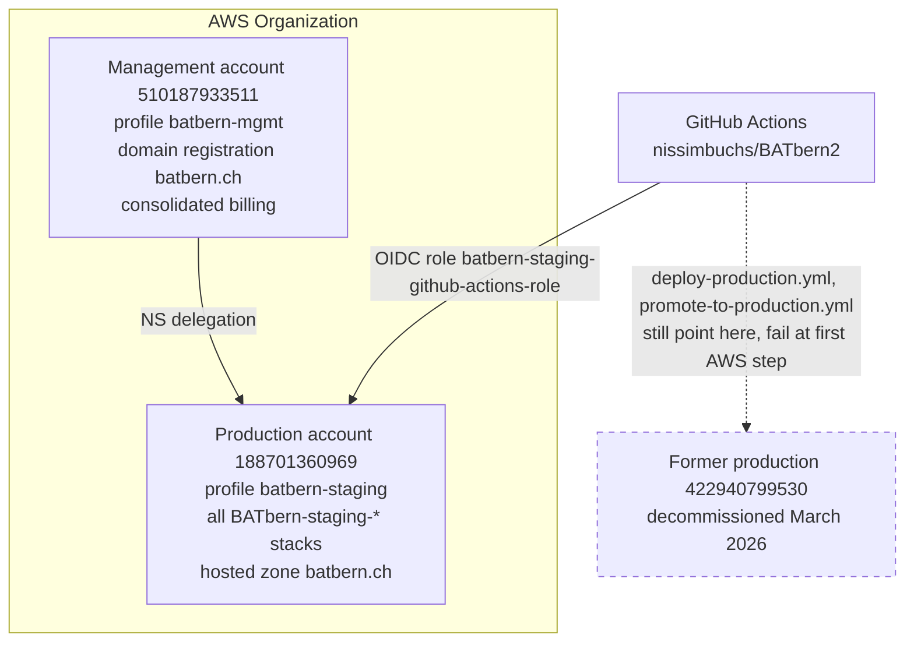

- There is no development AWS account. `dev-config.ts` and `prod-config.ts` still exist in
  `infrastructure/lib/config/`, but nothing is deployed with them today (not verified 2026-11-04
  for `prod-config.ts` beyond the file's existence).
- The CFO has IAM billing access in the management account (`docs/guides/aws-setup-guide.md`).

### CDK Stack Deployment Order

`infrastructure/bin/batbern-infrastructure.ts` instantiates 23 stacks with the prefix
`BATbern-{envName}`. The pipeline deploys them in the layers defined as npm scripts in
`infrastructure/package.json` (`deploy:staging:layer0-foundation` … `layer5-gateway`):

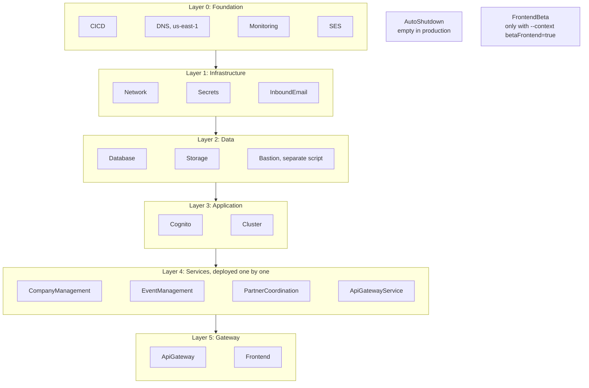

Reference: what each stack contains.

| Stack | Contents |
|---|---|
| `DNS` (us-east-1) | Imports the `batbern.ch` hosted zone; references the pre-created us-east-1 certificates for CloudFront and the Cognito domain |
| `Network` | VPC `10.1.0.0/16`, 2 AZs, public / private-with-egress / isolated subnets, **one** NAT gateway, S3 gateway endpoint only |
| `Secrets` | Secrets Manager and KMS, including the Watch JWT secret |
| `Database` | RDS PostgreSQL 15, `db.t4g.micro`, Single-AZ, 20 GB, encrypted, deletion protection, 7-day backups. ElastiCache configured with 0 nodes, so not created |
| `Bastion` | EC2 in a public subnet, reachable only via SSM Session Manager, for port-forwarding to RDS |
| `Storage` | Buckets `batbern-content-*`, `batbern-logs-*`, `batbern-backups-*`; CloudFront for cdn.batbern.ch with the `image-resize` Lambda@Edge |
| `Monitoring` | SNS alarm topic, dashboards, RDS and SES alarms, alarm-to-GitHub-issue Lambda |
| `CICD` | ECR repositories, GitHub OIDC deploy role |
| `Cognito` | User pool, Lambda triggers, Google OIDC federation, hosted UI on auth.batbern.ch ([ADR-010](./ADR-010-federated-identity-via-cognito.md)) |
| `SES` | Newsletter and transactional configuration sets, bounce queue, mail delivery status queue, each with a DLQ |
| `InboundEmail` | SES receipt rules, MX record, domain identity with DKIM, inbound S3 bucket, inbound and forwarding queues |
| `Cluster` | ECS cluster, Service Connect namespace `batbern.local`, Container Insights off |
| 5 domain service stacks | One Fargate service each, built by `domain-service-construct.ts` |
| `ApiGatewayService` | Spring Boot gateway on Fargate behind a public ALB |
| `ApiGateway` | AWS HTTP API on api.batbern.ch |
| `Frontend` | SPA bucket, rollback snapshot bucket, CloudFront for www.batbern.ch and batbern.ch |
| `FrontendBeta` | Second `FrontendStack` for beta.batbern.ch |
| `AutoShutdown` | Creates resources only for `development`; empty in production |

**Key points:**
- Stacks have explicit dependencies (e.g. Database depends on Network and Secrets).
- For `development` the web stacks (DNS, Cluster, services, both gateways, Frontend) are skipped.
- The pipeline deploys selectively: only the changed service stacks, or code only without
  CloudFormation (see [CI/CD Pipeline](#cicd-pipeline)).
- Deployment durations: the previous figures (15 min full, 5 min selective) were not measured.
  Team notes put a full PR pipeline (build, deploy, Bruno, Playwright) at roughly 70 minutes
  (not verified 2026-11-04).

### Deployment Architecture Diagram

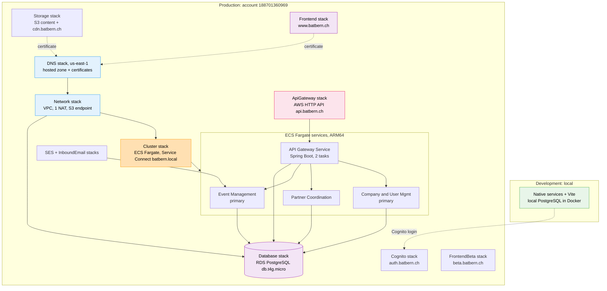

The speaker and attendee stub services were removed by Story 17.2 (#1216, ADR-014): their
logic lives in EMS and PCS.

## Cost-Optimized AWS Infrastructure

### Overview

The platform is sized for a small audience (the CDK config comments say "~300 users, 3 events
per year") with a few peaks around the BAT events.

- **Cost figures:** the earlier "~$150/month" and "83% reduction" were not measured. A cost
  review in September 2026 measured the monthly bill; see the cost-tier issue history (#1032 and
  related). Exact current figures: not verified 2026-11-04.
- Development costs nothing in AWS beyond the shared production resources it uses.
- There is no cost alarm and no AWS Budget, by decision (#978).

### Infrastructure Configuration by Environment

#### Production Environment (Account: 188701360969, CDK envName: `staging`)

Reference values from `staging-config.ts` and the stacks:

| Component | Configuration |
|---|---|
| **VPC** | `10.1.0.0/16`, 2 AZs (the minimum for an RDS subnet group) |
| **NAT Gateway** | 1 |
| **VPC endpoints** | S3 gateway endpoint only; interface endpoints rejected on cost |
| **RDS** | PostgreSQL 15, `db.t4g.micro`, Single-AZ, 20 GB, storage encrypted, isolated subnets |
| **ElastiCache Redis** | Not created (`numNodes: 0`); CUMS and PCS use Caffeine in-process caches |
| **ECS** | Fargate ARM64, plain `FARGATE` capacity (no Spot) |
| **Log retention** | 1 month for domain services, 6 months for the gateway |
| **RDS backup retention** | 7 days |
| **Deletion protection** | Enabled on RDS; content bucket `RETAIN` |
| **Domains** | www / apex, api, cdn, auth, beta `.batbern.ch` |

#### Development Environment (Local PostgreSQL)

PostgreSQL 15 in Docker (`docker-compose-dev.yml`), services as native Java processes, Vite dev
server, production Cognito. No AWS development environment exists.

### Deployment Model Details

#### Development Environment Architecture (Local-First)

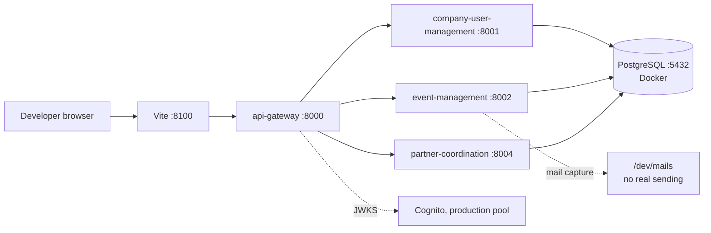

Ports follow `BASE_PORT` (default 8000; frontend `BASE_PORT + 100`), so several instances can
run side by side (`make dev-native-up-instance BASE_PORT=9000`).

```bash
# 1. Start local PostgreSQL
docker compose -f docker-compose-dev.yml up -d

# 2. Start all services natively
make dev-native-up

# 3. First time only: sync users from the production Cognito pool
./scripts/auth/get-token.sh staging your-email@example.com your-password
./scripts/dev/sync-users-from-cognito.sh

# Logs: /tmp/batbern-1-*.log, or make dev-native-logs
# Stop:  make dev-native-down
```

Local dev has no server-side cache (`@Profile("local")` NoOpCacheManager) and does not validate
SES addresses; both differ from production.

#### Production Architecture

**Full AWS deployment on ECS Fargate:**

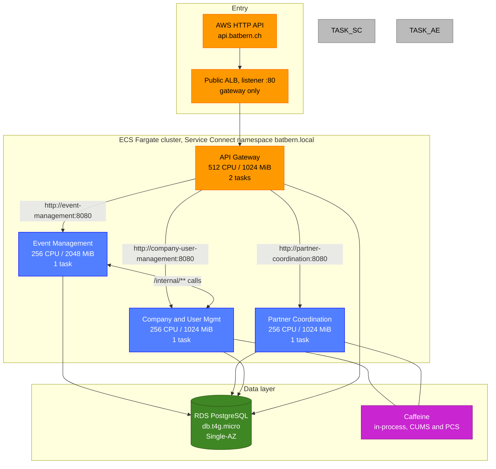

The `/internal/**` arrow is illustrative of the pattern (VPC-only service-to-service reads
without JWT); the exact set of internal callers per service is not drawn.

**ECS configuration:**
- **Platform:** ECS Fargate, ARM64 (Graviton), private subnets, egress through the single NAT.
- **Service discovery:** ECS Service Connect in `batbern.local`. There are **no internal ALBs**;
  only the gateway has a load balancer.
- **Capacity:** plain `FARGATE`. `domain-service-construct.ts` adds the 70/30 Spot strategy only
  when `isProd` is false, and the gateway pattern never used Spot. Verified live 2026-11-04.
- **Auto scaling:** target 70% CPU and 85% memory. `minCapacity`, not `desiredCount`, decides
  the steady-state count after creation.
- **Health checks:** container check `curl -f http://localhost:8080/actuator/health`; the
  gateway's ALB target group checks the same path.

**Production service sizing (reference):**

| Service | CPU | Memory | Scaling (CDK) | Running 2026-11-04 | Status |
|---|---|---|---|---|---|
| API Gateway Service | 512 | 1024 MiB | min 2, max 8 | 2 | active |
| Event Management | 256 | 2048 MiB | min 1, max 2 | 1 | primary |
| Company and User Management | 256 | 1024 MiB | min 1, max 2 | 1 | primary |
| Partner Coordination | 256 | 1024 MiB | min 1, max 2 | 1 | active |

Per-service monthly costs from the earlier table were estimates and are dropped (not verified).

### Architecture Decisions & Trade-offs

#### 1. Single NAT, Single-AZ database, two-AZ network

**Decision:** the VPC spans two AZs (RDS requires it), but there is one NAT gateway and the
database is Single-AZ. ECS tasks can land in either AZ's private subnet.

**Trade-offs:**
- An AZ failure takes the database down until it is restored; it is a restore, not a failover.
- The single NAT is a single point of failure for outbound traffic (Cognito, SES, Secrets
  Manager, ECR image pulls other than the S3 layer). Running services keep serving cached and
  DB-backed requests, but anything calling an AWS API would fail.
- Accepted because BAT events happen about three times a year and a short outage outside those
  days has low impact. No documented runbook for an AZ or NAT failure exists yet.

#### 2. RDS Database Optimization

**Decision:** `db.t4g.micro` (ARM, 1 GB RAM, burstable), Single-AZ, 20 GB, 7-day automated backups.

- Connection count, free storage and CPU are alarmed (`alarm-construct.ts`; thresholds in
  [08-operations-security.md](./08-operations-security.md)).
- The earlier "30-day retention" and "$99 → $19" figures were wrong or unmeasured: retention is
  **7 days**; cost not verified 2026-11-04.

#### 3. ElastiCache Redis Removal

**Decision:** no shared cache. `staging-config.ts` keeps an `elasticache` block with
`numNodes: 0`, so the Database stack skips the Redis cluster (the `CacheSG` security group is
still created).

- CUMS and PCS use Spring Cache with Caffeine, configured per service in `application.yml`
  (e.g. CUMS `maximumSize=1000,expireAfterWrite=15m`).
- Each task has its own cache; with one task per service this is not an issue today.
- Cache behaviour cannot be observed in local dev (no-op cache there); test it with an
  integration test.

#### 4. Log Retention Reduction

- Domain services: **1 month** in production, 1 week otherwise (`domain-service-construct.ts`).
- Gateway: **6 months** in production (`api-gateway-service-stack.ts`).
- No export of logs to S3 is configured.

#### 5. No Fargate Spot in production

Earlier documentation described 70% Spot with interruptions. That strategy applies only to
non-production configs; production runs on regular Fargate (verified live 2026-11-04).

### Event Scaling Strategy

Nothing in CDK or the workflows scales up for events. If a temporary RDS upgrade is ever needed,
it would be a manual change:

```bash
# Scale up (instance identifier from database-stack.ts)
AWS_PROFILE=batbern-staging aws rds modify-db-instance \
  --db-instance-identifier batbern-staging-postgres \
  --db-instance-class db.t4g.small --apply-immediately

# Scale back down afterwards
AWS_PROFILE=batbern-staging aws rds modify-db-instance \
  --db-instance-identifier batbern-staging-postgres \
  --db-instance-class db.t4g.micro --apply-immediately
```

An out-of-band class change is drift against CDK; the next Database stack deploy reverts it.
Whether this was ever done for an event: not verified 2026-11-04. The cost figures previously
given here were not measured and are removed.

### Monitoring Cost-Optimized Infrastructure

Monitoring is CloudWatch only. The alarm inventory, thresholds and the alarm → GitHub issue loop
are documented in [08-operations-security.md](./08-operations-security.md); the
[Monitoring section](#monitoring-and-observability-strategy) below shows the flow.

Corrections to the previous text:
- Alarms notify an SNS topic that a Lambda turns into GitHub issues. There is no Slack channel
  alerting and no PagerDuty for alarms. (The deploy workflow posts rollback notices to a Slack
  webhook if the secret is set; not verified 2026-11-04 whether it is.)
- No cost anomaly alarm and no budget alert (#978).
- No NAT gateway alarm (not verified 2026-11-04 against the live alarm list).

### Disaster Recovery & Business Continuity

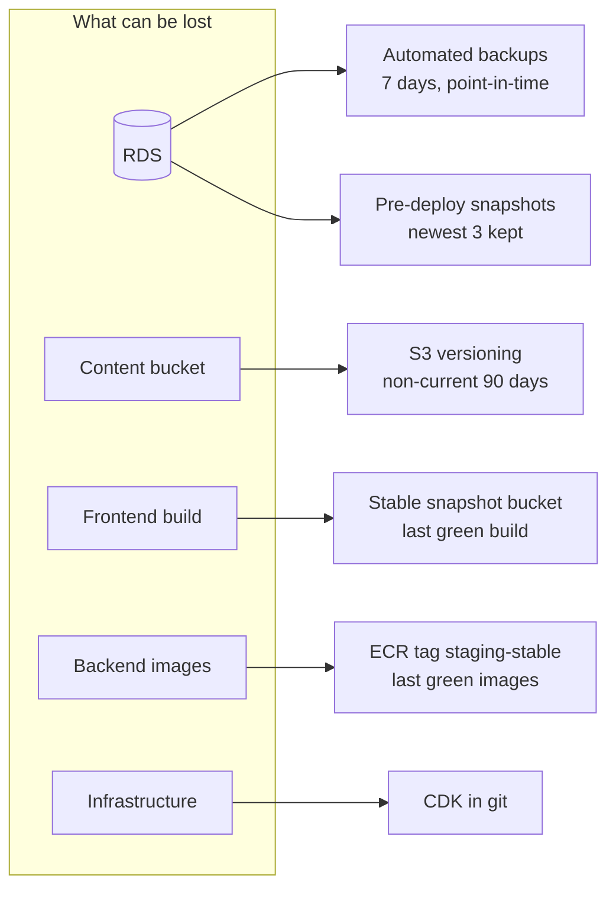

| What | How | Retention |
|---|---|---|
| RDS automated backups | `backupRetention` in `staging-config.ts` | 7 days, point-in-time restore |
| RDS pre-deploy snapshots | `deploy-staging.yml`, when infrastructure or a Flyway migration changed | newest 3 `batbern-staging-pre-deploy-*` kept; hand-named snapshots untouched (#1032) |
| Content bucket | S3 versioning (production only) | non-current versions to Glacier after 30 days, deleted after 90 |
| Frontend | `batbern-frontend-stable-*` bucket, restored automatically after a failed post-deploy test | last known-good build |
| Backend images | ECR tags `staging-current` / `staging-stable` | last known-good images |

- **RTO / RPO:** no objectives have been formally set or measured. The previously stated
  "RTO 4 h / RPO 1 h, hourly backups" was never true; RDS automated backups are daily with
  transaction logs enabling point-in-time restore within the 7-day window.
- **AZ failure:** restore into another AZ; no runbook yet in `docs/operations/runbooks.md`.
- **Region failure:** no cross-region replication of S3 or snapshots. Not implemented.
- Weekly manual snapshots with 90-day retention: not implemented.

### Cost Optimization Documentation

- `infrastructure/lib/config/staging-config.ts`: production configuration (`isProduction: true`).
- `infrastructure/lib/config/dev-config.ts`: development configuration.
- `infrastructure/COST_OPTIMIZATION.md` was referenced here but does not exist.

## API Gateway Architecture Pattern

### Dual Gateway Pattern: AWS HTTP API + Spring Boot Gateway

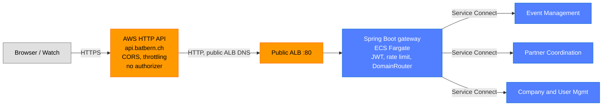

**Tier 1: AWS HTTP API (`api.batbern.ch`)** (`infrastructure/lib/stacks/api-gateway-stack.ts`)

- TLS with the pre-created eu-central-1 ACM certificate for api.batbern.ch.
- Stage `v1` with throttling: rate 1000 req/s, burst 2000.
- One catch-all route `/{proxy+}` for GET/POST/PUT/DELETE/PATCH, integrated with an
  `HttpUrlIntegration` to `http://{gateway ALB DNS}/{proxy}`. There is no VPC link: the HTTP
  API reaches the public ALB over the internet on port 80.
- **No authorizer.** An `HttpJwtAuthorizer` object is constructed but attached to no route
  ([ADR-008](./ADR-008-simplified-api-gateway-routing.md)).
- **The only CORS layer:** `corsPreflight` allows www.batbern.ch, batbern.ch and
  beta.batbern.ch, and exposes `X-Correlation-ID`, `X-Request-Id` and the rate-limit headers.
- No AWS WAF is attached. AWS Shield Standard applies to all AWS edge services by default.

```typescript
// infrastructure/lib/stacks/api-gateway-stack.ts (abridged)
const httpIntegration = new apigatewayv2_integrations.HttpUrlIntegration(
  'SpringBootApiGatewayIntegration',
  `${apiGatewayServiceUrl}/{proxy}`,      // http://<public ALB DNS>/{proxy}
  { method: apigatewayv2.HttpMethod.ANY },
);

this.api.addRoutes({
  path: '/{proxy+}',
  methods: [GET, POST, PUT, DELETE, PATCH],
  integration: httpIntegration,           // no authorizer (ADR-008)
});
```

---

**Tier 2: Spring Boot API Gateway (ECS Fargate)** (`api-gateway/`)

- A Spring MVC application (`spring-boot-starter-web`, OAuth2 resource server). It does **not**
  use Spring Cloud Gateway: the Spring Cloud BOM is imported but no gateway dependency is declared.
- Validates the Cognito JWT, applies rate limiting, Turnstile verification on selected public
  endpoints, the `is_active` account gate, correlation IDs and security headers.
- Denies `/internal/**`, which is reserved for VPC-only service-to-service calls.
- Makes **no authorization decisions.** Roles are checked only in the services: `@PreAuthorize`
  on every write endpoint, enforced per service by `EndpointAuthorizationGuardTest` (#1147).
- No circuit breaker or retry library (Resilience4j) is used.
- Exposed through a **public** ALB (not a private one), tasks in private subnets.

**Routing** is code, in `routing/DomainRouter.java`. Unknown paths get 404:

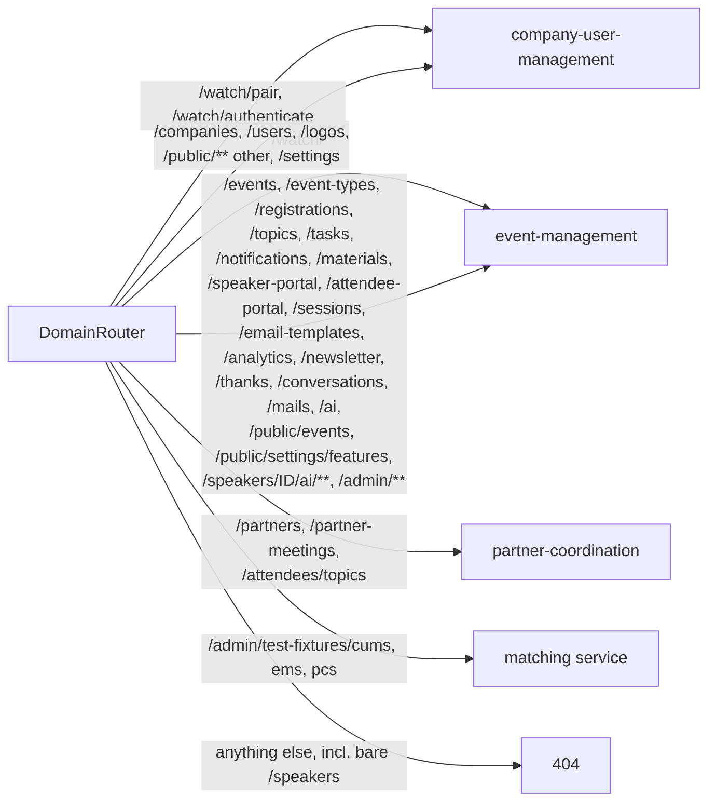

All paths are under `/api/v1`. Order matters in the code (e.g. `/public/events` is checked
before the `/public` fallback to CUMS).

**Environment variables (set in `api-gateway-service-stack.ts`):**
```bash
EVENT_MANAGEMENT_SERVICE_URL=http://event-management:8080
PARTNER_COORDINATION_SERVICE_URL=http://partner-coordination:8080
COMPANY_USER_MANAGEMENT_SERVICE_URL=http://company-user-management:8080
```

---

### Why Two Tiers?

- **AWS HTTP API** gives the custom domain, managed TLS, throttling and CORS cheaply, and never
  needs a deploy when a route is added (one catch-all route).
- **Spring Boot gateway** holds everything that needs application logic: JWT validation, the
  account gate, rate limiting, Turnstile, routing. It runs unchanged in local dev, where there is
  no AWS gateway.
- **Authorization** sits in neither tier but in each service (ADR-008, #1147), so a routing
  mistake cannot grant access.
- Service discovery is Service Connect, so no Consul/Eureka and no internal ALBs.

The earlier table claimed Cognito validation at the HTTP API tier and circuit breaking with
Resilience4j; neither exists.

---

### Request Flow Example

**POST `/api/v1/events`, create event**

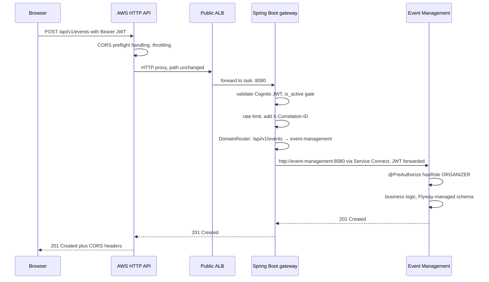

---

### Network Architecture for API Gateway

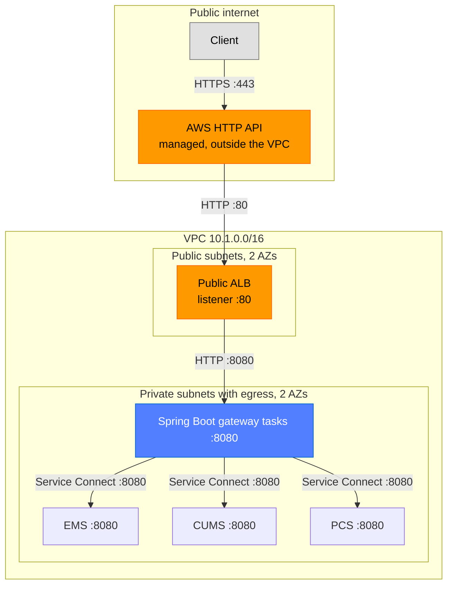

**Security groups** (detail in [Security Group Rules](#security-group-rules)):
- The ALB security group comes from the `ApplicationLoadBalancedFargateService` pattern; by its
  default (`openListener`) it accepts port 80 from anywhere, so the ALB is reachable directly,
  bypassing the HTTP API's throttling and CORS (not verified live 2026-11-04). JWT validation
  still applies because it happens in the gateway.
- Gateway and service tasks accept :8080 from the VPC CIDR (Service Connect).

---

## Deployment Strategy

**Frontend:**
- Built once, environment-agnostic: `npm run build:prerender` (Vite build plus a static crawl of
  `/`, `/privacy`, `/about`, `/support`, `/why-an-account`; falls back to a CSR-only build if the crawl fails).
- The SPA loads its configuration at runtime from `GET /api/v1/config`, so no `VITE_*` values are
  baked in by the deploy.
- Shipped by the `Frontend` stack's `BucketDeployment` into the website bucket, served by
  CloudFront with origin access control. beta.batbern.ch is published by
  `scripts/deploy/publish-beta-frontend.sh`.

**Backend:**
- Each module has a `Dockerfile`; `build.yml` builds ARM64 images and pushes them to ECR.
- ECS **rolling** deployments (ECS deployment controller) with the deployment circuit breaker
  and automatic rollback. Domain services use min 50% / max 200% healthy; the gateway uses
  100% / 200% plus a 300 s ALB slow start (#982). There is no blue/green deployment.

## CI/CD Pipeline

> **Opening a PR against `develop` deploys that branch to production**, before review and before
> merge. Each further push to the PR deploys again. Dependabot PRs are excluded. Full trigger
> matrix: `docs/deployment/cicd-pipeline-guide.md`.

### Selective Deployment Strategy

`deploy-staging.yml` diffs the PR (or push) and picks one of three paths:

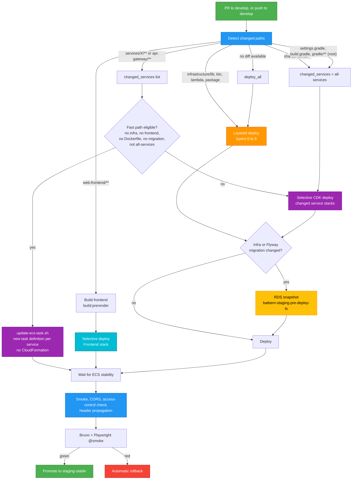

**Manual deploy commands:**

```bash
cd infrastructure
npm run deploy:staging:layer4-event-management     # one layer or stack, see package.json
npm run deploy:staging:selective -- BATbern-staging-PartnerCoordination
AWS_PROFILE=batbern-staging npx cdk deploy BATbern-staging-FrontendBeta \
  --context environment=staging --context betaFrontend=true --require-approval never
```

Infrastructure PRs also deploy on open, so they must deploy cleanly before merge. Touching
`infrastructure/` also requires a mapped doc change or `[no-doc]` (Doc Drift Check).

**Safety mechanisms:**
- RDS snapshot before a deploy that changes infrastructure or adds a Flyway migration.
- ECS stability wait; deployment circuit breaker rolls back failed task starts.
- Smoke tests, CORS validation, SES IAM simulation, and the anonymous **access-control check**
  (`scripts/ci/access-control-check.py` against `https://api.batbern.ch/api/v1`, #1156).
- Bruno contract tests and the Playwright `@smoke` suite as blocking gates.
- Automatic rollback of images and frontend to the last green state.

---

### Branch Protection Rules

`develop` is protected with `strict: true`. Required checks: `build-frontend`,
`build-shared-kernel`, and the four `build-services (…)` contexts (api-gateway,
event-management-service, company-user-management-service, partner-coordination-service).
The two contexts of the removed stub services are dropped by the owner before Story 17.2
merges; a required check that no job reports any more would block every PR.

**Why this matters for Dependabot:** the monthly batch (`dependabot-batch-merge.yml`, #1076)
includes a Dependabot PR only when these checks are green, and the batch PR merges through
`auto-merge.yml`, which waits for the same checks. A required check that never runs blocks like
a failing one, which is why nothing may push to a Dependabot branch with `GITHUB_TOKEN`.

```bash
gh api repos/nissimbuchs/BATbern2/branches/develop/protection/required_status_checks
gh api repos/nissimbuchs/BATbern2/branches/develop/protection/required_status_checks \
  --method PATCH --input checks.json
```

---

### Build Pipeline (`build.yml`)

Triggers: push to `develop` or `main`, pull request to `develop`, manual dispatch.

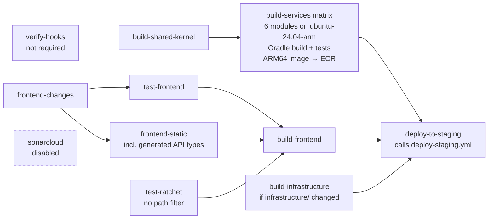

`deploy-to-staging` runs on a push to `develop` **or** a PR to `develop`, when all build jobs
succeeded and neither the actor nor the PR author is Dependabot. The frontend jobs skip when the
frontend did not change. Moving `build-services` to native ARM runners cut the Docker step from
about 29 to about 2 minutes (#1073). Other deployment times from the earlier table were not
measured and are removed.

---

### Production Deployment (`deploy-staging.yml`, automatic)

**Trigger:** called by `build.yml` (see above), or manual dispatch. `concurrency: deploy-staging`
serialises runs without cancelling them. There is no `environment:` approval gate.

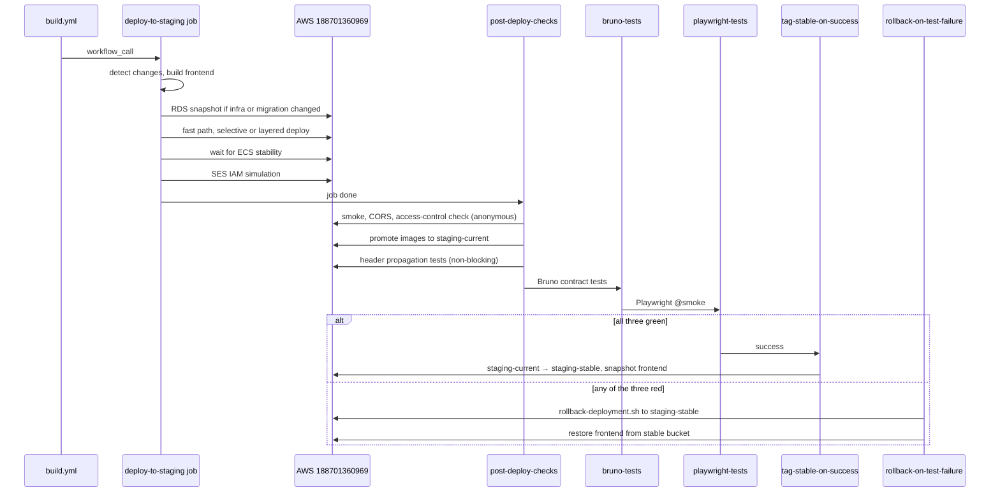

**Docker image tagging:**
```bash
${SHORT_SHA}-staging.${BUILD_RUN_NUMBER}     # e.g. a1b2c3d-staging.142
# plus mutable tags: staging-current (deployed, smoke-green), staging-stable (Bruno + Playwright green)
```

After a green run, `auto-merge.yml` merges the PR (never for Dependabot). A separate
`nightly-e2e.yml` runs the full `@gate` Playwright suite against production at 01:17 UTC.

---

### Production Deployment (Manual Approval)

**Deprecated, not usable.** `deploy-production.yml` ("Deploy to Production (DEPRECATED)") and
`promote-to-production.yml` still target the decommissioned account 422940799530 and fail at the
first AWS step. Kept on purpose (owner decision 2026-11-03); do not use them. The tagged-release,
manual-approval flow described here previously no longer exists.

**How a service rollout actually proceeds (ECS rolling update):**

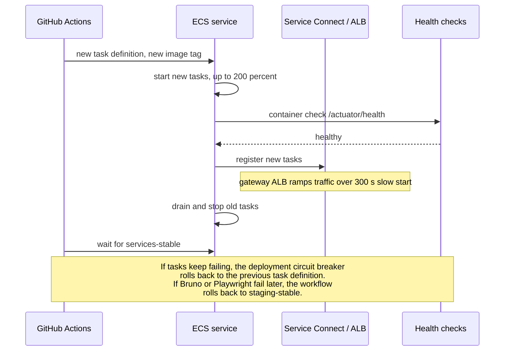

---

### CI/CD Architecture Diagram

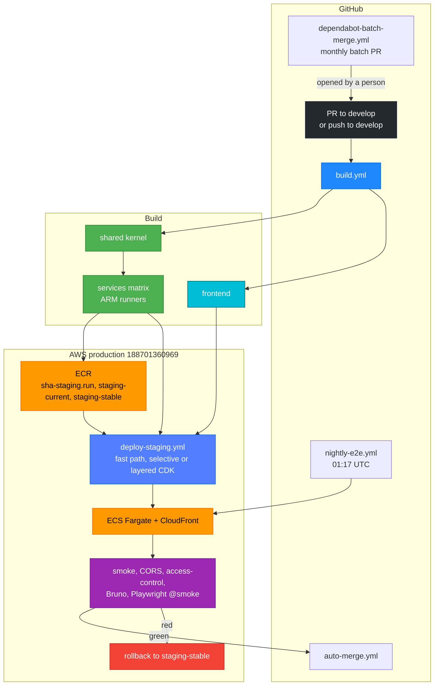

**OIDC authentication (no long-lived credentials):**

```yaml
- name: Configure AWS credentials
  uses: aws-actions/configure-aws-credentials@v4
  with:
    role-to-assume: arn:aws:iam::188701360969:role/batbern-staging-github-actions-role
    aws-region: eu-central-1
```

The role (`cicd-stack.ts`) trusts `repo:nissimbuchs/BATbern2:*`; narrowing it (#998) was closed
as not planned.

## Network Architecture

### VPC and Subnet Design

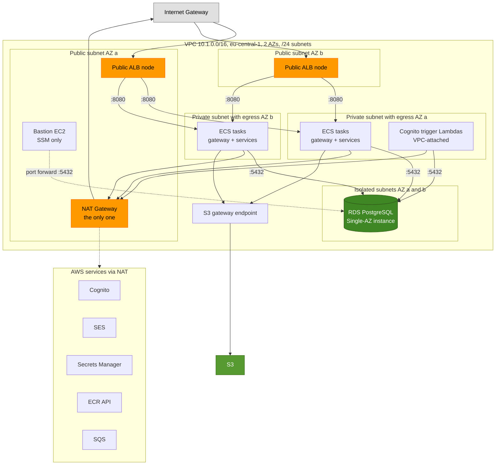

Subnets come from `vpc-construct.ts` (`PUBLIC`, `PRIVATE_WITH_EGRESS`, `PRIVATE_ISOLATED`, each
/24 per AZ). Whether the bastion and NAT share the same AZ is not verified 2026-11-04; the
diagram places both in AZ a for simplicity.

### Security Group Rules

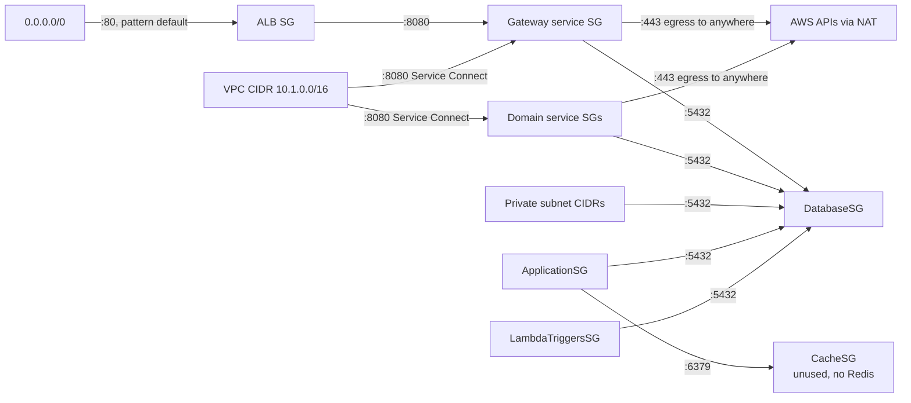

- **Domain service SG** (`domain-service-construct.ts`): ingress :8080 from the VPC CIDR; egress
  :5432 to the DB SG, :443 anywhere, :8080 to the VPC CIDR.
- **Gateway SG** (`api-gateway-service-stack.ts`): same shape, plus the ALB SG ingress the ECS
  pattern adds.
- **DatabaseSG** (`vpc-construct.ts`): ingress :5432 from ApplicationSG, from each private subnet
  CIDR (avoids cross-stack cycles), and from LambdaTriggersSG. No outbound.
- **Bastion:** the stack prints an `authorize-security-group-ingress` command for :5432 from the
  bastion SG; the rule is added by hand, not by CDK.

### DNS and Certificate Architecture

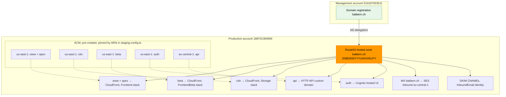

**Key DNS facts:**
- The zone is **imported** (`HostedZone.fromHostedZoneAttributes` in the DNS stack), not created
  by CDK. Records are created by the stacks that own the target (Storage, Frontend, ApiGateway,
  Cognito, InboundEmail).
- Certificates are pre-created and referenced by ARN; CDK only creates and DNS-validates a
  certificate when no ARN is configured. ACM renews them automatically.
- No Route53 health checks or failover records are configured.
- TTL values: not verified 2026-11-04 (alias records have no own TTL).

### Cost Optimization: Network Architecture

**Single NAT gateway strategy:**
- One NAT gateway instead of one per AZ; it is a single point of failure for outbound traffic
  (see [Architecture Decisions](#1-single-nat-single-az-database-two-az-network)).
- Only the free S3 gateway endpoint exists. The earlier claim that "all critical AWS services use
  VPC endpoints" is false: interface endpoints (ECR, Secrets Manager, SES, SQS, Logs) were
  rejected on cost (comment in `network-stack.ts`), so all of that traffic goes through the NAT.
- No NAT gateway alarm is defined (not verified 2026-11-04 against the live alarm list).
- Monthly network cost figures from the earlier table were not measured and are removed.

---

## Environments

| Environment | AWS account | Frontend | Backend | Purpose |
|---|---|---|---|---|
| Development | none (local) | http://localhost:8100 | http://localhost:8000 | Local development |
| Production | 188701360969 | https://www.batbern.ch (canary: https://beta.batbern.ch) | https://api.batbern.ch | Live platform |

**Beta frontend canary.** `beta.batbern.ch` (`BATbern-staging-FrontendBeta`, bucket
`batbern-frontend-beta-staging`) serves the same SPA against the **same production API, Cognito
and database**. It is for frontend-only changes; every action on beta acts on production data.

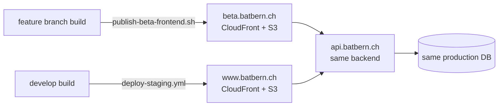

```bash
scripts/deploy/publish-beta-frontend.sh            # build, S3 sync, CloudFront invalidation
SKIP_BUILD=1 scripts/deploy/publish-beta-frontend.sh
```

Design: `docs/plans/beta-frontend-canary.md`.

## Infrastructure as Code with DNS and Certificate Management

### DNS Strategy with AWS Route53

The production account owns the `batbern.ch` hosted zone; development uses localhost and no
custom domains. Records are aliases created next to their targets, for example in the Storage
stack:

```typescript
// infrastructure/lib/stacks/storage-stack.ts (abridged)
if (props.hostedZone && props.config.domain?.cdnDomain) {
  new route53.ARecord(this, 'CdnAliasRecord', {
    zone: props.hostedZone,
    recordName: 'cdn',
    target: route53.RecordTarget.fromAlias(new targets.CloudFrontTarget(this.distribution)),
  });
}
```

The hosted zone itself is imported in the DNS stack:

```typescript
// infrastructure/lib/stacks/dns-stack.ts (abridged)
this.hostedZone = route53.HostedZone.fromHostedZoneAttributes(this, 'HostedZone', {
  hostedZoneId: props.config.domain!.hostedZoneId,   // Z08825557YYLWVHISLPY
  zoneName: props.config.domain!.zoneName,           // batbern.ch
});
```

### AWS Route53 Configuration Benefits
- DNS and certificate validation in the same account as the workloads; no external DNS provider.
- Alias records to CloudFront, the HTTP API domain and the Cognito domain, created by CDK.
- The earlier claims of Route53 health checks with failover and Let's Encrypt validation were
  wrong: there are no health checks, and certificates come from ACM.

## AWS SES Email Infrastructure

### SES Configuration Architecture

All mail goes through SES in eu-central-1. Outbound sending is done by the services (EMS, CUMS,
PCS) with the AWS SDK; inbound mail is received by SES and handed to EMS. Details:
[06d-notification-system.md](./06d-notification-system.md), `docs/guides/aws-ses-configuration.md`.

#### Domain Verification and Authentication

- The `batbern.ch` domain identity with DKIM is created in the **InboundEmail** stack
  (`ses.EmailIdentity` with `Identity.publicHostedZone`), which also writes the DKIM records.
- Custom MAIL FROM domain, SPF and DMARC records: not in CDK; not verified 2026-11-04 whether
  they exist in the zone.
- A custom tracking domain (`track.batbern.ch`) and open/click tracking: not implemented.

**Outbound flow and event handling:**

```mermaid
graph LR
    subgraph SENDERS["Senders"]
        EMS["EMS"]
        CUMS["CUMS"]
        PCS["PCS"]
    end

    EMS -->|"newsletter"| NL["Config set<br/>batbern-staging-newsletter"]
    EMS & CUMS & PCS -->|"transactional, default"| TX["Transactional config set"]
    NL & TX --> SESO["SES outbound"] --> INBOX["Recipients"]

    NL -->|"bounce, complaint"| BT["SNS ses-bounces"] --> BQ["SQS bounce-processing<br/>+ DLQ"] --> BPS["EMS BounceProcessingService<br/>suppress on permanent bounce"]
    TX -->|"delivery, bounce,<br/>complaint, reject"| CW["CloudWatch metrics"]
    TX -->|"same events"| TT["SNS ses-transactional-events"]
    TT --> LOG["logger Lambda"]
    TT --> MDQ["SQS mail-delivery-status<br/>+ DLQ"] --> MC["EMS Mail Center<br/>recipient status, Story 16.1b"]
```

Transactional bounces deliberately do not reach the newsletter suppression path.

#### SES Template Management Service

**Not implemented as described.** SES-side templates (`CreateTemplate` / `SendTemplatedEmail`)
are not used. Email templates are stored in the EMS database (`EmailTemplate` entity, Story 10.2),
rendered in the application, and sent as finished messages. Template languages are DE and EN
only; other locales fall back to EN.

#### Bounce and Complaint Handling

There is no Lambda handler. Newsletter bounces and complaints flow SNS → SQS → EMS
`BounceProcessingService` (see diagram above), which updates recipient bounce records and sets the
subscriber's suppression timestamp on a permanent bounce (idempotent, the first timestamp wins).
Transactional events update the per-recipient status in the Mail Center.

SES reputation alarms (bounce rate) live in the Monitoring stack (#984); thresholds in
[08-operations-security.md](./08-operations-security.md).

#### Inbound mail

```mermaid
graph LR
    SENDER["External sender"] -->|"MX batbern.ch"| SESIN["SES receipt rule set<br/>batbern-inbound-staging<br/>spam + virus scan"]

    SESIN -->|"rule 1: replies@"| E["S3 batbern-inbound-emails-staging<br/>emails/"]
    SESIN -->|"rule 2: ok@ info@ events@<br/>partner@ support@, then stop"| F["S3 forwarding/"]
    SESIN -->|"rule 3: catch-all<br/>batbern N ... @"| F

    E -->|"S3 event"| QI["SQS inbound-email + DLQ"] --> EMS1["EMS reply handling<br/>unsubscribe, deregistration"]
    F -->|"S3 event"| QF["SQS forwarding-email + DLQ"] --> EMS2["EMS EmailForwardingListener<br/>sender check, recipients in-process"]

    EMS2 -->|"forward copy, SendRawEmail<br/>forwarder config set"| SESOUT["SES outbound"]
    EMS2 -->|"notify instead of forward<br/>admin setting per alias group"| MCN["Mail Center conversation<br/>attachments in mail-attachments/"]
```

- Stories 10.17 (replies), 10.26 (forwarding) and Epic 16 (Mail Center). Forwarding moved from a
  Lambda into EMS in October 2026, so access is IAM only: SES writes S3, S3 notifies SQS, the EMS
  task role consumes. No HTTP endpoint is involved.
- EMS drops mail whose SES spam or virus verdict is FAIL (Story 16.7).
- Retention: `emails/` and `forwarding/` 7 days, `mail-attachments/` 400 days.
- Alarms: rejected-mail count, both DLQs, forwarding failures.
- Whether an alias group is forwarded or answered in the Mail Center is the admin setting
  `mailcenter.notify-instead-of-forward`. Only the owner switches it
  (`docs/operations/runbooks.md`).

### Production Configuration

#### Environment Variables
```bash
EMAIL_FROM=noreply@batbern.ch                       # EMS default in application.yml
BATBERN_SES_CONFIGURATION_SET_NAME=batbern-staging-newsletter   # injected by CDK into EMS
```
The transactional configuration set is applied through the shared `EmailService` default.
SES sending quota and rate for the account: not verified 2026-11-04 (the previous
50,000/day and 14/s were not checked).

#### Deliverability Best Practices
Guidance, not a list of implemented controls:
1. Remove hard-bounced addresses immediately (implemented for the newsletter via suppression).
2. One-click unsubscribe in newsletters (implemented via reply/unsubscribe handling; detail in
   06d).
3. Double opt-in for newsletter subscriptions (not verified 2026-11-04).
4. DKIM is configured; SPF and DMARC not verified 2026-11-04.
5. Keep bounce and complaint rates low; the bounce-rate alarm is the backstop.
6. Never let tests send real mail: staging is production (newsletter incident 2026-07-01, guard
   `@sends-real-email` and `EmailContentTestMarker`).

## AWS S3 Content Storage Infrastructure

### S3 Bucket Architecture with CDK

There is **one** content bucket with key prefixes, not one bucket per content type.

```mermaid
graph TB
    subgraph STORAGE["Storage stack"]
        CB["batbern-content-staging<br/>versioned, block public access, SSE-S3<br/>RETAIN"]
        LB["batbern-logs-staging<br/>CloudFront access logs under cloudfront/"]
        BB["batbern-backups-staging<br/>versioned"]
    end
    subgraph OTHER["Other stacks"]
        IB["batbern-inbound-emails-staging<br/>InboundEmail stack"]
        WB["batbern-frontend-*<br/>+ stable snapshot bucket, Frontend stack"]
        BETAB["batbern-frontend-beta-staging"]
    end

    CB --- P1["logos/"]
    CB --- P2["profile-pictures/"]
    CB --- P3["materials/"]
    CB --- P4["event photos, teaser images<br/>prefixes not verified"]

    CB -->|"OAC"| CF["CloudFront cdn.batbern.ch"]
```

#### CDK Stack for Content Storage

The canonical implementation is `infrastructure/lib/stacks/storage-stack.ts` (`StorageStack`).
The long illustrative listing that used to stand here (four buckets, OAI, inventory,
cross-region replication, storage alarms) described a design that was never built and is removed.
What the stack creates:

| Bucket | Lifecycle | Notes |
|---|---|---|
| `batbern-content-*` | Intelligent-Tiering after 30 days; in production non-current versions to Glacier after 30 days, deleted after 90 | CORS: GET/HEAD from anywhere; PUT/POST from www.batbern.ch, batbern.ch, localhost:3000 |
| `batbern-logs-*` | Objects expire after 30 days (the IA and Glacier IR transition rules at 30/60 days never take effect) | Not versioned |
| `batbern-backups-*` | Objects expire after 90 days in production; the Glacier rule is disabled | Versioned in production. What writes to it: not verified 2026-11-04 |

Note: the PUT CORS rule does not list beta.batbern.ch, so direct uploads from beta may fail
(not verified 2026-11-04).

#### Lambda@Edge Image Optimization

```mermaid
sequenceDiagram
    participant B as Browser
    participant CF as CloudFront cdn.batbern.ch
    participant L as image-resize Lambda@Edge
    participant S3 as S3 content bucket

    B->>CF: GET /logos/...png?w=400&fit=cover
    alt cached for this w, h, fit
        CF-->>B: cached response
    else cache miss
        CF->>L: origin request
        alt no w and no h
            L-->>CF: pass request through
            CF->>S3: GET original via OAC
            S3-->>CF: original
        else w or h given
            L->>S3: GetObject
            S3-->>L: original bytes
            L->>L: sharp resize, max 2000 px, withoutEnlargement, WebP q80
            L-->>CF: 200 image/webp, Cache-Control immutable
        end
        CF-->>B: response, cached up to 365 days
    end
    Note over L: On any error, or if sharp fails to load,<br/>the request passes through to the original.
```

- Origin-request trigger (not origin-response), Node.js 24, 512 MB, code in
  `infrastructure/lib/lambda/image-resize/index.ts`.
- Query parameters `w`, `h`, `fit` only; `fit` defaults to `cover`. Format is always WebP; no
  `q` or `f` parameter, no AVIF.
- `sharp` is a native dependency and must be bundled through the Docker bundler; a handler test
  imports the module to catch load failures (CLAUDE.md, Lambda handler tests).

### File Upload Service Implementation

Uploads go directly from the browser to S3 with presigned URLs; files never pass through the
backend. The pattern, as implemented in CUMS `GenericLogoService` and `ProfilePictureService`
and in EMS `MaterialsUploadService`, `EventPhotoService`, `EventTeaserImageService`,
`SpeakerPortalMaterialsService`, `ConversationAttachmentService`:

```mermaid
sequenceDiagram
    participant UI as Frontend
    participant SVC as CUMS or EMS
    participant S3 as S3 content bucket
    participant CDN as cdn.batbern.ch

    UI->>SVC: request upload URL, file name, size, type
    SVC->>SVC: validate size and type, e.g. logo max 5 MB
    SVC->>SVC: store pending upload record
    SVC-->>UI: presigned PUT URL, valid 15 min, plus upload ID
    UI->>S3: PUT file directly
    S3-->>UI: 200 + ETag
    UI->>SVC: confirm upload ID
    SVC->>S3: verify object, move from temp/ to final key
    SVC-->>UI: CDN URL
    UI->>CDN: display with ?w= and ?h= for resizing
```

Key shapes of new objects (examples): `logos/temp/{uploadId}/logo-{uploadId}.{ext}` →
`logos/companies/{name}/logo-{uploadId}.{ext}` (theme image: `logos/events/{eventCode}/theme-…`);
`profile-pictures/temp/{uploadId}/profile-{uploadId}.{ext}` →
`profile-pictures/{username}/profile-{uploadId}.{ext}`; `events/temp/{uploadId}/photo-{uploadId}.{ext}` →
`events/{eventCode}/photos/{uploadId}.{ext}` (event photos, Story 17.11b). Since Story 17.11a the final keys carry no
year; objects stored earlier keep their `logos/{year}/…` and `profile-pictures/{year}/…` keys (the
database rows hold the full key and URL, nothing is moved);
`materials/temp/{uploadId}/file-{uploadId}.{ext}`. Size limits and confirm steps differ per
service; the Java listing previously shown here (`ContentStorageService`, four buckets) did not
match the code and is removed.

### Storage Quota Service

Not implemented (as of 2026-11-04). No per-role storage quotas exist; only per-upload size limits
in the individual services.

### CloudFront CDN Configuration

`cdn.batbern.ch` (Storage stack):

- **Origin access control** (`S3BucketOrigin.withOriginAccessControl`), not the legacy OAI.
- HTTPS only (redirect), minimum TLS 1.2 (`TLS_V1_2_2021`), compression on, `PRICE_CLASS_100`
  (Europe and North America).
- **Cache policy** `batbern-image-resize-*`: cache key includes only `w`, `h`, `fit`; default and
  max TTL 365 days; gzip and brotli.
- **Response headers policy** `batbern-content-cache-*`: `Cache-Control: public,
  max-age=31536000, immutable` where the object has none; `Content-Security-Policy: sandbox`
  and `X-Content-Type-Options: nosniff`, which stop scripts in uploaded SVGs from running when
  opened top-level (Story 12.12).
- Access logs to `batbern-logs-*` under `cloudfront/`.

The header list previously shown here (HSTS, X-Frame-Options, X-XSS-Protection, Referrer-Policy)
is not applied on the CDN. Frontend distribution headers are covered in
[08-operations-security.md](./08-operations-security.md).

### Backup and Disaster Recovery

- **Versioning:** on in production; non-current versions move to Glacier after 30 days and are
  deleted after 90.
- **Cross-region replication:** not implemented.
- **Storage alarms** (bucket size, 4xx rate, replication lag, CDN request rate): not implemented.
- **Recovery runbook** `docs/runbooks/s3-recovery.md`: does not exist; RTO/RPO not set.
- **Integrity checks, orphan detection and cleanup:** not implemented.

## Monitoring and Observability Strategy

### Comprehensive Monitoring Stack

Monitoring is **CloudWatch only**: metrics, logs, alarms, dashboards. Grafana, Datadog APM and
Sentry are not used. The full alarm inventory is in
[08-operations-security.md](./08-operations-security.md).

```mermaid
graph LR
    subgraph SOURCES["Sources"]
        ECSM["ECS, ALB, RDS metrics"]
        SESM["SES metrics"]
        APPM["Micrometer CloudWatch registry<br/>CUMS, PCS"]
        LAM["Cognito trigger and user-sync metrics"]
        LOGS["Container logs<br/>/aws/ecs/BATbern-staging/*"]
    end
    SOURCES --> CW["CloudWatch alarms + dashboards"]
    CW --> SNS["SNS alarm topic"]
    SNS --> GHL["GitHub issues Lambda"]
    GHL --> ISSUE["GitHub issue opened,<br/>closed when the alarm resolves"]
    ISSUE -.->|"optional @claude handoff"| TRIAGE["Agent triage"]
```

- **Frontend monitoring:** none beyond the browser. `ErrorBoundary` and `reportWebVitals` carry
  TODOs to integrate a service; no Sentry SDK is installed.
- **Backend metrics:** CUMS and PCS include `micrometer-registry-cloudwatch2` (CUMS:
  `MetricsConfiguration`, 1-minute step). Other services: not verified 2026-11-04.
- **Tracing:** CUMS declares the AWS X-Ray SDK dependencies, but no X-Ray daemon sidecar is
  defined in the task definitions, so no traces reach X-Ray (not verified live 2026-11-04).
  Correlation IDs are the working tracing mechanism.

### Detailed Metrics and SLAs

Not implemented (as of 2026-11-04). No SLAs or availability targets are set, and the frontend
performance and per-service latency targets listed here before were never measured or alarmed.
The one measured latency reference: gateway steady-state p95 of 2 to 25 ms, measured for #982.

### Alerting and Incident Response

- Every alarm goes to the SNS alarm topic; the GitHub issues Lambda files an issue and closes it
  when the alarm returns to OK. Issues can carry an `@claude` triage handoff, switchable by a
  Lambda environment variable.
- A declared alarm is not a working alarm: alarms without actions were found and fixed in the
  #970/#977 sweep.
- Priority levels P0 to P3 and Grafana alert rules: not implemented.

### Logging Strategy

- Containers log to stdout; ECS ships to `/aws/ecs/BATbern-staging/{service}`.
- The gateway and CUMS use `logback-spring.xml` with `LogstashEncoder` (JSON). The other services
  have no own `logback-spring.xml` and use the Spring Boot default format (not verified
  2026-11-04 whether a shared config applies).
- **Correlation:** the gateway's `CorrelationIdFilter` sets or propagates `X-Correlation-ID`;
  `shared-kernel` provides `CorrelationIdGenerator`. The header is exposed to the browser by the
  HTTP API CORS config.
- Log levels and the second-pass log review are tracked in 08 and the owner decisions of
  2026-11-03.

### Business Metrics and KPIs

Not implemented (as of 2026-11-04). The KPI targets listed here before were never instrumented.
The CloudWatch dashboard has widgets for `EventsCreated` and `UserActivity`; whether these
metrics are emitted is not verified 2026-11-04.

### Health Checks and Monitoring Endpoints

Spring Boot Actuator, no custom health controller. `/actuator/health` is used by the container
health check of every service and by the gateway's ALB target group (30 s interval, 2 healthy /
3 unhealthy). The gateway exposes `health`, `info`, `metrics`, `prometheus` actuator endpoints;
`/actuator/health/ready` and `/live` endpoints as previously shown do not exist as custom code
(Spring's probe groups may be enabled per service; not verified 2026-11-04).

## Historical / not implemented

Described in earlier versions of this document; not built, or removed (as of 2026-11-04):

- Separate staging and production accounts with a tagged, manually approved production deploy
  (`deploy-production.yml` targets the decommissioned account 422940799530).
- Blue/green deployments; ECS uses rolling updates with a circuit breaker.
- Internal ALBs per service; replaced by ECS Service Connect.
- Cognito JWT authorizer on the HTTP API; the authorizer object exists but is attached to no route.
- Spring Cloud Gateway with YAML routes and Resilience4j circuit breakers; the gateway is Spring
  MVC with `DomainRouter`.
- Fargate Spot in production.
- 30-day log retention everywhere, 14- or 30-day RDS backups, weekly manual snapshots, RTO 4 h /
  RPO 1 h.
- Event-time RDS scaling as a routine.
- Interface VPC endpoints for critical AWS services; Route53 health checks and failover.
- SES templates synced to SES, SES bounce-handler Lambda, custom tracking domain, 50,000/day quota
  alarm.
- Four content buckets, OAI, S3 inventory, cross-region replication, storage alarms, S3 recovery
  runbook, integrity and orphan checks.
- Storage quota service with per-role limits; ClamAV or other upload virus scanning (only SES
  inbound scanning exists).
- Lambda@Edge on origin response with `q`, `f`, AVIF support.
- Grafana Cloud, Datadog APM, Sentry, working X-Ray tracing, SLAs, KPI tracking, P0-P3 alert
  hierarchy, Slack and PagerDuty alerting, cost anomaly alarm.
- `infrastructure/COST_OPTIMIZATION.md`.
