# Data Architecture

This document describes the data model and database design of the BATbern platform: the
concepts first, then the schema of each service as the Flyway migrations build it.

**Database architecture:**
- **One PostgreSQL 15 database**: `batbern` on RDS (local development: `batbern_development`).
- **One shared schema**: `public`, no schema per service.
- **Table ownership by convention**: each service owns its tables and is the only one to read or
  write them. The database does not enforce this.
- **ADR-003**: references across service boundaries use meaningful identifiers (`username`,
  `event_code`, company `name`) and **never foreign keys**
  ([ADR-003](./ADR-003-meaningful-identifiers-public-apis.md)). Other services read through the
  owning service's API, not its tables.
- **Flyway per service**: each service has its own `flyway_schema_history_<service>` table and its
  own migrations under `services/<service>/src/main/resources/db/migration/`.

**How the schema in this document was derived (2026-11-04):** all migrations of CUMS (V1 to
V22), PCS (V1 to V10) and EMS (V1 to V144) were applied in version order to an empty
PostgreSQL 15 database, and the resulting tables, columns, keys and check constraints were read
from the catalog. Every migration applied without error. The Flyway migrations remain the source
of truth; regenerate the diagrams the same way rather than editing them from memory. Text that
could not be checked is marked "(not verified 2026-11-04)".

## Conceptual Model

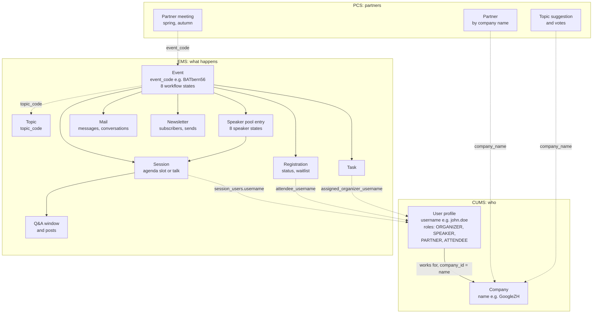

Solid arrows are relationships inside one service (usually foreign keys); dashed arrows cross a
service boundary or use a meaningful identifier without a foreign key (ADR-003). Inside CUMS,
`user_profiles.company_id` holds the company `name` and has no foreign key either.

## Data Models

The concepts below describe what each entity means and which identifiers it exposes. Columns and
relationships are shown in the [Database Schema](#database-schema) diagrams; the API shapes are
defined in `docs/api/*.openapi.yml` ([ADR-006](./ADR-006-openapi-contract-first-code-generation.md)).
The TypeScript interfaces that stood here until 2026-11 described a design that was only partly
built; what was never built is listed under [Not implemented](#not-implemented).

### Company

**Purpose:** one record per company, used for speakers, partners and attendees, with an optional
logo.

**Key attributes** (`companies`, CUMS): `id` (UUID, internal), `name` (public identifier,
pattern `^[a-zA-Z0-9]{1,12}$`, unique), `display_name` (full official name for the UI), `website`,
`industry`, `description`, `logo_url`, `logo_s3_key`, `logo_file_id` (the `upload_id` of the
`logos` row), `is_verified`, `created_by`. The Swiss UID column was dropped in CUMS V22.

**Meaningful IDs (Story 1.16.2):** the database key is a UUID; the API and URLs use `name`
(`/companies/GoogleZH`). The unique constraint on `name` is case-sensitive; the search endpoint
matches case-insensitively (`findByNameContainingIgnoreCase`).

**Relationships:**
- Company to users: `user_profiles.company_id` stores the company `name` (no foreign key). Users
  of a company are found through the user API.
- Company to partner: `partners.company_name` (PCS) stores the company `name`, one partner per
  company (unique).

### Logo upload (ADR-002)

**Purpose:** the generic three-phase upload for company logos and other branding images
([ADR-002](./ADR-002-generic-file-upload-service.md)), table `logos`.

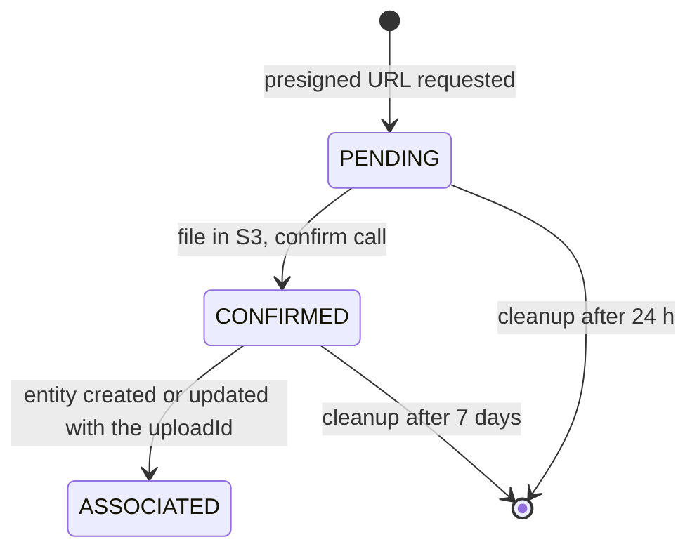

- **Endpoints** (CUMS, `companies-api`): `POST /logos/presigned-url`, `POST /logos/{uploadId}/confirm`,
  plus `upload-from-url` for server-side imports (`fetch-from-url`, which had no caller, was removed
  by Story 17.1).
- **Constraints** (from the migrations): `file_extension` in png, jpg, jpeg, svg; `file_size` up
  to 5 MB.
- **S3 keys:** temporary `logos/temp/{uploadId}/logo-{fileId}.{ext}`; final
  `logos/{year}/{entity-type}/{entity-name}/logo-{fileId}.{ext}` (`GenericLogoService`).
- **Cleanup:** `LogoCleanupService` in CUMS, daily at 02:00, removes PENDING older than 24 hours
  and CONFIRMED older than 7 days.
- **Use:** companies (`associated_entity_type = 'COMPANY'`, checked in `CompanyService`). EMS also
  maps the table (`events.theme_image_upload_id`); which other entity types are written in
  practice (not verified 2026-11-04).
- **Not via `logos`:** user profile pictures use `ProfilePictureService` with keys
  `profile-pictures/{year}/{username}/...` and the columns `user_profiles.profile_picture_url` and
  `profile_picture_s3_key`. Session materials, event photos and teaser images have their own
  tables in EMS.

### User

**Purpose:** one profile per person, whether they log in or only registered for an event
([ADR-007](./ADR-007-unified-user-profile.md)). The profile is the single source of truth for
name, email, bio and photo ([ADR-004](./ADR-004-factor-user-fields-from-domain-entities.md)).

**Key attributes** (`user_profiles`, CUMS): `id` (UUID, internal), `username` (public identifier),
`cognito_user_id` (nullable: NULL means the person has never logged in), `email` (unique, also
unique case-insensitively since V21), `first_name`, `last_name`, `bio`, `company_id` (company
`name`), `profile_picture_url`, `profile_picture_s3_key`, the `pref_*` columns (theme, language,
email / in-app / push notification switches, frequency, quiet hours, Q&A notification frequency
`live`, `daily`, `off`), the `settings_*` columns (profile visibility, show email, show company,
messaging, calendar sync, timezone, two-factor flag), `is_active`, `deactivation_reason`,
`terms_accepted_at`, `picture_import_attempted_at`, `last_login_at`.

Related tables: `role_assignments` (roles per user), `user_additional_emails` (further addresses of
the same person; a trigger pair prevents an address from being both a primary and an additional
address), `activity_history`.

**Usernames (Story 1.16.2):** pattern `^[a-z]+\.[a-z]+(\.[0-9]+)?$` (check constraint);
generated from first and last name by `SlugGenerationService` in the shared kernel, with German
umlauts transliterated (ä to ae, ö to oe, ü to ue) and a numeric suffix `.2`, `.3` on collision.
URLs use the username (`/users/john.doe`).

**Roles:** `role_assignments.role` in ORGANIZER, SPEAKER, PARTNER, ATTENDEE, in any combination.
SPEAKER is a role, not an entity ([ADR-009](./ADR-009-unified-speaker-workflow.md)): there is no
`speakers` table since EMS V94. The speaker's CV is `user_profiles.bio`, the portrait
`profile_picture_url`. The legacy speaker-only attributes (availability, expertise areas, social
links, speaking history and so on) were dropped, not migrated. The role is granted at the
`CONTACTED → READY` speaker transition (see
[06a-workflow-state-machines.md](./06a-workflow-state-machines.md)).

**Business rules (verified):**
- At least two organizers: `RoleService` in CUMS (`MINIMUM_ORGANIZERS = 2`) throws
  `MinimumOrganizersException` when a role change would leave fewer.
- Email uniqueness: unique constraint and a case-insensitive unique index; additional emails are
  unique case-insensitively as well.
- Role changes are organizer-only (`@PreAuthorize`, see
  [ADR-008](./ADR-008-simplified-api-gateway-routing.md)).
- Cognito sync: the Cognito triggers read and write `user_profiles`; see
  [06b-user-lifecycle-sync.md](./06b-user-lifecycle-sync.md).
- Deleting or merging a user: merge is orchestrated by CUMS and logged in EMS `user_merge_log`
  (#1183) and, for the partner rows, PCS `partner_user_merge_log` (V12, Epic 17 sweep). A cascade of user deletion across all services with an audit log (not verified
  2026-11-04).

**Caching:** Caffeine caches `companySearch` and `userSearch` in CUMS, 15-minute TTL
(`CacheConfig`). Cache invalidation on writes (not verified 2026-11-04).

### Partner

**Purpose:** partnership data for companies that sponsor BATbern. Partners are company-centric.

**Key attributes** (`partners`, PCS): `id`, `company_name` (unique, the CUMS company `name`),
`partnership_level` (BRONZE, SILVER, GOLD, PLATINUM, STRATEGIC), `partnership_start_date`,
`partnership_end_date`, `partnership_cost`.

**Contacts:** the `partner_contacts` table was dropped in PCS V6. A partner's contacts are now
derived: every user with the PARTNER role whose `company_id` is the partner's company
(`PartnerContactService`).

**Related:** `partner_notes` (organizer notes), `partner_meetings` with `partner_meeting_rsvps`,
`topic_suggestions` with `topic_votes`, `partner_user_merge_log` (one row per profile merge that
moved a PCS username: source, target, who and how, the moved row ids per column; V12). Partner analytics (attendance of a partner's employees)
are computed on request from EMS registrations; nothing is stored in PCS.

### Event

**Purpose:** one BATbern conference with its agenda, registrations and workflow.

**Key attributes** (`events`, EMS): `id` (UUID, internal), `event_code` (public identifier,
`BATbern{event_number}`, unique), `event_number` (unique), `title`, `description`, `event_date`,
`registration_deadline`, `venue_name`, `venue_address`, `venue_capacity`,
`registration_capacity` (registrations beyond it go to the waitlist), `event_type` (full_day,
afternoon, evening; foreign key to `event_types.type`), `workflow_state`, `topic_code`,
`organizer_username`, `theme_image_url`, `current_published_phase` (none, topic, speakers,
agenda), Q&A settings (`qna_enabled`, `qna_open_trigger`, `qna_window_days`),
`live_timing_version`, full-text vectors and `version` for optimistic locking.

**Workflow states** (check constraint and `EventWorkflowState`):

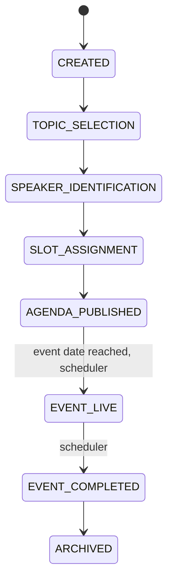

The diagram shows the forward path only; the allowed transitions and their guards are in
[06a-workflow-state-machines.md](./06a-workflow-state-machines.md). The 16-state draft was
consolidated to nine in V30 (logged in `workflow_state_migration_log`) and AGENDA_FINALIZED
removed in V84, which leaves eight. The old `status` column was removed in V17.

**Agenda configuration:** `event_types` holds the template per type (slot count and duration,
break, lunch, moderation and apéro slots and durations, default capacity, typical times).
`event_agenda_config` is a per-event copy created the first time an organizer edits the event
type in slot assignment (Story 15.2); `AgendaConfigResolver` uses the per-event row if present,
otherwise the template. The template is never changed from an event.

**Relationships:** sessions, speaker pool, registrations, tasks, publishing configuration,
newsletter sends, photos and teaser images, thanks, agenda configuration (all foreign keys in
EMS); one topic by `topic_code` (no foreign key); partner meetings in PCS by `event_code`.

### Topic

**Purpose:** the backlog of event topics, with usage history for reuse decisions.

**Key attributes** (`topics`, EMS): `id`, `topic_code` (unique), `title`, `description`,
`category` (technical, management, soft_skills, industry_trends, tools_platforms),
`partner_influence_score`, `similarity_scores` (JSONB), `is_active`, full-text vectors.

**Usage:** an event has at most one topic (`events.topic_code`). `topic_usage_history` records
which topic was used for which event. Staleness is computed at read time by
`StalenessScoreService`; the stored staleness and usage-count columns were removed in V70 and V71.
Topic similarity and clustering use the OpenAI API (`TopicSimilarityService`,
`BatbernTopicClusterService`).

**Not the same as** PCS `topic_suggestions`: those are proposals from partners (source PARTNER)
and attendees (source COMMUNITY) with partner votes, status PROPOSED, SELECTED or DECLINED and an
optional `planned_event`.

### Session

**Purpose:** one item on an event's agenda: a talk, a keynote, a break, lunch, moderation or the
apéro.

**Key attributes** (`sessions`, EMS): `id`, `event_id`, `event_code`, `session_slug` (public
identifier, unique), `title`, `description` (the current abstract), `session_type` (keynote,
presentation, workshop, panel_discussion, networking, break, lunch, moderation; the apéro is
stored as networking since V127), `start_time`, `end_time`, `room`, `capacity`, `language`,
`speaker_pool_id`, materials summary (`materials_count`, `has_presentation`, `materials_status`
NONE or COMPLETE, maintained by a trigger on `session_materials`), live timing
(`actual_start_time`, `actual_end_time`, `overrun_minutes`, `completed_by_username`).

**Speakers of a session:** `session_users` is the junction to users by `username` (ADR-003), with
`speaker_role` (primary_speaker, co_speaker, moderator, panelist), confirmation fields and cached
name columns for search. A username appears at most once per session.

**Content:** the canonical current title and abstract are on `sessions`; every submission is kept
in `session_content_history` (`submission_version`, abstract up to 1000 characters, title up to
200, reviewer feedback). Uploaded files are in `session_materials` (PRESENTATION, DOCUMENT, VIDEO,
OTHER).

### Speaker workflow (ADR-009)

**Purpose:** track each candidate speaker for an event from first idea to reviewed content.

`speaker_pool` holds one row per candidate per event: `speaker_name`, `company`, `expertise`,
`assigned_organizer_id`, `status`, deadlines (`response_deadline`, `content_deadline`),
response fields, preferences (`preferred_time_slot`, travel and technical requirements),
`reminders_disabled`, `source` (organizer_added or self_nomination) and `session_id`.

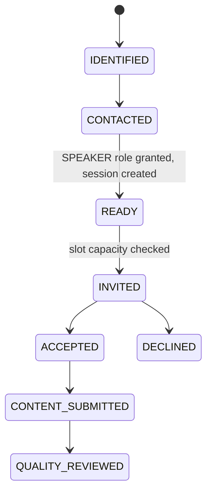

Simplified; the full transition table is in
[06a-workflow-state-machines.md](./06a-workflow-state-machines.md). The pool row carries no
identity of its own: `speaker_pool.username` and `email` were dropped in V103. Identity comes from
the session's `session_users` row (`PrimarySpeakerResolver`), and the content status is derived at
read time by `ContentStatusDeriver` (PENDING, SUBMITTED, REVISION_NEEDED, APPROVED) since the
stored content columns were dropped in V102.

Audit and support tables: `speaker_status_history`, `speaker_outreach_history` (email, phone, in
person, automated and manual email), `speaker_reminder_log` (RESPONSE or CONTENT, tiers 1 to 3),
`speaker_slot_preferences`, `session_proposals` (talk proposals from self-nomination,
[ADR-012](./ADR-012-self-nomination-proposals.md)), `speaker_arrivals` (event-day check-in).

### Registration

**Purpose:** one person's registration for one event.

**Key attributes** (`registrations`, EMS): `id`, `event_id`, `registration_code` (public,
`{eventCode}-reg-{6 random characters}`, unique), `attendee_username` (ADR-003, no foreign key),
cached `attendee_first_name`, `attendee_last_name`, `attendee_email`, `attendee_company_id`,
`status`, `waitlist_position`, `deregistration_token` (unique), `calendar_uid` (unique, for the
calendar invitation), `confirmation_resent_at` and count, `decline_link_sent_at`, `metadata`
(JSONB).

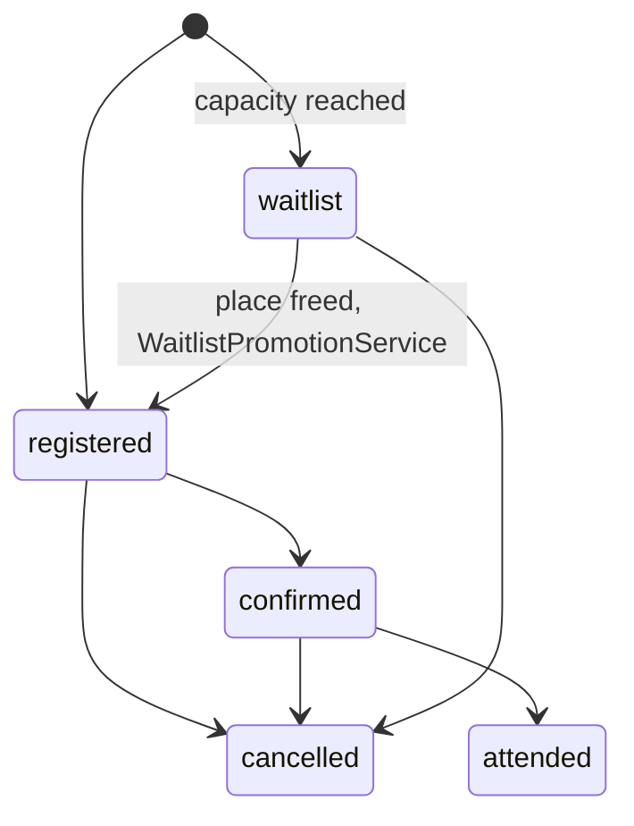

The status values are those of the check constraint; the transitions shown are the intended
lifecycle (not verified 2026-11-04 against every code path). Duplicate registrations for the same
event and user are prevented in code (`existsByEventIdAndAttendeeUsername`), not by a unique
index.

### Registration without an account (ADR-007)

ADR-005 (now a stub) and [ADR-007](./ADR-007-unified-user-profile.md) decided that people can
register without a Cognito account. As built:

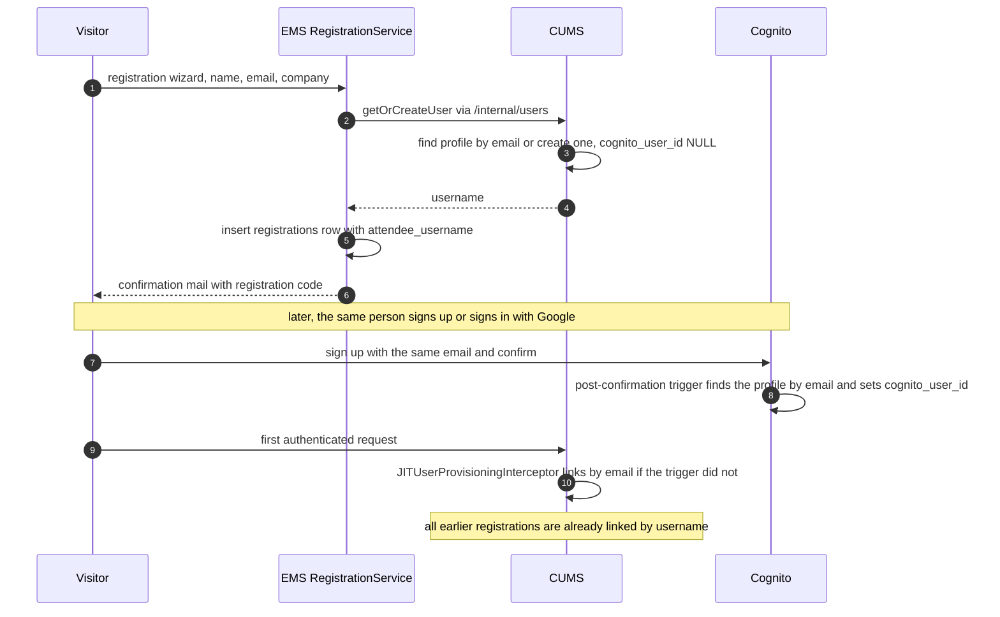

- No data is copied or migrated when the account is created; there is no `claimed_at` column.
- A federated Google sign-in is linked to an existing profile by the pre-signup trigger
  ([ADR-010](./ADR-010-federated-identity-via-cognito.md)).
- Two profiles of the same person can be merged by an organizer or by self-claim (#1183); see
  `user_merge_log`.

### Mail

**Purpose:** a record of every mail the platform sends or receives, the basis of the Mail Center
(Epic 16).

- `mail_message`: one row per mail, `direction` OUT or IN, `audience` (NEWSLETTER, REGISTRANTS,
  SPEAKERS, VENUE, PARTNERS, ORGANIZERS, SYSTEM, PUBLIC), `content_source` (TEMPLATE or
  OWN_TEXT), subject and bodies, threading headers, `inbound_path` (REPLIES or ALIAS),
  attachments as JSONB, `is_spam`, optional `conversation_id` and `newsletter_send_id`.
- `mail_recipient`: one row per address (`kind` TO or CC) with SES message id and delivery status
  (SENT, DELIVERED, FAILED).
- `mail_conversation`: inbound mail grouped by `conversation_key`, with `status` (OPEN, WAITING,
  DONE), `assignee_username` and a unique `reply_token`.
- `mail_automatic_event`: counts automatic mail (out of office, bounce, calendar replies,
  keywords, unsubscribe, loops, spam) without storing content.
- `email_forwarding_log`: one row per inbound S3 object for idempotent alias forwarding, with the
  outcome; no addresses or bodies.
- `email_templates`: templates per `template_key` and `locale` (unique pair), with layouts
  (`is_layout`, `layout_key`) and system flags. They are seeded from the classpath at startup
  (`EmailTemplateSeedService`) and editable by organizers. Email templates exist in `de` and `en`
  only.

PCS records the mail it sends through EMS `/internal/mails`, so partner mail appears in the
Mail Center too.

### Notifications

`notifications` (EMS) holds the delivery audit trail and the in-app notifications for organizers:
`recipient_username`, `event_code`, `notification_type`, `channel` (EMAIL, IN_APP; SMS is named as
future in the column comment), `priority`, `status` (PENDING, SENT, FAILED for mail; UNREAD, READ
for in-app), timestamps and metadata. User notification preferences are columns on
`user_profiles` (`pref_*`), not a table of their own. Details:
[06d-notification-system.md](./06d-notification-system.md).

## Database Schema

The diagrams show the tables that exist after the last migration, with their main columns (not
every column), primary keys (PK), foreign keys (FK) and unique keys (UK). Relationship lines are
foreign keys unless the label says "no FK".

### Cross-service references (ADR-003)

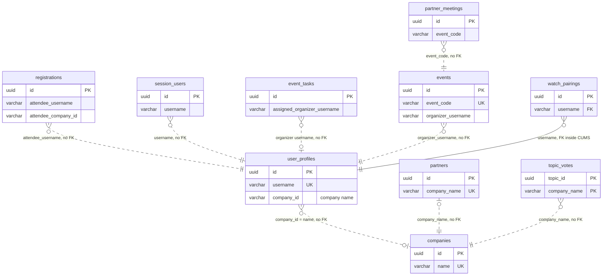

Other username columns that follow the same pattern: `mail_conversation.assignee_username`,
`newsletter_subscribers.username`, `organizer_thanks.thanked_by_username`,
`session_qna_post.posted_by_username`, `speaker_arrivals.speaker_username`,
`partner_notes.author_username`, `live_timing_presence.username`. When a profile merge moves a
person to another username, EMS rewrites these columns and records what moved in
`user_merge_log`.

### Company User Management Service (CUMS)

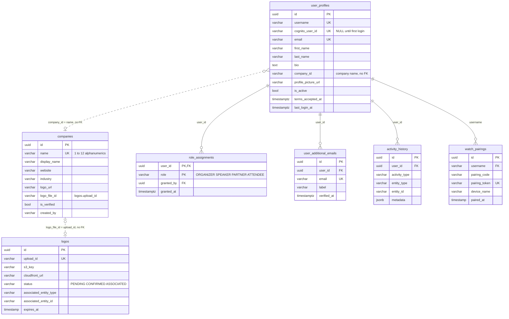

- `role_assignments` has a composite key (user, role); `granted_by` points to the organizer who
  granted it.
- `presentation_settings` (CUMS V14) held the presenter screen settings until Story 4.9: EMS V152
  copied its row into `app_settings` (key `presentation`). It stayed, unread, for one release so an
  old CUMS image could still start (rollback safety); CUMS V29 dropped it (#1280).
- `shedlock` (scheduler locks) is declared by both CUMS (V12) and EMS (V31) with
  `CREATE TABLE IF NOT EXISTS`; `logos` likewise by CUMS (V10) and EMS (V5).

### Partner Coordination Service (PCS)

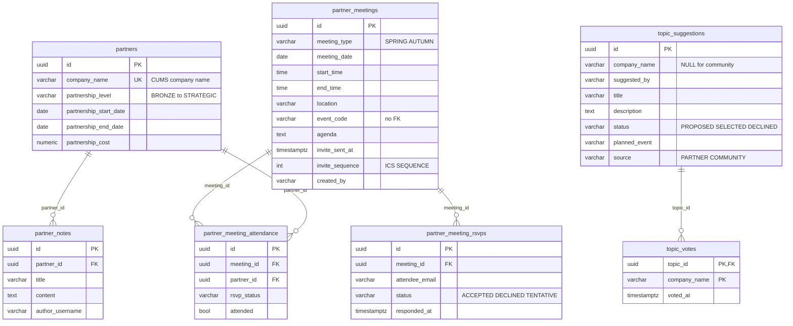

- **Meetings and RSVPs:** invitations are ICS mails; `invite_sequence` increments with every
  re-send so calendar clients update the existing entry. Calendar replies arrive by mail at EMS,
  which hands them at once to the calendar reply contract it owns, `POST /internal/calendar-replies`
  (implemented by PCS, Epic 17 entry 8b; until then `/internal/partner-meetings/rsvps`).
- **`partner_meeting_attendance`** (V2) has no JPA entity in PCS and is touched only by the
  test-fixture cleanup. Treat it as unused.
- **Topics:** `topic_suggestions` and `topic_votes` were recreated in V4 with company names instead
  of partner IDs; `source` (V10) separates partner suggestions from attendee suggestions.

### Event Management Service (EMS)

EMS owns 43 tables, plus `logos` and `shedlock`, which it shares with CUMS. They are grouped by domain below; a table that belongs to two groups is drawn
in full in one and as a key-only stub in the other.

#### Events, agenda and topics

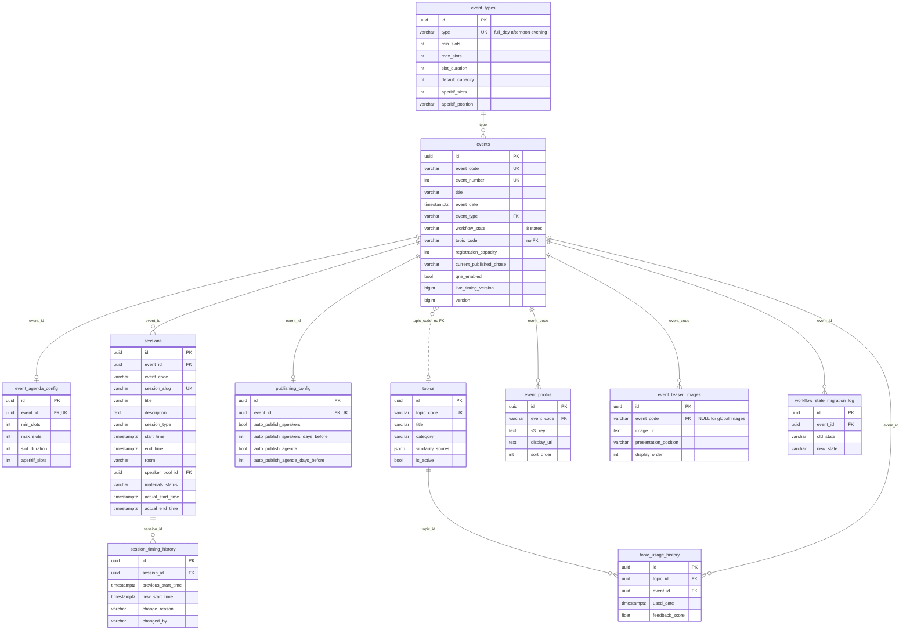

- Nearly every event child table cascades on event delete (`ON DELETE CASCADE`).
- `event_photos` and `event_teaser_images` reference `events.event_code`, not the UUID; teaser
  images with no event code are global and shown at every event (V90). Teaser images are shown
  on the presenter screen at one of four positions (after welcome, committee, topic reveal,
  upcoming events).
- `publishing_config` drives the auto-publishing of speakers and agenda; the column defaults are
  30 days (speakers) and 14 days (agenda) before the event.
- `workflow_state_migration_log` is a one-off audit of the V30 state consolidation; no code reads
  it.

#### Speaker workflow and content

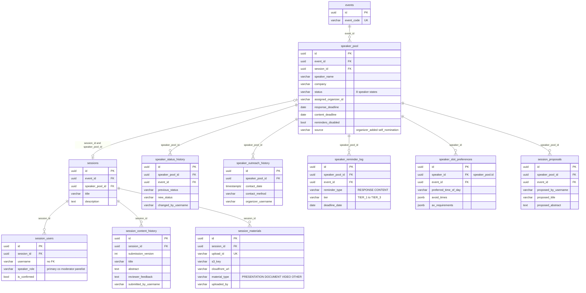

- **Two links between pool and session:** `speaker_pool.session_id` and
  `sessions.speaker_pool_id`, both `ON DELETE SET NULL`. V103 re-synchronised them before dropping
  the pool's identity columns.
- **Who the speaker is** is answered only by `session_users.username` of the primary speaker; the
  pool keeps a display name and company for brainstorming before a session exists.
- `session_content_history` numbers submissions per session with `submission_version`; the
  database has no unique constraint on `(session_id, submission_version)`, so uniqueness is up to
  the code. It was created in V53 as `speaker_content_submissions` and renamed in V99.
- `session_materials` changes keep `sessions.materials_count`, `has_presentation` and
  `materials_status` up to date through the trigger `update_session_materials_summary`.
- Dropped along the way: `speakers` (V37 to V94), `speaker_invitation_tokens` (magic-link tokens,
  V43 to V104).

#### Registrations and attendee contributions

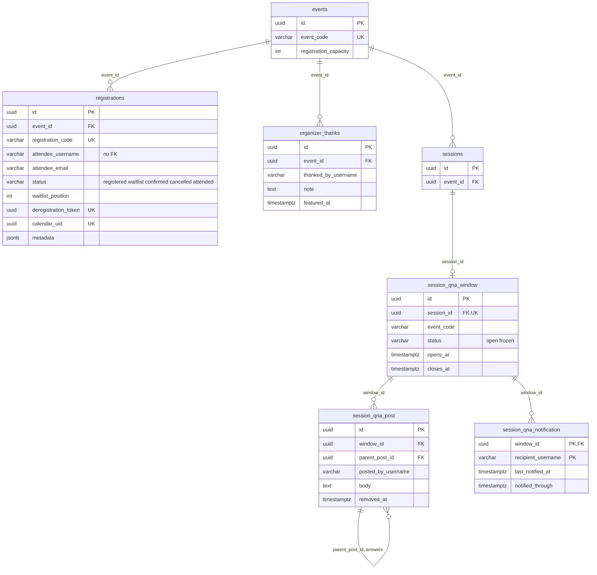

- **Waitlist:** when `registration_capacity` is reached, new registrations get status `waitlist`
  and a `waitlist_position`; `WaitlistPromotionService` promotes them when places free up or the
  capacity is raised.
- **Deregistration** works by the `deregistration_token` link or by email verification, without
  login.
- **Q&A (Story 7.5, 15.7):** one window per session, opened by `events.qna_open_trigger`
  (EVENT_COMPLETED or SPEAKERS_PUBLISHED) for `qna_window_days`; answers are posts with a
  parent. `session_qna_notification` keeps per-recipient digest state for the `live` and `daily`
  notification preferences.
- **Thanks (Story 7.4):** one note per user per event (partial unique index); organizers can
  feature notes on the public site (`featured_at`).
- **Self-nomination (Story 7.2)** writes `session_proposals` and a `speaker_pool` row with
  `source = 'self_nomination'` (see the speaker workflow diagram).
- **Topics from the floor** are stored in PCS `topic_suggestions` with `source = 'COMMUNITY'`.

#### Tasks and notifications

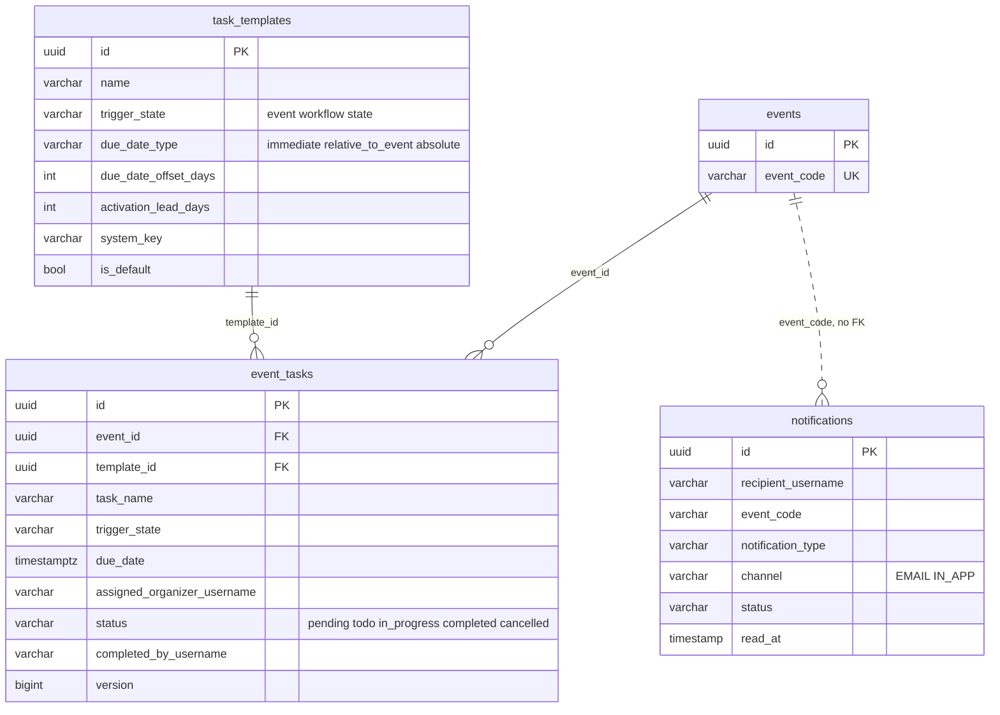

- Tasks are activated (`pending` to `todo`) when the event reaches the template's
  `trigger_state` (edge-triggered by `EventWorkflowTransitionEvent`) or when the due date is
  within `activation_lead_days`; `TaskActivationScheduler` re-checks daily at 05:30 as a safety
  net. `TaskDeadlineReminderScheduler` sends deadline reminders. `system_key` marks templates that code
  relies on (for example the slides-online task, V110 and V125).

#### Mail Center, forwarding and templates

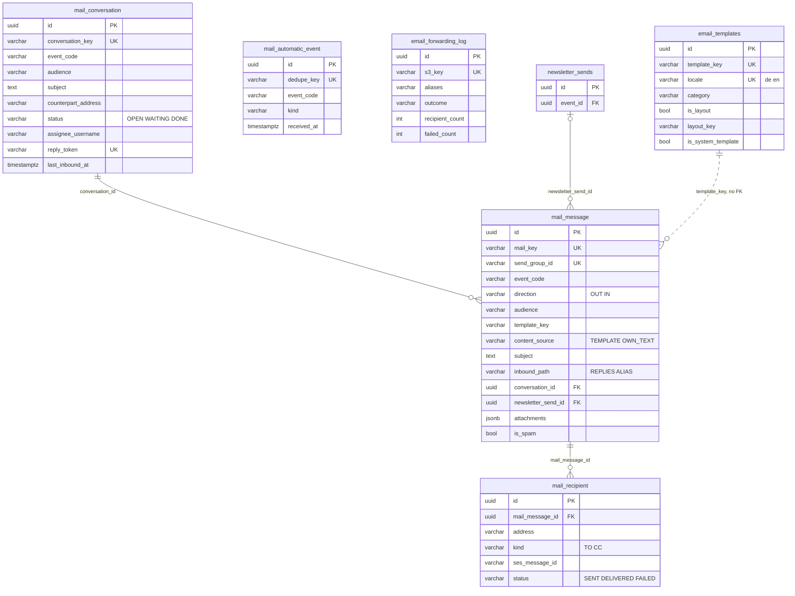

- **Outbound:** sends are recorded as `mail_message` rows with their recipients
  (`JpaOutboundMailRecorder`; whether every send path records (not verified 2026-11-04));
  SES delivery events from the `mail-delivery-status` queue update `mail_recipient.status`.
- **Inbound:** replies to `replies@` and mail to the event aliases are stored as `direction = 'IN'`
  messages and threaded into `mail_conversation` (`ConversationThreader`). Out-of-office, bounces,
  loops and calendar replies are counted in `mail_automatic_event` instead of being stored.
- **Forwarding:** `email_forwarding_log` makes alias forwarding idempotent per S3 object; its
  `outcome` is one of processing, forwarded, partial, rejected, unresolved, failed, stalled,
  notified (the Mail Center switch replaced forwarding) and dropped_auto_reply, dropped_bounce,
  dropped_loop, dropped_malformed, dropped_spam, dropped_virus.
- **Retention:** `MailMessageRetentionScheduler` and `EmailForwardingLogRetentionScheduler` delete
  old rows; the retention periods are in [06d-notification-system.md](./06d-notification-system.md)
  (not verified 2026-11-04).

#### Newsletter

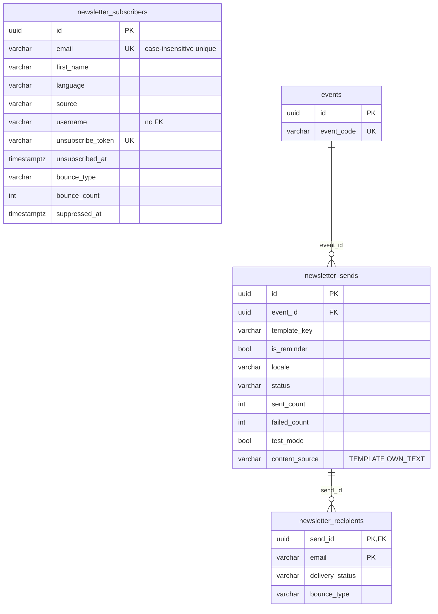

- Subscribers are not linked by foreign key to anything; `username` is set when the subscriber is
  also a user. Bounces from the `bounce-processing` queue raise `bounce_count` and can suppress an
  address (`BounceProcessingService`).
- Newsletter sends can use a template or the organizer's own text (V138) and are also recorded in
  `mail_message` (`newsletter_send_id`).

#### AI assist

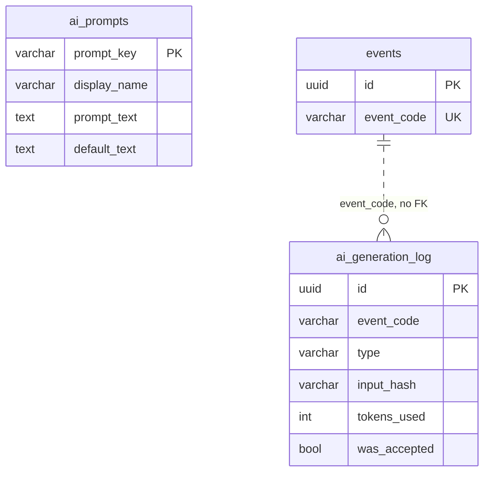

Prompts are organizer-editable with a stored default to reset to; every call to OpenAI is logged
with its token count. See [09-aiml-architecture.md](./09-aiml-architecture.md).

#### Live timing and Watch

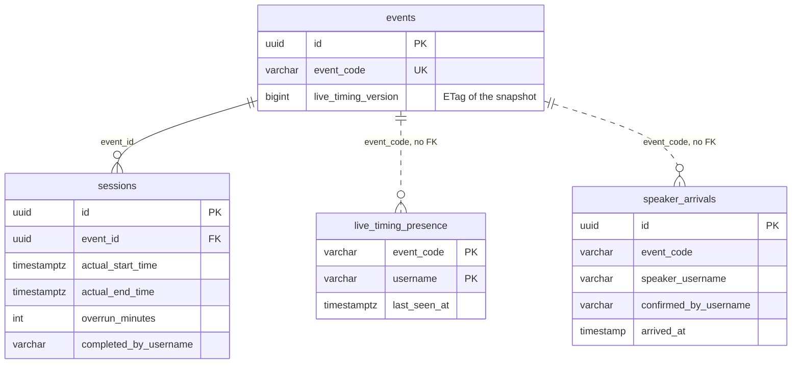

- Live timing (Story 15.1) is a polled snapshot: every organizer action on the session clock bumps
  `events.live_timing_version`, which the endpoint returns as ETag so clients get `304` while
  nothing changed. `live_timing_presence` shows which organizers are currently controlling the
  event.
- Watch pairing is in CUMS (`watch_pairings`); everything the paired Watch reads or writes is here.

#### Administration and operations

| Table | Purpose |
|---|---|
| `app_settings` | Key-value settings edited in Administration, the one store for application settings (`AdminSettingsService`, `/admin/settings/{key}`): for example the forwarding recipients, `mailcenter.notify-instead-of-forward`, `venue.coordination.config` (JSON) and `presentation` (JSON `{aboutText, partnerCount}` for the presenter screen, validated on write, read anonymously at `/public/settings/presentation`; moved from CUMS by V152, Story 4.9) |
| `user_merge_log` | One row per profile merge: source and target username, who and how (ORGANIZER or SELF_CLAIM), what moved and what was removed (JSONB), a snapshot of the source profile |
| `shedlock` | Scheduler locks so that only one task runs each scheduled job |
| `logos` | Shared with CUMS, see above |

### Speaker and attendee data

Per [ADR-009](./ADR-009-unified-speaker-workflow.md) and
[ADR-014](./ADR-014-backend-service-consolidation.md), everything speaker-related is in EMS
(see the speaker workflow diagram). Registrations, the attendee dashboard and the archive are in
EMS; attendee topic suggestions are in PCS. The former speaker stub service (removed by Story
17.2, 2026-11) applied only the shared-kernel baseline; its history table
`flyway_schema_history_speaker_coordination` stays in the database, deliberately untouched.

### Business Rule Enforcement

Most rules are enforced in application code. The database enforces:

- **Check constraints** on every status and type column shown in the diagrams (workflow states,
  speaker states, registration status, session types, mail enums and so on), plus value ranges
  (slot counts, durations, abstract length up to 1000 characters, title up to 200, logo size up to
  5 MB, `qna_window_days` 1 to 365) and the username and company name patterns.
- **Unique keys** on all public identifiers (`event_code`, `session_slug`, `registration_code`,
  `topic_code`, `username`, company `name`, partner `company_name`) and case-insensitive unique
  emails for users, additional emails and newsletter subscribers.
- **Triggers:** `updated_at` maintenance (18 tables), the session materials summary, the
  `session_content_history` timestamp, and the two triggers that keep a user's primary and
  additional email addresses disjoint.

In code: the minimum of two organizers (`RoleService`), one registration per user and event
(`RegistrationService`), slot capacity at speaker invitation (`SpeakerWorkflowService`), and
authorization (`@PreAuthorize`).

**See also:** [06d-notification-system.md](./06d-notification-system.md) and
[Story 1.15a.10: Notifications API Consolidation](../stories/archived/epic-1/1.15a.10.notifications-api-consolidation.md).

## Data Consistency and Cross-Service Communication

### Domain Events

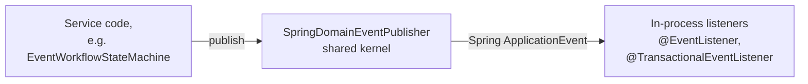

The shared kernel defines `DomainEvent<T>` with `eventId`, `aggregateId`, `eventType`, `userId`,
`occurredAt`, `version`, `metadata`, `correlationId` and `causationId`. There are 29 event classes,
for example `EventWorkflowTransitionEvent`, `SpeakerAcceptedEvent`, `SessionTimingAssignedEvent`,
`RegistrationCreatedEvent`, `CompanyCreatedEvent`, `UserUpdatedEvent`, `PartnerCreatedEvent`.

Events stay in the process that raised them; there is no message bus (the unused EventBridge bus
was removed in Story 17.2 part B, 2026-11). All listeners are in EMS (for example
`EventWorkflowTransitionListener`, `SpeakerAcceptedEventListener`, `SessionQnaWindowListener`,
`OrganizerNotificationListener`). No service consumes another service's events.

### Data Synchronization Strategy

As built, cross-service data is read, not replicated:

1. **Synchronous reads through the owning service.** EMS asks CUMS for users and companies
   (`UserApiClient`, mostly through VPC-only `/internal/users`), PCS asks CUMS and EMS, CUMS asks
   EMS during a profile merge. No service reads another service's tables.
2. **Meaningful identifiers as references** (ADR-003): a username, event code or company name is
   stored, never a foreign key into another service's table.
3. **Small denormalised caches where reads would otherwise fan out:** attendee name, email and
   company on `registrations`; speaker names on `session_users` (for full-text search). They are
   refreshed on write and by backfills (for example `SpeakerNameBackfillRunner`, run with the
   `backfill-speakers` profile; the admin endpoint for it was removed by Story 17.1);
   how stale they can become (not verified 2026-11-04).
4. **Profile merges** rewrite usernames across EMS in one transaction on the EMS side and log the
   result in `user_merge_log`.

## Table Inventory

A compact list of every table and the migration that created it, for finding your way. It was
derived by scanning every migration for `CREATE TABLE`, `DROP TABLE` and `ALTER TABLE ... RENAME
TO` and cross-checked against the applied schema on 2026-11-04.

| Service | Migrations | Flyway history table |
|---|---|---|
| event-management-service | V1 to V144 | `flyway_schema_history_event_management` |
| company-user-management-service | V1 to V22 | `flyway_schema_history_company_user_management` |
| partner-coordination-service | V1 to V10 | `flyway_schema_history_partner_coordination` |
| (former speaker stub, removed by Story 17.2) | shared-kernel baseline only | `flyway_schema_history_speaker_coordination`, kept |

**EMS** (43 tables plus the shared `logos` and `shedlock`): `events` V2, `sessions` V2, `registrations` V2, `logos` V5 (shared with
CUMS), `session_users` V7, `event_types` V10, `topics` V14, `topic_usage_history` V14,
`speaker_pool` V14, `speaker_outreach_history` V16, `task_templates` V22, `event_tasks` V22,
`speaker_status_history` V23, `session_timing_history` V28, `speaker_slot_preferences` V28,
`publishing_config` V28, `workflow_state_migration_log` V30, `shedlock` V31 (shared with CUMS),
`notifications` V33, `session_materials` V41, `session_content_history` V53 (as
`speaker_content_submissions`, renamed V99), `speaker_reminder_log` V54, `speaker_arrivals` V55,
`email_templates` V62, `newsletter_subscribers` V67, `newsletter_sends` V67,
`newsletter_recipients` V67, `ai_generation_log` V77, `event_photos` V79, `event_teaser_images`
V80, `ai_prompts` V82, `app_settings` V88, `session_proposals` V109, `organizer_thanks` V111,
`session_qna_window` V112, `session_qna_post` V112, `session_qna_notification` V117,
`live_timing_presence` V119, `event_agenda_config` V121, `email_forwarding_log` V128,
`mail_message` V135, `mail_recipient` V135, `mail_conversation` V139, `mail_automatic_event`
V139, `user_merge_log` V144.

Dropped: `publishing_versions` (V28 to V89), `speakers` (V37 to V94), `speaker_invitation_tokens`
(V43 to V104); in CUMS `presentation_settings` (V14 to V29), copied into `app_settings` by EMS V152
(Story 4.9) and dropped one release later (rollback safety).

**CUMS** (8 tables): `companies` V3, `user_profiles` V4, `role_assignments` V5,
`activity_history` V6, `logos` V10, `shedlock` V12, `watch_pairings` V13,
`user_additional_emails` V16, `company_key_changes` V28 (shared: CUMS
V28, EMS V150 and PCS V11 create it with the same canonical block, see below).

**Company keys** (owner decision 2026-11-09): `companies.name`, the company's meaningful ID, is
`^[a-zA-Z0-9]{1,12}$`, the slug that `SlugGenerationService.generateCompanyName` makes from the typed
name (`POST /companies` and get-or-create), made unique by `ensureUniqueCompanyName` (a digit appended
within 12 characters). Keys stored before that rule were re-keyed by CUMS V28, EMS V150 and PCS V11:
each contains shared-kernel `db/company/company_key_changes.sql` byte for byte
(`CompanyKeyChangesContract`), which records old key → new key once in `company_key_changes` from
`companies` (whichever service migrates first, under an advisory lock); each service then rewrites
only its own references: CUMS `companies`, `logos` (COMPANY rows), `company_logo_requests`,
`activity_history` (COMPANY rows), `user_profiles.company_id`; EMS `registrations.attendee_company_id`;
PCS `partners`, `topic_suggestions`, `topic_votes`. The table stays as the audit of what changed.

**PCS** (7 tables): `partners` V2, `partner_meetings` V2, `partner_meeting_attendance` V2 (no
entity, unused), `topic_suggestions` V4 (V2 version dropped and recreated), `topic_votes` V4 (same),
`partner_notes` V7, `partner_meeting_rsvps` V9. Dropped: `partner_contacts` (V2 to V6).

## Not implemented

Described in earlier versions of this document; none of it exists in the migrations or the code.

- `content_metadata`, `presentation_files`, `supplementary_materials` tables (files are in
  `session_materials`, `event_photos`, `event_teaser_images` and `logos`).
- Storage quotas per user (`storage_quota`, `storage_usage_log`) and the quota triggers.
- Download counters on session files.
- Virus scanning status on uploads.
- Event slots as entities (`EventSlot`); slots are computed from the agenda configuration and
  sessions.
- Overflow management with organizer voting (`OverflowManagement`, `SpeakerSelectionVote`).
- A separate quality-review model (`ContentQualityReview`, `AbstractReview`, `MaterialReview`,
  bio and photo review); review is `session_content_history.reviewer_feedback` plus the
  QUALITY_REVIEWED speaker state.
- An `Attendee` entity, attendee engagement tracking, content preferences and GDPR consent
  records with IP address; an attendee is a user with registrations.
- Anonymous registration columns on `registrations` (`anonymous_email` and so on), `claimed_by`
  and `claimed_at`; linking works through `user_profiles.cognito_user_id`.
- Confirmation codes in the format `BAT-YYYY-NNNNNN`.
- Session tags, prerequisites, target audience and attendee ratings.
- Partner analytics stored as entities (`PartnerAnalytics`, ROI and brand exposure metrics).
- Partner contact roles (primary, billing, technical, marketing).
- A notification preferences table, escalation rules with backup organizers, and a notification
  log with SES message IDs separate from `notifications` and `mail_recipient`.
- Versioned email templates with an `is_active` flag and a plain-text body.
- Cross-service sagas and services keeping local copies of other domains' data.
- An event-to-topic many-to-many relationship.
