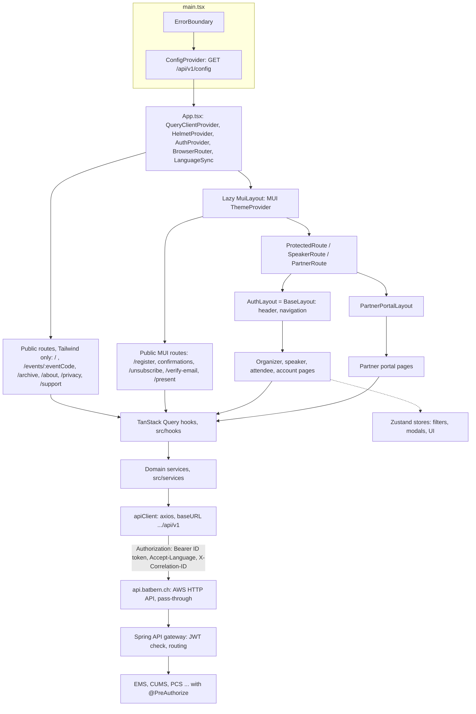
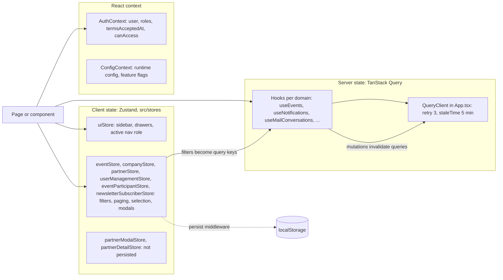
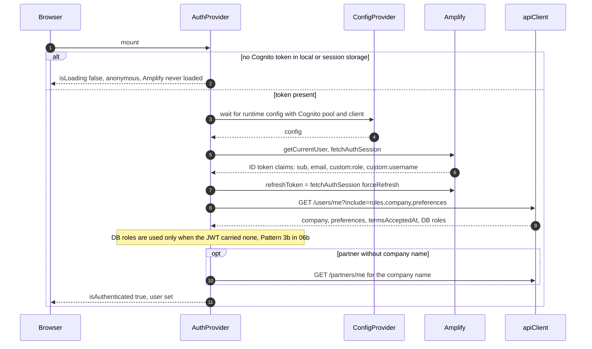
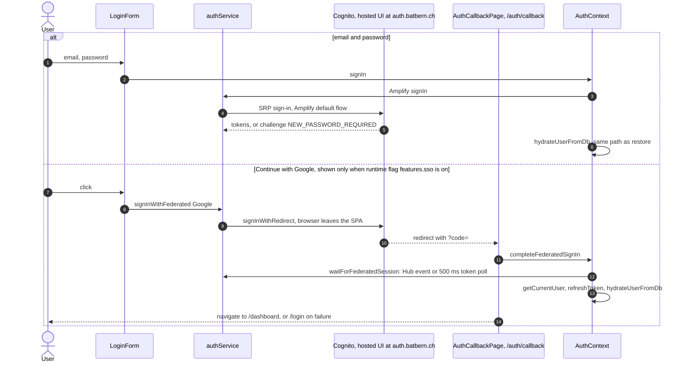
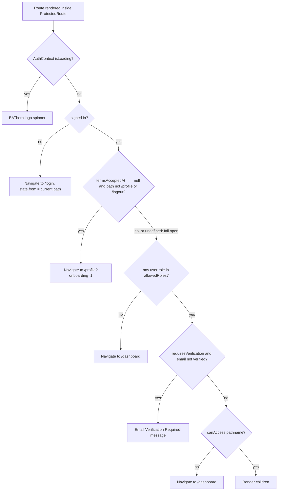
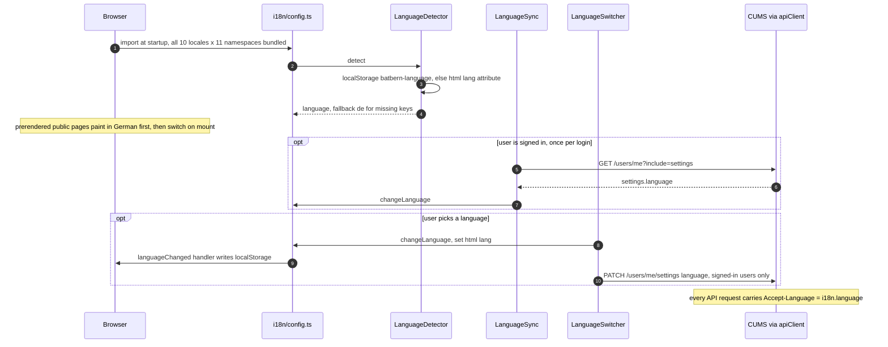
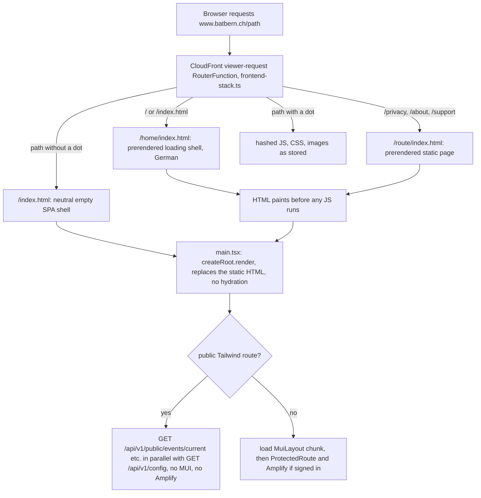

# Frontend Architecture

## Component Organization

Top-level layout of `web-frontend/src/` (develop c4593449). Components are grouped partly by role
and partly by feature; the tree below lists folders only, not individual files.

```
web-frontend/src/
├── App.tsx                        # Route table (see Routing Architecture)
├── main.tsx                       # Bootstrap (see Bootstrap & Prerendering)
├── components/
│   ├── auth/                      # Login, registration wizard, password reset, ProtectedRoute, AuthCallbackPage
│   ├── shared/                    # Layout, Navigation, Breadcrumbs, Company, Event, Session, FileUpload,
│   │                              # LanguageSwitcher, LanguageSync, Notifications, OrganizerSelect, ErrorBoundary, ...
│   ├── organizer/                 # Admin, Analytics, EventManagement, EventPage, EventTypeConfigurationForm,
│   │                              # EventTypeSelector, LiveControl, MailCenter, NewsletterSubscribers,
│   │                              # PartnerManagement, SlotTemplatePreview, SpeakerDrawer, SpeakerOutreach,
│   │                              # SpeakerStatus, Tasks, UserManagement
│   ├── partner/                   # Partner portal layout, attendance dashboard, topic suggestions
│   ├── attendee/                  # Community topic suggestion, speaker self-nomination panels
│   ├── speaker-portal/            # Presentation and profile photo upload
│   ├── public/                    # Public website: Hero, Navigation, Footer, Event, EventPhotos, Partners,
│   │                              # Registration, Testimonials, About, ui
│   ├── user/                      # Account page tabs: profile, settings, earlier profiles
│   ├── Publishing/                # LivePreview, PublishingControls, PublishingTimeline, ValidationDashboard
│   ├── SlotAssignment/            # Drag-and-drop slot assignment, conflict detection, preferences
│   ├── SpeakerBrainstormingPanel/
│   ├── TopicBacklogManager/
│   ├── TopicHeatMap/
│   ├── BlobTopicSelector/
│   └── SEO/                       # EventSchema, OpenGraphTags
├── pages/                         # Route-level pages (organizer/, public/, speaker-portal/, attendee/,
│                                  # presentation/, profile/, UserAccountPage/, LiveControlPage/, dev/, ...)
├── features/profile/              # Apple Watch pairing section
├── contexts/                      # AuthContext, ConfigContext, feature/environment hooks
├── hooks/                         # Custom React hooks (TanStack Query wrappers per domain)
├── services/                      # API client services (one per domain, plus services/api/)
├── stores/                        # Zustand stores
├── i18n/                          # i18next config and locale parity test
├── types/                         # Hand-written types; types/generated/ holds the OpenAPI-generated types
├── schemas/                       # Validation schemas
├── utils/  lib/  theme/  styles/  config/  data/  pwa/  mocks/  test/
```

## How the SPA Fits Together

One build serves every audience: the public website, the organizer app, the speaker portal and
the partner portal. A request from a page always takes the same way down: page, TanStack Query
hook, domain service, the shared axios `apiClient`, then the backend. Checked against
`src/main.tsx`, `src/App.tsx`, `src/MuiLayout.tsx`, `ProtectedRoute.tsx` and
`services/api/apiClient.ts` (develop c4593449).



The guards are UX only; the services decide (ADR-008, see
[Backend Architecture](./06-backend-architecture.md)). The public routes sit outside the MUI
boundary so the homepage never downloads `@mui/material`.

## Type Safety & API Contract

### OpenAPI Type Generation

**Library**: `openapi-typescript` ^7.13.0 (`web-frontend/package.json`, develop c4593449)

**Rationale**: Ensures frontend types stay synchronized with backend OpenAPI specifications, preventing type drift and runtime errors. Generated types serve as the single source of truth derived from API contracts.

**Workflow**:

1. **OpenAPI Spec** (single source of truth):
   - Located at: `/docs/api/*.openapi.yml` (companies is the reference example below)
   - Maintained by backend team
   - Versioned in Git

2. **Type Generation**:
   ```bash
   npm run generate:api-types
   ```
   - Runs one sub-script per API (companies, users, events, speakers, topics, partners,
     partner-meetings) and writes `src/types/generated/*.types.ts`, for example
     `company-api.types.ts`
   - Types are **committed to repository**

3. **Git Hook Integration** (`.githooks/pre-commit`, not Husky):
   - Triggers when `docs/api/`, `web-frontend/package(-lock).json` or
     `web-frontend/src/types/generated/` is staged
   - Runs `npm run check:api-types`: regenerates the types and fails the commit if they differ
     from what is committed, leaving the corrected files in the working tree (not auto-staged)

4. **CI/CD Validation** (GitHub Actions, `build.yml`):
   - Runs `npm run generate:api-types` and verifies the committed types match the OpenAPI spec
   - Fails build if types are out of date
   - Provides clear instructions for fixing drift

**Usage in Frontend**:

```typescript
// src/types/company.types.ts
import type { components } from './generated/company-api.types';

// Derive application types from OpenAPI-generated types
export type Company = components['schemas']['CompanyResponse'];
export type CompanyStatistics = components['schemas']['CompanyStatistics'];
export type CreateCompanyRequest = components['schemas']['CreateCompanyRequest'];
export type UpdateCompanyRequest = components['schemas']['UpdateCompanyRequest'];
export type PaginatedCompanyResponse = components['schemas']['PaginatedCompanyResponse'];

// Frontend-specific types (not in OpenAPI)
export interface CompanyFilters {
  isVerified?: boolean;
  industry?: string;
}
```

**Benefits**:
- ✅ Compile-time type safety between frontend and backend
- ✅ Automatic type updates when API changes
- ✅ Prevents field name mismatches and data model drift
- ✅ IDE autocomplete for all API response fields
- ✅ CI validation prevents merging unsynchronized types

## HTTP Client Configuration

### API Base URL Pattern

**CRITICAL**: The runtime config sets `apiBaseURL` to include the `/api/v1` prefix (e.g., `http://localhost:8000/api/v1` in native dev, where `VITE_API_PORT` defaults to 8000; docker-compose maps the gateway to 8080; `https://api.batbern.ch/api/v1` in production).
All API service paths must **exclude** the `/api/v1` prefix to avoid double concatenation errors.

> Note: the base URL is now also seeded **synchronously at bootstrap** from
> `getDefaultApiBaseUrl()` (hostname-derived, identical to the runtime-config value), so
> public requests can fire before `/api/v1/config` resolves. `updateApiClientConfig()` still
> applies the authoritative value on config load. See "Bootstrap & Prerendering (SSG)" below.

**Why This Matters**:
- Runtime config (from backend `/api/v1/config`): `apiBaseUrl: "http://localhost:8000/api/v1"`
- If frontend code uses `/api/v1/users`, result is: `http://localhost:8000/api/v1/api/v1/users` ❌
- This causes 404/500 errors that are difficult to debug

**Correct Pattern** (Reference Implementation: `src/services/api/companyApi.ts`):

```typescript
// src/services/api/userManagementApi.ts

// Define API path constants WITHOUT /api/v1 prefix
// Note: apiClient baseURL is set from runtime config to 'http://localhost:8000/api/v1'
// so we only need '/users' (the /api/v1 prefix is already in the baseURL)
const USER_API_PATH = '/users';

export const listUsers = async (filters: UserFilters, pagination: UserPagination) => {
  const response = await apiClient.get(USER_API_PATH, { params });
  // ✅ Resolves to: http://localhost:8000/api/v1/users
  return response.data;
};

export const searchUsers = async (query: string) => {
  const response = await apiClient.get(`${USER_API_PATH}/search`, { params });
  // ✅ Resolves to: http://localhost:8000/api/v1/users/search
  return response.data;
};

export const getUserById = async (id: string) => {
  const response = await apiClient.get(`${USER_API_PATH}/${id}`, { params });
  // ✅ Resolves to: http://localhost:8000/api/v1/users/{id}
  return response.data;
};
```

**Incorrect Pattern** (DO NOT DO THIS):

```typescript
// ❌ WRONG - Includes /api/v1 prefix, causing double concatenation
const response = await apiClient.get('/api/v1/users');
// Result: http://localhost:8000/api/v1/api/v1/users ❌ 500 ERROR

// ❌ WRONG - Direct path string without constant
const response = await apiClient.post('/api/v1/users', data);
// Result: http://localhost:8000/api/v1/api/v1/users ❌ 500 ERROR
```

**Standard Path Constants**:

```typescript
// Use these standard constants across all API services:
const USER_API_PATH = '/users';
const COMPANY_API_PATH = '/companies';
const EVENT_API_PATH = '/events';
const SPEAKER_API_PATH = '/speakers';
const PARTNER_API_PATH = '/partners';
const ATTENDEE_API_PATH = '/attendees';
```

**Testing Your API Paths**:

When writing tests with `MockAdapter`, use the same path constants (WITHOUT `/api/v1`):

```typescript
// ✅ CORRECT - Test mocks match implementation
import MockAdapter from 'axios-mock-adapter';
import apiClient from './apiClient';

const mock = new MockAdapter(apiClient);
mock.onGet('/users').reply(200, mockResponse);  // ✅ Matches USER_API_PATH
mock.onPost('/users').reply(201, mockResponse);  // ✅ Matches USER_API_PATH
```

## State Management Architecture

### State Structure

State lives in three places, each with one job. Server data is never copied into a Zustand
store; a store holds only what the user chose (filters, paging, which modal is open).



The persisted stores use Zustand's `persist` middleware with the localStorage keys
`event-store`, `company-store`, `partner-store`, `user-management-store`,
`event-participant-store` and `newsletter-subscriber-store`. `uiStore` writes its few values to
localStorage by hand (`batbern-ui-locale`, `batbern-ui-sidebar`, ...).

> **Not built:** the 2025 design sketched a single `AppState` tree holding auth, UI and domain
> lists (`events.eventList`, `speakers.invitations`, `attendees.bookmarks`, ...) in one store.
> The code never had that tree: domain data comes from TanStack Query, auth from `AuthContext`,
> and there is no `authStore` and no bookmark feature.

## Detailed Component Specifications

> **Status of this section (2026-11-04):** the component code below is the 2025 design sketch.
> It shows intended responsibilities and props, not the implementation, and was not re-verified
> line by line (not verified 2026-11-04). Known differences: `BaseLayout` takes `children` and
> optional `maxWidth`, `user`, `notifications` (no `currentRole`), and `App.tsx` passes only
> `children`; there is no `authStore`; the real component
> folders are listed under [Component Organization](#component-organization). Treat names and
> props here as orientation and check the source before relying on them.

### Shared Component Architecture

**Layout Components:**
```typescript
// BaseLayout Component
interface BaseLayoutProps {
  children: React.ReactNode;
  currentRole: UserRole;
  user: User;
  notifications: Notification[];
}

const BaseLayout: React.FC<BaseLayoutProps> = ({
  children,
  currentRole,
  user,
  notifications
}) => {
  return (
    <Box sx={{ display: 'flex', minHeight: '100vh' }}>
      <AppHeader
        user={user}
        currentRole={currentRole}
        notifications={notifications}
      />
      <Sidebar currentRole={currentRole} />
      <MainContent>{children}</MainContent>
    </Box>
  );
};

// Navigation Component Specifications
interface NavigationItem {
  id: string;
  label: string;
  icon: React.ComponentType;
  path: string;
  roles: UserRole[];
  children?: NavigationItem[];
}

const navigationConfig: Record<UserRole, NavigationItem[]> = {
  [UserRole.ORGANIZER]: [
    {
      id: 'dashboard',
      label: 'Dashboard',
      icon: DashboardIcon,
      path: '/organizer/dashboard',
      roles: [UserRole.ORGANIZER]
    },
    {
      id: 'events',
      label: 'Event Management',
      icon: EventIcon,
      path: '/organizer/events',
      roles: [UserRole.ORGANIZER],
      children: [
        { id: 'create', label: 'Create Event', icon: AddIcon, path: '/organizer/events/create', roles: [UserRole.ORGANIZER] },
        { id: 'timeline', label: 'Event Timeline', icon: TimelineIcon, path: '/organizer/events/timeline', roles: [UserRole.ORGANIZER] }
      ]
    }
  ],
  // Additional role configurations...
};
```

**Form Components:**
```typescript
// Reusable Form Components with Validation
interface FormFieldProps<T> {
  name: keyof T;
  label: string;
  required?: boolean;
  validation?: (value: any) => string | undefined;
  disabled?: boolean;
}

// AutoComplete Company Selector (AC2 - Search & Autocomplete)
interface CompanySelectorProps {
  value: Company | null;
  onChange: (company: Company | null) => void;
  allowCreate?: boolean;
}

const CompanySelector: React.FC<CompanySelectorProps> = ({
  value,
  onChange,
  allowCreate = false,
}) => {
  const { data: companies, isLoading } = useCompanySearch(searchQuery, 10);

  return (
    <Autocomplete
      options={companies || []}
      value={value}
      onChange={(_, newValue) => onChange(newValue)}
      getOptionLabel={(option) => option.displayName || option.name}
      renderInput={(params) => (
        <TextField {...params} label="Company" />
      )}
      loading={isLoading}
      freeSolo={allowCreate}
      onInputChange={async (_, inputValue) => {
        // Search triggered with 3+ characters (AC2 requirement)
        if (inputValue.length >= 3) {
          setSearchQuery(inputValue);
        }
      }}
      renderOption={(props, option) => (
        <Box component="li" {...props}>
          <Box>
            <Typography variant="body1">
              {option.displayName || option.name}
              {option.isVerified && ' ✅'}
            </Typography>
            {option.industry && (
              <Typography variant="caption" color="text.secondary">
                {option.industry}
              </Typography>
            )}
          </Box>
        </Box>
      )}
    />
  );
};
```

### Data Visualization Components

**Library:** Recharts 2.10+

**Rationale:** React-native charting library that integrates seamlessly with Material-UI and TypeScript, providing declarative chart components with minimal configuration.

**Usage:**
- Topic usage heat maps
- Historical usage timelines
- Partner engagement analytics
- Event attendance trends

**Key Components:**

```typescript
import {
  HeatMap,
  BarChart,
  LineChart,
  Tooltip,
  ResponsiveContainer
} from 'recharts';

// Topic Usage Heat Map Component
interface TopicHeatMapProps {
  topics: Topic[];
  usageHistory: TopicUsageRecord[];
  timeRange: '12months' | '24months';
}

const TopicUsageHeatMap: React.FC<TopicHeatMapProps> = ({
  topics,
  usageHistory,
  timeRange
}) => {
  const heatMapData = useMemo(() =>
    calculateHeatMapData(topics, usageHistory, timeRange),
    [topics, usageHistory, timeRange]
  );

  return (
    <ResponsiveContainer width="100%" height={400}>
      <HeatMap
        data={heatMapData}
        margin={{ top: 20, right: 30, left: 20, bottom: 5 }}
      >
        <Tooltip content={<TopicTooltip />} />
      </HeatMap>
    </ResponsiveContainer>
  );
};
```

**Performance Requirements:**
- Heat map rendering: <500ms for 100+ topics
- Interactive updates: <100ms response time
- Lazy loading for historical data beyond 24 months

### Role-Specific Component Specifications

**Enhanced Organizer Workflow Components:**

```typescript
// Enhanced Event Workflow Dashboard
interface EventWorkflowDashboardProps {
  event: Event;
  workflowState: EventWorkflowState;
  nextSteps: WorkflowStep[];
  onStateTransition: (targetState: EventWorkflowState) => Promise<void>;
}

const EventWorkflowDashboard: React.FC<EventWorkflowDashboardProps> = ({
  event,
  workflowState,
  nextSteps,
  onStateTransition
}) => {
  return (
    <Container maxWidth="lg">
      <Typography variant="h4" gutterBottom>
        Event Workflow: {event.title}
      </Typography>

      <Grid container spacing={3}>
        <Grid item xs={12} md={4}>
          <WorkflowProgressCard
            currentState={workflowState}
            completedSteps={getCompletedSteps(workflowState)}
            totalSteps={16}
          />
        </Grid>

        <Grid item xs={12} md={8}>
          <WorkflowStepDetails
            currentStep={getCurrentStep(workflowState)}
            nextSteps={nextSteps}
            onTransition={onStateTransition}
          />
        </Grid>

        <Grid item xs={12}>
          <WorkflowVisualization
            steps={getAllWorkflowSteps()}
            currentState={workflowState}
            eventType={event.eventType}
          />
        </Grid>
      </Grid>
    </Container>
  );
};

// Slot Assignment Management Interface
interface SlotAssignmentManagerProps {
  event: Event;
  slots: EventSlot[];
  speakers: SessionSpeaker[];
  preferences: SpeakerSlotPreferences[];
  onSlotAssign: (slotId: string, speakerId: string) => Promise<void>;
  onAutoAssign: () => Promise<void>;
}

const SlotAssignmentManager: React.FC<SlotAssignmentManagerProps> = ({
  event,
  slots,
  speakers,
  preferences,
  onSlotAssign,
  onAutoAssign
}) => {
  const [draggedSpeaker, setDraggedSpeaker] = useState<string | null>(null);

  return (
    <Container maxWidth="xl">
      <Box sx={{ display: 'flex', justifyContent: 'space-between', mb: 3 }}>
        <Typography variant="h5">Slot Assignment</Typography>
        <Button
          variant="contained"
          onClick={onAutoAssign}
          startIcon={<AutoAwesomeIcon />}
        >
          Auto-Assign Speakers
        </Button>
      </Box>

      <Grid container spacing={3}>
        <Grid item xs={12} md={8}>
          <Paper sx={{ p: 2 }}>
            <Typography variant="h6" gutterBottom>
              Event Slots ({event.eventType})
            </Typography>
            <SlotGrid
              slots={slots}
              eventType={event.eventType}
              onSlotDrop={(slotId, speakerId) => onSlotAssign(slotId, speakerId)}
              draggedSpeaker={draggedSpeaker}
            />
          </Paper>
        </Grid>

        <Grid item xs={12} md={4}>
          <Paper sx={{ p: 2 }}>
            <Typography variant="h6" gutterBottom>
              Unassigned Speakers
            </Typography>
            <UnassignedSpeakersList
              speakers={speakers.filter(s => !s.slotAssignment)}
              preferences={preferences}
              onDragStart={setDraggedSpeaker}
              onDragEnd={() => setDraggedSpeaker(null)}
            />
          </Paper>
        </Grid>
      </Grid>
    </Container>
  );
};

// Quality Review Dashboard
interface QualityReviewDashboardProps {
  pendingReviews: ContentQualityReview[];
  completedReviews: ContentQualityReview[];
  moderatorId: string;
  onReviewUpdate: (reviewId: string, status: QualityReviewStatus, feedback?: string) => Promise<void>;
}

const QualityReviewDashboard: React.FC<QualityReviewDashboardProps> = ({
  pendingReviews,
  completedReviews,
  moderatorId,
  onReviewUpdate
}) => {
  const [selectedReview, setSelectedReview] = useState<ContentQualityReview | null>(null);

  return (
    <Container maxWidth="lg">
      <Typography variant="h4" gutterBottom>
        Content Quality Review
      </Typography>

      <Tabs value={0}>
        <Tab label={`Pending Reviews (${pendingReviews.length})`} />
        <Tab label={`Completed Reviews (${completedReviews.length})`} />
      </Tabs>

      <TabPanel value={0}>
        <Grid container spacing={2}>
          {pendingReviews.map((review) => (
            <Grid item xs={12} md={6} key={review.id}>
              <ReviewCard
                review={review}
                onSelect={() => setSelectedReview(review)}
                onQuickApprove={() => onReviewUpdate(review.id, QualityReviewStatus.APPROVED)}
                onRequireChanges={() => setSelectedReview(review)}
              />
            </Grid>
          ))}
        </Grid>
      </TabPanel>

      {selectedReview && (
        <ReviewDetailModal
          review={selectedReview}
          open={!!selectedReview}
          onClose={() => setSelectedReview(null)}
          onSubmitReview={onReviewUpdate}
        />
      )}
    </Container>
  );
};

// Overflow Management & Voting Interface
interface OverflowManagementProps {
  event: Event;
  overflowSpeakers: OverflowSpeaker[];
  votes: SpeakerSelectionVote[];
  currentOrganizerId: string;
  onVote: (speakerId: string, vote: VoteType, reason?: string) => Promise<void>;
}

const OverflowManagement: React.FC<OverflowManagementProps> = ({
  event,
  overflowSpeakers,
  votes,
  currentOrganizerId,
  onVote
}) => {
  const [votingReason, setVotingReason] = useState<Record<string, string>>({});

  return (
    <Container maxWidth="lg">
      <Alert severity="warning" sx={{ mb: 3 }}>
        <AlertTitle>Speaker Overflow Detected</AlertTitle>
        We have {overflowSpeakers.length} speakers for {event.slotConfiguration.maxSlots} available slots.
        Please vote to select the final speakers.
      </Alert>

      <Grid container spacing={2}>
        {overflowSpeakers.map((speaker) => {
          const userVote = votes.find(v =>
            v.speakerId === speaker.speakerId && v.organizerId === currentOrganizerId
          );

          return (
            <Grid item xs={12} md={6} key={speaker.speakerId}>
              <SpeakerVotingCard
                speaker={speaker}
                currentVote={userVote}
                totalVotes={votes.filter(v => v.speakerId === speaker.speakerId).length}
                onVote={(vote, reason) => onVote(speaker.speakerId, vote, reason)}
                disabled={!!userVote}
              />
            </Grid>
          );
        })}
      </Grid>

      <VotingProgressSummary
        totalOrganizers={getTotalOrganizers()}
        votesReceived={getVotesReceived()}
        votingDeadline={event.overflowManagement?.votingDeadline}
      />
    </Container>
  );
};

// Real-time Notification & Alert System
interface WorkflowNotificationProps {
  notifications: WorkflowNotification[];
  onMarkAsRead: (notificationId: string) => void;
  onEscalate: (notificationId: string) => void;
}

const WorkflowNotificationCenter: React.FC<WorkflowNotificationProps> = ({
  notifications,
  onMarkAsRead,
  onEscalate
}) => {
  const unreadCount = notifications.filter(n => !n.isRead).length;

  return (
    <Badge badgeContent={unreadCount} color="error">
      <IconButton>
        <NotificationsIcon />
      </IconButton>
      <Menu>
        {notifications.map((notification) => (
          <NotificationItem
            key={notification.id}
            notification={notification}
            onMarkAsRead={() => onMarkAsRead(notification.id)}
            onEscalate={() => onEscalate(notification.id)}
          />
        ))}
      </Menu>
    </Badge>
  );
};
```

**Enhanced Speaker Interface Components:**

```typescript
// Speaker Preferences Collection Interface
interface SpeakerPreferencesFormProps {
  eventId: string;
  existingPreferences?: SpeakerSlotPreferences;
  eventSlots: EventSlot[];
  onSubmit: (preferences: SpeakerSlotPreferences) => Promise<void>;
}

const SpeakerPreferencesForm: React.FC<SpeakerPreferencesFormProps> = ({
  eventId,
  existingPreferences,
  eventSlots,
  onSubmit
}) => {
  const [preferences, setPreferences] = useState<Partial<SpeakerSlotPreferences>>(
    existingPreferences || {}
  );

  return (
    <Container maxWidth="md">
      <Typography variant="h5" gutterBottom>
        Slot Preferences & Requirements
      </Typography>

      <FormSection title="Time Slot Preferences">
        <Grid container spacing={2}>
          {eventSlots.map((slot) => (
            <Grid item xs={12} md={6} key={slot.id}>
              <SlotPreferenceCard
                slot={slot}
                preference={preferences.preferredTimeSlots?.find(p =>
                  p.startTime === slot.startTime
                )?.preference || PreferenceLevel.ACCEPTABLE}
                onChange={(preference) => updateSlotPreference(slot, preference)}
              />
            </Grid>
          ))}
        </Grid>
      </FormSection>

      <FormSection title="Technical Requirements">
        <FormControlLabel
          control={
            <Checkbox
              checked={preferences.ownLaptopRequired || false}
              onChange={(e) => setPreferences({
                ...preferences,
                ownLaptopRequired: e.target.checked
              })}
            />
          }
          label="I must use my own laptop for presentation"
        />

        <TextField
          fullWidth
          multiline
          rows={3}
          label="Special Equipment or Setup Requirements"
          value={preferences.specialEquipmentNeeds || ''}
          onChange={(e) => setPreferences({
            ...preferences,
            specialEquipmentNeeds: e.target.value
          })}
          sx={{ mt: 2 }}
        />
      </FormSection>

      <Button
        variant="contained"
        onClick={() => onSubmit(preferences as SpeakerSlotPreferences)}
        fullWidth
        sx={{ mt: 3 }}
      >
        Save Preferences
      </Button>
    </Container>
  );
};

// Speaker Workflow Status Dashboard
interface SpeakerWorkflowDashboardProps {
  speaker: Speaker;
  sessions: SessionSpeaker[];
  qualityReviews: ContentQualityReview[];
  onContentSubmit: (sessionId: string, content: SubmitContentRequest) => Promise<void>;
}

const SpeakerWorkflowDashboard: React.FC<SpeakerWorkflowDashboardProps> = ({
  speaker,
  sessions,
  qualityReviews,
  onContentSubmit
}) => {
  return (
    <Container maxWidth="lg">
      <Typography variant="h4" gutterBottom>
        My Speaking Engagements
      </Typography>

      <Grid container spacing={3}>
        {sessions.map((session) => {
          const review = qualityReviews.find(r => r.sessionId === session.sessionId);

          return (
            <Grid item xs={12} md={6} key={session.sessionId}>
              <SpeakerSessionCard
                session={session}
                qualityReview={review}
                onContentSubmit={(content) => onContentSubmit(session.sessionId, content)}
              />
            </Grid>
          );
        })}
      </Grid>

      <WorkflowProgressIndicator
        sessions={sessions}
        currentState={getCurrentWorkflowState(sessions)}
      />
    </Container>
  );
};
```

**Organizer Components:**

```typescript
// Event Management Dashboard
interface EventDashboardProps {
  currentEvent: Event | null;
  upcomingEvents: Event[];
  onEventSelect: (event: Event) => void;
}

const EventDashboard: React.FC<EventDashboardProps> = ({
  currentEvent,
  upcomingEvents,
  onEventSelect
}) => {
  return (
    <Grid container spacing={3}>
      <Grid item xs={12} md={8}>
        <EventTimelineCard event={currentEvent} />
      </Grid>
      <Grid item xs={12} md={4}>
        <WorkflowStatusCard event={currentEvent} />
        <SpeakerStatusCard event={currentEvent} />
      </Grid>
    </Grid>
  );
};

// Speaker Coordination Workflow
interface SpeakerWorkflowProps {
  event: Event;
  speakers: Speaker[];
  invitations: SpeakerInvitation[];
  onStateChange: (speakerId: string, newState: SpeakerState) => void;
}

const SpeakerWorkflow: React.FC<SpeakerWorkflowProps> = ({
  event,
  speakers,
  invitations,
  onStateChange
}) => {
  const workflowSteps = [
    'OPEN',
    'CONTACTED',
    'READY',
    'DECLINED_ACCEPTED',
    'FINAL_AGENDA'
  ];

  return (
    <Card>
      <CardHeader title="Speaker Pipeline" />
      <CardContent>
        {workflowSteps.map((step) => (
          <WorkflowStep
            key={step}
            step={step}
            speakers={speakers.filter(s => s.status === step)}
            onSpeakerAction={onStateChange}
          />
        ))}
      </CardContent>
    </Card>
  );
};

// Role Management Components
interface RoleManagementPanelProps {
  eventId?: string; // Optional: scope to specific event
}

const RoleManagementPanel: React.FC<RoleManagementPanelProps> = ({ eventId }) => {
  const [selectedUser, setSelectedUser] = useState<User | null>(null);
  const { data: pendingRequests } = usePendingApprovals();

  const { mutate: promoteUser } = usePromoteUser();
  const { mutate: demoteUser } = useDemoteUser();
  const { mutate: approveChange } = useApproveRoleChange();

  return (
    <Stack spacing={3}>
      <Typography variant="h5">Role Management</Typography>

      <UserSearchBar
        onUserSelected={setSelectedUser}
        placeholder="Search users by name or email..."
      />

      {selectedUser && (
        <RoleActionPanel
          user={selectedUser}
          onPromote={(role, reason) => promoteUser({
            userId: selectedUser.id,
            role,
            reason
          })}
          onDemote={(role, reason) => demoteUser({
            userId: selectedUser.id,
            role,
            reason
          })}
        />
      )}

      <PendingApprovalsQueue
        requests={pendingRequests || []}
        onApprove={(requestId, approved, comments) =>
          approveChange({
            userId: selectedUser?.id,
            changeId: requestId,
            approved,
            comments
          })
        }
      />
    </Stack>
  );
};

// API Hooks for Role Management
// Story 1.16.2: Uses username in URL paths, not UUID
export const usePromoteUser = () => {
  const queryClient = useQueryClient();

  return useMutation({
    mutationFn: async ({ username, role, reason }: PromoteUserRequest) => {
      return apiClient.post(`/users/${username}/roles`, { role, reason });
    },
    onSuccess: () => {
      queryClient.invalidateQueries(['users']);
      showNotification('User role promoted successfully', 'success');
    },
    onError: (error: ApiError) => {
      showNotification(error.message || 'Failed to promote user', 'error');
    },
  });
};

export const useDemoteUser = () => {
  const queryClient = useQueryClient();

  return useMutation({
    mutationFn: async ({ username, role, reason }: DemoteUserRequest) => {
      return apiClient.delete(`/users/${username}/roles/${role}`, {
        data: { reason }
      });
    },
    onSuccess: (data) => {
      if (data.status === 202) {
        showNotification('Demotion request created - awaiting approval', 'info');
      } else {
        showNotification('User role demoted successfully', 'success');
      }
      queryClient.invalidateQueries(['users']);
    },
    onError: (error: ApiError) => {
      showNotification(error.message || 'Failed to demote user', 'error');
    },
  });
};

export const useApproveRoleChange = () => {
  const queryClient = useQueryClient();

  return useMutation({
    mutationFn: async ({ username, changeId, approved, comments }: ApprovalRequest) => {
      return apiClient.post(
        `/api/v1/users/${username}/role-changes/${changeId}/approve`,
        { approved, comments }
      );
    },
    onSuccess: () => {
      queryClient.invalidateQueries(['role-change-requests']);
      showNotification('Approval processed successfully', 'success');
    },
    onError: (error: ApiError) => {
      showNotification(error.message || 'Failed to process approval', 'error');
    },
  });
};

export const usePendingApprovals = () => {
  const { user } = useAuth();

  return useQuery({
    queryKey: ['role-change-requests', 'pending', user?.id],  // id is username (Story 1.16.2)
    queryFn: async () => {
      const response = await apiClient.get(
        `/api/v1/users/${user.id}/role-changes?status=PENDING`  // user.id is username (Story 1.16.2)
      );
      return response.data;
    },
    enabled: !!user?.id,
  });
};
```

**Speaker Components:**

```typescript
// Speaker Dashboard Component
interface SpeakerDashboardProps {
  speaker: Speaker;
  invitations: SpeakerInvitation[];
  submissions: SpeakerSubmission[];
}

const SpeakerDashboard: React.FC<SpeakerDashboardProps> = ({
  speaker,
  invitations,
  submissions
}) => {
  return (
    <Container maxWidth="lg">
      <Typography variant="h4" gutterBottom>
        Welcome, {speaker.firstName}
      </Typography>

      <Grid container spacing={3}>
        <Grid item xs={12} md={6}>
          <PendingInvitationsCard invitations={invitations} />
        </Grid>
        <Grid item xs={12} md={6}>
          <UpcomingSessionsCard speaker={speaker} />
        </Grid>
        <Grid item xs={12}>
          <SubmissionHistoryCard submissions={submissions} />
        </Grid>
      </Grid>
    </Container>
  );
};

// Material Submission Form
interface MaterialSubmissionProps {
  sessionId: string;
  existingSubmission?: SpeakerSubmission;
  onSubmit: (submission: SpeakerSubmissionData) => Promise<void>;
}

const MaterialSubmissionForm: React.FC<MaterialSubmissionProps> = ({
  sessionId,
  existingSubmission,
  onSubmit
}) => {
  const [formData, setFormData] = useState<SpeakerSubmissionData>({
    title: existingSubmission?.title || '',
    abstract: existingSubmission?.abstract || '',
    biography: existingSubmission?.biography || '',
    materials: existingSubmission?.materials || []
  });

  return (
    <Card>
      <CardHeader title="Submit Session Materials" />
      <CardContent>
        <Stack spacing={3}>
          <TextField
            label="Session Title"
            value={formData.title}
            onChange={(e) => setFormData(prev => ({ ...prev, title: e.target.value }))}
            fullWidth
            required
          />

          <TextField
            label="Abstract"
            value={formData.abstract}
            onChange={(e) => setFormData(prev => ({ ...prev, abstract: e.target.value }))}
            multiline
            rows={4}
            fullWidth
            required
          />

          <FileUploadZone
            acceptedTypes={['.pdf', '.pptx', '.jpg', '.png']}
            maxSize={10 * 1024 * 1024} // 10MB
            onFilesAdd={(files) => setFormData(prev => ({
              ...prev,
              materials: [...prev.materials, ...files]
            }))}
          />
        </Stack>
      </CardContent>
    </Card>
  );
};
```

**Partner Components:**

```typescript
// Topic Voting Interface
interface TopicVotingProps {
  availableTopics: Topic[];
  existingVotes: TopicVote[];
  votingPower: number;
  onVoteSubmit: (votes: TopicVoteData[]) => Promise<void>;
}

const TopicVotingInterface: React.FC<TopicVotingProps> = ({
  availableTopics,
  existingVotes,
  votingPower,
  onVoteSubmit
}) => {
  const [votes, setVotes] = useState<Record<string, number>>({});
  const totalVotesUsed = Object.values(votes).reduce((sum, vote) => sum + vote, 0);

  return (
    <Card>
      <CardHeader
        title="Strategic Topic Voting"
        subheader={`${votingPower - totalVotesUsed} votes remaining`}
      />
      <CardContent>
        <Stack spacing={2}>
          {availableTopics.map((topic) => (
            <TopicVoteCard
              key={topic.id}
              topic={topic}
              currentVote={votes[topic.id] || 0}
              onVoteChange={(newVote) => setVotes(prev => ({ ...prev, [topic.id]: newVote }))}
              disabled={totalVotesUsed >= votingPower && !votes[topic.id]}
            />
          ))}
        </Stack>
      </CardContent>
    </Card>
  );
};
```

**Attendee Components:**

```typescript
// Content Discovery Engine
interface ContentDiscoveryProps {
  searchQuery: string;
  filters: ContentFilters;
  results: SearchResult[];
  onSearch: (query: string, filters: ContentFilters) => void;
  onBookmark: (contentId: string) => void;
}

const ContentDiscovery: React.FC<ContentDiscoveryProps> = ({
  searchQuery,
  filters,
  results,
  onSearch,
  onBookmark
}) => {
  return (
    <Container maxWidth="lg">
      <Box sx={{ mb: 3 }}>
        <SearchBar
          value={searchQuery}
          onSearch={(query) => onSearch(query, filters)}
          placeholder="Search 20+ years of BATbern content..."
        />
        <FilterPanel
          filters={filters}
          onChange={(newFilters) => onSearch(searchQuery, newFilters)}
        />
      </Box>

      <Grid container spacing={2}>
        {results.map((result) => (
          <Grid item xs={12} md={6} lg={4} key={result.id}>
            <ContentCard
              content={result}
              onBookmark={() => onBookmark(result.id)}
              onView={() => window.open(result.url, '_blank')}
            />
          </Grid>
        ))}
      </Grid>
    </Container>
  );
};

// Event Registration Component
interface EventRegistrationProps {
  event: Event;
  existingRegistration?: EventRegistration;
  onRegister: (registration: RegistrationData) => Promise<void>;
}

const EventRegistration: React.FC<EventRegistrationProps> = ({
  event,
  existingRegistration,
  onRegister
}) => {
  const [registrationData, setRegistrationData] = useState<RegistrationData>({
    attendeeType: existingRegistration?.attendeeType || 'GENERAL',
    dietaryRequirements: existingRegistration?.dietaryRequirements || '',
    networkingOptIn: existingRegistration?.networkingOptIn || true
  });

  return (
    <Card>
      <CardHeader title={`Register for ${event.title}`} />
      <CardContent>
        <Stack spacing={3}>
          <EventDetailsCard event={event} />

          <FormControl fullWidth>
            <InputLabel>Attendee Type</InputLabel>
            <Select
              value={registrationData.attendeeType}
              onChange={(e) => setRegistrationData(prev => ({
                ...prev,
                attendeeType: e.target.value as AttendeeType
              }))}
            >
              <MenuItem value="GENERAL">General Attendee</MenuItem>
              <MenuItem value="STUDENT">Student</MenuItem>
              <MenuItem value="SPEAKER">Speaker</MenuItem>
            </Select>
          </FormControl>

          <TextField
            label="Dietary Requirements (Optional)"
            value={registrationData.dietaryRequirements}
            onChange={(e) => setRegistrationData(prev => ({
              ...prev,
              dietaryRequirements: e.target.value
            }))}
            multiline
            rows={2}
            fullWidth
          />

          <FormControlLabel
            control={
              <Checkbox
                checked={registrationData.networkingOptIn}
                onChange={(e) => setRegistrationData(prev => ({
                  ...prev,
                  networkingOptIn: e.target.checked
                }))}
              />
            }
            label="I'd like to participate in networking activities"
          />
        </Stack>
      </CardContent>
    </Card>
  );
};
```

### Component Development Standards

**TypeScript Interface Patterns:**
```typescript
// Props interfaces should be explicitly defined
interface ComponentNameProps {
  // Required props first
  requiredProp: string;
  onAction: (data: ActionData) => void;

  // Optional props second with defaults
  variant?: 'primary' | 'secondary';
  disabled?: boolean;
  children?: React.ReactNode;
}

// Use generic constraints for flexible components
interface DataTableProps<T extends { id: string }> {
  data: T[];
  columns: TableColumn<T>[];
  onRowClick?: (row: T) => void;
}
```

**Error Boundary Implementation:**
```typescript
class ComponentErrorBoundary extends React.Component<
  { children: React.ReactNode; fallback: React.ComponentType<{ error: Error }> },
  { hasError: boolean; error: Error | null }
> {
  constructor(props: any) {
    super(props);
    this.state = { hasError: false, error: null };
  }

  static getDerivedStateFromError(error: Error) {
    return { hasError: true, error };
  }

  componentDidCatch(error: Error, errorInfo: React.ErrorInfo) {
    console.error('Component Error:', error, errorInfo);
    // Log to monitoring service
    Sentry.captureException(error, { extra: errorInfo });
  }

  render() {
    if (this.state.hasError && this.state.error) {
      const FallbackComponent = this.props.fallback;
      return <FallbackComponent error={this.state.error} />;
    }

    return this.props.children;
  }
}
```

## Authentication in the SPA

Authentication is AWS Cognito through Amplify v6 (`aws-amplify/auth`), wrapped by
`src/services/auth/authService.ts` and exposed to components by `AuthContext`
(`src/contexts/AuthContext.tsx`). Amplify is imported lazily: an anonymous visitor has no
Cognito token in storage (`hasCognitoSession()`, `src/utils/auth/cognitoSession.ts`), so neither
`AuthContext` nor `apiClient` loads Amplify for them. The JWT carries identity and roles; the
rest of the user (company, preferences, `termsAcceptedAt`) comes from `GET /users/me`.

### Session restore on page load



`hydrateUserFromDb` fails open: if `/users/me` fails, the user keeps the token-derived values
and `termsAcceptedAt` stays `undefined`, so the consent gate in `ProtectedRoute` does not lock
anyone out.

### Password login and Google SSO



A first Google sign-in for an email that already has a password account is linked by the
PreSignUp trigger, and Cognito aborts that one sign-in by design (`error_description=Already
found an entry for username`). `AuthCallbackPage` retries once, guarded by a sessionStorage
key, so the user's first click still ends signed in. Backend side of linking and JIT
provisioning: [User Lifecycle Sync](./06b-user-lifecycle-sync.md).

### Tokens on API calls

The request interceptor in `apiClient` calls `fetchAuthSession()` for every request that is not
marked `Skip-Auth` and sends the **ID token** as `Authorization: Bearer`. Amplify renews expired
tokens with the refresh token inside `fetchAuthSession()` (Amplify library behaviour, not code of
ours). The SPA keeps no tokens of its own; `types/auth.ts` notes that the refresh token is
managed by Amplify.

The response interceptor handles two cases: **401** navigates to `/login` (unless the request
set `skipAuthRedirect`, used by optional public reads such as the archive Q&A); **403** with
`error: ACCOUNT_DEACTIVATED` signs the user out and navigates to
`/login?reason=account_deactivated`. Other 403s are only logged.

## Routing Architecture

The route table lives in `web-frontend/src/App.tsx` (React Router 7). Routes that use MUI sit
under a lazy `<MuiLayout>` boundary; the public Tailwind-only routes (`/`, `/events/:eventCode`,
`/archive`, `/archive/:eventCode`, `/about`, `/privacy`, `/support`) are declared as siblings so
that the public homepage never loads MUI. Unknown paths (`*`) redirect to `/`.

Guards: **P** = `ProtectedRoute` (any authenticated role, then the path-prefix check below),
**S** = `SpeakerRoute` (speaker role), **Pa** = `PartnerRoute` (organizer or partner),
**O** = `ProtectedRoute allowedRoles={['organizer']}`. Unmarked routes are public.

```
# Public website (Tailwind-only, no MUI)
/                                         # Homepage, current event
/events/:eventCode                        # Public event page (HomePage, preview mode)
/archive                                  # Archive list
/archive/:eventCode                       # Archived event (HomePage)
/about  /privacy  /support

# Public, MUI layout
/register/:eventCode                      # Registration wizard
/registration-success
/events/:eventCode/confirm-registration
/unsubscribe                              # Newsletter unsubscribe
/verify-email                             # Additional-email verification (token)
/deregister                               # Self-service deregistration (token)
/present/:eventCode                       # Fullscreen moderator presentation page
/dev/emails                               # Local dev mail inbox

# Authentication
/login  /auth/login  /auth/register  /auth/forgot-password  /auth/reset-password  /auth/verify-email
/auth/callback                            # Federated login callback (Story 12.7)
/logout

# Any authenticated role
/dashboard                          P
/profile                            P     # Role-neutral profile; onboarding gate target /profile?onboarding=1
/account/:tab?                      P     # profile (default) | settings
/claim-profile                      P     # Merge an earlier profile (#1183 D)

# Organizer
/organizer/events                   P
/organizer/events/:eventCode        P     # Unified event page
/organizer/events/:eventCode/live-control   P
/organizer/events/:eventCode/topic-blob     P
/organizer/events/:eventCode/slot-assignment P  # redirect-only, to ?tab=speakers&view=slots
/organizer/events/:eventCode/edit           # redirects to the event page
/organizer/admin                    P     # Tabs: event types, import, task/email templates, presentation, AI prompts, settings, ...
/organizer/event-types                    # redirects to /organizer/admin?tab=0
/organizer/topics                   P
/organizer/tasks                    P
/organizer/speakers                 P
/organizer/partners                 P
/organizer/partners/:companyName    P
/organizer/partner-topics           P
/organizer/partner-meetings         P
/organizer/companies/*              P
/organizer/users/*                  P
/organizer/notifications            P
/organizer/analytics                P     # also reachable by partners
/organizer/newsletter-subscribers   P
/organizer/mail                     O     # Mail Center (Story 16.7)

# Speaker
/speaker-portal/dashboard           S
/speaker-portal/respond/:eventCode  S
/speaker-portal/content/:eventCode  S
/speaker-portal/respond                   # redirects to /speaker-portal/dashboard (old mail links)
/speaker-portal/profile[/:eventCode]      # redirect to /profile (Story 12.11)
/speakers                           S
/speaker/company/*                  S

# Partner
/partners                           Pa    # Partner portal; index redirects to company
/partners/company  /partners/analytics  /partners/topics
/analytics                                # redirects to /partners/analytics

# Attendee
/attendee/dashboard                 P     # Event history (Story 7.6)
/attendee                                 # redirects to /attendee/dashboard
```

### Route Guards (`ProtectedRoute`)

All authenticated routes render through `ProtectedRoute`
(`src/components/auth/ProtectedRoute/ProtectedRoute.tsx`), which enforces these checks in order:

1. **ToS/Privacy consent gate** _(Story 12.11, "Pattern C" in 06b)_: if the hydrated
   user's `termsAcceptedAt` is `null` (consent confirmed absent), every protected path
   except `/profile` and `/logout` redirects to `/profile?onboarding=1`, where the
   Consent tab is preselected; a successful accept calls `refreshUser()` and the gate
   lifts. `undefined` (hydration failed) **fails open**: a transient `/users/me`
   failure never locks users out.
2. **Role check against `allowedRoles`**: roles come from the hydrated auth user
   (`AuthContext`, including the Pattern 3b DB fallback for empty JWT roles, see
   `06b-user-lifecycle-sync.md`). Any of the user's roles suffices; otherwise redirect to
   `/dashboard`.
3. **Path-prefix check** `canAccess(pathname)` in `src/contexts/AuthContext.tsx`: a static
   map of path prefixes per role (for example organizer: `/organizer`, `/events`,
   `/speakers`, ...). A path no role's prefix list covers redirects to `/dashboard`.

The full decision, including the two steps before the list above (auth still loading, not
signed in) and the optional email-verification check (`requiresVerification`, off by default):



`SpeakerRoute`, `PartnerRoute`, `OrganizerRoute` and `AttendeeRoute` are `ProtectedRoute` with a
fixed `allowedRoles` (`speaker`; `organizer, partner`; `organizer`; `attendee, organizer`).

These guards are UX only. Authorization is enforced in the backend services
(`@PreAuthorize`, ADR-008).

## Internationalization (i18n) Architecture

### Supported Languages & Locales

Ten locales, each with the same namespace files under `web-frontend/public/locales/{locale}/`:
`de`, `en`, `fr`, `it`, `rm`, `es`, `fi`, `nl`, `ja`, `gsw-BE`. All are bundled at build time
by `src/i18n/config.ts` (static JSON imports, no HTTP backend).

- **Fallback**: `fallbackLng: 'de'`.
- **Detection**: `localStorage` (key `batbern-language`), then the `<html lang>` attribute.
  Every `changeLanguage()` is written back to `localStorage`. For logged-in users
  `LanguageSync` applies the language from the user profile (`preferences.language`).
- **Namespaces**: `common` (default), `auth`, `validation`, `userManagement`, `events`,
  `partners`, `organizer`, `about`, `registration`, `admin`, `newsletterSubscribers`.

New UI keys must be populated in all ten locales (see CLAUDE.md, "Localization"). Backend email
templates are a separate rule: DE and EN only.

### Library Stack

Versions as declared in `web-frontend/package.json` (develop c4593449):

| Library | Version | Purpose |
|---------|---------|---------|
| **i18next** | ^25.5.3 | Core i18n framework (namespaces, pluralization, interpolation) |
| **react-i18next** | ^16.1.0 | React bindings (`useTranslation`), on React ^19.3.0 |
| **i18next-browser-languagedetector** | ^8.2.0 | Language detection from localStorage and the html tag |
| **date-fns** | ^4.1.0 | Date and time formatting with locale support |

### Translation File Structure

```
web-frontend/
├── public/
│   └── locales/
│       ├── de/                      # one folder per locale: de en fr it rm es fi nl ja gsw-BE
│       │   ├── common.json          # Shared UI (navigation, buttons, labels), default namespace
│       │   ├── auth.json            # Authentication & account flows
│       │   ├── validation.json      # Form validation messages
│       │   ├── userManagement.json
│       │   ├── events.json
│       │   ├── partners.json
│       │   ├── organizer.json
│       │   ├── about.json
│       │   ├── registration.json
│       │   ├── admin.json
│       │   └── newsletterSubscribers.json
│       └── en/ ...                  # same files in every locale
├── src/
│   └── i18n/
│       ├── config.ts                # i18next initialization, imports every JSON file statically
│       ├── react-i18next.d.ts       # Hand-written key typing (common, auth, validation)
│       ├── config.test.ts
│       └── localesComplete.test.ts  # fails on "[MISSING]" placeholders
```

Formatting helpers live in `src/utils/date/` (`formatDate`, `formatDateTime`), not in
`src/i18n/`.

**Namespace Strategy** (as built): every namespace of every locale is part of the bundle and
available from the first render; nothing is lazy-loaded per route or role. The 2025 design
planned `common` eagerly and role namespaces (`speaker`, `partner`, `attendee`) on demand; those
role files were never created.

### How a language is chosen and loaded



### Translation Key Patterns

**Nested JSON Structure** (type-safe with TypeScript):

```json
{
  "auth": {
    "login": {
      "title": "Anmelden",
      "emailLabel": "E-Mail-Adresse",
      "passwordLabel": "Passwort",
      "submitButton": "Anmelden",
      "forgotPassword": "Passwort vergessen?"
    },
    "validation": {
      "emailRequired": "E-Mail ist erforderlich",
      "invalidEmail": "Ungültige E-Mail-Adresse"
    }
  },
  "common": {
    "navigation": {
      "dashboard": "Übersicht",
      "events": "Veranstaltungen",
      "profile": "Profil"
    }
  }
}
```

**Usage in Components**:
```typescript
import { useTranslation } from 'react-i18next';

const LoginForm: React.FC = () => {
  const { t } = useTranslation('auth');

  return (
    <form>
      <h1>{t('login.title')}</h1>
      <TextField label={t('login.emailLabel')} />
      <TextField label={t('login.passwordLabel')} type="password" />
      <Button>{t('login.submitButton')}</Button>
    </form>
  );
};
```

### TypeScript Type Safety

**Compile-time Type Checking for Translation Keys** (`src/i18n/react-i18next.d.ts`, hand-written,
not generated):

```typescript
import 'react-i18next';
import commonDe from '../../public/locales/de/common.json';
import authDe from '../../public/locales/de/auth.json';
import validationDe from '../../public/locales/de/validation.json';

declare module 'react-i18next' {
  interface CustomTypeOptions {
    defaultNS: 'common';
    resources: {
      common: typeof commonDe;
      auth: typeof authDe;
      validation: typeof validationDe;
    };
  }
}
```

**Result**:
- IDE autocomplete and compile-time errors for keys in `common`, `auth` and `validation`
- Keys of the other eight namespaces (`organizer`, `events`, `admin`, ...) are **not** type-checked;
  a typo there renders the key string at runtime

### i18next Configuration

`src/i18n/config.ts`, shortened (the real file imports 110 JSON files: 11 namespaces x 10 locales):

```typescript
import i18n from 'i18next';
import { initReactI18next } from 'react-i18next';
import LanguageDetector from 'i18next-browser-languagedetector';

import commonDe from '../../public/locales/de/common.json';
// ... one import per namespace and locale, including gsw-BE

const resources = {
  de: { common: commonDe, auth: authDe, validation: validationDe, userManagement: userManagementDe,
        events: eventsDe, partners: partnersDe, organizer: organizerDe, about: aboutDe,
        registration: registrationDe, admin: adminDe, newsletterSubscribers: newsletterSubscribersDe },
  // en, fr, it, rm, es, fi, nl, ja, 'gsw-BE': same shape
} as const;

i18n
  .use(LanguageDetector)
  .use(initReactI18next)
  .init({
    resources,
    fallbackLng: 'de',
    defaultNS: 'common',
    ns: ['common', 'auth', 'validation', 'userManagement', 'events', 'partners',
         'organizer', 'about', 'registration', 'admin', 'newsletterSubscribers'],
    detection: {
      order: ['localStorage', 'htmlTag'],
      caches: ['localStorage'],
      lookupLocalStorage: 'batbern-language',
    },
    interpolation: { escapeValue: false },
    react: { useSuspense: typeof window !== 'undefined' && !import.meta.env.VITEST },
  });

// The detector caches only its own detection; programmatic changes are cached here
i18n.on('languageChanged', (lng) => localStorage.setItem('batbern-language', lng));
```

### Language Detection & Selection

**Detection Priority Order** (as built):
1. **LocalStorage** (`batbern-language`)
2. **`<html lang>` attribute**
3. **Fallback**: German (`de`)

The browser language (`navigator.language`) is **not** consulted: `navigator` is not in the
detector's `order`. For a signed-in user, `LanguageSync` then overrides the detected language
once per login with `preferences.language` from `GET /users/me` (see the diagram above).

**Language Switcher Component** (`src/components/shared/LanguageSwitcher/LanguageSwitcher.tsx`),
shortened:

```typescript
const LanguageSwitcher: React.FC = () => {
  const { i18n } = useTranslation();
  const { isAuthenticated } = useAuth();
  const languages = [
    { code: 'de', label: 'DE — Deutsch' }, { code: 'en', label: 'EN — English' },
    { code: 'fr', ... }, { code: 'it', ... }, { code: 'rm', ... }, { code: 'es', ... },
    { code: 'fi', ... }, { code: 'nl', ... }, { code: 'ja', ... },
  ];

  const handleLanguageChange = async (event) => {
    const newLang = event.target.value;
    await i18n.changeLanguage(newLang);
    document.documentElement.lang = newLang;
    localStorage.setItem('batbern-language', newLang);
    if (isAuthenticated) {
      await updateUserSettings({ language: newLang }); // PATCH /users/me/settings, errors only logged
    }
  };
  // renders a native <select>
};
```

The switcher offers nine languages. `gsw-BE` is bundled and complete but not offered in the
switcher (checked 2026-11-04), and it cannot be stored as a profile preference either: the
users API enum lists the nine codes above and `user_profiles.pref_language` is `VARCHAR(2)`. It is
reachable only through `batbern-language` in localStorage.

**Placement**: `PublicNavigation`, `LoginForm` and the auth pages in `App.tsx` (checked by grep). The
authenticated `AppHeader` does not render it; signed-in users change the language in their
account settings (not verified 2026-11-04).

### State Management Integration

`uiStore` has a `locale` field with `setLocale`, which only writes `batbern-ui-locale` to
localStorage. It does **not** call `i18n.changeLanguage`, and no component reads it to drive the
UI language (checked by grep, 2026-11-04). The language source of truth is i18next plus
`batbern-language` in localStorage, and `settings.language` in CUMS for signed-in users.

**Persistence**:
- LocalStorage: `batbern-language` (written by the `languageChanged` handler and the switcher)
- Database: `user_profiles.pref_language` in CUMS, written through `PATCH /users/me/settings` (Story 4.9)

### Date & Time Formatting

**Using date-fns with Locale Support**: `src/utils/date/dateFormat.ts` exports plain functions
(not a hook) that take the locale as an argument: `formatDate`, `formatTime`, `formatDateTime`,
`formatRelativeTime`, `parseDate`. Only `de` and `en` date-fns locales are mapped; every other
UI language (fr, it, ...) formats dates in **German**, because `getLocale` falls back to `de`.

```typescript
// src/utils/date/dateFormat.ts (shortened)
import { format } from 'date-fns';
import { de, enUS, type Locale } from 'date-fns/locale';

const locales = { de, en: enUS } as const;

function getLocale(locale?: string | null): Locale {
  if (!locale) return locales.de;
  return locales[locale.toLowerCase() as keyof typeof locales] || locales.de;
}

export function formatDateTime(date: Date, locale: string): string { /* ... */ }

// Usage in a component:
const { i18n } = useTranslation();
formatDateTime(new Date(event.date), i18n.language);
// de: "15. März 2024, 14:30"   en: "March 15, 2024, 2:30 PM"
```

Many newer components (Mail Center, communications tab) skip these helpers and call
`new Date(...).toLocaleString(i18n.language, ...)` directly, which does follow every UI language.

> **Not built:** the `useFormatDate` hook in `src/i18n/utils.ts` that the 2025 design showed;
> there is no `src/i18n/utils.ts`.

### Number & Currency Formatting

**Not built as a shared helper.** The design's `useFormatNumber` (`Intl.NumberFormat` with `de-CH`
and CHF) does not exist, and no component in `src/` calls `Intl.NumberFormat` (checked by grep,
2026-11-04). Where a number is formatted, components call `toLocaleString()` directly (for
example `KpiCard`). The platform shows no prices.

### Pluralization

**Built-in i18next Pluralization**:

```json
{
  "speakers": {
    "count_zero": "Keine Referenten",
    "count_one": "{{count}} Referent",
    "count_other": "{{count}} Referenten"
  },
  "events": {
    "registered_one": "Sie sind für {{count}} Veranstaltung registriert",
    "registered_other": "Sie sind für {{count}} Veranstaltungen registriert"
  }
}
```

```typescript
const { t } = useTranslation('common');

t('speakers.count', { count: 0 });  // "Keine Referenten"
t('speakers.count', { count: 1 });  // "1 Referent"
t('speakers.count', { count: 5 });  // "5 Referenten"
```

### Content Translation Strategy

**What Gets Translated**:

| Content Type | Translation Approach |
|--------------|---------------------|
| **UI Chrome** (navigation, buttons, labels, help text) | ✅ All 10 locales (`public/locales`) |
| **Form Validation Messages** | ✅ All 10 locales (`validation` namespace) |
| **Organizer in-app notifications** | ❌ Built in English by `OrganizerNotificationListener` (see 06d) |
| **Email Templates** | DE and EN only: HTML templates seeded from `email-templates/*.html` into the `email_templates` table, editable by organizers (see 06d); other languages fall back |
| **Event Titles & Descriptions** | ❌ Single language (organizer's choice, typically German) |
| **Session abstracts** | ❌ Original language; `sessions.language` (`VARCHAR(10)`, default `de`) records it |
| **Company Names** | ❌ Never translated |
| **User-Generated Content** | ❌ Preserved in original language |

**Rationale**:
- Swiss audience is primarily German-speaking
- Event content is typically German with occasional English speakers
- Preserving original language maintains authenticity and avoids poor machine translation

**User-Generated Content Handling**:
- No automatic translation: content is shown in its original language
- Whether the UI shows a language badge from `sessions.language`: not verified 2026-11-04

### URL Structure & SEO

**No language in the URL.** The design's `?lang=de` / `?lang=en` query parameter was not built:
the language detector reads only localStorage and `<html lang>`, and no code reads a `lang`
search parameter (checked by grep, 2026-11-04). There are no `hreflang` alternate links.

**HTML Lang Attribute**: set by `LanguageSwitcher` on every change
(`document.documentElement.lang = newLang`). The prerendered public pages ship with the German
default.

**Meta Tags** (public pages): `src/components/SEO/` (`EventSchema`, `OpenGraphTags`) through
`react-helmet-async`.

### CI/CD Translation Validation

There is no pre-commit translation check and no dedicated translation workflow. What runs:

- **`src/i18n/localesComplete.test.ts`** (Vitest; in CI part of the sharded Vitest job in `build.yml`, which runs when `web-frontend/` changed):
  scans every JSON file of every locale and fails if any value contains a `[MISSING]`
  placeholder, because visitors would see it verbatim (#1149). It does **not** compare key sets
  between locales; a key that exists in `de` but is absent in another locale falls back to
  `de` at runtime without failing the build.
- **`src/i18n/config.test.ts`**: checks the i18next configuration (namespaces, German fallback,
  detection, default namespace).
- **Type safety**: `src/i18n/react-i18next.d.ts` types `t()` keys against the German `common`,
  `auth` and `validation` files only.
- **Formatting**: the `.githooks/pre-commit` hook runs lint-staged for anything under
  `web-frontend/`, which includes the locale JSON files (formatting, not content).
- `web-frontend/scripts/i18n/analyze-unused.py` is a manual helper to find unused keys.

### Testing Strategy

What exists (checked 2026-11-04):

- `src/i18n/localesComplete.test.ts` and `src/i18n/config.test.ts`, described above. Neither
  compares key sets between locales.
- Component tests assert against EN values or the namespace-stripped key, never a specific
  non-EN translation (project rule, see CLAUDE.md "Localization").
- `LanguageSwitcher.test.tsx` covers the switcher.

> **Not built** (shown in the 2025 design): a `translations.test.ts` comparing `de` and `en`
> key sets, and a Playwright `e2e/i18n.spec.ts` that switches the language and reloads. Neither
> file exists.

### Accessibility Considerations

**Screen Reader Support**: the switcher sets `<html lang>` on every change, so screen readers
pick the right pronunciation. The design's `aria-live` announcement of the language change was
not built (no `aria-live` in `LanguageSwitcher.tsx`).

**Keyboard Navigation**: the switcher is a native `<select>`, so it is keyboard accessible by
default.

### Performance Optimization

**Bundle Size Management** (as built):
- All locales and namespaces are bundled at build time, nothing is lazy-loaded. On disk the
  110 locale JSON files total about 1.9 MB, about 200 KB per locale (measured 2026-11-04 with
  `du`, before minification and compression; the share in the shipped chunks was not measured).
- The design's lazy loading of role namespaces and of the `en` files on switch was not built.

**Caching**:
- Language preference cached in localStorage (`batbern-language`)
- Translations ship inside the hashed JS chunks, so they are cached with the bundle

## Bootstrap & Prerendering (SSG)

> Plan & decision record: `docs/plans/public-homepage-prerender.md`.

### Public site versus app: what a first request gets



A missing prerendered object is harmless: the distribution answers 404 with `/index.html`, the
CSR shell. If the crawl fails in `deploy-staging.yml`, the deploy logs
`Prerender failed — deploying CSR-only dist` and ships the plain build (#1205 fixed the crawl after
it had failed on every deploy since at least 2026-10-26).

### Decoupled bootstrap (`src/main.tsx`)

The app **renders its shell immediately** — it does **not** block on the runtime-config
round-trip and shows **no full-screen bootstrap spinner**:

- `main.tsx` synchronously sets the API client base URL via
  `getDefaultApiBaseUrl()` (`src/config/runtime-config.ts`) = `getApiUrl() + '/api/v1'`,
  which is byte-identical to the backend `ConfigController.getApiBaseUrl()` value in every
  environment. Public data (e.g. the homepage current event) therefore loads **in parallel**
  with `GET /api/v1/config` instead of after it.
- `main.tsx` then mounts `<ConfigProvider><App/></ConfigProvider>` with `createRoot`.
  `ConfigProvider` (`src/contexts/ConfigContext.tsx`) loads runtime config in an effect and,
  on resolve, calls `updateApiClientConfig` + `setAmplifyRuntimeConfig`. It accepts an
  optional `config` prop for tests. A config-load failure is **non-fatal** — public pages
  keep working; it does not blank the app.
- `useConfig()` still throws if read with no config. The only public-path consumer,
  `useTurnstile`, uses `useOptionalConfig()` (null ⇒ "turnstile not ready / disabled"). The
  newsletter widget (the hook's host) is additionally **lazy-loaded** below the fold.
- Genuinely slow regions use the BATbern **logo** spinner (`BATbernLoader`), e.g. the
  homepage event-data block — never a generic bootstrap spinner.

### Build-time prerender (SSG) of public routes

The public, MUI-free routes are prerendered to static HTML so real content paints **before
any JS executes** (the FCP/LCP lever). Tooling = a **build-time Playwright crawl**
(`web-frontend/scripts/prerender.mjs`), chosen over `vite-react-ssg` (beta, peers cap at
Vite 7 / React Router 6 — incompatible with our Vite 8 / RR 7 stack) and RR7 framework-mode
prerender (would require migrating off the `<BrowserRouter>` SPA). The crawl is
version-immune: it operates on the already-built `dist`.

- **Render model = paint-and-replace** (not hydration): the static HTML paints first, then
  `createRoot().render()` mounts fresh and replaces it. No `hydrateRoot` ⇒ no
  hydration-mismatch risk across the 10 locales. The prerendered shell is the **German
  default locale**; other locales are corrected client-side on mount.
- **Routes prerendered:** `/privacy`, `/support`, `/about` (pure static) and `/` (the
  homepage *loading shell* — nav + animated logo spinner + footer; the live event hydrates
  in client-side, preserving "build once").
- **Output convention:** the homepage is written to `dist/home/index.html` (NOT
  `dist/index.html`) so the build's neutral `dist/index.html` stays the SPA fallback for all
  non-prerendered routes (admin/archive/events) — no shell flash on those. Static routes are
  written to `dist/<route>/index.html`.
- **Build scripts** (`web-frontend/package.json`): the default `build` is unchanged
  (`tsc && vite build`); `build:prerender` = `build` + the crawl. The crawl **degrades
  gracefully** to a CSR-only build if Chromium is unavailable (prerender is a pure
  enhancement, never a hard build dependency). Deploy paths
  (`deploy-staging.yml`, `scripts/deploy/publish-beta-frontend.sh`) run `build:prerender`;
  the local/CI verification build (`make build` → `npm run build`, `build.yml`) stays the
  fast plain `build`.
- **CloudFront routing** (`infrastructure/lib/stacks/frontend-stack.ts`, `RouterFunction`):
  `/`→`/home/index.html`, `/privacy|/about|/support`→ their folder `index.html`, everything
  else → neutral `/index.html`. Safe even if a prerendered object is missing: the
  distribution's `404 → /index.html` error response falls back to the CSR shell.
- **Guardrails:** the crawl fails the build on an empty `#root` snapshot or a missing
  per-route content marker, and on any uncaught page error.
