# Backend Architecture

This document outlines the core backend architecture for the BATbern Event Management Platform, including service patterns, authentication, authorization, and error handling strategies.

## Related Documentation

For detailed information on specific subsystems, see:
- **[Workflow State Machines](./06a-workflow-state-machines.md)** - Event workflow, speaker coordination, slot assignment and quality review
- **[User Lifecycle Sync Patterns](./06b-user-lifecycle-sync.md)** - Unidirectional Cognito → PostgreSQL sync with Lambda triggers
- **[Testing Strategy](./06c-testing-strategy.md)** - Testcontainers PostgreSQL setup, integration and unit testing patterns
- **[Notification System](./06d-notification-system.md)** - Email (SES) and in-app organizer notifications, the `notifications` audit table, speaker escalation after unanswered reminders

---

## Service Architecture Pattern

### How a request reaches a service

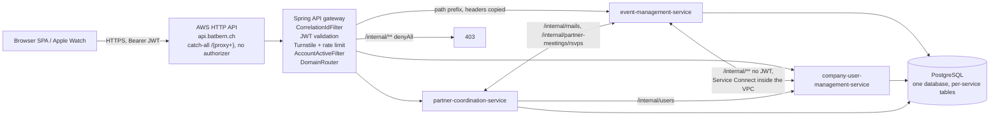

Every service validates the JWT again and decides access itself with `@PreAuthorize` (ADR-008,
#1147). The AWS HTTP API (`infrastructure/lib/stacks/api-gateway-stack.ts`) has a single catch-all
route without an authorizer; the Spring gateway (`api-gateway/`) authenticates and routes by path
prefix in `DomainRouter.determineTargetService`, and copies the incoming headers, including
`Authorization`, to the service (`DomainRouter.routeRequest`). Service URLs are Service Connect
names (`http://event-management:8080`, see `api-gateway-service-stack.ts`).

### Package layout

Layer packages are shared by all services; larger services add feature packages next to them.

```
services/{domain-service}/
├── src/main/java/ch/batbern/{domain}/
│   ├── controller/   service/   repository/   domain/   dto/   exception/   security/   config/
│   ├── client/                         # HTTP clients to other services (e.g. UserApiClient)
│   └── ...                             # feature packages, e.g. in EMS: listener/, scheduler/,
│                                       # scheduled/, notification/, forwarding/, mailcenter/,
│                                       # usermerge/, watch/
├── src/main/resources/
│   ├── application.yml
│   ├── db/migration/                   # Flyway migrations (never edit an applied one)
│   └── email-templates/                # EMS: DE + EN mail templates
└── build.gradle
```

## Authentication and Authorization

> **Single auth flow for all roles** (per **ADR-009**). Speakers authenticate the same way as organizers, partners, and attendees — via **standard AWS Cognito** with a Bearer token. There is no parallel speaker auth stack: no magic-link, no `?token=` / `?jwt=` query auth, no opaque RESPOND/VIEW tokens, no separate `speaker_jwt` cookie. The `/api/v1/speaker-portal/**` endpoints are `@PreAuthorize("hasRole('SPEAKER')")` and are NOT in any `permitAll()` list. See the "Speaker authentication (ADR-009)" subsection below for the provisioning lifecycle.

### JWT Authentication Flow

Login does not go through the backend. The SPA signs in against Cognito with Amplify (password or
"Continue with Google" via `auth.batbern.ch`) and sends the ID token as Bearer token on every API
call. The PreTokenGeneration Lambda puts the roles from `role_assignments` into `custom:role`.

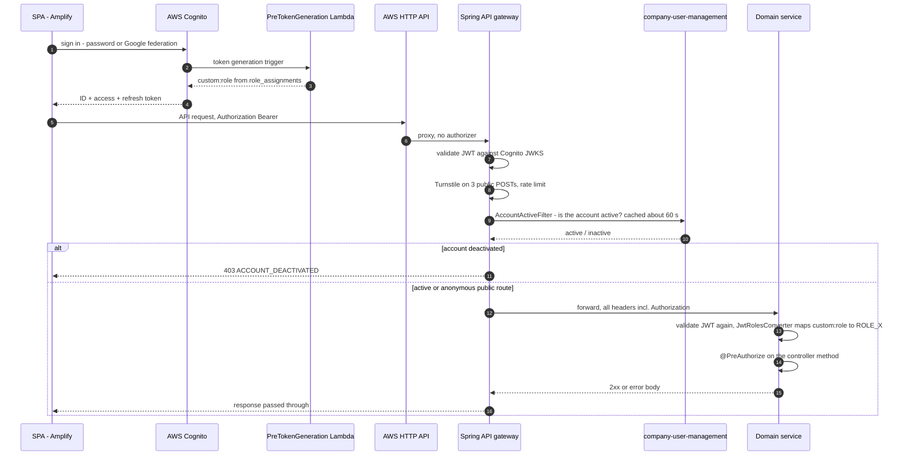

Facts behind the diagram: `api-gateway/.../config/SecurityConfig.java` (`oauth2ResourceServer`,
composite decoder for Cognito and Watch tokens), `TurnstileVerificationFilter` (protected endpoints
in `api-gateway/src/main/resources/application.yml`: newsletter subscribe, registration create,
thanks POST; `turnstile.enabled` defaults to false and is switched on by environment),
`RateLimitingFilter`, `AccountActiveFilter` (fail-open, kill switch
`security.active-gate.enabled`), and `shared-kernel/.../security/JwtRolesConverter` (with the
Pattern 3b database fallback, see 06b).

### Role-Based Security Configuration

> **Important (corrected 2026-10):** Both the API gateway and each domain service validate the JWT
> (`oauth2ResourceServer` with `jwtDecoder()`). The gateway only authenticates and routes; it does
> **not** check roles. Role-based access control is enforced **only** in the services, via
> `@PreAuthorize` on the controller methods (`@EnableMethodSecurity` in every service and the
> gateway). Every write endpoint must declare its rule; `EndpointAuthorizationGuardTest` in each
> service fails the build otherwise. (An unused gateway `RoleBasedAuthorizer` from Story 1.2 was
> removed; it was never wired into the request path.)

#### Public Endpoints (no authentication required)

Main `permitAll` entries of the event-management chain
(`services/event-management-service/.../config/SecurityConfig.java`); the gateway chain mirrors them
(dual SecurityConfig rule: a public path needs `permitAll` in both).

| Pattern | Notes |
|---|---|
| `/actuator/health`, `/actuator/info` | Health probes |
| `/swagger-ui/**`, `/v3/api-docs/**` | API documentation |
| `GET /api/v1/public/events`, `/public/events/current`, `/public/events/{code}` | Public Events read model, the website's only event source (see below) |
| `GET /api/v1/events/current` | Apple Watch app only. Retirement tracked in #1070 |
| `GET /api/v1/events`, `/api/v1/events/{code}` | Event list and detail. Sessions and speakers are returned to organizers only |
| `GET /api/v1/events/{code}/sessions`, `/sessions/{slug}`, `/sessions/{slug}/speakers` | Filtered by `PublicSessionVisibilityPolicy` for non-organizers |
| `GET .../sessions/{slug}/qna`, `.../materials/{id}/download`, `/events/{code}/photos`, `/events/{code}/live-timing` | Public reads for Q&A archive, materials, photos, presenter screen |
| `POST /api/v1/events/{code}/registrations`, `.../registrations/confirm`, `GET .../registrations/{code}` | Anonymous registration; the code or the token is the credential |
| `POST /api/v1/newsletter/subscribe`, `/newsletter/unsubscribe`, `GET /newsletter/unsubscribe/verify` | Newsletter |
| `GET/POST /api/v1/registrations/deregister*` | Token-based self-service deregistration |
| `GET/POST /api/v1/events/{code}/thanks`, `GET /api/v1/thanks/featured` | Thank the organizers |
| `/internal/**` | Service-to-service only; the gateway denies it (below) |

Literal organizer paths that the wildcards would match (`/events/attendance-summary`,
`/events/registrations`, `/sessions/unassigned`, `/sessions/conflicts`) are declared
`authenticated()` before the public wildcards (GHSA-qhqv).

#### Public Events read model (2026-10-07)

The public website reads events only through `GET /api/v1/public/events*` (tag "Public Events" in
`events-core-api.openapi.yml`). The response is the same for every caller, anonymous or organizer,
so the website never shows an organizer something a visitor would not see.

- **Which sessions:** `PublicSessionVisibilityPolicy` is the single rule. Unpublished or TOPIC phase:
  none. SPEAKERS phase: sessions whose speaker is ACCEPTED, CONTENT_SUBMITTED or QUALITY_REVIEWED.
  AGENDA phase: slotted sessions whose speaker is QUALITY_REVIEWED, plus slotted structural
  sessions. Completed, archived and past events: unfiltered.
- **What shape:** `PublicEventShaper` derives `speakers[]` from the visible sessions. In the SPEAKERS
  phase it empties the session list and omits talk titles, so the lineup is public before the
  programme is.
- `GET /public/events/{code}` returns 404 unless the event is publicly visible.
  `GET /public/events?scope=upcoming|archive` serves the upcoming list and the archive (search,
  topic filter and sort apply to `archive` only).
- **Structural sessions** (moderation, break, lunch, networking) have one definition per tier:
  `Session.isStructuralType` in the backend, `web-frontend/src/utils/sessionTypes.ts` in the
  frontend. `networking` is the apéro: V127 (#1123) folded the duplicate `aperitif` value back into
  it. The agenda config keeps its apéro names (`aperitifSlots`, `TimetableSlot.Type.APERITIF`);
  `StructuralSessionService` stores that slot as `networking`. Publishing the agenda calls
  `generateIfMissing`, so the public agenda (stored sessions only) matches the slot view, which
  computes the structure from the config (#1108). It never overwrites and never throws.
- **`sessionType` and `materialsStatus` are enums in the contract** (`SessionType`,
  `MaterialsStatus` in `event-sessions-api`). Never add a second value for an existing meaning and
  never rename one: installed Apple Watch binaries decode the list. `materialsStatus` is `NONE` or
  `COMPLETE`; one file of any type makes a session `COMPLETE`.

The older `GET /api/v1/events` and `/events/{code}` return sessions and speakers to organizers only.
`GET /api/v1/events/current` is unchanged for the Apple Watch, an installed binary that calls the
path directly: organizers see every session, everyone else gets the public view. It is retired once
a Watch release has switched to `/public/events/current` (#1070).

**Internal service API (`/internal/**`, no JWT):**

Service-to-service reads that must not depend on the end user use a separate path prefix,
`/internal/**`, outside the public `/api/v1` contract. The API gateway has no route for it and
denies it explicitly (`SecurityConfig`: `/internal/**` → `denyAll`), so it is reachable only inside
the VPC through Service Connect. Callers send **no** JWT.

| Pattern | Service | Callers |
|---|---|---|
| `GET /internal/users/{username}[?include=…]` | Company-User Management | EMS user lookups (incl. preferred language, Q&A cadence), PCS contact enrichment, gateway `is_active` gate |
| `GET /internal/users?role=&company=&page=&limit=` | Company-User Management | EMS organizer/partner lists, PCS partner contacts by company and users by role |
| `POST /internal/partner-meetings/rsvps` | Partner Coordination | EMS inbound iCal REPLY handling |
| `POST /internal/mails` | Event Management | PCS records its partner meeting invites and cancellations in "What went out" (Story 16.9) |
| `POST /internal/users/get-or-create` | Company-User Management | EMS anonymous registration and speaker provisioning (ADR-005) |
| `GET /internal/email-owners?email=` | Company-User Management | EMS by-email deregistration across a person's profiles (#1183) |
| `GET /internal/users/merge-preview`, `POST /internal/users/merge`, `POST /internal/users/primary-email` | Event Management | CUMS profile merge (#1183 C/D, below) and primary-address change (#1244) |
| `POST /internal/mail-center/{merge,logo}-requests[/{requestId}/done]` | Event Management | CUMS opens and closes the Mail Center conversation of a merge or logo request (#1237, #1246) |

The CUMS→EMS calls other than the merge itself (`primary-email`, `mail-center/*`) are upstream→downstream
exceptions to the module map, owned by Story 17.7 (request pull); no new one is added.

Every operation above is specified in `docs/api/internal/` (`cums-`, `ems-`, `pcs-internal.openapi.yml`,
Story 17.0b2) and contract-tested on both sides; the public tooling does not read that folder.
Callers read list endpoints page by page (`pagination.hasNext`; PCS read only the first 100 users
before 17.0b2) and percent-encode every username, company name and address they put in a path or
query.

Why a separate API rather than forwarding the user's JWT: the public user directory
(`GET /api/v1/users`, `/users/search`, `/users/{username}`) is ORGANIZER/ADMIN only, while EMS and
PCS look users up on behalf of any caller (speakers, attendees, partners, schedulers without a JWT)
and cache the answer per username for everyone. A per-caller answer would either fail or poison
that cache. The internal API returns the same complete record regardless of who triggered the
lookup.

CUMS still serves a few `/api/v1/users/*` calls from EMS without a JWT through
`VpcInternalAuthorizationManager`. It grants them only when the connection and every
`X-Forwarded-For` hop are VPC or loopback addresses; anything that came through the gateway carries
a public hop and needs a token (#1132, see `08-operations-security.md`).

Role checks are enforced **in each service** (`@PreAuthorize` / service `SecurityConfig`). The
API gateway only authenticates the caller (JWT) and routes; it does not check roles. Shape of a
service chain (event-management, abridged):

```java
@Bean
@Profile("!test")
public SecurityFilterChain filterChain(HttpSecurity http, JwtAuthenticationConverter jwtAuthenticationConverter) {
    http
        .csrf(csrf -> csrf.disable())
        .sessionManagement(s -> s.sessionCreationPolicy(SessionCreationPolicy.STATELESS))
        .authorizeHttpRequests(auth -> auth
            .requestMatchers("/actuator/health", "/actuator/info").permitAll()
            // organizer literals before the public wildcards (GHSA-qhqv)
            .requestMatchers(HttpMethod.GET, "/api/v1/events/attendance-summary", ...).authenticated()
            .requestMatchers(HttpMethod.GET, "/api/v1/events/*").permitAll()
            // ... further public reads and token-credentialed writes ...
            .requestMatchers("/internal/**").permitAll()   // the gateway denies it
            .anyRequest().authenticated())
        // every service validates the JWT itself (multi-issuer: Cognito RS256, Watch HS256)
        .oauth2ResourceServer(o -> o.jwt(j -> j.jwtAuthenticationConverter(jwtAuthenticationConverter)));
    return http.build();
}

@Bean
public JwtAuthenticationConverter jwtAuthenticationConverter(ObjectProvider<DataSource> ds) {
    JwtAuthenticationConverter converter = new JwtAuthenticationConverter();
    // custom:role "ATTENDEE,SPEAKER" -> ROLE_ATTENDEE, ROLE_SPEAKER; DB fallback when the claim is empty
    converter.setJwtGrantedAuthoritiesConverter(new JwtRolesConverter(ds.getIfAvailable()));
    return converter;
}
```

`@EnableMethodSecurity(prePostEnabled = true)` is on in every profile, so `@PreAuthorize` decides.
`EndpointAuthorizationGuardTest` exists in the gateway, EMS, CUMS and PCS and fails the build for a
write endpoint without a rule.

### User Context Management

Each service has its own `SecurityContextHelper` (`security/SecurityContextHelper.java` in EMS, CUMS
and PCS) that reads the authenticated JWT: `getCurrentUsername()`, `getCurrentUsernameOrNull()`
(EMS, for scheduler and anonymous paths), `getCurrentUserEmail()`, `getCurrentUserRoles()`,
`hasRole(role)`. There is no `UserContext` object and no `canAccessCompany` helper; ownership rules
live in the `@PreAuthorize` expressions and the services.

### Speaker authentication (ADR-009)

Speakers are full Cognito users with the SPEAKER role. Provisioning is wired into the speaker workflow state machine — not into a separate auth flow.

**Provisioning lifecycle (Story 11.E.2 two-endpoint design — Resolved Q#1 Variant B):**

1. **`CONTACTED → READY` transition** (`SpeakerWorkflowService.transition()` side-effect hook): the backend calls `UserApiClient.provisionUserWithRole(email, firstName, lastName, SPEAKER)`. The company-user-management-service performs, in order:
   1. `cognito-idp:AdminCreateUser` with `MessageAction=SUPPRESS` and a **throwaway** temporary password. The user is created in Cognito with status `FORCE_CHANGE_PASSWORD`.
   2. SPEAKER role grant in `role_assignments` (database — NOT Cognito groups, per CLAUDE.md "Authentication & Roles").
   3. `INSERT INTO user_profiles` (idempotent on existing user).
   4. Returns `{ username, created }` to the caller. The throwaway temporary password is **never returned** (the `temporaryPassword` field was removed from `ProvisionUserResponse` in Story 11.E.2) and is discarded from CUMS memory.

   Re-calling `provisionUserWithRole` for an already-provisioned user is idempotent and skips the Cognito call entirely (the Cognito user already exists).

2. **`READY → INVITED` transition**: EMS's `runInvitedHook` calls the new sibling endpoint **`POST /api/v1/users/{username}/issue-invitation-credentials`**. CUMS branches on the Cognito user's current status (via `AdminGetUser`):
   - `FORCE_CHANGE_PASSWORD` / `RESET_REQUIRED` / `UNCONFIRMED` → generate a fresh temp password, call `AdminSetUserPassword(Permanent=false)`, return `{ action: "FRESH_TEMP_PASSWORD", temporaryPassword: "..." }`.
   - `CONFIRMED` → no Cognito mutation; return `{ action: "USE_EXISTING_PASSWORD", temporaryPassword: null }`.
   - `ARCHIVED` / `COMPROMISED` → return HTTP 422 (`UnprocessableInvitationStateException`).

   The invitation-email service then sends a templated HTML email containing the speaker portal login URL + the speaker's email as the Cognito username + either the temporary password block or the "use existing password / Forgot password" block (selected by the `action` discriminator). Templates ship in `de` + `en` only per `CLAUDE.md` §"Localization — Email Templates: DE + EN Only; UI i18n: All 10 Locales"; other locales fall back to `en`. HTML-only (no `.txt` parity) per Story 11.E.2 Resolved Q#3.

3. **First login**: speaker enters email + temporary password on the standard Cognito hosted/SDK login page. Cognito challenges them with `NEW_PASSWORD_REQUIRED`; the speaker sets a new password. From then on they are a regular Cognito user — `custom:role` JWT claim includes `SPEAKER` (populated by the PreTokenGeneration Lambda from `role_assignments`).

4. **Portal access**: every `/api/v1/speaker-portal/**` endpoint is `@PreAuthorize("hasRole('SPEAKER')")`. The speaker-portal frontend (`web-frontend/src/pages/speaker-portal/**`) reads the Cognito session via `useAuth()` — same pattern as organizer/partner pages — and calls backend endpoints with a Bearer token.

**Components NOT present** (deleted by ADR-009 Decision 3 / Epic 11 Phase F):
- `MagicLinkService`, `SpeakerPortalTokenController`, `SpeakerMagicLoginController`, `JwtConfig` (speaker-side).
- The `magic_link_tokens` table.
- The `speaker_jwt` HTTP-only cookie.
- `?token=` and `?jwt=` URL parsing in the speaker pages.

**No Lambda triggers are required.** Standard Cognito invitation flow covers the entire path — no `DefineAuthChallenge` / `CreateAuthChallenge` / `VerifyAuthChallengeResponse` Lambdas; no Custom Auth flow.

See `06b-user-lifecycle-sync.md` ("Pattern N: Speaker Provisioning at CONTACTED → READY") for the cross-service sequence diagram.

## Error Handling Strategy

### Error Flow

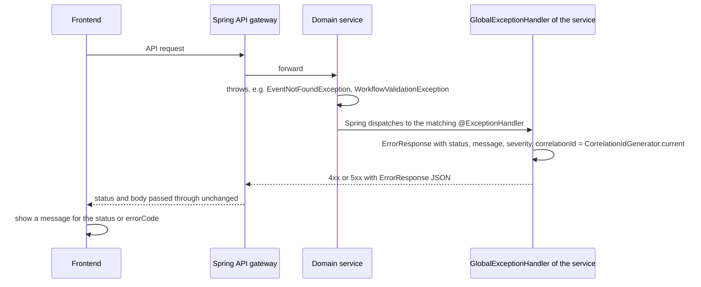

The gateway does not rewrite service errors: `DomainRouter` catches `HttpStatusCodeException` and
returns the downstream status and body as they are, minus duplicated security headers. Errors the
gateway raises itself (route not found, rate limit, Turnstile, deactivated account) come from the
gateway's own `GlobalExceptionHandler` and filters.

### Error Response Format

`shared-kernel/.../dto/ErrorResponse.java`, flat (no `error` wrapper object):

```typescript
interface ErrorResponse {
  timestamp: string;
  path: string;
  status: number;
  error: string;            // reason phrase, e.g. "Not Found"
  errorCode?: string;       // ErrorCode name where the exception carries one
  message: string;
  correlationId: string;
  severity: string;         // EMS uses LOW, MEDIUM, HIGH, CRITICAL (one handler writes WARNING)
  details?: Record<string, unknown>;
  stackTrace?: string;      // dev and staging profiles only
}
```

### Exception Hierarchy

Shared kernel (`shared-kernel/.../exception/`): abstract `BATbernException` (carries an `ErrorCode`)
with `NotFoundException`, `ValidationException`, `InvalidStateTransitionException`,
`ServiceException` and `UnauthorizedException`. Services add their own exceptions in
`{service}/exception/` (EMS for example `EventNotFoundException`, `BusinessValidationException`,
`WorkflowValidationException`, `RegistrationCapacityExceededException`,
`RegistrationClosedException`); the gateway has `RateLimitExceededException`.

### Global Exception Handler

Each service has its own `GlobalExceptionHandler` (`@RestControllerAdvice` in EMS, CUMS and PCS;
`@ControllerAdvice` in the gateway). The EMS handler has 60 `@ExceptionHandler` methods, among them
`MethodArgumentNotValidException`, `ConstraintViolationException`, `PropertyReferenceException`,
`HttpMessageNotReadableException` and `MethodArgumentTypeMismatchException` (all 400),
`AccessDeniedException` / `AuthorizationDeniedException` (403),
`ObjectOptimisticLockingFailureException` (409), and a final `@ExceptionHandler(Exception.class)`
(500, severity CRITICAL).

Not implemented (named in earlier versions): `InvalidEventStateException`,
`SpeakerAlreadyInvitedException`, an `ErrorMessageResolver` and a `MetricRegistry` in the handler.

#### Two invariants the handlers must preserve

**1. A correlation ID that is returned must also be logged.** Every handler obtains the ID via
`CorrelationIdGenerator.current()` — never `generate()` — and the generic handler resolves it
*before* its `log.error(...)` call and passes it as a log argument:

```java
String correlationId = CorrelationIdGenerator.current();
log.error("Unexpected error [correlationId={}]", correlationId, ex);
```

`generate()` mints a fresh UUID per call, so a handler that logs first and generates second hands
the caller an ID that appears in no log line — the response and the log become unlinkable, and a
user (or a ZAP report, or a support request) quoting an ID cannot be matched to anything. `current()`
reads and registers the ID in the SLF4J `MDC` under `correlationId`, so it is stable for the whole
request, reused across service hops when forwarded via `X-Correlation-ID`, and rendered by any log
pattern containing `%X{correlationId}`. `generate()` remains correct inside the correlation filters,
which legitimately mint the ID for a brand-new request. (Issue #904.)

**2. Malformed user input must never produce a 5xx.** Two traps have caused 500s that should have
been 400s:

- `MethodArgumentNotValidException` needs its own explicit `@ExceptionHandler`, or the catch-all
  `@ExceptionHandler(Exception.class)` shadows Spring's default 400.
- **Sort parameters** are validated at the parse boundary by `SortParser`, which accepts only
  identifier paths (`[A-Za-z_][A-Za-z0-9_]*` optionally dot-separated). This is not cosmetic:
  Spring Data JPA's `QueryUtils.checkSortExpression` rejects **any** `\p{Punct}` character in a
  sort property by throwing `InvalidDataAccessApiUsageException` — and it does so *before*
  resolving the property, so even a real field name with one stray character (`sort=date%`)
  bypassed the `PropertyReferenceException` → 400 mapping and surfaced as a 500 with severity
  CRITICAL. Validating in `SortParser` fixes this for every service that uses it and keeps
  punctuation — the injection vector Spring Data's guard exists to stop — out of sort expressions
  entirely. (Issue #903.)
- **A body that does not bind** (malformed JSON, an unknown enum value) raises
  `HttpMessageNotReadableException`. EMS maps it itself; CUMS and PCS had no handler and answered
  500. The shared `ClientErrorClassifier`, which every catch-all asks first, now maps it to 400
  with the fixed message "Malformed request body" (the parser's message names our classes and is
  not passed on). Found by Story 4.9, when `PATCH /users/me/settings` with `theme: "neon"`
  answered 500.

### Circuit Breaker, Bulkhead and Retry

There is no generic resilience layer. The shared kernel used Resilience4j only around the
EventBridge publisher; both were removed with the event bus (Story 17.2 part B, 2026-11), and
the shared kernel no longer depends on Resilience4j.

There is no generic retry service: no `RetryService` class, no Spring Retry dependency and no
`@Retryable` in the codebase. Outbound calls (SES, S3, cross-service HTTP) do not go
through Resilience4j. partner-coordination-service declares circuit breaker instances
`companyService` and `userService` in its `application.yml`, but no code in `services/*/src/main`
references Resilience4j, so those instances are configuration only.

### Request Correlation and Context

- The gateway's `CorrelationIdFilter` (highest precedence) takes `X-Correlation-ID` from the request
  or generates one, puts it into the MDC and onto the response.
- `DomainRouter` copies the **incoming** headers to the service. A correlation id the client sent
  therefore reaches the service; one the gateway generated does not (it adds no header to the
  forwarded request).
- In the services, CUMS has a `RequestCorrelationFilter`; EMS and PCS rely on
  `CorrelationIdGenerator.current()`, which reads the id from the MDC or registers a new one for
  the request thread. The exception handlers use it (invariant 1 above).

Not implemented: a `RequestContext` class with `ThreadLocal` user and correlation id.

## Service Communication Patterns

### Domain Events

Domain events are consumed **inside the service that raised them**. Cross-service work is
synchronous HTTP (`/internal/**`, see above) or SQS for mail, not events.

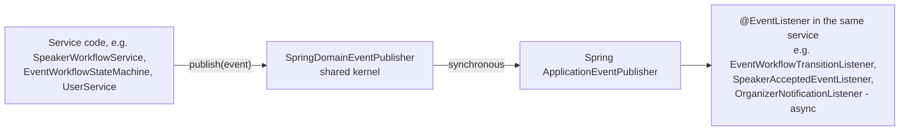

- `DomainEventPublisher` (shared kernel) is an interface with one method, `publish`;
  `SpringDomainEventPublisher` implements it by validating the event and handing it to Spring's
  `ApplicationEventPublisher`. A synchronous listener that throws is logged at ERROR and does not
  fail the caller (the behaviour before the bus was removed; whether it should fail the caller is
  story 17.12). The ERROR line starts with the fixed marker `DOMAIN_EVENT_LISTENER_FAILED`
  (`SpringDomainEventPublisher.LOG_MARKER`), followed by `listener=`, `event_type=` and the
  aggregate. Each such failure also increments the Micrometer counter
  `domain.events.listener.failures`, tagged `event_type` and `listener` (`Class.method`, or
  `unknown`), readable at `/actuator/metrics/domain.events.listener.failures` and in the Prometheus
  scrape. No service exports Micrometer metrics to CloudWatch (`CLOUDWATCH_METRICS_ENABLED` is not
  set in the CDK), so the alarm is log based: a CloudWatch metric filter on the marker in the EMS,
  CUMS and PCS log groups feeds `{Service}-Event-Listener-Failures`, which opens an issue on the
  first failure in 5 minutes (`EcsServiceAlarms`, runbook in `docs/operations/runbooks.md`). The
  CDK test reads the marker from the Java source, so renaming it fails the build.
- There is no message bus. The EventBridge bus, the EventBridge publisher with its Resilience4j
  wrapping, the `EVENT_BUS_NAME` settings and the `events:PutEvents` grants were removed in
  Story 17.2 part B (2026-11): the bus had no rules and EMS published to a bus name that did not
  exist. `DomainEventListenersIntegrationTest` (EMS) proves each listener still gets its event.
- Listeners differ in transaction handling: the workflow auto-transition listeners run in
  `REQUIRES_NEW` and never fail the triggering request; `OrganizerNotificationListener` is `@Async`.
- Some events are plain Spring events published through `ApplicationEventPublisher` directly,
  e.g. EMS's `SpeakersPhasePublishedEvent` (task activation), a record, not a `DomainEvent`.

### Data Validation and Business Rules

Business rules sit in the services and state machines, not in a rules class:

- `EventWorkflowStateMachine.validateBusinessRules`: `SLOT_ASSIGNMENT` needs at least one speaker in
  `ACCEPTED` or later; `AGENDA_PUBLISHED` needs every speaker in `ACCEPTED` or later to be publishable
  (`QUALITY_REVIEWED` and slotted). Violations throw `WorkflowValidationException`.
- `SpeakerWorkflowService.transition` enforces the speaker allow-list and the slot-capacity gate
  (see 06a).
- Registrations: deadline (`RegistrationClosedException`), capacity and waitlist (see
  "Registration, waitlist and capacity" below).
- Slot assignment: `ConflictDetectionService` (table below).

Not implemented (named in earlier versions): an `EventBusinessRules` class with "event date at least
30 days ahead" and "one event per quarter" rules.

#### Names, emails and usernames

One rule per value, shared by every service (#1102): person names are free text up to 100 characters,
emails are accepted whenever SES can deliver to them (`shared-kernel` `EmailAddresses`, mirrored as the
`pattern:` on request email fields in `docs/api/`), and usernames are generated by
`SlugGenerationService.generateUsername(first, last, email)`, which always satisfies
`chk_username_format`. Full rules: [06b-user-lifecycle-sync.md → Names, emails and usernames](06b-user-lifecycle-sync.md#names-emails-and-usernames-1102).

**One mail, several To: addresses.** `EmailService` validates its `String to` as exactly one address.
A mail for several people in To: (partner meeting invites and cancellations, partner mails) goes
through `sendGroupHtmlEmailSync` / `sendGroupHtmlEmailWithAttachments` with a `List<String>`: each
address is checked on its own, an undeliverable or reserved-domain one is dropped with a warning, and
the call throws only when none is left. Never pass a comma-joined string as `to`: since #1104 it is
rejected as a whole, and every partner invite failed that way from 2026-10-24 until the fix. The send
is recorded once, with the To: addresses comma-joined. The partner meeting invite (`POST /partner-meetings/{id}/send-invite`) sends
synchronously and sets `invite_sent_at` only after SES accepted the mail; a failure answers 502 and
rolls back. Never mark something as sent before the send has returned.

#### Spec patterns describe what the services produce

A `pattern:` in `docs/api/` must accept every value the producing code writes and every value still
stored, or a consumer validating against the spec (the S2S and MSW contract harnesses) rejects real
data. `SpecPatternsAcceptProducedValuesIntegrationTest` (EMS, CUMS) runs produced and stored values
through the real controllers and checks the responses against the spec:

- `registrationCode`: produced only by `RegistrationCodes.newUnique`, `{eventCode}-reg-{6 of A-Z0-9}`;
  still stored are `{eventCode}-reg-{8 hex}` (V4 backfill) and `BAT{n}-EXIST-{n}` / `BAT{n}-NEW-{n}`
  (a 2026-03 data load). The spec said `BAT-YYYY-NNNNNN`, which no code ever had.
- `CompanyResponse.createdBy`: a username, `anonymous` (company named in an anonymous registration),
  or the Cognito subject when the token has no `custom:username`.
- `CompanyResponse.name`: no pattern, because `POST /companies` accepts any 2 to 255 characters.
- `Event.organizerUsername` (response only): historical events carry imported names with an umlaut.

#### Conflict Detection Severities

The `ConflictDetectionService` distinguishes between hard errors and soft warnings:

| Conflict Type | Severity | Blocking |
|---|---|---|
| `ROOM_OVERLAP` — two sessions in the same room at overlapping times | `ERROR` | Yes — `SlotAssignmentController` answers 409 (`TimingConflictException`) |
| `SPEAKER_DOUBLE_BOOKED` — same speaker assigned to overlapping sessions | `ERROR` | Yes — 409 as above; bulk assignment applies nothing |
| `PREFERENCE_MISMATCH` — session scheduled outside speaker's preferred time window | `WARNING` | No — informational only, assignment proceeds |

## Workflow State Management

Two state machines drive an event: the **event workflow** (8 states, one per event) and the
**speaker workflow** (8 states, one per `speaker_pool` row). Their state diagrams, definitions and
side-effect hooks are in [Workflow State Machines](./06a-workflow-state-machines.md); this section
shows only how they push each other forward.

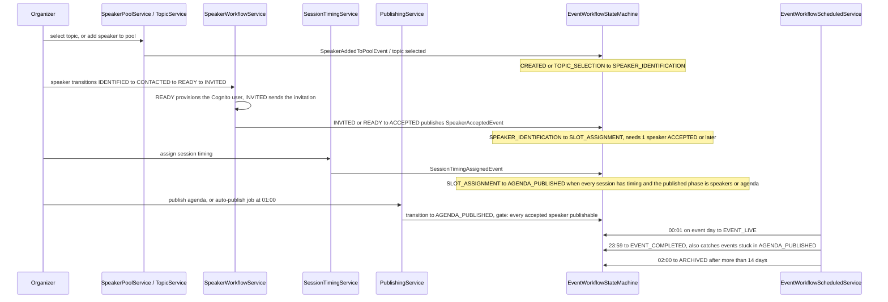

- The listeners (`SpeakerAddedToPoolEventListener`, `SpeakerAcceptedEventListener`,
  `SessionTimingAssignedEventListener`) only act in the expected current state, run in
  `REQUIRES_NEW` and log instead of failing the speaker or timing change.
- Every transition goes through `EventWorkflowStateMachine.transitionToState` and publishes
  `EventWorkflowTransitionEvent`, which activates tasks (below) and opens or freezes Q&A windows
  (`SessionQnaWindowListener`). The Watch completes an event directly when all sessions are done
  (`WatchSessionService`, override).
- Crons are the defaults in `EventWorkflowScheduledService` and `PublishingScheduledService`
  (speakers phase 30 days before, agenda 14 days before the event, when auto-publish is enabled).
  No `zone` is set on these crons, so they run in the JVM time zone (not verified 2026-11-04 which
  zone the containers use).
- Not implemented: overflow management and voting (removed by ADR-009, replaced by the slot-capacity
  gate at `READY → INVITED`).

## User Lifecycle and Synchronization

The platform maintains user data across AWS Cognito (authentication) and PostgreSQL (business logic) using a **database-centric approach** per [ADR-001](./ADR-001-invitation-based-user-registration.md):

1. **PostConfirmation Lambda** - Creates database user on Cognito email verification
2. **PreTokenGeneration Lambda** - Adds `custom:role` JWT claim from database
3. **Spring Security** - Extracts roles from JWT for authorization
4. **Unidirectional Sync** - Cognito → Database only (NO Cognito Groups, NO reverse sync)

**Key Point**: Roles are a `Set<Role>` on the `User` entity, mapped as an `@ElementCollection` onto the
`role_assignments` table (`user_id`, `role`; CUMS migration V5). The PreTokenGeneration Lambda reads
that table into `custom:role` whenever Cognito issues a token, so a role change reaches the JWT with
the next login or token refresh. In local dev, where that Lambda cannot see the local rows,
`JwtRolesConverter` reads the roles from the database (Pattern 3b). Federated (Google) users are
created just in time; see 06b.

**See [User Lifecycle Sync Patterns](./06b-user-lifecycle-sync.md) for complete implementation details.**

### Email Address Matching (case-insensitive)

An email address identifies a person regardless of capitalisation. Every lookup by email is
case-insensitive (`…IgnoreCase` finders, `LOWER(x) = LOWER(:email)` in JPQL, `lower(email) = lower($1)`
in the Cognito Lambdas). CUMS stores the primary address trimmed and lower-cased on every write
through the `User` entity (`@PrePersist`/`@PreUpdate`), and the newsletter and partner RSVPs store
theirs lower-cased; the PostConfirmation Lambda inserts via SQL as typed, so there only the unique
index guarantees uniqueness.
Case-sensitive email finders were removed so they cannot be reused by accident.

This covers user get-or-create and creation (CUMS), the PostConfirmation / PostAuthentication /
PreTokenGeneration Lambdas, newsletter subscribe / unsubscribe / bounce / complaint handling,
registration lookup by email (deregistration by email, ACCEPT replies) and partner-meeting RSVPs.
Unique indexes on `lower(email)` back this for `user_profiles` and `newsletter_subscribers`.

**Why:** case-sensitive matching created duplicate users and subscribers (5 people and one
double newsletter subscription in production, merged 2026-10-18) and made by-email actions
silently miss their target (issue #1099).

## Company Logo Requests (#1246)

A participant with a login asks the organizers for a new logo of the company on their profile.
The organizers decide in the Mail Center; company edits themselves stay `ORGANIZER`-only.

- **Upload.** The person uploads through the normal logo flow (`/logos/presigned-url`, S3 PUT,
  `/logos/{uploadId}/confirm`), then `POST /users/me/company-logo-requests {logoUploadId, note?}`
  (`isAuthenticated`). CUMS associates the confirmed upload with the request right away
  (`logos.associated_entity_type = 'LOGO_REQUEST'`, key `logos/requests/{uploadId}/logo.{ext}`), so
  it has a CDN URL for the preview and `LogoCleanupService` (which removes expired PENDING and
  CONFIRMED uploads) leaves it alone.
- **Record.** `company_logo_requests` (CUMS V25): requester, company slug, snapshot of the old logo
  URL, the new upload id and URL, optional note, status OPEN / APPROVED / DECLINED, decided by/at,
  optional reason. One OPEN request per person and company (partial unique index, 409
  `LOGO_REQUEST_OPEN`); the company is the one on the caller's profile (409 `NO_COMPANY`).
- **Mail Center.** In the same transaction CUMS calls EMS `POST /internal/mail-center/logo-requests`
  (`RequestConversations` kind LOGO, `mail_conversation.logo_request_id`, EMS V146): an OPEN
  conversation without event, audience SYSTEM. If EMS does not answer, nothing is stored (502
  `LOGO_REQUEST_NOT_DELIVERED`); the client uploads again on retry, because the association has
  already moved the temporary S3 object.
- **Decision** (`ORGANIZER`). `POST /users/company-logo-requests/{id}/approve` copies the logo to the
  company's final key (`logos/{year}/companies/{name}/logo-{uploadId}.{ext}`) and sets it through
  `CompanyService.applyRequestedLogo` (cache invalidation, `CompanyUpdatedEvent`, like an organizer
  edit). `.../decline {reason?}` changes nothing on the company. Either way the requester is mailed
  at the primary address (`company-logo-approved|declined-{de,en}`, the reason block only when given)
  and the conversation is closed (`.../done`). Mail and close are best effort after the decision.
  The request's own copy of the logo stays, so the decided conversation still shows both logos.

## Profile Merge (#1183 C/D)

Two profiles of one person (an imported or guest profile without login, and the person's login
profile) are merged: the source is folded into the target and deleted. CUMS decides and
orchestrates; EMS moves its own rows through an internal endpoint and keeps the undo log.

**Merge requests (#1237).** When the person cannot read the earlier profile's mailbox, CUMS stores a
`profile_merge_requests` row and EMS opens a Mail Center conversation for it
(`RequestConversations` kind MERGE, `POST /internal/mail-center/merge-requests`, `mail_conversation.merge_request_id`).
The organizer approves or declines in that conversation (CUMS `/users/merge-requests/{id}/approve|decline`);
approval runs the same merge with `carryAddresses = false`, then CUMS closes the conversation
(`.../{id}/done`). Details: `06b-user-lifecycle-sync.md`.

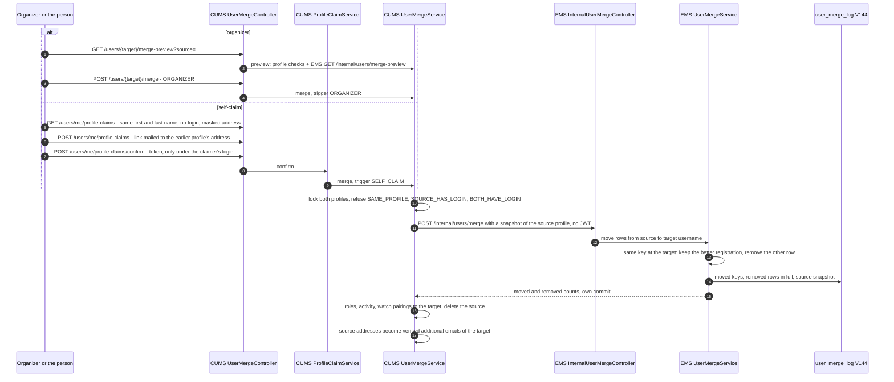

- **Refused with 409** in EMS when both lead a different talk at the same event; an organizer has to
  resolve that first.
- **Order makes retries safe.** EMS commits first and is idempotent. If the CUMS step fails, the
  source still exists and owns nothing in EMS; running the merge again finishes it.
- **What EMS moves** (`UserMergeService.MOVES`): registrations, session_users, speaker_arrivals,
  session_qna_notification, live_timing_presence, session_proposals, organizer_thanks,
  notifications, session_qna_post, session_content_history, newsletter_subscribers. Audit columns
  that record who acted (`created_by`, `changed_by_username`, ...) do not move.
- **Registration rank** when both have one for the same event: attended, confirmed, registered,
  waitlist, then no_show and cancelled (equal); the target's wins a tie.
- `user_merge_log` (EMS V144) holds what is needed to undo a merge by hand: `moved`,
  `removed_rows`, `source_profile`, `trigger` (`ORGANIZER` or `SELF_CLAIM`).

## Role Management Service

`RoleService` (CUMS) adds, removes and sets roles on the `User` entity through `UserRepository` only.

- `addRole` and `removeRole` are idempotent; a no-op change does nothing.
- **Minimum two organizers**: removing `ORGANIZER` (via `removeRole` or `setRoles`) throws
  `MinimumOrganizersException` when fewer than two organizers would remain
  (`enforceMinimumOrganizers`).
- A change is logged (`logRoleChange`); no domain event is published ("nothing consumes one").
- No Cognito group sync (ADR-001): the database is the source, the JWT picks it up at the next token.

Not implemented (an earlier "design reference" here): a `RoleManagementService` with promotion and
demotion requests, an approval workflow (`RoleChangeRequest`, `RoleChangeApproval` tables) and
`UserRoleChangedEvent`.

## Newsletter Async Processing

The newsletter send system uses an asynchronous fire-and-forget pattern to handle large recipient lists without blocking the API or exhausting thread pools:

- **Trigger**: `POST /api/v1/events/{code}/newsletter/send` returns `202 Accepted` immediately
- **Processing**: `@Async` method sends emails sequentially with a pause between mails (`newsletter.send.rate-delay-ms`, default 70 ms, about 14 per second)
- **Recipient iteration**: active subscribers are read in batches of 50 by keyset (`id > :lastId ORDER BY id`), not by OFFSET page, so recipients who unsubscribe or bounce during the send cannot make the loop skip anyone; each recipient is re-checked as active right before their mail (#1129)
- **Progress tracking**: the `newsletter_sends` row tracks state (`PENDING` → `IN_PROGRESS` → `COMPLETED` / `PARTIAL` / `FAILED`), with sent, failed and total counts for progress polling
- **Duplicate prevention**: A second send attempt while `IN_PROGRESS` returns `409 Conflict`
- **Retry**: Dedicated retry endpoint to re-send failed recipients of a previous partial/failed send and to reach active subscribers that have no recipient row yet. A failed recipient whose subscriber was since deleted, unsubscribed or suppressed is marked `skipped` and never mailed again (#1129)
- **Orphan recovery**: on `ApplicationReadyEvent`, sends left `IN_PROGRESS` or `PENDING` by a killed task become `PARTIAL` (some mails went out) or `FAILED` (none did), so the organizer can retry (`NewsletterEmailService.recoverOrphanedSends`)

## Email Forwarding (in EMS)

Mail to the platform aliases (`ok@`, `info@`, `events@`, `partner@`, `support@`,
`batbern{N}-speaker@`, `batbern{N}-moderator@`, `batbern{N}-participants@`, deprecated
`batbern{N}@`) is forwarded by the event-management-service:

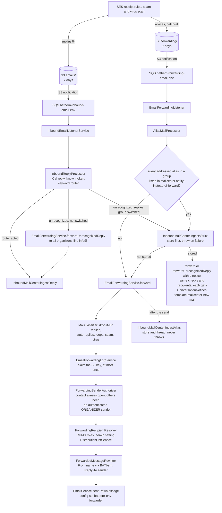

`env` stands for the environment name (`{env}` in the queue names). The two queues have DLQs
(`batbern-inbound-email-dlq-{env}`, `batbern-forwarding-email-dlq-{env}`;
`infrastructure/lib/stacks/inbound-email-stack.ts`). The switch is described in "Attachments and the
notify switch" below; the Mail Center storage path in "Inbound mail and conversations".

- **No public endpoint.** Until 2026-10 a Lambda did this and resolved recipients by calling the
  public API anonymously, which required `permitAll` on the registrations, distribution-list,
  admin-settings and user-list reads. The premise ("the Spring gateway is VPC-only") was wrong:
  the gateway *is* `api.batbern.ch`. **Never open an endpoint on the assumption that only in-VPC
  callers can reach it.** Machine callers use queues and IAM, not anonymous HTTP.
- **Delivery modes**: `batbern{N}-speaker@` sends one visible mail (speakers in To, event moderator
  in Cc, Reply-To `batbern{N}-moderator@`); every other alias sends one private copy per recipient
  with Reply-To = the original sender. Since Story 16.2a the speaker broadcast is recorded in the
  event's "What went out" (audience SPEAKERS, own text, sender = the organizer's username via
  `ForwardingDirectory.organizerUsernameFor`) through the context-taking
  `EmailService.sendRawMessage(MailContext, mime, to, cc, subject, html, configSet)`. Private copies
  are not recorded; the Mail Center stores the inbound mail itself (below).
- **Unrecognized `replies@` mail** (Story 16.0, #1160): `InboundEmailListenerService` hands every
  reply that `InboundEmailRouter` cannot act on (`RouteResult.UNRECOGNIZED`) to
  `EmailForwardingService.forwardUnrecognizedReply`, which forwards it to all organizers like
  `info@` (alias `replies` in the log, metric `RepliesForwarded`). Bounces, automatic replies,
  loops and malformed mail are not forwarded and are logged as `dropped_*` outcomes (V131). A
  failure before the first send is rethrown, so the replies queue retries and then dead-letters
  (alarm `batbern-{env}-replies-dlq`).
- **Keyword replies ask first** (Story 16.0, #1162): `InboundEmailRouter` acts on a keyword only
  when the first line has at most 3 words. A cancel keyword sends the deregistration-link mail via
  `DeregistrationService.requestDeregistrationLinkByReply` instead of cancelling; the mail goes out
  at most once per 7 days per registration (`registrations.decline_link_sent_at`, V132, set by one
  conditional UPDATE). Unsubscribe still acts at once.
- **Calendar declines** (Story 16.0, #1161): `EmailForwardingService` still forwards no iMIP reply,
  but a `PARTSTAT=DECLINED` to `calendar@` goes to `CalendarDeclineService`. It matches the
  registration by the invite UID `reg-{registrations.calendar_uid}@batbern.ch` (V133; written by
  `RegistrationEmailService` via `CalendarInviteUid`), else by sender + event date ±1 day when
  exactly one registration fits, and sends the deregistration-link mail through
  `DeregistrationService.sendDeregistrationLinkOnce` (7-day de-dup, V132). Metrics
  `CalendarDeclineLinkSent`, `CalendarDeclineUnmatched`, `CalendarDeclineSkipped`; other calendar
  replies still count as `CalendarRepliesDropped`.
- **Speaker Reply-To**: speaker-facing mails (invitation, acceptance, tiered reminder,
  quality-review revision) set Reply-To via `ModeratorReplyAddress` → `batbern{N}-moderator@`.
- **Idempotency**: `email_forwarding_log` (V128 to V131) holds one row per S3 object, no addresses or
  content. A failure before the first send releases the claim so SQS retries (3×, then DLQ with
  alarm `batbern-{env}-forwarding-dlq`). A claim whose task died before sending is taken over by
  the redelivery after 6 minutes (`STALE_CLAIM_SECONDS` = 360, which must stay above the queue's
  300 s visibility timeout). After `sending_started_at` is set nothing is retried; failed copies
  raise `batbern-{env}-forwarding-failed`, and a send that stalled is recorded once as outcome
  `stalled` (same alarm), so further redeliveries count as duplicates. The info log line carries
  recipient count and send duration per mail.
- **Retention**: `EmailForwardingLogRetentionScheduler` deletes rows older than 90 days nightly
  (03:15, ShedLock). The raw mail is gone from S3 after 7 days, so older rows cannot be replayed.
- **Metrics**: namespace `BATbern/EmailForwarder` (`EmailsForwarded`, `EmailsRejected`,
  `EmailsUnresolved`, `EmailsFailed`, `RepliesForwarded`, `*Dropped`, `DuplicatesSkipped`); alarm
  `batbern-{env}-emails-rejected`.
- **Replay**: raw mail stays in S3 for 7 days. Re-sending an S3 event JSON for a `forwarding/` key
  to the forwarding queue forwards it again unless its key is already in `email_forwarding_log`.

## Outbound Mail Record (Story 16.1a)

Every mail EMS sends for an event or on an organizer's behalf is recorded, so the team can see what
went out (Mail Center, Epic 16). Record only; the Communications page (16.3) reads it.

### Outbound pipeline at a glance

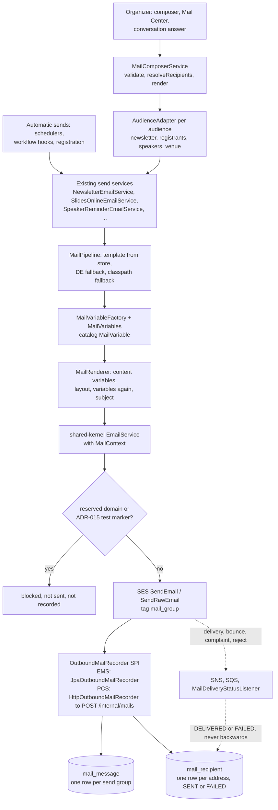

The composer reuses each send service's own render method, so the preview equals the sent mail
(AC3 of Story 16.8a). Mail without a `MailContext` (forwarded private copies, the unsubscribe
acknowledgement) is sent but not recorded.

- **Hook**: callers pass a `MailContext` (shared kernel `ch.batbern.shared.mail`) to the
  context-taking `EmailService` overloads. After SES answers, `EmailService` hands the redacted mail
  and the SES Message-ID to the optional `OutboundMailRecorder` SPI; EMS implements it with
  `JpaOutboundMailRecorder` (own transaction). A send without context, or blocked before SES
  (reserved domain, ADR-015 test marker), is not recorded. An SES error is recorded as `FAILED` with
  its error code. Every recorded send carries the SES tag `mail_group` = send-group id.
- **Tables** (`V135`): `mail_message`, one row per send group, public id `mail_key` =
  `{eventCode}-{n}` or `general-{n}` from `mail_message_seq`; `mail_recipient`, one row per address
  (TO/CC) with `ses_message_id` and status `SENT`/`FAILED`, moved to `DELIVERED`/`FAILED` by 16.1b. A recipient row
  keeps its own body only when its text differs from the message's.
- **Send groups** (`MailTrigger`): one per organizer request, per scheduler run × event × template,
  or per transactional mail. Newsletter and registrant notices group by their `newsletter_sends` row,
  so a retry joins the same record. The newsletter adds no recipient rows; its per-recipient status
  stays in `newsletter_recipients`.
- **No credentials in the record**: `MailRedaction` masks every `token=` link parameter
  (confirmation, deregistration, unsubscribe) and the plain-text secrets the caller names
  (`MailContext.withSecrets`: registration code, temporary password).
- **Guard**: `OutboundMailInventoryGuardTest` scans EMS sources and fails for a send through
  `EmailService` without a context. Allow-listed: forwarding (private copies of inbound mail; its
  speaker broadcast passes a context since 16.2a, the guard works per file) and the newsletter
  unsubscribe acknowledgement.
- **Retention**: `MailMessageRetentionScheduler` (03:30 Europe/Zurich, ShedLock) deletes a mail once
  its event date and the mail itself are older than 12 months; mail without an event after 12 months.
  Since Story 16.2a, in the same transaction and by the same rule: conversations (by last activity,
  with their inbound mail) and the automatic counts (by receipt).

### Mail of other services (Story 16.9)

Partner-coordination sends the partner meeting invite and, when a meeting whose invite went out is
deleted, the cancellation. Both are recorded in the event's mail like EMS's own.

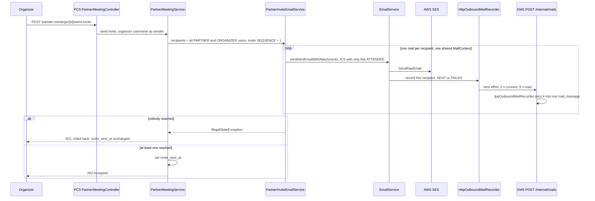

The invite call itself is synchronous (`sendCalendarInvites` returns the count); 202 is the status
the controller answers with after it returned. The cancellation (`sendCancellationNotice`) is
`@Async` and follows the same per-recipient loop.

- **Context**: `PartnerInviteEmailService` sends through the context-taking `EmailService` overload
  with `MailContext.of(MailTrigger.organizer(clicker), eventCode, PARTNERS,
  "partner-meeting-invite" | "partner-meeting-cancellation").withReference("partner-meeting:{id}")`.
  The organizer's username comes from `PartnerMeetingController` (send-invite, delete).
- **Transport**: PCS's `HttpOutboundMailRecorder` (the `OutboundMailRecorder` bean of that service)
  posts the redacted mail to EMS `POST /internal/mails` (`InternalMailController`), no JWT, 2 s
  connect / 5 s read. Best effort: EMS down or an error status costs the record, never the send; one
  WARN with reference, group and status or exception class, no addresses, no body, no retry.
- **Endpoint limits**: audience `PARTNERS` only, subject ≤ 1000, body ≤ 2 MB, ≤ 500 addresses;
  anything else is a 400. Permitted in the EMS production chain like every `/internal/**` path; the
  gateway denies it (`InternalPathSecurityTest` covers the EMS chain).
- **One mail per recipient, one record** (owner decision 2026-11-02, replacing the shared To: line of
  #1163): invite and cancellation go to each partner and organizer on their own, the invite with an
  ICS that carries only that recipient's ATTENDEE line. All sends share one `MailContext`, so
  `JpaOutboundMailRecorder` joins them into one mail with a `mail_recipient` row per address. A
  failed recipient is recorded FAILED and the others still get it; only when nobody is reached does
  the invite answer 502. The plain partner mail (16.9 B) is sent the same way. The recorder still
  splits a comma-separated To: into rows, for any other multi-address caller.
- **Reference** (`V137`): `mail_message.reference VARCHAR(100)`, what the mail is about beyond its
  event, by value (ADR-003, no FK). `GET /events/{code}/mails?reference=` filters by it and the
  summary carries it; the partner meeting panel lists its mails with it and shows the meeting's RSVP
  summary on the invite row.

### Delivery status (Story 16.1b)

SES events of the transactional configuration set move each `mail_recipient` from `SENT` to
`DELIVERED` or `FAILED`, so an organizer sees which address bounced and why.

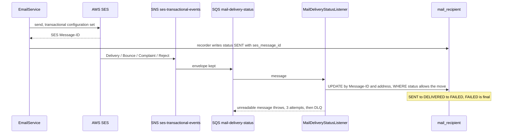

- **Path**: SES → SNS `batbern-{env}-ses-transactional-events` → SQS
  `batbern-{env}-mail-delivery-status` (SNS envelope kept) → `MailDeliveryStatusListener` →
  `MailDeliveryStatusService`. The log-only `transactional-event-logger` Lambda stays subscribed.
  The listener runs only with `aws.ses.delivery-status.enabled=true` (set by the CDK stack); local
  dev has no queue.
- **Matching**: SES Message-ID (`mail.messageId`) plus address, case-insensitive. Delivery, bounce and
  complaint carry their own recipient lists; a reject has none and fails every recipient of the message.
- **Reasons**: bounce = `bounceType/bounceSubType` (e.g. `Permanent/NoEmail`), complaint =
  `complaint`, reject = SES's reason.
- **Never backwards** (`DeliveryStatusRule`): `SENT` → `DELIVERED` → `FAILED`. `FAILED` is final and
  keeps its first reason; a complaint after delivery still fails. The rule is applied in the UPDATE's
  `WHERE status IN (...)`, so concurrent events cannot reorder it.
- **Unknown Message-IDs** (system mail without context, forwarding, mail before 16.1a)
  are ignored and counted as `BATbern/MailCenter DeliveryEventsUnmatched`.
- **Message-ID header** (Story 16.2a): when the event carries `mail.commonHeaders.messageId`, it is
  stored once on the message's recipients (`mail_recipient.message_id_header`, V139), so a reply's
  `In-Reply-To` finds the mail whatever form the header has.
- **Failures**: an unreadable message throws; SQS retries it and moves it to
  `mail-delivery-status-dlq` after 3 attempts (alarm in `MonitoringStack`).
- **Newsletter suppression untouched**: the newsletter set keeps its own bounce queue and
  `BounceProcessingService`; no transactional event reaches it.

### Read API (Story 16.3)

`event-mail-api.openapi.yml`, implemented by `EventMailController` → `MailMessageQueryService`
(native SQL, read-only), all `hasRole('ORGANIZER')` and `Cache-Control: no-store`:

- `GET /events/{eventCode}/mails`: paged, newest first, filters `audience`,
  `templateKey`, `date` (Europe/Zurich). Automatic mails (no sender, template, not a newsletter)
  collapse per template and day unless `grouped=false`.
- Newsletter sends without a `mail_message` (sent before 16.1a) are a read-time union from
  `newsletter_sends`, keyed `newsletter-{sendId}`, without body. Their audience is REGISTRANTS for
  `REGISTRANT_NOTICE` templates, otherwise NEWSLETTER. Newsletter counts come from
  `newsletter_recipients` (failed = SES refused or bounced; the newsletter set has no delivery
  events).
- `GET .../mails/{mailKey}`: body and recipients; for a newsletter only the failed ones.
- `GET .../mails/counts`: failed deliveries of the event ("Handled automatically"); since 16.2a also
  the automatic inbound mail by kind (out-of-office, bounce mail, calendar accepts/declines, keyword
  accepts/cancels, unsubscribes) from `mail_automatic_event`.
- `GET .../mails` lists outbound mail by default (`direction=OUT`, conversation answers left out);
  `direction=IN|ANY` adds inbound mail (Story 16.7). Spam is never listed unless `spam=true`.
- **Across events (Story 16.7):** `GET /mails` and `GET /mails/{mailKey}` are the same resource with
  the event as an optional filter (`eventCode`, or `noEvent=true` for mail without event). One query
  builder (`MailMessageQueryService`, `MailScope` + `MailFilter`) serves the event list, the global
  list and the participant view, so they cannot drift. `PATCH /mails/{mailKey}` accepts only
  `{ spam: false }` ("Not spam", below). The gateway routes `/api/v1/mails` to EMS.
- **Participant view (Story 16.10):** `GET /mails?participantUsername=` or `?participantCompany=`
  (exclusive, 400 if both; unknown → 404). `MailParticipantResolver` resolves at read time: a user's
  primary and every additional email (verified or not, `ForwardingDirectory.addressesOf`), a company's
  PARTNER users (`UserApiClient.getUsersByCompany`, CUMS `GET /internal/users?role=&company=`, paged).
  Rows match on `lower(mail_recipient.address)` (OUT) or `lower(from_address)` (IN), V143 indexes;
  conversation answers are included, newsletters, test sends and spam are not.
  `participantStatus` is that address's delivery status (the worst when several match).
- List and counts hide organizer test sends (`is_test`) unless `includeTests=true` (Story 16.8);
  the detail opens a test send by its key.

### Inbound mail and conversations (Story 16.2a)

Speaker replies land in the event's "Needs an answer" list with a status and an assignee instead of
one organizer's private inbox. Forwarding is unchanged and stays the safety net until the 16.6
switch is turned on per alias group.

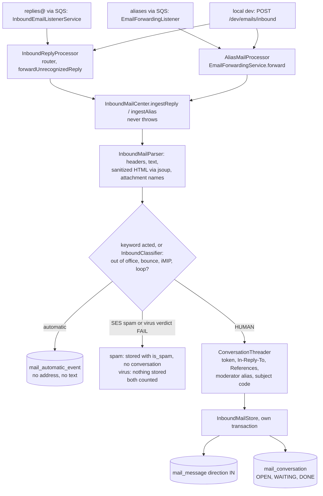

- **Classification** (`InboundClassifier`, reuses `forwarding/MailClassifier`): iMIP REPLY, loop
  (our marker header or our domain), bounce, automatic reply (RFC 3834 headers, or a subject that
  starts with Out of Office, Automatic reply, Auto-Reply, Autoreply, Abwesenheitsnotiz, Automatische
  Antwort, Abwesend, Réponse automatique, Absence, Risposta automatica), else HUMAN. Runs on both
  paths, so the alias path now notices bounces too.
- **Counts** (`mail_automatic_event`, V139): one row per mail, deduplicated by its key. Event: the
  mail it answers (In-Reply-To/References), else the moderator alias; calendar replies by
  `CalendarInviteUid` → registration → event; keyword actions by the event code in the subject.
  `InboundEmailRouter.RouteResult` names the keyword that acted (`UNSUBSCRIBED`,
  `DEREGISTRATION_LINK`, `CONFIRMED`).
- **Threading** (`ConversationThreader`, first hit wins): token in `replies+{token}@` (handed out
  as Reply-To of an organizer's answer, 16.6); In-Reply-To, then References newest first: full id against
  `mail_message.message_id_header` (inbound) and `mail_recipient.message_id_header` (from the SES
  event), local part against `mail_recipient.ses_message_id`; then the event of
  `batbern{N}-moderator@`. Within the event, the OPEN or WAITING conversation with the same
  counterpart is joined, else one is opened (assignee `Event.organizerUsername`). New inbound mail
  sets the conversation OPEN. Metrics `ThreadMatchedByToken|Header|SesId|Alias` show which rule
  carries production traffic.
- **Message-ID format**, verified 2026-11-02 on platform mail in an organizer's own mailbox: SES writes
  `<{SES MessageId}@eu-central-1.amazonses.com>` for `SendEmail` and also for `SendRawEmail` (the
  registration ICS mail, forwarded copies): JavaMail's own id is replaced. So the local-part match
  is the production branch; the header columns cover anything else.
- **Gate (16.2a, widened by 16.2b)**: a HUMAN mail opens or joins a conversation when it is a
  `replies+{token}@` reply, any reply at `replies@` the keyword router did not act on, or alias mail
  to `batbern{N}-moderator@`, `info@`, `events@` or `support@`. Organizer sends to `-speaker@`,
  `-participants@`, `batbern{N}@`, `partner@` and mail to `ok@` open nothing. An organizer
  (primary or additional email, `ForwardingDirectory`) is a counterpart only on a contact alias
  (16.2b AC6; organizer mail to `-moderator@` still opens nothing). Audience: the matched mail's,
  else `SPEAKERS` for the moderator alias, else `PUBLIC` (V141, inbound only). Assignee: the lead
  organizer for a new `SPEAKERS` conversation, otherwise unassigned. Without any match the
  conversation has no event (listed by Story 16.7) and joins the person's open no-event
  conversation. Metric `ThreadMatchedNone`.
- **Subject fallback (16.2b AC3, owner decision 2026-11-01)**: after token, headers and alias,
  exactly one `BATbern\d+` code of an existing event in the subject puts the conversation on that
  event; several distinct codes give none. Counted as `ThreadMatchedBySubject`, so the owner can
  judge the rule.
- **Broadcasts recorded (16.2b AC4)**: an organizer's mail to `-participants@` (or the deprecated
  `batbern{N}@`) or `partner@` is one `mail_message` (OUT, own text, sender = organizer, audience
  `REGISTRANTS` on the event or `PARTNERS` without event), each private copy one recipient with its
  SES id. Copies to organizers (forwarded inbound mail) stay unrecorded.
- **Message-ID on raw sends (16.2b AC7)**: `sendHtmlEmailWithAttachments` and
  `sendHtmlEmailSyncWithAttachments` with a `MailContext` (registration mails with ICS, newsletter)
  set `Message-ID: <{uuid}@{sender domain}>` and hand it to the recorder
  (`mail_recipient.message_id_header`), so replies match whatever SES does with the header. Without
  a context the header stays JavaMail's. Local dev has no SES branch, so locally the
  `local-{captureId}` id threads instead.
- **Storage**: inbound rows are `mail_message` with `direction = 'IN'`, `content_source = 'OWN_TEXT'`,
  no recipients, `send_group_id = in_ + 40 hex of sha256(Message-ID, else S3 key)`; the unique
  constraint makes a redelivery or a mail to two aliases one row. Text and sanitized HTML (no images,
  styles, scripts; links kept) are stored at receipt, so the 7-day S3 expiry does not matter.
  Attachments: names, types and sizes only.
- **Failure**: `InboundMailCenter` logs and counts `MailCenterIngestFailed`; it never throws into the
  listeners, so forwarding and SQS retries behave as before.
- **Spam and virus (Story 16.7)**: the three SES receipt rules scan (`scanEnabled`), so SES writes
  `X-SES-Spam-Verdict` and `X-SES-Virus-Verdict`. Only `FAIL` counts (`MailClassifier.sesVerdict`,
  header block only; a virus wins). Virus: nothing stored or forwarded, counted `VIRUS`, logged with the
  S3 key. Spam: stored as inbound `mail_message` with `is_spam` (V143), no event, no conversation, key
  `general-{n}`, attachments by name only, counted `SPAM`; listed only by `GET /mails?spam=true`.
  `InboundReplyProcessor` skips the keyword router and iCal routing for both; `EmailForwardingService`
  drops both before the calendar branch (`DROPPED_SPAM`/`DROPPED_VIRUS`, metrics `SpamDropped`,
  `VirusDropped`; the replies@ path writes the outcome to the forwarding log). "Not spam"
  (`InboundMailCenter.releaseSpam`) threads the stored mail like a new arrival (token, headers,
  moderator alias, subject, else no event) and `InboundMailStore.release` clears the flag. The
  retention job deletes spam 30 days after receipt.
- **SES setup notification (#1195)**: on every receipt-rule create or update SES writes the object
  `AMAZON_SES_SETUP_NOTIFICATION` under each rule's prefix. Both S3 listeners skip that key before the
  download (`MailClassifier.isSesSetupNotification`): not forwarded, not stored, one INFO line.
- **API** (`MailConversationController`, ORGANIZER, `no-store`): `GET /events/{code}/conversations`
  (OPEN and WAITING first, then DONE), `GET /conversations/{key}` (messages oldest first as
  `MailMessageDetail`; the UI shows them newest first, older ones collapsed), `PATCH /conversations/{key}` (status, assignee, which must hold ORGANIZER;
  `updated_by` = caller). Keys `conv-{n}` are global, so the gateway routes `/api/v1/conversations`
  to EMS. Bruno covers the reads only.
- **Across events (Story 16.7)**: `GET /conversations` (filters `status` repeated, `eventCode`,
  `noEvent` true/false) and `GET /conversations/counts` (`open`, `waiting`, `noEvent` = without event
  and not done, `spam`) for the global Mail page and its navigation badge. `PATCH` takes `eventCode`
  (must exist, else 404) or `clearEvent: true`; the conversation and all its messages move in one
  transaction, keys unchanged, retention follows the new event.

#### Answers and token replies (Story 16.6)

- **Answer** (`POST /conversations/{key}/replies`, ORGANIZER, `ConversationReplyService`): one mail
  to the last inbound mail's Reply-To (`mail_message.reply_to_address`, V140), else its From. Built by
  the shared kernel's `EmailService.sendComposed(MailContext, ComposedMail)` through
  `SendRawEmail`, because `SendEmail` carries neither `In-Reply-To`/`References` nor a per-mail
  display name: From `"{first last} via BATbern" <info@…>` (`ComposedMail.fromAddress`; was
  `noreply@` until 2026-11-03, owner: a reply typed to the sender by hand reaches the Mail Center),
  Reply-To `replies+{token}@…`,
  subject `Re: …` (no second prefix after `Re:`/`AW:`), `In-Reply-To` = the last inbound id,
  `References` = its References plus that id, and our own `Message-ID: <{uuid}@{domain}>`, kept
  through `saveChanges()` by a `MimeMessage` subclass. Body: the organizer's text as plain text
  and minimal HTML, then the quoted inbound text; no BATbern layout. Same walls as every send
  (reserved domain, test marker); a counterpart that cannot be mailed is a 409.
- **Record**: `MailContext.ownText` (sender = organizer), recorded by the 16.1a recorder with
  `OutboundMail.messageIdHeader` → `mail_recipient.message_id_header` (stored without brackets, like
  every id in the Mail Center); then the row gets `conversation_id` and `message_id_header` by its
  send group. "What went out" excludes rows with a `conversation_id`, so an answer shows once,
  inside its conversation. Status `WAITING`, or `DONE` with `markDone`.
- **Token replies**: SES rule `RouteReplies` lists `replies@` exactly, so `replies+{token}@` most
  likely arrives through the domain catch-all (alias path). `ForwardingAlias` classifies `replies`
  and `replies+…` as `CONVERSATION_REPLY` (not forwardable); `forward()` returns
  `CONVERSATION_REPLY` instead of `UNRESOLVED`, and `AliasMailProcessor` hands it on: a known token
  is forwarded to the organizers like an unrecognized reply (until the `replies` switch, 16.6 PR 2)
  and stored; an unknown token goes through `InboundReplyProcessor` like any `replies@` mail.
  `InboundReplyProcessor` checks for a known token before the keyword router, so "accept" in an
  answer never confirms a registration. Metric `ConversationReplies` with dimension
  `path=replies|alias` shows which rule took the first real reply.
- **Reassign** (`ConversationService.patch` → `ConversationAssignmentNotifier`): when the assignee
  changes to another organizer than the caller, that organizer gets template `mailcenter-assigned`
  (category `MAIL_CENTER`, DE/EN by preferred language) with a link to
  `/organizer/events/{code}?tab=communications&conversation={key}` (no event: `/organizer/mail`,
  Story 16.7). Self-assignment, clearing, or the same assignee send nothing. A failed notification
  is logged, the assignment stays.

#### Attachments and the notify switch (Story 16.6 PR 2)

- **Attachments** (`InboundAttachmentStore`): at receipt, each attachment up to 25 MB is put to the
  private inbound bucket as `mail-attachments/{send_group_id}/{index}`; its key is stored in the
  message's `attachments` JSON (`storageKey`, not exposed; the API shows `kept`). Larger files keep
  only their name. Server-side `putObject` with the injected `S3Client`, like the other EMS S3
  writers; download follows the session materials pattern (`GET …/attachments/{index}/download` →
  `{downloadUrl}`, `_shared` `DownloadUrlResponse`, injected `S3Presigner`, 5 minutes, original
  file name). The retention job collects the keys of expiring conversations
  (`MailConversationRepository.expiredAttachmentKeys`) and deletes them after the rows; a 400-day
  lifecycle rule is the backstop. Without a configured bucket (local dev) only names are kept.
- **Switch** (`MailCenterSwitch`, admin setting `mailcenter.notify-instead-of-forward`, read per
  mail): groups `moderator`, `replies`, `contact`. Set in Administration → Settings
  (`MailCenterSwitchSettings.tsx`, writes the checked groups comma separated, nothing = empty). `AliasMailProcessor` switches only when every
  addressed alias maps to a switched group (`-speaker@`, `-participants@`, `batbern{N}@`,
  `partner@`, `ok@` never do). Then `InboundMailCenter.ingest*Strict` stores first and throws on
  failure (SQS retry, DLQ), and `EmailForwardingService.forward(…, notice)` /
  `forwardUnrecognizedReply(…, notice)` run the same checks, claim, authorization and recipient
  resolution as forwarding, but send each recipient `ConversationNotices` (template
  `mailcenter-new-mail`, DE/EN by the organizer's preference) instead of the copy. Outcome
  `NOTIFIED` (V142), metric `NotificationsSent`. Mail that was not stored is forwarded as before.
  A redelivery of a stored mail finds its conversation by group id and is notified once
  (forwarding log claim).

### Composer API (Story 16.8a)

One composer for every audience, on the same resource (no second mail resource). Package
`ch.batbern.events.mailcenter.compose`, all `hasRole('ORGANIZER')`:

- `POST /events/{eventCode}/mails/preview`: renders the mail for recipient `recipientIndex` of the
  audience, redacted like the record, with `recipientCount`, up to 8 sample names, `skipped[]`
  (`OPTED_OUT`, `REMINDERS_DISABLED`, `NO_EMAIL`, `DUPLICATE`), `organizerCount` and
  `unknownPlaceholders` (a warning for templates). `Cache-Control: no-store`.
- `POST /events/{eventCode}/mails` with `target`: `RECIPIENTS` delivers through the existing send
  code; `ORGANIZERS` sends recipient i's mail to every ORGANIZER-role user (CUMS, subscribed or
  not), subject prefixed `[TEST] `, credential variables replaced by dummies (`token=TEST`),
  recorded with `is_test = true`; no send audit row, no one-shot guard consumed. Returns 202 with
  the recorded `mailKeys` at once.
- `POST .../mails/{mailKey}/retry`: retries a PARTIAL or FAILED newsletter (400 for any other mail,
  409 when completed or running). `GET .../mails/{mailKey}` carries `progress` (status, total,
  sent, failed, retryable) for a newsletter or registrant notice.
- **Flow** (`MailComposerService`, no audience `if`): validate (own text 400 until 16.5, template
  allowed for the audience, audience fields) → `resolveRecipients` → `render` one recipient →
  preview, test or `deliver`.
- **`AudienceAdapter`**, one per audience: `NewsletterAudienceAdapter` (subscribers in the job's
  keyset order, not personalised, delivery = newsletter job), `RegistrantAudienceAdapter`
  (`SlidesOnlineEmailService.resolveRecipients`, per-recipient language and cancel link, one-shot
  guard), `SpeakerAudienceAdapter` (the six `speaker-reminder-*` keys only; automatic = tier of each
  speaker's own deadline; one request, one `MailTrigger`, so one record per template key instead of
  one per speaker), `VenueAudienceAdapter` (one mail, first role To, rest Cc).
- **Preview equals sent** (AC3): the adapter renders through the same service method the send
  uses (`NewsletterEmailService.prepare`/`renderBody`, `SlidesOnlineEmailService.renderBase`/
  `personalise`, `SpeakerReminderEmailService.render`, `VenueCoordinationService.renderFor`);
  `MailRenderer` holds the content → layout → variables order. Tested byte-equal per audience
  (`MailComposerSendIntegrationTest`). `mail_recipient` keeps no subject, so a recipient whose
  language differs from the first recipient's has the mail's subject in the record.
- **Key before an async send**: `JpaOutboundMailRecorder.open` creates the group's row (same
  `INSERT_IF_ABSENT`) so the response carries the key while the newsletter or reminder threads are
  still sending.
- The old compose endpoints (newsletter, registrant notices, venue, speaker send-reminder) stay
  until the clean-up release (16.8c).

### One mail pipeline and variable catalog (Story 16.11)

Every template-based mail in event-management renders the same way:

- **`MailVariable`** (`mailcenter.variables`) is the only place that defines placeholder names:
  canonical name, scope (`SYSTEM`, `EVENT`, `RECIPIENT`, `REGISTRATION`, `SPEAKER`, `SUBSCRIBER`,
  `VENUE`, `TASK`, `QNA`, `LAYOUT`), credential flag and old aliases (`venue`, `eventDetailLink`,
  `deregistrationLink`). `MailVariableCatalogTest` fails when a seeded template uses an unknown name.
- **`MailVariableFactory`** builds the `SYSTEM` and `EVENT` values once (`eventDate` long form per
  language, `supportUrl = {baseUrl}/support`, `logoUrl`, `eventUrl`, `eventTime`); services add the
  scopes they have data for through `MailVariables`, which also writes the aliases.
- **`MailPipeline`** resolves a `MailContent` (store template, DE fallback, classpath fallback, in
  one place; `storedTemplate` for store-only mails with the default layout) and renders it with
  `MailRenderer.render` (content variables → layout → variables again → subject). The eight copied
  `loadHtmlContent` methods are gone.
- **Finished notices** (#1235): `render` keeps a `{{name}}` or `{{#name}}…{{/name}}` whose variable
  is not in the map, because the newsletter and slides fill per-recipient values in a second pass
  and the composer shows leftovers to the organizer. Mails to one recipient that get no second
  pass (registration, waitlist, deregistration, speaker invitation/acceptance/reminder, task
  reminder, Q&A, inbound confirmation, Mail Center notices) use `MailPipeline.renderNotice`: it
  removes such sections and tags (`EmailService.removeUnresolved`, absent counts as false) and
  logs a WARN naming them. A notice for a mail without an event sets `eventCode` to empty, so its
  `{{#eventCode}}` section drops without a warning.
- **Newsletter**: `prepare` resolves the content once per send (`NewsletterDraft.content`), so an
  admin edit during a send or before a retry changes nothing for that send.
- **Adapters** declare `scopes()`; `allowedVariables()` and `credentialVariables()` derive from the
  catalog, and `variables(context, recipient, test)` returns the map `render` uses (input for the
  own text of Story 16.5).
- **Golden files**: `MailGoldenTest` pins subject and HTML of every template-based mail
  (`src/test/resources/mail-golden/`); a mismatch writes the actual output to
  `build/mail-golden-actual`.
- **Own text (Story 16.5)**: one more `MailContent` (`OWN_TEXT`, no template key) rendered with
  `AudienceAdapter.variables(...)`, so it can use what a template of the audience can.
  `PlaceholderValidator` checks every `{{name}}` against the names that map really fills (400
  `UNKNOWN_PLACEHOLDER` on send; marked by `PreviewHighlighter` in the preview). The two async sends
  store the text on their `newsletter_sends` row (V138: `content_source`, `own_subject`,
  `own_body_html`; template key `own-text-newsletter` / `own-text-registrants`), so the job and the
  newsletter retry render exactly it. Newsletter content without `{{unsubscribeLink}}` gets the DE/EN
  footer. Registrants: one-shot by subject (409 `ALREADY_SENT` unless `confirmResend`). Speakers:
  `SpeakerOwnTextMailService` (by status, outreach note, no reminder log). Recorded as `OWN_TEXT`.
- Not yet on the pipeline: HTML built in Java (`NotificationService`, `QualityReviewService`, Story
  16.12), the partner invite in partner-coordination.

## Settings: one store per kind (Story 4.9)

- **Application settings** live in EMS `app_settings`, read and written only through
  `AdminSettingsService` (`GET`/`PUT /admin/settings/{key}`, ORGANIZER). A structured setting is
  a JSON value under its key and validated before it is stored: `venue.coordination.config` and
  `presentation` (`PresentationSettings`: non-blank `aboutText`, integer `partnerCount` >= 0,
  no other fields; anything else is a 400). The presenter screen reads it anonymously at
  `GET /public/settings/presentation` (`PublicSettingsController`, next to
  `/public/settings/features`); without a stored value it answers the former CUMS defaults. The
  value moved from the CUMS table `presentation_settings` with EMS V152, which copies the row and
  drops the table in one statement (a no-op where the table does not exist).
- **A user's settings** are one CUMS resource, `GET`/`PATCH /users/me/settings`
  (`UserSettingsService`): display, notifications and privacy in one object, partial update.
  Storage stays the two embeddables on `user_profiles`. EMS reads language, Q&A frequency and
  notification settings with `/internal/users/{username}?include=settings`.
- **Derived configuration** that is not stored (feature flags, the gateway `/config`) is not a
  setting and stays where it is.

## Auto-Enrollment on Event Creation

When a new event is created, `AutoEnrollmentListener` (on `EventCreatedEvent`, `REQUIRES_NEW`, never
fails the creation) calls `RegistrationService.enrollStakeholders`: every user with the ORGANIZER or
PARTNER role gets a `confirmed` registration without confirmation mail, capacity check or waitlist,
marked in `metadata` with `AUTO_REGISTERED_FROM_KEY` so it does not count as a real attendee for the
event delete guard. The capacity count (`registered` + `confirmed`) does include these rows.
`POST /events/{eventCode}/enroll-stakeholders` (ORGANIZER) repeats it idempotently for older events.

## Task Activation

Organizer tasks (`event_tasks`, model in 06a "Task Management System") are created from templates
for an event, mostly as `pending`, and become `todo` in two ways: edge-triggered by a workflow
transition, and level-triggered by a daily reconcile that catches anything the edge missed.

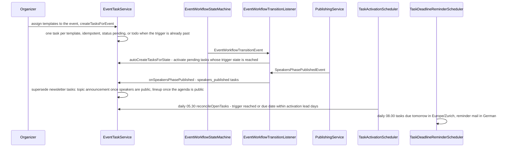

- `TaskActivationScheduler` runs at 05:30 Europe/Zurich with ShedLock, after the 01:00 auto-publish
  jobs and before the 08:00 reminders, so a reminder never goes out for a task that should already
  be visible. It skips archived events.
- A trigger state at or before the current state counts as reached, so a skipped state (for example
  `CREATED` straight to `SPEAKER_IDENTIFICATION`) still activates its tasks.
- Task reminders do not use the `notifications` table (see 06d).

## Real-time Notifications and Escalation

Two channels exist: **email** (SES through the shared `EmailService`) and **in-app** rows for
organizers (`OrganizerNotificationListener` writes one `IN_APP` row per organizer per domain event and
pushes it over STOMP to `/topic/notifications/{username}`). Escalation is limited to
`SpeakerReminderService`: after the third unanswered reminder the organizer gets a
`SPEAKER_ESCALATION` mail. Users set email on or off, quiet hours and the Q&A digest cadence in their
preferences. No SMS channel and no escalation rule engine exist.

**See [Notification System](./06d-notification-system.md) for details.**

## Registration, Waitlist and Capacity

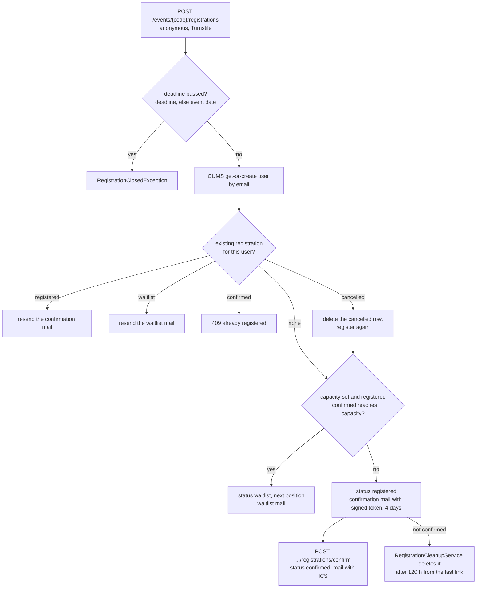

**Filling the waitlist (#1208).** `WaitlistPromotionService.promoteFromWaitlist(eventId)` promotes, in
waitlist order, as many people as there are free places: capacity minus `registered` + `confirmed`
(the same count that puts new sign-ups on the waitlist); no capacity means everyone waiting. Each
promoted person becomes `registered` (waitlist position cleared) and gets the waitlist-promotion mail.
Remaining positions are not renumbered.

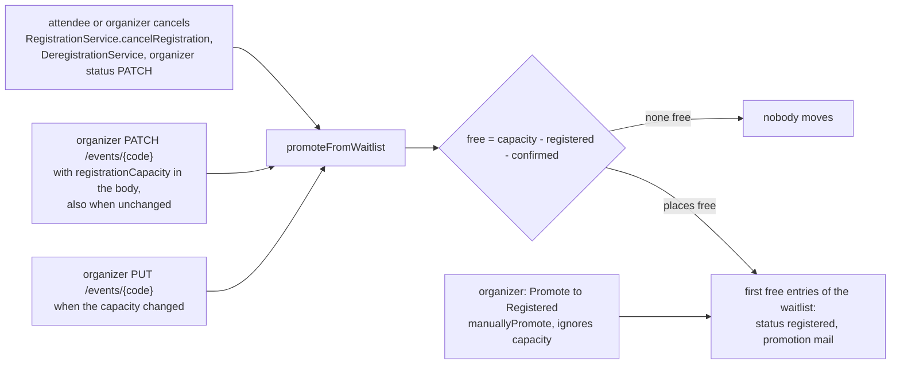

Saving the capacity again unchanged is how an organizer fills places that are already free. A
participant an organizer adds over the capacity (`force`) leaves `free` at or below zero, so a later
cancellation does not pull someone in until a place is really free.

**Late cancellations (#1238 E2).** `RegistrationWindow` holds the dates, in Bern time:

- From 00:00 Bern on the event day an attendee can no longer unregister. `cancelRegistration`
  (token link, hero "Abmelden" via `DELETE /events/{code}/my-registration`) throws
  `DeregistrationClosedException`, mapped to 409 `details.code = DEREGISTRATION_CLOSED`. The
  by-e-mail request and the reply/calendar-decline paths send no link on and after that day
  (`DeregistrationLinkResult.CLOSED`).
- After the registration deadline (`registrationDeadline`, or the event start without one) an
  attendee's cancellation does not call `promoteFromWaitlist`: the name badges are printed by then.
  Before the deadline the waitlist moves up as before. The organizer status PATCH and the capacity
  save are unchanged.
- The public page mirrors both rules in `getRegistrationView` (`web-frontend/.../homePagePhase.ts`).

## Confirmation Links and Resend Jobs


Two distinct confirmation flows exist, with **different** token mechanics — a frequent source of confusion:

| Flow | Token | Validity | Configurable? |
| --- | --- | --- | --- |
| **Event registration** confirmation (status `registered` → `confirmed`) | Our own signed JWT (`ConfirmationTokenService`) | **4 days** (`app.registration.confirmation-token-validity-hours`, default 96h) | ✅ yes — we issue it |
| **Cognito account** confirmation (sign-up email verification) | Cognito's native sign-up code | **24h, fixed** | ❌ no — Cognito limitation |

**Coupling invariant (registration):** `RegistrationCleanupService` deletes still-`registered` rows
whose **most-recent confirmation link** is older than `app.registration.cleanup-after-hours`
(default 120h / 5 days). The deletion clock is keyed off `COALESCE(confirmation_resent_at, created_at)`
— i.e. the last time a link was minted — **not** `created_at` alone. This is required because the
resend job (below) issues a *fresh* full-validity token on each nudge: keying cleanup off `created_at`
would orphan a just-resent, still-valid link (the 2026-06-08 "Confirmation Failed" incident). The
window **must exceed** the confirmation-token validity, otherwise a still-valid 4-day link could point
at an already-deleted row; the service enforces this defensively
(`effectiveCleanupHours() = max(configured, tokenValidity + 24h)`) and warns at startup if misconfigured.

**Daily auto-resend jobs** (both Spring `@Scheduled` + `@SchedulerLock`/ShedLock):

- `RegistrationResendService` (event-management-service, 08:30) re-sends the registration-confirmation
  email — with **fresh** JWTs — to attendees unconfirmed for `> after-hours` (default 48h), capped at
  `max-attempts` (default 2) via `confirmation_resend_count` / `confirmation_resent_at` on `registrations`.
- `CognitoConfirmationResendJob` (company-user-management-service, 08:15) re-sends a fresh Cognito
  sign-up code to accounts unconfirmed within a bounded age window (stateless anti-spam, since
  UNCONFIRMED users have no DB row) — see [06b §Unconfirmed Sign-up Resend Job](./06b-user-lifecycle-sync.md).
  Requires `cognito-idp:ListUsers` + `cognito-idp:ResendConfirmationCode` on the CUMS task role.

Together these close the "first confirmation email missed/expired → recovery dead-end → locked out"
failure mode without manual admin intervention.

## Search (Story 17.17)

Every free-text search in the organizer and public UI means the same thing: **every word of the
input occurs as a substring of at least one searchable field, in any order, after folding both
sides**. It runs in SQL before paging, so `totalItems` counts every match and page 2 holds the next
ones. A blank input is no search; the other filters (role, company, status, tier, topic codes,
workflow state) combine with it unchanged.

- **Fold**: the SQL function `batbern_fold(text)`: lower case, `unaccent` (also `ß` to `ss`),
  `ae/oe/ue` read as `a/o/u`, hyphen, apostrophe and underscore as a space, whitespace collapsed.
  So "Müller", "Mueller" and "Muller" find each other. Canonical body:
  `shared-kernel/src/main/resources/db/search/batbern_fold.sql`; created by CUMS `V27__search_fold.sql`
  and EMS `V147__search_fold.sql` (one shared database, both `CREATE OR REPLACE` the same body under
  an advisory lock). `SearchFoldContract` (test fixture) fails a service whose copy differs by one
  byte. No `pg_trgm`, no typo tolerance.
- **Terms**: `ch.batbern.shared.search.SearchTerms` splits on whitespace, `-`, `'`, `_` (at most 8
  terms) and escapes `\`, `%`, `_` for `LIKE ... ESCAPE '\'`, so they match literally;
  `SearchPredicates` builds `batbern_fold(field) LIKE '%' || batbern_fold(:term) || '%'`. Java never
  folds.
- **Field sets**:

  | Search | Fields |
  |---|---|
  | Users (list `GET /users?search`, picker `GET /users/search`) | username, first and last name, primary e-mail, additional e-mails (verified or not), company id |
  | Participants (`GET /events/{code}/registrations?search`) | attendee username, first and last name, e-mail, company id (denormalized columns) |
  | Newsletter subscribers | e-mail, first name, username (the username of a subscriber with a profile carries the last name; no EMS read of `user_profiles`) |
  | Companies (list `GET /companies?search`, picker `GET /companies/search`) | slug (`name`), display name |
  | Partners (`GET /partners?search`) | company slug and display name, resolved to slugs by CUMS `GET /internal/companies?search=` (PCS holds only the slug) |
  | Topics (`GET /topics?search`) | title, description |
  | Events and archive (`title $contains`, `GET /public/events?scope=archive&search`) | event title, description, event code (`56` finds BATbern56), session titles and abstracts, speaker first and last names |

- **Ranking**: the user and company pickers return at most N rows, ordered in SQL before the limit:
  exact match (full name in either order for users), then prefix, then the rest, with a unique
  tie-break. Lists keep their explicit sort (events: date); there is no relevance rank.
- **Kept on purpose**: the `tsvector` columns and the V39 functions stay in the EMS schema, unused
  by the code since 17.17 (dropping them needs a migration and gains nothing now).


## Testing Strategy

The BATbern backend uses Testcontainers PostgreSQL for all integration tests to ensure production parity. This approach catches PostgreSQL-specific issues (JSONB, functions, constraints) that would be missed with H2.

**Testing Layers:**
- **E2E Tests** - Full user journeys with Playwright
- **Integration Tests** - REST API + PostgreSQL via Testcontainers
- **Unit Tests** - Business logic with mocked dependencies

**See [Testing Strategy](./06c-testing-strategy.md) for complete implementation details and examples.**

---

## Summary

- **Authorization in the services**: the AWS HTTP API and the Spring gateway pass requests through;
  the gateway authenticates (JWT, Turnstile, rate limit, active account) and routes, every service
  validates the JWT again and decides with `@PreAuthorize`. Service-to-service calls use
  `/internal/**` without JWT, denied at the gateway.
- **Errors**: one `ErrorResponse` shape, built per service by its `GlobalExceptionHandler`, passed
  through by the gateway with a correlation id that is also logged.
- **No Resilience4j** in the shared kernel (it wrapped only the EventBridge publisher, removed in Story 17.2 part B); there is no generic retry layer.
- **Two state machines** (8 event states, 8 speaker states) that push each other forward through
  in-process domain events, plus schedulers for live, completed and archived.
- **One mail record** for everything that goes out and comes in (Mail Center), with delivery status
  from SES events and a per-group switch from forwarding to notification.
- **Registrations** with capacity, waitlist and automatic fill (#1208); **profile merge** across CUMS
  and EMS with an undo log.
- **Production-parity tests** with Testcontainers PostgreSQL and the authorization guard tests.
