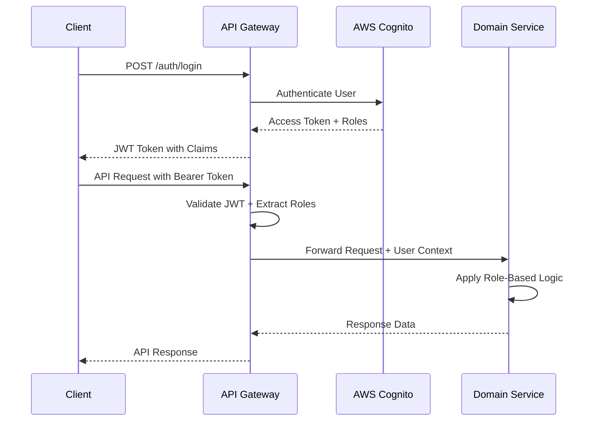
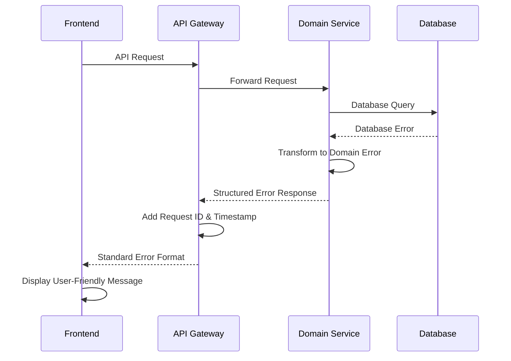

# Backend Architecture

This document outlines the core backend architecture for the BATbern Event Management Platform, including service patterns, authentication, authorization, and error handling strategies.

## Related Documentation

For detailed information on specific subsystems, see:
- **[Workflow State Machines](./06a-workflow-state-machines.md)** - Event workflow, speaker coordination, slot assignment and quality review
- **[User Lifecycle Sync Patterns](./06b-user-lifecycle-sync.md)** - Unidirectional Cognito → PostgreSQL sync with Lambda triggers
- **[Testing Strategy](./06c-testing-strategy.md)** - Testcontainers PostgreSQL setup, integration and unit testing patterns
- **[Notification System](./06d-notification-system.md)** - Email (SES) and in-app organizer notifications, the `notifications` audit table, speaker escalation after unanswered reminders

---

## Service Architecture Pattern

```
services/{domain-service}/
├── src/main/java/ch/batbern/{domain}/
│   ├── controller/                     # REST API controllers
│   ├── service/                        # Business logic layer
│   ├── repository/                     # Data access layer
│   ├── domain/                         # Domain models and entities
│   ├── dto/                           # Data transfer objects
│   ├── exception/                     # Custom exceptions
│   └── security/                      # Security components
├── src/main/resources/
│   ├── application.yml                # Configuration
│   └── db/migration/                  # Flyway migrations
└── build.gradle                      # Build configuration
```

## Authentication and Authorization

> **Single auth flow for all roles** (per **ADR-009**). Speakers authenticate the same way as organizers, partners, and attendees — via **standard AWS Cognito** with a Bearer token. There is no parallel speaker auth stack: no magic-link, no `?token=` / `?jwt=` query auth, no opaque RESPOND/VIEW tokens, no separate `speaker_jwt` cookie. The `/api/v1/speaker-portal/**` endpoints are `@PreAuthorize("hasRole('SPEAKER')")` and are NOT in any `permitAll()` list. See the "Speaker authentication (ADR-009)" subsection below for the provisioning lifecycle.

### JWT Authentication Flow



### Role-Based Security Configuration

> **Important (corrected 2026-10):** Both the API gateway and each domain service validate the JWT
> (`oauth2ResourceServer` with `jwtDecoder()`). The gateway only authenticates and routes; it does
> **not** check roles. Role-based access control is enforced **only** in the services, via
> `@PreAuthorize` on the controller methods (`@EnableMethodSecurity` in every service and the
> gateway). Every write endpoint must declare its rule; `EndpointAuthorizationGuardTest` in each
> service fails the build otherwise. (An unused gateway `RoleBasedAuthorizer` from Story 1.2 was
> removed; it was never wired into the request path.)

#### Public Endpoints (no authentication required)

The following endpoints are accessible without any token at the domain-service level:

| Pattern | Notes |
|---|---|
| `/actuator/health`, `/actuator/info` | Health probes |
| `/swagger-ui/**`, `/v3/api-docs/**` | API documentation |
| `GET /api/v1/public/events`, `/public/events/current`, `/public/events/{code}` | Public Events read model, the website's only event source (see below) |
| `GET /api/v1/events/current` | Apple Watch app only. Retirement tracked in #1070 |
| `GET /api/v1/events/**` | Event details. Sessions and speakers are returned to organizers only |
| `GET /api/v1/events/{code}/sessions/**` | Session listings, filtered by `PublicSessionVisibilityPolicy` for non-organizers |
| `GET /api/v1/events/{code}/speakers/**` | Speaker listings (read-only) |
| `POST /api/v1/events/{code}/registrations` | Attendee registration creation |
| `POST /api/v1/events/{code}/registrations/confirm` | Registration confirmation |

#### Public Events read model (2026-10-07)

The public website reads events only through `GET /api/v1/public/events*` (tag "Public Events" in
`events-core-api.openapi.yml`). The response is the same for every caller, anonymous or organizer,
so the website never shows an organizer something a visitor would not see.

- **Which sessions:** `PublicSessionVisibilityPolicy` is the single rule. Unpublished or TOPIC phase:
  none. SPEAKERS phase: sessions whose speaker is ACCEPTED, CONTENT_SUBMITTED or QUALITY_REVIEWED.
  AGENDA phase: slotted sessions whose speaker is QUALITY_REVIEWED, plus slotted structural
  sessions. Completed, archived and past events: unfiltered.
- **What shape:** `PublicEventShaper` derives `speakers[]` from the visible sessions. In the SPEAKERS
  phase it empties the session list and omits talk titles, so the lineup is public before the
  programme is.
- `GET /public/events/{code}` returns 404 unless the event is publicly visible.
  `GET /public/events?scope=upcoming|archive` serves the upcoming list and the archive (search,
  topic filter and sort apply to `archive` only).
- **Structural sessions** (moderation, break, lunch, networking) have one definition per tier:
  `Session.isStructuralType` in the backend, `web-frontend/src/utils/sessionTypes.ts` in the
  frontend. `networking` is the apéro: V127 (#1123) folded the duplicate `aperitif` value back into
  it. The agenda config keeps its apéro names (`aperitifSlots`, `TimetableSlot.Type.APERITIF`);
  `StructuralSessionService` stores that slot as `networking`. Publishing the agenda calls
  `generateIfMissing`, so the public agenda (stored sessions only) matches the slot view, which
  computes the structure from the config (#1108). It never overwrites and never throws.
- **`sessionType` and `materialsStatus` are enums in the contract** (`SessionType`,
  `MaterialsStatus` in `event-sessions-api`). Never add a second value for an existing meaning and
  never rename one: installed Apple Watch binaries decode the list. `materialsStatus` is `NONE` or
  `COMPLETE`; one file of any type makes a session `COMPLETE`.

The older `GET /api/v1/events` and `/events/{code}` return sessions and speakers to organizers only.
`GET /api/v1/events/current` is unchanged for the Apple Watch, an installed binary that calls the
path directly: organizers see every session, everyone else gets the public view. It is retired once
a Watch release has switched to `/public/events/current` (#1070).

**Internal service API (`/internal/**`, no JWT):**

Service-to-service reads that must not depend on the end user use a separate path prefix,
`/internal/**`, outside the public `/api/v1` contract. The API gateway has no route for it and
denies it explicitly (`SecurityConfig`: `/internal/**` → `denyAll`), so it is reachable only inside
the VPC through Service Connect. Callers send **no** JWT.

| Pattern | Service | Callers |
|---|---|---|
| `GET /internal/users/{username}[?include=…]` | Company-User Management | EMS user lookups (incl. preferred language, Q&A cadence), PCS contact enrichment, gateway `is_active` gate |
| `GET /internal/users?role=&company=&page=&limit=` | Company-User Management | EMS organizer/partner lists, PCS partner contacts by company and users by role |
| `POST /internal/partner-meetings/rsvps` | Partner Coordination | EMS inbound iCal REPLY handling |
| `POST /internal/mails` | Event Management | PCS records its partner meeting invites and cancellations in "What went out" (Story 16.9) |

Why a separate API rather than forwarding the user's JWT: the public user directory
(`GET /api/v1/users`, `/users/search`, `/users/{username}`) is ORGANIZER/ADMIN only, while EMS and
PCS look users up on behalf of any caller (speakers, attendees, partners, schedulers without a JWT)
and cache the answer per username for everyone. A per-caller answer would either fail or poison
that cache. The internal API returns the same complete record regardless of who triggered the
lookup.

CUMS still serves a few `/api/v1/users/*` calls from EMS without a JWT through
`VpcInternalAuthorizationManager`. It grants them only when the connection and every
`X-Forwarded-For` hop are VPC or loopback addresses; anything that came through the gateway carries
a public hop and needs a token (#1132, see `08-operations-security.md`).

Role checks are enforced **in each service** (`@PreAuthorize` / service `SecurityConfig`). The
API gateway only authenticates the caller (JWT) and routes; it does not check roles.

```java
@Configuration
@EnableWebSecurity
public class SecurityConfiguration {

    @Bean
    public SecurityFilterChain filterChain(HttpSecurity http) throws Exception {
        return http
            .csrf(csrf -> csrf.disable())
            .sessionManagement(session -> session.sessionCreationPolicy(SessionCreationPolicy.STATELESS))
            .authorizeHttpRequests(auth -> auth
                // Health & docs — always public
                .requestMatchers("/actuator/health", "/actuator/info").permitAll()
                .requestMatchers("/swagger-ui/**", "/v3/api-docs/**").permitAll()
                // Public read endpoints — no auth required
                .requestMatchers(HttpMethod.GET, "/api/v1/events/**").permitAll()
                .requestMatchers(HttpMethod.GET, "/api/v1/events/*/sessions/**").permitAll()
                .requestMatchers(HttpMethod.GET, "/api/v1/events/*/speakers/**").permitAll()
                // Public write endpoints — registration flow
                .requestMatchers(HttpMethod.POST, "/api/v1/events/*/registrations").permitAll()
                .requestMatchers(HttpMethod.POST, "/api/v1/events/*/registrations/confirm").permitAll()
                // Everything else: trust the gateway-injected user context
                .anyRequest().permitAll()
            )
            .build();
        // No oauth2ResourceServer / jwtDecoder — JWT validation is the gateway's responsibility
    }

    @Bean
    public JwtAuthenticationConverter jwtAuthenticationConverter() {
        JwtAuthenticationConverter converter = new JwtAuthenticationConverter();
        converter.setJwtGrantedAuthoritiesConverter(this::extractAuthorities);
        return converter;
    }

    private Collection<GrantedAuthority> extractAuthorities(Jwt jwt) {
        // Extract custom:role claim from JWT (populated by PreTokenGeneration Lambda)
        String rolesString = jwt.getClaimAsString("custom:role");

        if (rolesString == null || rolesString.isEmpty()) {
            return Collections.emptyList();
        }

        // Split comma-separated roles and map to Spring Security authorities
        // "ATTENDEE,SPEAKER" → [ROLE_ATTENDEE, ROLE_SPEAKER]
        return Arrays.stream(rolesString.split(","))
            .map(role -> new SimpleGrantedAuthority("ROLE_" + role.trim()))
            .collect(Collectors.toList());
    }
}
```

### User Context Management

```java
@Component
public class SecurityContextHelper {

    public UserContext getCurrentUser() {
        // Implementation details - see source code
    }

    public boolean hasRole(String role) {
        // Implementation details - see source code
    }

    public boolean isOrganizer() {
        // Implementation details - see source code
    }

    public boolean canAccessCompany(String companyId) {
        // Implementation details - see source code
    }
}
```

### Speaker authentication (ADR-009)

Speakers are full Cognito users with the SPEAKER role. Provisioning is wired into the speaker workflow state machine — not into a separate auth flow.

**Provisioning lifecycle (Story 11.E.2 two-endpoint design — Resolved Q#1 Variant B):**

1. **`CONTACTED → READY` transition** (`SpeakerWorkflowService.transition()` side-effect hook): the backend calls `UserApiClient.provisionUserWithRole(email, firstName, lastName, SPEAKER)`. The company-user-management-service performs, in order:
   1. `cognito-idp:AdminCreateUser` with `MessageAction=SUPPRESS` and a **throwaway** temporary password. The user is created in Cognito with status `FORCE_CHANGE_PASSWORD`.
   2. SPEAKER role grant in `role_assignments` (database — NOT Cognito groups, per CLAUDE.md "Authentication & Roles").
   3. `INSERT INTO user_profiles` (idempotent on existing user).
   4. Returns `{ username, created }` to the caller. The throwaway temporary password is **never returned** (the `temporaryPassword` field was removed from `ProvisionUserResponse` in Story 11.E.2) and is discarded from CUMS memory.

   Re-calling `provisionUserWithRole` for an already-provisioned user is idempotent and skips the Cognito call entirely (the Cognito user already exists).

2. **`READY → INVITED` transition**: EMS's `runInvitedHook` calls the new sibling endpoint **`POST /api/v1/users/{username}/issue-invitation-credentials`**. CUMS branches on the Cognito user's current status (via `AdminGetUser`):
   - `FORCE_CHANGE_PASSWORD` / `RESET_REQUIRED` / `UNCONFIRMED` → generate a fresh temp password, call `AdminSetUserPassword(Permanent=false)`, return `{ action: "FRESH_TEMP_PASSWORD", temporaryPassword: "..." }`.
   - `CONFIRMED` → no Cognito mutation; return `{ action: "USE_EXISTING_PASSWORD", temporaryPassword: null }`.
   - `ARCHIVED` / `COMPROMISED` → return HTTP 422 (`UnprocessableInvitationStateException`).

   The invitation-email service then sends a templated HTML email containing the speaker portal login URL + the speaker's email as the Cognito username + either the temporary password block or the "use existing password / Forgot password" block (selected by the `action` discriminator). Templates ship in `de` + `en` only per `CLAUDE.md` §"Localization — Email Templates: DE + EN Only; UI i18n: All 10 Locales"; other locales fall back to `en`. HTML-only (no `.txt` parity) per Story 11.E.2 Resolved Q#3.

3. **First login**: speaker enters email + temporary password on the standard Cognito hosted/SDK login page. Cognito challenges them with `NEW_PASSWORD_REQUIRED`; the speaker sets a new password. From then on they are a regular Cognito user — `custom:role` JWT claim includes `SPEAKER` (populated by the PreTokenGeneration Lambda from `role_assignments`).

4. **Portal access**: every `/api/v1/speaker-portal/**` endpoint is `@PreAuthorize("hasRole('SPEAKER')")`. The speaker-portal frontend (`web-frontend/src/pages/speaker/**`) reads the Cognito session via `useAuth()` — same pattern as organizer/partner pages — and calls backend endpoints with a Bearer token.

**Components NOT present** (deleted by ADR-009 Decision 3 / Epic 11 Phase F):
- `MagicLinkService`, `SpeakerPortalTokenController`, `SpeakerMagicLoginController`, `JwtConfig` (speaker-side).
- The `magic_link_tokens` table.
- The `speaker_jwt` HTTP-only cookie.
- `?token=` and `?jwt=` URL parsing in `pages/speaker/**`.

**No Lambda triggers are required.** Standard Cognito invitation flow covers the entire path — no `DefineAuthChallenge` / `CreateAuthChallenge` / `VerifyAuthChallengeResponse` Lambdas; no Custom Auth flow.

See `06b-user-lifecycle-sync.md` ("Pattern N: Speaker Provisioning at CONTACTED → READY") for the cross-service sequence diagram.

## Error Handling Strategy

### Error Flow



### Error Response Format

```typescript
interface ApiError {
  error: {
    code: string;
    message: string;
    details?: Record<string, any>;
    timestamp: string;
    requestId: string;
    path: string;
    severity: string;
  };
}
```

### Comprehensive Exception Hierarchy

```java
// Base domain exception
public abstract class BATbernException extends RuntimeException {
    // Implementation details - see source code
}

// Domain-specific exceptions
@ResponseStatus(HttpStatus.NOT_FOUND)
public class EventNotFoundException extends BATbernException {
    // Implementation details - see source code
}

@ResponseStatus(HttpStatus.BAD_REQUEST)
public class InvalidEventStateException extends BATbernException {
    // Implementation details - see source code
}

@ResponseStatus(HttpStatus.CONFLICT)
public class SpeakerAlreadyInvitedException extends BATbernException {
    // Implementation details - see source code
}

@ResponseStatus(HttpStatus.UNPROCESSABLE_ENTITY)
public class BusinessValidationException extends BATbernException {
    // Implementation details - see source code
}

@ResponseStatus(HttpStatus.TOO_MANY_REQUESTS)
public class RateLimitExceededException extends BATbernException {
    // Implementation details - see source code
}
```

### Global Exception Handler

```java
@ControllerAdvice
@Slf4j
public class GlobalExceptionHandler {

    private final ErrorMessageResolver messageResolver;
    private final MetricRegistry metricRegistry;

    @ExceptionHandler(BATbernException.class)
    public ResponseEntity<ErrorResponse> handleBATbernException(BATbernException ex, HttpServletRequest request) {
        // Implementation details - see source code
    }

    @ExceptionHandler(MethodArgumentNotValidException.class)
    public ResponseEntity<ErrorResponse> handleValidationException(MethodArgumentNotValidException ex, HttpServletRequest request) {
        // Implementation details - see source code
    }

    @ExceptionHandler(DataIntegrityViolationException.class)
    public ResponseEntity<ErrorResponse> handleDataIntegrityViolation(DataIntegrityViolationException ex, HttpServletRequest request) {
        // Implementation details - see source code
    }

    @ExceptionHandler(Exception.class)
    public ResponseEntity<ErrorResponse> handleGenericException(Exception ex, HttpServletRequest request) {
        // Implementation details - see source code
    }
}
```

#### Two invariants the handlers must preserve

**1. A correlation ID that is returned must also be logged.** Every handler obtains the ID via
`CorrelationIdGenerator.current()` — never `generate()` — and the generic handler resolves it
*before* its `log.error(...)` call and passes it as a log argument:

```java
String correlationId = CorrelationIdGenerator.current();
log.error("Unexpected error [correlationId={}]", correlationId, ex);
```

`generate()` mints a fresh UUID per call, so a handler that logs first and generates second hands
the caller an ID that appears in no log line — the response and the log become unlinkable, and a
user (or a ZAP report, or a support request) quoting an ID cannot be matched to anything. `current()`
reads and registers the ID in the SLF4J `MDC` under `correlationId`, so it is stable for the whole
request, reused across service hops when forwarded via `X-Correlation-ID`, and rendered by any log
pattern containing `%X{correlationId}`. `generate()` remains correct inside the correlation filters,
which legitimately mint the ID for a brand-new request. (Issue #904.)

**2. Malformed user input must never produce a 5xx.** Two traps have caused 500s that should have
been 400s:

- `MethodArgumentNotValidException` needs its own explicit `@ExceptionHandler`, or the catch-all
  `@ExceptionHandler(Exception.class)` shadows Spring's default 400.
- **Sort parameters** are validated at the parse boundary by `SortParser`, which accepts only
  identifier paths (`[A-Za-z_][A-Za-z0-9_]*` optionally dot-separated). This is not cosmetic:
  Spring Data JPA's `QueryUtils.checkSortExpression` rejects **any** `\p{Punct}` character in a
  sort property by throwing `InvalidDataAccessApiUsageException` — and it does so *before*
  resolving the property, so even a real field name with one stray character (`sort=date%`)
  bypassed the `PropertyReferenceException` → 400 mapping and surfaced as a 500 with severity
  CRITICAL. Validating in `SortParser` fixes this for every service that uses it and keeps
  punctuation — the injection vector Spring Data's guard exists to stop — out of sort expressions
  entirely. (Issue #903.)

### Circuit Breaker, Bulkhead and Retry (EventBridge publishing)

The platform uses **Resilience4j** (`resilience4j-*` 2.4.0 in `shared-kernel/build.gradle`). The
only place it is applied is `shared-kernel/.../events/EventBridgeEventPublisher`, which decorates
the EventBridge `putEvents` call programmatically, not with annotations:

```java
// EventBridgeEventPublisher.publish(...)
Bulkhead.decorateSupplier(bulkhead,
    CircuitBreaker.decorateSupplier(circuitBreaker,
        Retry.decorateSupplier(retry, publishSupplier)));
```

The instances are configured in `shared-kernel/src/main/resources/application-shared.yml`:

```yaml
resilience4j:
  circuitbreaker:
    instances:
      eventBridgePublisher:
        slidingWindowSize: 50
        failureRateThreshold: 60          # open after 60% failures
        waitDurationInOpenState: 10s
        permittedNumberOfCallsInHalfOpenState: 5
  bulkhead:
    instances:
      eventBridgePublisher:
        maxConcurrentCalls: 50
        maxWaitDuration: 100ms
  retry:
    instances:
      eventBridgePublisher:
        maxAttempts: 3
        waitDuration: 1000ms
        enableExponentialBackoff: true
        exponentialBackoffMultiplier: 2
```

Failed entries in a `putEvents` response are handled in `handleFailedEntries`; there is no
fallback store for events that could not be published.

There is no generic retry service: no `RetryService` class, no Spring Retry dependency and no
`@Retryable` in the codebase. Other outbound calls (SES, S3, cross-service HTTP) do not go
through Resilience4j. partner-coordination-service declares circuit breaker instances
`companyService` and `userService` in its `application.yml`, but no code in `services/*/src/main`
references Resilience4j, so those instances are configuration only.

### Request Correlation and Context

```java
@Component
@Slf4j
public class RequestCorrelationFilter implements Filter {
    private static final String CORRELATION_ID_HEADER = "X-Correlation-ID";

    @Override
    public void doFilter(ServletRequest request, ServletResponse response, FilterChain chain)
            throws IOException, ServletException {
        // Implementation details - see source code
    }
}

public class RequestContext {
    private static final ThreadLocal<String> correlationId = new ThreadLocal<>();
    private static final ThreadLocal<UserContext> userContext = new ThreadLocal<>();

    public static String getCurrentRequestId() {
        // Implementation details - see source code
    }

    public static void setCorrelationId(String id) {
        // Implementation details - see source code
    }

    public static UserContext getCurrentUser() {
        // Implementation details - see source code
    }

    public static void setCurrentUser(UserContext user) {
        // Implementation details - see source code
    }

    public static void clear() {
        // Implementation details - see source code
    }
}
```

## Service Communication Patterns

### Domain Events

```java
@Component
@Slf4j
public class DomainEventPublisher {

    private final ApplicationEventPublisher eventPublisher;
    private final EventBridge eventBridge;

    public void publishEvent(DomainEvent event) {
        // Publish locally for same-service subscribers
        eventPublisher.publishEvent(event);

        // Publish to EventBridge for cross-service communication
        try {
            eventBridge.publishEvent(event);
            log.debug("Published domain event: {} with ID: {}", event.getEventType(), event.getId());
        } catch (Exception ex) {
            log.error("Failed to publish domain event to EventBridge: {}", event.getId(), ex);
            // Store for retry
            failedEventStore.store(event);
        }
    }
}

// Event listeners
@EventListener
@Async
public void handleSpeakerInvited(SpeakerInvitedEvent event) {
    log.info("Processing speaker invitation for speaker {} to event {}",
             event.getSpeakerId(), event.getEventId());

    // Implementation details - see source code
}
```

### Data Validation and Business Rules

```java
@Component
public class EventBusinessRules {

    public void validateEventCreation(CreateEventRequest request) {
        // Business rule: Event date must be at least 30 days in the future
        if (request.getEventDate().isBefore(LocalDateTime.now().plusDays(30))) {
            throw new BusinessValidationException(
                "eventDate",
                "Event date must be at least 30 days in the future",
                request.getEventDate()
            );
        }

        // Business rule: Only one event per quarter
        if (eventRepository.existsByQuarter(getQuarter(request.getEventDate()))) {
            throw new BusinessValidationException(
                "eventDate",
                "Only one event is allowed per quarter",
                getQuarter(request.getEventDate())
            );
        }
    }

    public void validateSpeakerInvitation(String speakerId, String eventId) {
        // Business rule: Speaker cannot be invited to multiple sessions in same time slot
        List<Session> conflictingSessions = sessionRepository.findConflictingSessions(speakerId, eventId);
        if (!conflictingSessions.isEmpty()) {
            throw new BusinessValidationException(
                "speakerId",
                "Speaker has conflicting sessions",
                Map.of("conflictingSessions", conflictingSessions.stream()
                      .map(Session::getId).collect(Collectors.toList()))
            );
        }
    }
}
```

#### Names, emails and usernames

One rule per value, shared by every service (#1102): person names are free text up to 100 characters,
emails are accepted whenever SES can deliver to them (`shared-kernel` `EmailAddresses`, mirrored as the
`pattern:` on request email fields in `docs/api/`), and usernames are generated by
`SlugGenerationService.generateUsername(first, last, email)`, which always satisfies
`chk_username_format`. Full rules: [06b-user-lifecycle-sync.md → Names, emails and usernames](06b-user-lifecycle-sync.md#names-emails-and-usernames-1102).

**One mail, several To: addresses.** `EmailService` validates its `String to` as exactly one address.
A mail for several people in To: (partner meeting invites and cancellations, partner mails) goes
through `sendGroupHtmlEmailSync` / `sendGroupHtmlEmailWithAttachments` with a `List<String>`: each
address is checked on its own, an undeliverable or reserved-domain one is dropped with a warning, and
the call throws only when none is left. Never pass a comma-joined string as `to`: since #1104 it is
rejected as a whole, and every partner invite failed that way from 2026-10-24 until the fix. The send
is recorded once, with the To: addresses comma-joined. The partner meeting invite (`POST /partner-meetings/{id}/send-invite`) sends
synchronously and sets `invite_sent_at` only after SES accepted the mail; a failure answers 502 and
rolls back. Never mark something as sent before the send has returned.

#### Conflict Detection Severities

The `ConflictDetectionService` distinguishes between hard errors and soft warnings:

| Conflict Type | Severity | Blocking |
|---|---|---|
| `ROOM_OVERLAP` — two sessions in the same room at overlapping times | `ERROR` | Yes — slot assignment is rejected |
| `SPEAKER_DOUBLE_BOOKED` — same speaker assigned to overlapping sessions | `ERROR` | Yes — slot assignment is rejected |
| `PREFERENCE_MISMATCH` — session scheduled outside speaker's preferred time window | `WARNING` | No — informational only, assignment proceeds |

## Workflow State Management

The BATbern platform implements sophisticated state machines to manage the complex 9-state event workflow. These include:

- **Event Workflow State Machine** - Manages event lifecycle from draft to published
- **Speaker Workflow Management** - Tracks speaker states from invitation to final agenda
- **Slot Assignment Algorithm** - Optimally assigns speakers to presentation slots
- **Quality Review Workflow** - Manages content review and approval process

**See [Workflow State Machines](./06a-workflow-state-machines.md) for complete implementation details.**

## User Lifecycle and Synchronization

The platform maintains user data across AWS Cognito (authentication) and PostgreSQL (business logic) using a **database-centric approach** per [ADR-001](./ADR-001-invitation-based-user-registration.md):

1. **PostConfirmation Lambda** - Creates database user on Cognito email verification
2. **PreTokenGeneration Lambda** - Adds `custom:role` JWT claim from database
3. **Spring Security** - Extracts roles from JWT for authorization
4. **Unidirectional Sync** - Cognito → Database only (NO Cognito Groups, NO reverse sync)

**Key Point**: Roles are stored as a `Set<Role>` directly on the `User` entity (not in a separate `role_assignments` table). Roles are synced to the JWT at login time, cached for request duration. Role updates take effect on the next login.

**See [User Lifecycle Sync Patterns](./06b-user-lifecycle-sync.md) for complete implementation details.**

### Email Address Matching (case-insensitive)

An email address identifies a person regardless of capitalisation. Every lookup by email is
case-insensitive (`…IgnoreCase` finders, `LOWER(x) = LOWER(:email)` in JPQL, `lower(email) = lower($1)`
in the Cognito Lambdas). CUMS stores the primary address trimmed and lower-cased on every write
through the `User` entity (`@PrePersist`/`@PreUpdate`), and the newsletter and partner RSVPs store
theirs lower-cased; the PostConfirmation Lambda inserts via SQL as typed, so there only the unique
index guarantees uniqueness.
Case-sensitive email finders were removed so they cannot be reused by accident.

This covers user get-or-create and creation (CUMS), the PostConfirmation / PostAuthentication /
PreTokenGeneration Lambdas, newsletter subscribe / unsubscribe / bounce / complaint handling,
registration lookup by email (deregistration by email, ACCEPT replies) and partner-meeting RSVPs.
Unique indexes on `lower(email)` back this for `user_profiles` and `newsletter_subscribers`.

**Why:** case-sensitive matching created duplicate users and subscribers (5 people and one
double newsletter subscription in production, merged 2026-10-18) and made by-email actions
silently miss their target (issue #1099).

## Role Management Service

Handles user role promotion, demotion, and approval workflows while enforcing business rules.

**Deployed implementation:** The production `RoleService` stores roles as a `Set<Role>` on the `User` entity and injects `UserRepository` only — there is no separate `UserRoleRepository` or `role_assignments` table. Role lookups use `userRepository.findByRolesContaining(Role.ORGANIZER)`.

**Idempotency:** `addRole` and `removeRole` are idempotent. A `UserRoleChangedEvent` is only published when the role set actually changes (i.e. if the role was already present on add, or already absent on remove, no event is published).

> **Note:** The snippet below is a design reference that documents the intended approval-workflow shape. The deployed `RoleService` is simpler; refer to source for the exact implementation.

### Role Management Service Implementation (design reference)

```java
@Service
@RequiredArgsConstructor
public class RoleManagementService {

    private final UserRoleRepository userRoleRepository;
    private final RoleChangeRequestRepository roleChangeRequestRepository;
    private final RoleChangeApprovalRepository roleChangeApprovalRepository;
    private final CognitoIdentityProviderClient cognitoClient;
    private final ApplicationEventPublisher eventPublisher;

    @Value("${aws.cognito.user-pool-id}")
    private String cognitoUserPoolId;

    /**
     * Promote user to a higher role
     * Story 1.16.2: Uses String username instead of UUID
     */
    @Transactional
    public RoleChange promoteUser(String username, UserRole targetRole, String promotedByUsername, String reason) {
        // Validate promotion eligibility
        validatePromotion(username, targetRole);

        // Create role record
        UserRoleEntity roleEntity = UserRoleEntity.builder()
            .username(username)  // Story 1.16.2: Store username, not UUID
            .role(targetRole)
            .grantedBy(promotedByUsername)  // Story 1.16.2: Store username, not UUID
            .reason(reason)
            .isActive(true)
            .build();

        userRoleRepository.save(roleEntity);

        // NO Cognito sync - roles fetched from database on next login via PreTokenGeneration Lambda
        // Per ADR-001: Database is single source of truth for roles

        // Publish domain event
        // Story 1.16.2: Event uses String username as aggregateId
        RoleChange roleChange = mapToRoleChange(roleEntity);
        eventPublisher.publishEvent(new UserRolePromotedEvent(roleChange));

        return roleChange;
    }

    /**
     * Demote user from role - immediate for Speaker, requires approval for Organizer
     * Story 1.16.2: Uses String username instead of UUID
     */
    @Transactional
    public RoleChangeResult demoteUser(String username, UserRole currentRole, String demotedByUsername, String reason) {
        if (currentRole == UserRole.ORGANIZER) {
            // Check minimum organizers rule
            if (!canDemoteOrganizer(username, null)) {
                throw new BusinessRuleException("Cannot demote: minimum 2 organizers required");
            }

            // Create approval request
            RoleChangeRequest request = RoleChangeRequest.builder()
                .username(username)  // Story 1.16.2: Store username, not UUID
                .currentRole(currentRole)
                .requestedRole(UserRole.ATTENDEE)
                .requestedBy(demotedByUsername)  // Story 1.16.2: Store username, not UUID
                .requiresApprovalFrom(username)
                .reason(reason)
                .status(RequestStatus.PENDING)
                .build();

            roleChangeRequestRepository.save(request);

            return RoleChangeResult.pendingApproval(request);
        } else {
            // Immediate demotion for non-organizers
            UserRoleEntity roleEntity = userRoleRepository
                .findActiveRole(username, currentRole)
                .orElseThrow(() -> new NotFoundException("Active role not found"));

            roleEntity.setIsActive(false);
            roleEntity.setRevokedBy(demotedBy);
            roleEntity.setRevokedAt(Instant.now());

            userRoleRepository.save(roleEntity);

            // NO Cognito sync - roles fetched from database on next login
            // Per ADR-001: Database is single source of truth for roles

            RoleChange roleChange = mapToRoleChange(roleEntity);
            eventPublisher.publishEvent(new UserRoleDemotedEvent(roleChange));

            return RoleChangeResult.completed(roleChange);
        }
    }

    /**
     * Approve organizer demotion request
     * Story 1.16.2: Uses String username instead of UUID
     */
    @Transactional
    public RoleChange approveRoleChange(UUID requestId, String approverUsername, boolean approved, String comments) {
        // Implementation details - see source code
    }

    /**
     * Check if organizer can be demoted (minimum 2 organizers rule)
     * Story 1.16.2: Uses String username instead of UUID
     */
    public boolean canDemoteOrganizer(String username, String eventCode) {
        long activeOrganizerCount = userRoleRepository.countActiveOrganizers(eventCode);
        return activeOrganizerCount >= 2;
    }

    // syncRoleToCognito removed - per ADR-001, roles NOT synced to Cognito
    // Roles stored in database only, added to JWT via PreTokenGeneration Lambda

    private UserRole determineNewRole(String username) {
        // Implementation details - see source code
    }

    private void validatePromotion(String username, UserRole targetRole) {
        // Implementation details - see source code
    }

    private RoleChange mapToRoleChange(UserRoleEntity entity) {
        // Implementation details - see source code
    }
}
```

## Newsletter Async Processing

The newsletter send system uses an asynchronous fire-and-forget pattern to handle large recipient lists without blocking the API or exhausting thread pools:

- **Trigger**: `POST /api/v1/events/{code}/newsletter/send` returns `202 Accepted` immediately
- **Processing**: `@Async` method sends emails sequentially with SES rate limiting (~70ms/email to stay within SES quotas)
- **Recipient iteration**: active subscribers are read in batches of 50 by keyset (`id > :lastId ORDER BY id`), not by OFFSET page, so recipients who unsubscribe or bounce during the send cannot make the loop skip anyone; each recipient is re-checked as active right before their mail (#1129)
- **Progress tracking**: `newsletter_send_status` table tracks state (`PENDING` → `IN_PROGRESS` → `COMPLETED` / `PARTIAL` / `FAILED`), with `sent_count` and `total_count` for progress polling
- **Duplicate prevention**: A second send attempt while `IN_PROGRESS` returns `409 Conflict`
- **Retry**: Dedicated retry endpoint to re-send failed recipients of a previous partial/failed send and to reach active subscribers that have no recipient row yet. A failed recipient whose subscriber was since deleted, unsubscribed or suppressed is marked `skipped` and never mailed again (#1129)
- **Orphan recovery**: On service startup, any stuck `IN_PROGRESS` records (from a crash mid-send) are reset to `FAILED` for manual retry

## Email Forwarding (in EMS)

Mail to the platform aliases (`ok@`, `info@`, `events@`, `partner@`, `support@`,
`batbern{N}-speaker@`, `batbern{N}-moderator@`, `batbern{N}-participants@`, deprecated
`batbern{N}@`) is forwarded by the event-management-service:

```
SES receipt rule → S3 forwarding/ → SQS batbern-forwarding-email-{env} → EMS EmailForwardingListener
                                                                          ├─ MailClassifier: drop iMIP replies, auto-replies, loops, noreply@/calendar@
                                                                          ├─ EmailForwardingLogService: claim the S3 key (at-most-once per mail)
                                                                          ├─ ForwardingSenderAuthorizer: contact aliases open; others need an
                                                                          │    ORGANIZER From that SES authenticated (DMARC / aligned DKIM)
                                                                          ├─ ForwardingRecipientResolver: CUMS roles, admin setting,
                                                                          │    DistributionListService (in-process)
                                                                          ├─ ForwardedMessageRewriter: From "{name} via BATbern" <noreply@>, Reply-To sender
                                                                          └─ EmailService.sendRawMessage → SES (config set batbern-{env}-forwarder)
```

- **No public endpoint.** Until 2026-10 a Lambda did this and resolved recipients by calling the
  public API anonymously, which required `permitAll` on the registrations, distribution-list,
  admin-settings and user-list reads. The premise ("the Spring gateway is VPC-only") was wrong:
  the gateway *is* `api.batbern.ch`. **Never open an endpoint on the assumption that only in-VPC
  callers can reach it.** Machine callers use queues and IAM, not anonymous HTTP.
- **Delivery modes**: `batbern{N}-speaker@` sends one visible mail (speakers in To, event moderator
  in Cc, Reply-To `batbern{N}-moderator@`); every other alias sends one private copy per recipient
  with Reply-To = the original sender. Since Story 16.2a the speaker broadcast is recorded in the
  event's "What went out" (audience SPEAKERS, own text, sender = the organizer's username via
  `ForwardingDirectory.organizerUsernameFor`) through the context-taking
  `EmailService.sendRawMessage(MailContext, mime, to, cc, subject, html, configSet)`. Private copies
  are not recorded; the Mail Center stores the inbound mail itself (below).
- **Unrecognized `replies@` mail** (Story 16.0, #1160): `InboundEmailListenerService` hands every
  reply that `InboundEmailRouter` cannot act on (`RouteResult.UNRECOGNIZED`) to
  `EmailForwardingService.forwardUnrecognizedReply`, which forwards it to all organizers like
  `info@` (alias `replies` in the log, metric `RepliesForwarded`). Bounces, automatic replies,
  loops and malformed mail are not forwarded and are logged as `dropped_*` outcomes (V131). A
  failure before the first send is rethrown, so the replies queue retries and then dead-letters
  (alarm `batbern-{env}-replies-dlq`).
- **Keyword replies ask first** (Story 16.0, #1162): `InboundEmailRouter` acts on a keyword only
  when the first line has at most 3 words. A cancel keyword sends the deregistration-link mail via
  `DeregistrationService.requestDeregistrationLinkByReply` instead of cancelling; the mail goes out
  at most once per 7 days per registration (`registrations.decline_link_sent_at`, V132, set by one
  conditional UPDATE). Unsubscribe still acts at once.
- **Calendar declines** (Story 16.0, #1161): `EmailForwardingService` still forwards no iMIP reply,
  but a `PARTSTAT=DECLINED` to `calendar@` goes to `CalendarDeclineService`. It matches the
  registration by the invite UID `reg-{registrations.calendar_uid}@batbern.ch` (V133; written by
  `RegistrationEmailService` via `CalendarInviteUid`), else by sender + event date ±1 day when
  exactly one registration fits, and sends the deregistration-link mail through
  `DeregistrationService.sendDeregistrationLinkOnce` (7-day de-dup, V132). Metrics
  `CalendarDeclineLinkSent`, `CalendarDeclineUnmatched`, `CalendarDeclineSkipped`; other calendar
  replies still count as `CalendarRepliesDropped`.
- **Speaker Reply-To**: speaker-facing mails (invitation, acceptance, tiered reminder,
  quality-review revision) set Reply-To via `ModeratorReplyAddress` → `batbern{N}-moderator@`.
- **Idempotency**: `email_forwarding_log` (V128 to V131) holds one row per S3 object, no addresses or
  content. A failure before the first send releases the claim so SQS retries (3×, then DLQ with
  alarm `batbern-{env}-forwarding-dlq`). A claim whose task died before sending is taken over by
  the redelivery after 6 minutes (`STALE_CLAIM_SECONDS` = 360, which must stay above the queue's
  300 s visibility timeout). After `sending_started_at` is set nothing is retried; failed copies
  raise `batbern-{env}-forwarding-failed`, and a send that stalled is recorded once as outcome
  `stalled` (same alarm), so further redeliveries count as duplicates. The info log line carries
  recipient count and send duration per mail.
- **Retention**: `EmailForwardingLogRetentionScheduler` deletes rows older than 90 days nightly
  (03:15, ShedLock). The raw mail is gone from S3 after 7 days, so older rows cannot be replayed.
- **Metrics**: namespace `BATbern/EmailForwarder` (`EmailsForwarded`, `EmailsRejected`,
  `EmailsUnresolved`, `EmailsFailed`, `RepliesForwarded`, `*Dropped`, `DuplicatesSkipped`); alarm
  `batbern-{env}-emails-rejected`.
- **Replay**: raw mail stays in S3 for 7 days. Re-sending an S3 event JSON for a `forwarding/` key
  to the forwarding queue forwards it again unless its key is already in `email_forwarding_log`.

## Outbound Mail Record (Story 16.1a)

Every mail EMS sends for an event or on an organizer's behalf is recorded, so the team can see what
went out (Mail Center, Epic 16). Record only; the Communications page (16.3) reads it.

- **Hook**: callers pass a `MailContext` (shared kernel `ch.batbern.shared.mail`) to the
  context-taking `EmailService` overloads. After SES answers, `EmailService` hands the redacted mail
  and the SES Message-ID to the optional `OutboundMailRecorder` SPI; EMS implements it with
  `JpaOutboundMailRecorder` (own transaction). A send without context, or blocked before SES
  (reserved domain, ADR-015 test marker), is not recorded. An SES error is recorded as `FAILED` with
  its error code. Every recorded send carries the SES tag `mail_group` = send-group id.
- **Tables** (`V135`): `mail_message`, one row per send group, public id `mail_key` =
  `{eventCode}-{n}` or `general-{n}` from `mail_message_seq`; `mail_recipient`, one row per address
  (TO/CC) with `ses_message_id` and status `SENT`/`FAILED`, moved to `DELIVERED`/`FAILED` by 16.1b. A recipient row
  keeps its own body only when its text differs from the message's.
- **Send groups** (`MailTrigger`): one per organizer request, per scheduler run × event × template,
  or per transactional mail. Newsletter and registrant notices group by their `newsletter_sends` row,
  so a retry joins the same record. The newsletter adds no recipient rows; its per-recipient status
  stays in `newsletter_recipients`.
- **No credentials in the record**: `MailRedaction` masks every `token=` link parameter
  (confirmation, deregistration, unsubscribe) and the plain-text secrets the caller names
  (`MailContext.withSecrets`: registration code, temporary password).
- **Guard**: `OutboundMailInventoryGuardTest` scans EMS sources and fails for a send through
  `EmailService` without a context. Allow-listed: forwarding (private copies of inbound mail; its
  speaker broadcast passes a context since 16.2a, the guard works per file) and the newsletter
  unsubscribe acknowledgement.
- **Retention**: `MailMessageRetentionScheduler` (03:30 Europe/Zurich, ShedLock) deletes a mail once
  its event date and the mail itself are older than 12 months; mail without an event after 12 months.
  Since Story 16.2a, in the same transaction and by the same rule: conversations (by last activity,
  with their inbound mail) and the automatic counts (by receipt).

### Mail of other services (Story 16.9)

Partner-coordination sends the partner meeting invite and, when a meeting whose invite went out is
deleted, the cancellation. Both are recorded in the event's mail like EMS's own.

- **Context**: `PartnerInviteEmailService` sends through the context-taking `EmailService` overload
  with `MailContext.of(MailTrigger.organizer(clicker), eventCode, PARTNERS,
  "partner-meeting-invite" | "partner-meeting-cancellation").withReference("partner-meeting:{id}")`.
  The organizer's username comes from `PartnerMeetingController` (send-invite, delete).
- **Transport**: PCS's `HttpOutboundMailRecorder` (the `OutboundMailRecorder` bean of that service)
  posts the redacted mail to EMS `POST /internal/mails` (`InternalMailController`), no JWT, 2 s
  connect / 5 s read. Best effort: EMS down or an error status costs the record, never the send; one
  WARN with reference, group and status or exception class, no addresses, no body, no retry.
- **Endpoint limits**: audience `PARTNERS` only, subject ≤ 1000, body ≤ 2 MB, ≤ 500 addresses;
  anything else is a 400. Permitted in the EMS production chain like every `/internal/**` path; the
  gateway denies it (`InternalPathSecurityTest` covers the EMS chain).
- **One mail per recipient, one record** (owner decision 2026-11-02, replacing the shared To: line of
  #1163): invite and cancellation go to each partner and organizer on their own, the invite with an
  ICS that carries only that recipient's ATTENDEE line. All sends share one `MailContext`, so
  `JpaOutboundMailRecorder` joins them into one mail with a `mail_recipient` row per address. A
  failed recipient is recorded FAILED and the others still get it; only when nobody is reached does
  the invite answer 502. The plain partner mail (16.9 B) is sent the same way. The recorder still
  splits a comma-separated To: into rows, for any other multi-address caller.
- **Reference** (`V137`): `mail_message.reference VARCHAR(100)`, what the mail is about beyond its
  event, by value (ADR-003, no FK). `GET /events/{code}/mails?reference=` filters by it and the
  summary carries it; the partner meeting panel lists its mails with it and shows the meeting's RSVP
  summary on the invite row.

### Delivery status (Story 16.1b)

SES events of the transactional configuration set move each `mail_recipient` from `SENT` to
`DELIVERED` or `FAILED`, so an organizer sees which address bounced and why.

- **Path**: SES → SNS `batbern-{env}-ses-transactional-events` → SQS
  `batbern-{env}-mail-delivery-status` (SNS envelope kept) → `MailDeliveryStatusListener` →
  `MailDeliveryStatusService`. The log-only `transactional-event-logger` Lambda stays subscribed.
  The listener runs only with `aws.ses.delivery-status.enabled=true` (set by the CDK stack); local
  dev has no queue.
- **Matching**: SES Message-ID (`mail.messageId`) plus address, case-insensitive. Delivery, bounce and
  complaint carry their own recipient lists; a reject has none and fails every recipient of the message.
- **Reasons**: bounce = `bounceType/bounceSubType` (e.g. `Permanent/NoEmail`), complaint =
  `complaint`, reject = SES's reason.
- **Never backwards** (`DeliveryStatusRule`): `SENT` → `DELIVERED` → `FAILED`. `FAILED` is final and
  keeps its first reason; a complaint after delivery still fails. The rule is applied in the UPDATE's
  `WHERE status IN (...)`, so concurrent events cannot reorder it.
- **Unknown Message-IDs** (system mail without context, forwarding, mail before 16.1a)
  are ignored and counted as `BATbern/MailCenter DeliveryEventsUnmatched`.
- **Message-ID header** (Story 16.2a): when the event carries `mail.commonHeaders.messageId`, it is
  stored once on the message's recipients (`mail_recipient.message_id_header`, V139), so a reply's
  `In-Reply-To` finds the mail whatever form the header has.
- **Failures**: an unreadable message throws; SQS retries it and moves it to
  `mail-delivery-status-dlq` after 3 attempts (alarm in `MonitoringStack`).
- **Newsletter suppression untouched**: the newsletter set keeps its own bounce queue and
  `BounceProcessingService`; no transactional event reaches it.

### Read API (Story 16.3)

`event-mail-api.openapi.yml`, implemented by `EventMailController` → `MailMessageQueryService`
(native SQL, read-only), all `hasRole('ORGANIZER')` and `Cache-Control: no-store`:

- `GET /events/{eventCode}/mails`: paged, newest first, filters `audience`,
  `templateKey`, `date` (Europe/Zurich). Automatic mails (no sender, template, not a newsletter)
  collapse per template and day unless `grouped=false`.
- Newsletter sends without a `mail_message` (sent before 16.1a) are a read-time union from
  `newsletter_sends`, keyed `newsletter-{sendId}`, without body. Their audience is REGISTRANTS for
  `REGISTRANT_NOTICE` templates, otherwise NEWSLETTER. Newsletter counts come from
  `newsletter_recipients` (failed = SES refused or bounced; the newsletter set has no delivery
  events).
- `GET .../mails/{mailKey}`: body and recipients; for a newsletter only the failed ones.
- `GET .../mails/counts`: failed deliveries of the event ("Handled automatically"); since 16.2a also
  the automatic inbound mail by kind (out-of-office, bounce mail, calendar accepts/declines, keyword
  accepts/cancels, unsubscribes) from `mail_automatic_event`.
- `GET .../mails` lists outbound mail by default (`direction=OUT`, conversation answers left out);
  `direction=IN|ANY` adds inbound mail (Story 16.7). Spam is never listed unless `spam=true`.
- **Across events (Story 16.7):** `GET /mails` and `GET /mails/{mailKey}` are the same resource with
  the event as an optional filter (`eventCode`, or `noEvent=true` for mail without event). One query
  builder (`MailMessageQueryService`, `MailScope` + `MailFilter`) serves the event list, the global
  list and the participant view, so they cannot drift. `PATCH /mails/{mailKey}` accepts only
  `{ spam: false }` ("Not spam", below). The gateway routes `/api/v1/mails` to EMS.
- **Participant view (Story 16.10):** `GET /mails?participantUsername=` or `?participantCompany=`
  (exclusive, 400 if both; unknown → 404). `MailParticipantResolver` resolves at read time: a user's
  primary and every additional email (verified or not, `ForwardingDirectory.addressesOf`), a company's
  PARTNER users (`UserApiClient.getUsersByCompany`, CUMS `GET /internal/users?role=&company=`, paged).
  Rows match on `lower(mail_recipient.address)` (OUT) or `lower(from_address)` (IN), V143 indexes;
  conversation answers are included, newsletters, test sends and spam are not.
  `participantStatus` is that address's delivery status (the worst when several match).
- List and counts hide organizer test sends (`is_test`) unless `includeTests=true` (Story 16.8);
  the detail opens a test send by its key.

### Inbound mail and conversations (Story 16.2a)

Speaker replies land in the event's "Needs an answer" list with a status and an assignee instead of
one organizer's private inbox. Forwarding is unchanged and stays the safety net until the 16.6
switch is turned on per alias group.

```
replies@  → SQS → InboundEmailListenerService → InboundReplyProcessor ─┐  router, forwardUnrecognizedReply
aliases   → SQS → EmailForwardingListener     → AliasMailProcessor    ─┤  EmailForwardingService.forward
local dev → POST /dev/emails/inbound (same processors)                  ─┘
                                   then InboundMailCenter.ingestReply / ingestAlias (never throws)
                                   ├─ InboundMailParser: headers, text, sanitized HTML (jsoup), attachment names
                                   ├─ keyword that acted / InboundClassifier (OOO, bounce, iMIP, loop)
                                   │     → AutomaticMailCounter: mail_automatic_event (no address, no text)
                                   └─ HUMAN → ConversationThreader → InboundMailStore (own transaction)
```

- **Classification** (`InboundClassifier`, reuses `forwarding/MailClassifier`): iMIP REPLY, loop
  (our marker header or our domain), bounce, automatic reply (RFC 3834 headers, or a subject that
  starts with Out of Office, Automatic reply, Auto-Reply, Autoreply, Abwesenheitsnotiz, Automatische
  Antwort, Abwesend, Réponse automatique, Absence, Risposta automatica), else HUMAN. Runs on both
  paths, so the alias path now notices bounces too.
- **Counts** (`mail_automatic_event`, V139): one row per mail, deduplicated by its key. Event: the
  mail it answers (In-Reply-To/References), else the moderator alias; calendar replies by
  `CalendarInviteUid` → registration → event; keyword actions by the event code in the subject.
  `InboundEmailRouter.RouteResult` names the keyword that acted (`UNSUBSCRIBED`,
  `DEREGISTRATION_LINK`, `CONFIRMED`).
- **Threading** (`ConversationThreader`, first hit wins): token in `replies+{token}@` (handed out
  as Reply-To of an organizer's answer, 16.6); In-Reply-To, then References newest first: full id against
  `mail_message.message_id_header` (inbound) and `mail_recipient.message_id_header` (from the SES
  event), local part against `mail_recipient.ses_message_id`; then the event of
  `batbern{N}-moderator@`. Within the event, the OPEN or WAITING conversation with the same
  counterpart is joined, else one is opened (assignee `Event.organizerUsername`). New inbound mail
  sets the conversation OPEN. Metrics `ThreadMatchedByToken|Header|SesId|Alias` show which rule
  carries production traffic.
- **Message-ID format**, verified 2026-11-02 on platform mail in an organizer's own mailbox: SES writes
  `<{SES MessageId}@eu-central-1.amazonses.com>` for `SendEmail` and also for `SendRawEmail` (the
  registration ICS mail, forwarded copies): JavaMail's own id is replaced. So the local-part match
  is the production branch; the header columns cover anything else.
- **Gate (16.2a, widened by 16.2b)**: a HUMAN mail opens or joins a conversation when it is a
  `replies+{token}@` reply, any reply at `replies@` the keyword router did not act on, or alias mail
  to `batbern{N}-moderator@`, `info@`, `events@` or `support@`. Organizer sends to `-speaker@`,
  `-participants@`, `batbern{N}@`, `partner@` and mail to `ok@` open nothing. An organizer
  (primary or additional email, `ForwardingDirectory`) is a counterpart only on a contact alias
  (16.2b AC6; organizer mail to `-moderator@` still opens nothing). Audience: the matched mail's,
  else `SPEAKERS` for the moderator alias, else `PUBLIC` (V141, inbound only). Assignee: the lead
  organizer for a new `SPEAKERS` conversation, otherwise unassigned. Without any match the
  conversation has no event (listed by Story 16.7) and joins the person's open no-event
  conversation. Metric `ThreadMatchedNone`.
- **Subject fallback (16.2b AC3, owner decision 2026-11-01)**: after token, headers and alias,
  exactly one `BATbern\d+` code of an existing event in the subject puts the conversation on that
  event; several distinct codes give none. Counted as `ThreadMatchedBySubject`, so the owner can
  judge the rule.
- **Broadcasts recorded (16.2b AC4)**: an organizer's mail to `-participants@` (or the deprecated
  `batbern{N}@`) or `partner@` is one `mail_message` (OUT, own text, sender = organizer, audience
  `REGISTRANTS` on the event or `PARTNERS` without event), each private copy one recipient with its
  SES id. Copies to organizers (forwarded inbound mail) stay unrecorded.
- **Message-ID on raw sends (16.2b AC7)**: `sendHtmlEmailWithAttachments` and
  `sendHtmlEmailSyncWithAttachments` with a `MailContext` (registration mails with ICS, newsletter)
  set `Message-ID: <{uuid}@{sender domain}>` and hand it to the recorder
  (`mail_recipient.message_id_header`), so replies match whatever SES does with the header. Without
  a context the header stays JavaMail's. Local dev has no SES branch, so locally the
  `local-{captureId}` id threads instead.
- **Storage**: inbound rows are `mail_message` with `direction = 'IN'`, `content_source = 'OWN_TEXT'`,
  no recipients, `send_group_id = in_ + 40 hex of sha256(Message-ID, else S3 key)`; the unique
  constraint makes a redelivery or a mail to two aliases one row. Text and sanitized HTML (no images,
  styles, scripts; links kept) are stored at receipt, so the 7-day S3 expiry does not matter.
  Attachments: names, types and sizes only.
- **Failure**: `InboundMailCenter` logs and counts `MailCenterIngestFailed`; it never throws into the
  listeners, so forwarding and SQS retries behave as before.
- **Spam and virus (Story 16.7)**: the three SES receipt rules scan (`scanEnabled`), so SES writes
  `X-SES-Spam-Verdict` and `X-SES-Virus-Verdict`. Only `FAIL` counts (`MailClassifier.sesVerdict`,
  header block only; a virus wins). Virus: nothing stored or forwarded, counted `VIRUS`, logged with the
  S3 key. Spam: stored as inbound `mail_message` with `is_spam` (V143), no event, no conversation, key
  `general-{n}`, attachments by name only, counted `SPAM`; listed only by `GET /mails?spam=true`.
  `InboundReplyProcessor` skips the keyword router and iCal routing for both; `EmailForwardingService`
  drops both before the calendar branch (`DROPPED_SPAM`/`DROPPED_VIRUS`, metrics `SpamDropped`,
  `VirusDropped`; the replies@ path writes the outcome to the forwarding log). "Not spam"
  (`InboundMailCenter.releaseSpam`) threads the stored mail like a new arrival (token, headers,
  moderator alias, subject, else no event) and `InboundMailStore.release` clears the flag. The
  retention job deletes spam 30 days after receipt.
- **SES setup notification (#1195)**: on every receipt-rule create or update SES writes the object
  `AMAZON_SES_SETUP_NOTIFICATION` under each rule's prefix. Both S3 listeners skip that key before the
  download (`MailClassifier.isSesSetupNotification`): not forwarded, not stored, one INFO line.
- **API** (`MailConversationController`, ORGANIZER, `no-store`): `GET /events/{code}/conversations`
  (OPEN and WAITING first, then DONE), `GET /conversations/{key}` (messages oldest first as
  `MailMessageDetail`; the UI shows them newest first, older ones collapsed), `PATCH /conversations/{key}` (status, assignee, which must hold ORGANIZER;
  `updated_by` = caller). Keys `conv-{n}` are global, so the gateway routes `/api/v1/conversations`
  to EMS. Bruno covers the reads only.
- **Across events (Story 16.7)**: `GET /conversations` (filters `status` repeated, `eventCode`,
  `noEvent` true/false) and `GET /conversations/counts` (`open`, `waiting`, `noEvent` = without event
  and not done, `spam`) for the global Mail page and its navigation badge. `PATCH` takes `eventCode`
  (must exist, else 404) or `clearEvent: true`; the conversation and all its messages move in one
  transaction, keys unchanged, retention follows the new event.

#### Answers and token replies (Story 16.6)

- **Answer** (`POST /conversations/{key}/replies`, ORGANIZER, `ConversationReplyService`): one mail
  to the last inbound mail's Reply-To (`mail_message.reply_to_address`, V140), else its From. Built by
  the shared kernel's `EmailService.sendComposed(MailContext, ComposedMail)` through
  `SendRawEmail`, because `SendEmail` carries neither `In-Reply-To`/`References` nor a per-mail
  display name: From `"{first last} via BATbern" <info@…>` (`ComposedMail.fromAddress`; was
  `noreply@` until 2026-11-03, owner: a reply typed to the sender by hand reaches the Mail Center),
  Reply-To `replies+{token}@…`,
  subject `Re: …` (no second prefix after `Re:`/`AW:`), `In-Reply-To` = the last inbound id,
  `References` = its References plus that id, and our own `Message-ID: <{uuid}@{domain}>`, kept
  through `saveChanges()` by a `MimeMessage` subclass. Body: the organizer's text as plain text
  and minimal HTML, then the quoted inbound text; no BATbern layout. Same walls as every send
  (reserved domain, test marker); a counterpart that cannot be mailed is a 409.
- **Record**: `MailContext.ownText` (sender = organizer), recorded by the 16.1a recorder with
  `OutboundMail.messageIdHeader` → `mail_recipient.message_id_header` (stored without brackets, like
  every id in the Mail Center); then the row gets `conversation_id` and `message_id_header` by its
  send group. "What went out" excludes rows with a `conversation_id`, so an answer shows once,
  inside its conversation. Status `WAITING`, or `DONE` with `markDone`.
- **Token replies**: SES rule `RouteReplies` lists `replies@` exactly, so `replies+{token}@` most
  likely arrives through the domain catch-all (alias path). `ForwardingAlias` classifies `replies`
  and `replies+…` as `CONVERSATION_REPLY` (not forwardable); `forward()` returns
  `CONVERSATION_REPLY` instead of `UNRESOLVED`, and `AliasMailProcessor` hands it on: a known token
  is forwarded to the organizers like an unrecognized reply (until the `replies` switch, 16.6 PR 2)
  and stored; an unknown token goes through `InboundReplyProcessor` like any `replies@` mail.
  `InboundReplyProcessor` checks for a known token before the keyword router, so "accept" in an
  answer never confirms a registration. Metric `ConversationReplies` with dimension
  `path=replies|alias` shows which rule took the first real reply.
- **Reassign** (`ConversationService.patch` → `ConversationAssignmentNotifier`): when the assignee
  changes to another organizer than the caller, that organizer gets template `mailcenter-assigned`
  (category `MAIL_CENTER`, DE/EN by preferred language) with a link to
  `/organizer/events/{code}?tab=communications&conversation={key}` (no event: `/organizer/mail`,
  Story 16.7). Self-assignment, clearing, or the same assignee send nothing. A failed notification
  is logged, the assignment stays.

#### Attachments and the notify switch (Story 16.6 PR 2)

- **Attachments** (`InboundAttachmentStore`): at receipt, each attachment up to 25 MB is put to the
  private inbound bucket as `mail-attachments/{send_group_id}/{index}`; its key is stored in the
  message's `attachments` JSON (`storageKey`, not exposed; the API shows `kept`). Larger files keep
  only their name. Server-side `putObject` with the injected `S3Client`, like the other EMS S3
  writers; download follows the session materials pattern (`GET …/attachments/{index}/download` →
  `{downloadUrl}`, `_shared` `DownloadUrlResponse`, injected `S3Presigner`, 5 minutes, original
  file name). The retention job collects the keys of expiring conversations
  (`MailConversationRepository.expiredAttachmentKeys`) and deletes them after the rows; a 400-day
  lifecycle rule is the backstop. Without a configured bucket (local dev) only names are kept.
- **Switch** (`MailCenterSwitch`, admin setting `mailcenter.notify-instead-of-forward`, read per
  mail): groups `moderator`, `replies`, `contact`. Set in Administration → Settings
  (`MailCenterSwitchSettings.tsx`, writes the checked groups comma separated, nothing = empty). `AliasMailProcessor` switches only when every
  addressed alias maps to a switched group (`-speaker@`, `-participants@`, `batbern{N}@`,
  `partner@`, `ok@` never do). Then `InboundMailCenter.ingest*Strict` stores first and throws on
  failure (SQS retry, DLQ), and `EmailForwardingService.forward(…, notice)` /
  `forwardUnrecognizedReply(…, notice)` run the same checks, claim, authorization and recipient
  resolution as forwarding, but send each recipient `ConversationNotices` (template
  `mailcenter-new-mail`, DE/EN by the organizer's preference) instead of the copy. Outcome
  `NOTIFIED` (V142), metric `NotificationsSent`. Mail that was not stored is forwarded as before.
  A redelivery of a stored mail finds its conversation by group id and is notified once
  (forwarding log claim).

### Composer API (Story 16.8a)

One composer for every audience, on the same resource (no second mail resource). Package
`ch.batbern.events.mailcenter.compose`, all `hasRole('ORGANIZER')`:

- `POST /events/{eventCode}/mails/preview`: renders the mail for recipient `recipientIndex` of the
  audience, redacted like the record, with `recipientCount`, up to 8 sample names, `skipped[]`
  (`OPTED_OUT`, `REMINDERS_DISABLED`, `NO_EMAIL`, `DUPLICATE`), `organizerCount` and
  `unknownPlaceholders` (a warning for templates). `Cache-Control: no-store`.
- `POST /events/{eventCode}/mails` with `target`: `RECIPIENTS` delivers through the existing send
  code; `ORGANIZERS` sends recipient i's mail to every ORGANIZER-role user (CUMS, subscribed or
  not), subject prefixed `[TEST] `, credential variables replaced by dummies (`token=TEST`),
  recorded with `is_test = true`; no send audit row, no one-shot guard consumed. Returns 202 with
  the recorded `mailKeys` at once.
- `POST .../mails/{mailKey}/retry`: retries a PARTIAL or FAILED newsletter (400 for any other mail,
  409 when completed or running). `GET .../mails/{mailKey}` carries `progress` (status, total,
  sent, failed, retryable) for a newsletter or registrant notice.
- **Flow** (`MailComposerService`, no audience `if`): validate (own text 400 until 16.5, template
  allowed for the audience, audience fields) → `resolveRecipients` → `render` one recipient →
  preview, test or `deliver`.
- **`AudienceAdapter`**, one per audience: `NewsletterAudienceAdapter` (subscribers in the job's
  keyset order, not personalised, delivery = newsletter job), `RegistrantAudienceAdapter`
  (`SlidesOnlineEmailService.resolveRecipients`, per-recipient language and cancel link, one-shot
  guard), `SpeakerAudienceAdapter` (the six `speaker-reminder-*` keys only; automatic = tier of each
  speaker's own deadline; one request, one `MailTrigger`, so one record per template key instead of
  one per speaker), `VenueAudienceAdapter` (one mail, first role To, rest Cc).
- **Preview equals sent** (AC3): the adapter renders through the same service method the send
  uses (`NewsletterEmailService.prepare`/`renderBody`, `SlidesOnlineEmailService.renderBase`/
  `personalise`, `SpeakerReminderEmailService.render`, `VenueCoordinationService.renderFor`);
  `MailRenderer` holds the content → layout → variables order. Tested byte-equal per audience
  (`MailComposerSendIntegrationTest`). `mail_recipient` keeps no subject, so a recipient whose
  language differs from the first recipient's has the mail's subject in the record.
- **Key before an async send**: `JpaOutboundMailRecorder.open` creates the group's row (same
  `INSERT_IF_ABSENT`) so the response carries the key while the newsletter or reminder threads are
  still sending.
- The old compose endpoints (newsletter, registrant notices, venue, speaker send-reminder) stay
  until the clean-up release (16.8c).

### One mail pipeline and variable catalog (Story 16.11)

Every template-based mail in event-management renders the same way:

- **`MailVariable`** (`mailcenter.variables`) is the only place that defines placeholder names:
  canonical name, scope (`SYSTEM`, `EVENT`, `RECIPIENT`, `REGISTRATION`, `SPEAKER`, `SUBSCRIBER`,
  `VENUE`, `TASK`, `QNA`, `LAYOUT`), credential flag and old aliases (`venue`, `eventDetailLink`,
  `deregistrationLink`). `MailVariableCatalogTest` fails when a seeded template uses an unknown name.
- **`MailVariableFactory`** builds the `SYSTEM` and `EVENT` values once (`eventDate` long form per
  language, `supportUrl = {baseUrl}/support`, `logoUrl`, `eventUrl`, `eventTime`); services add the
  scopes they have data for through `MailVariables`, which also writes the aliases.
- **`MailPipeline`** resolves a `MailContent` (store template, DE fallback, classpath fallback, in
  one place; `storedTemplate` for store-only mails with the default layout) and renders it with
  `MailRenderer.render` (content variables → layout → variables again → subject). The eight copied
  `loadHtmlContent` methods are gone.
- **Newsletter**: `prepare` resolves the content once per send (`NewsletterDraft.content`), so an
  admin edit during a send or before a retry changes nothing for that send.
- **Adapters** declare `scopes()`; `allowedVariables()` and `credentialVariables()` derive from the
  catalog, and `variables(context, recipient, test)` returns the map `render` uses (input for the
  own text of Story 16.5).
- **Golden files**: `MailGoldenTest` pins subject and HTML of every template-based mail
  (`src/test/resources/mail-golden/`); a mismatch writes the actual output to
  `build/mail-golden-actual`.
- **Own text (Story 16.5)**: one more `MailContent` (`OWN_TEXT`, no template key) rendered with
  `AudienceAdapter.variables(...)`, so it can use what a template of the audience can.
  `PlaceholderValidator` checks every `{{name}}` against the names that map really fills (400
  `UNKNOWN_PLACEHOLDER` on send; marked by `PreviewHighlighter` in the preview). The two async sends
  store the text on their `newsletter_sends` row (V138: `content_source`, `own_subject`,
  `own_body_html`; template key `own-text-newsletter` / `own-text-registrants`), so the job and the
  newsletter retry render exactly it. Newsletter content without `{{unsubscribeLink}}` gets the DE/EN
  footer. Registrants: one-shot by subject (409 `ALREADY_SENT` unless `confirmResend`). Speakers:
  `SpeakerOwnTextMailService` (by status, outreach note, no reminder log). Recorded as `OWN_TEXT`.
- Not yet on the pipeline: HTML built in Java (`NotificationService`, `QualityReviewService`, Story
  16.12), the partner invite in partner-coordination.

## Auto-Enrollment on Event Creation

When a new event is created, an `EventCreatedEvent` listener automatically enrolls all active organizers and partner contacts as stakeholders. A manual quick-action button is also available for idempotent re-enrollment (`POST` endpoint returns success even if already enrolled).

## Real-time Notifications and Escalation

The platform provides multi-channel notifications (email, WebSocket) with intelligent escalation based on workflow state, user preferences, and deadline proximity.

**Key Features:**
- Real-time WebSocket notifications
- Email notifications with templating
- Automatic escalation for approaching deadlines
- User-configurable notification preferences
- Notification history and audit trail

**See [Notification System](./06d-notification-system.md) for complete implementation details.**

## Registration & Sign-up Confirmation Lifecycle

Two distinct confirmation flows exist, with **different** token mechanics — a frequent source of confusion:

| Flow | Token | Validity | Configurable? |
| --- | --- | --- | --- |
| **Event registration** confirmation (status `registered` → `confirmed`) | Our own signed JWT (`ConfirmationTokenService`) | **4 days** (`app.registration.confirmation-token-validity-hours`, default 96h) | ✅ yes — we issue it |
| **Cognito account** confirmation (sign-up email verification) | Cognito's native sign-up code | **24h, fixed** | ❌ no — Cognito limitation |

**Coupling invariant (registration):** `RegistrationCleanupService` deletes still-`registered` rows
whose **most-recent confirmation link** is older than `app.registration.cleanup-after-hours`
(default 120h / 5 days). The deletion clock is keyed off `COALESCE(confirmation_resent_at, created_at)`
— i.e. the last time a link was minted — **not** `created_at` alone. This is required because the
resend job (below) issues a *fresh* full-validity token on each nudge: keying cleanup off `created_at`
would orphan a just-resent, still-valid link (the 2026-06-08 "Confirmation Failed" incident). The
window **must exceed** the confirmation-token validity, otherwise a still-valid 4-day link could point
at an already-deleted row; the service enforces this defensively
(`effectiveCleanupHours() = max(configured, tokenValidity + 24h)`) and warns at startup if misconfigured.

**Daily auto-resend jobs** (both Spring `@Scheduled` + `@SchedulerLock`/ShedLock):

- `RegistrationResendService` (event-management-service, 08:30) re-sends the registration-confirmation
  email — with **fresh** JWTs — to attendees unconfirmed for `> after-hours` (default 48h), capped at
  `max-attempts` (default 2) via `confirmation_resend_count` / `confirmation_resent_at` on `registrations`.
- `CognitoConfirmationResendJob` (company-user-management-service, 08:15) re-sends a fresh Cognito
  sign-up code to accounts unconfirmed within a bounded age window (stateless anti-spam, since
  UNCONFIRMED users have no DB row) — see [06b §Unconfirmed Sign-up Resend Job](./06b-user-lifecycle-sync.md).
  Requires `cognito-idp:ListUsers` + `cognito-idp:ResendConfirmationCode` on the CUMS task role.

Together these close the "first confirmation email missed/expired → recovery dead-end → locked out"
failure mode without manual admin intervention.

## Testing Strategy

The BATbern backend uses Testcontainers PostgreSQL for all integration tests to ensure production parity. This approach catches PostgreSQL-specific issues (JSONB, functions, constraints) that would be missed with H2.

**Testing Layers:**
- **E2E Tests** - Full user journeys with Playwright
- **Integration Tests** - REST API + PostgreSQL via Testcontainers
- **Unit Tests** - Business logic with mocked dependencies

**See [Testing Strategy](./06c-testing-strategy.md) for complete implementation details and examples.**

---

## Summary

This backend architecture provides:

✅ **Role-based security** with JWT authentication via AWS Cognito
✅ **Comprehensive error handling** with circuit breakers and retry logic
✅ **Sophisticated workflow state machines** for the 9-state event process
✅ **Robust user synchronization** across Cognito and PostgreSQL
✅ **Real-time notifications** with intelligent escalation
✅ **Production-parity testing** with Testcontainers PostgreSQL

The implementation follows domain-driven design principles with clear separation of concerns and robust error handling throughout the system.
