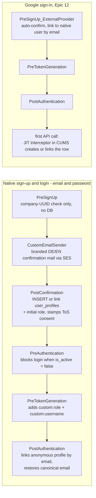
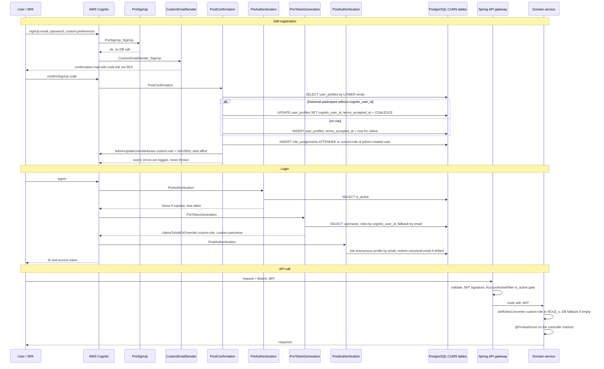
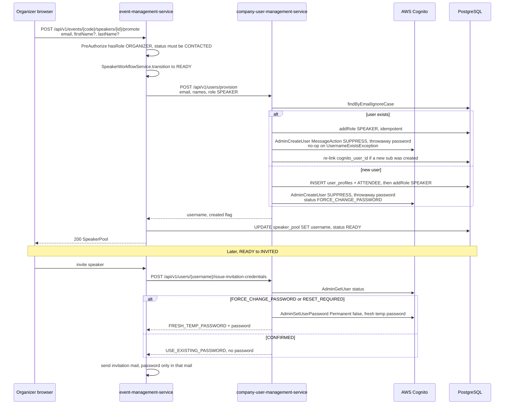
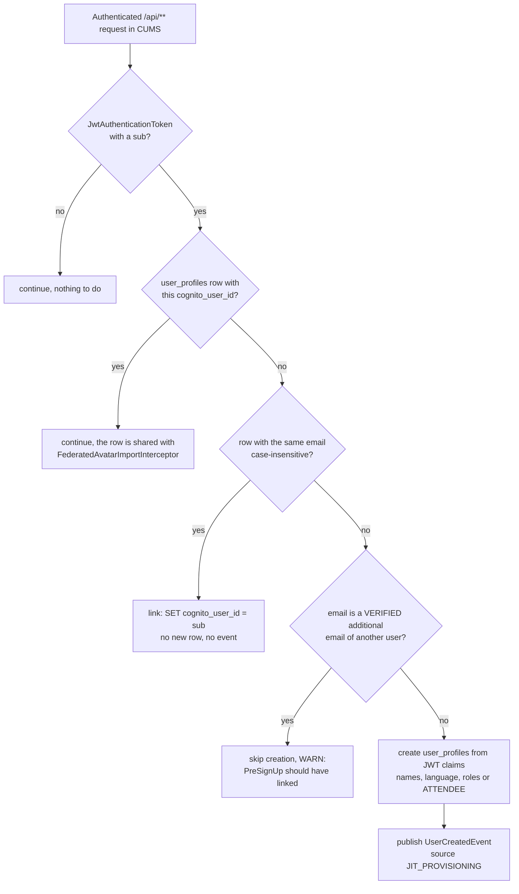
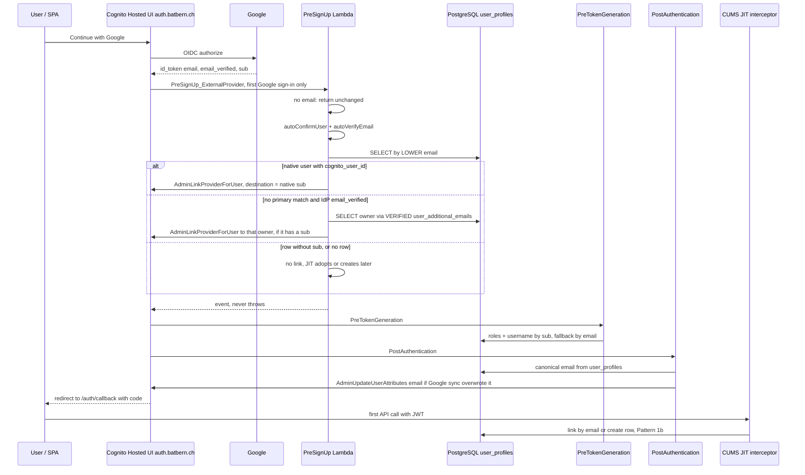
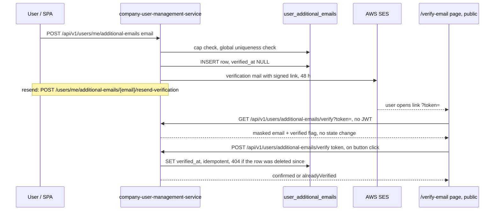
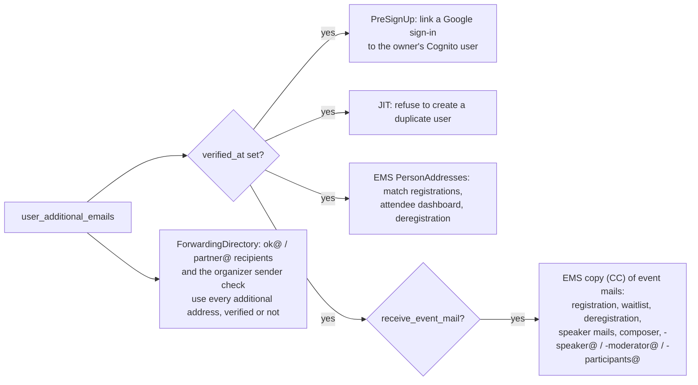

# User Lifecycle and Sync Patterns

This document outlines the user lifecycle management and synchronization patterns between AWS Cognito and PostgreSQL for the BATbern Event Management Platform.

## Architecture Decision

Per **[ADR-001: Invitation-Based User Registration Architecture](./ADR-001-invitation-based-user-registration.md)**, BATbern implements a **database-centric** user management architecture with the following principles:

- **Database as Single Source of Truth**: All user data and roles stored in PostgreSQL
- **Cognito for Authentication Only**: JWT generation and validation only
- **NO Cognito Groups**: Roles managed exclusively via `role_assignments` table
- **Unidirectional Sync**: Cognito → Database (via Lambda triggers and reconciliation job; no reverse DB→Cognito writes)

## Problem Statement

The BATbern platform maintains user data in two distinct systems:

1. **AWS Cognito User Pool** - Authentication, credentials, email verification, MFA
2. **PostgreSQL Database** - User profiles, roles, business relationships, audit trails, event participation

**Key Requirements:**
- **Self-Registration**: Users can register directly via Cognito (Story 1.2.3)
- **Automatic Database Creation**: Database user created automatically on Cognito signup
- **Role-Based Authorization**: JWT contains roles from database for API authorization
- **Single Source of Truth**: Database is authoritative for all user data and roles

## Sync Architecture Overview

BATbern implements a **simplified unidirectional sync** from Cognito to Database. Cognito has six
Lambda triggers wired (`infrastructure/lib/constructs/cognito-user-sync-triggers.ts` adds PreSignUp,
PostConfirmation, PreAuthentication, PostAuthentication, PreTokenGeneration; `cognito-stack.ts` adds
CustomEmailSender). Which of them fire depends on how the person signs in:



Federated sign-ins never fire PostConfirmation or PreAuthentication; row creation and the `is_active`
check are covered by the JIT interceptor and the gateway `AccountActiveFilter` instead (see
Pattern 1b and Pattern F below).

The native path end to end:



Roles are checked in the services, not in the gateway (ADR-008). The earlier version of this diagram
showed `@PreAuthorize` on the API gateway; that has not been true since #1147.

**Design Principles:**
- **Cognito as Auth Source of Truth** - Credentials, verification status, MFA settings
- **Database as Business Source of Truth** - User profiles, roles, relationships, audit trails
- **Unidirectional Sync** - Cognito → Database (no DB→Cognito writes; a reconciliation job reads Cognito to deactivate orphaned DB users)
- **No Drift** - Reconciliation job detects and resolves divergence
- **Simplified Operations** - No compensation logs

## Pattern 1: PostConfirmation Lambda - User Creation

**Purpose**: Automatically create database user record when user completes email verification in Cognito.

**Trigger**: AWS Cognito `PostConfirmation` event

**Implementation**:

```typescript
// infrastructure/lib/lambda/triggers/post-confirmation.ts
import { PostConfirmationTriggerHandler } from 'aws-lambda';
import { getDbClient } from './common/database';

export const handler: PostConfirmationTriggerHandler = async (event) => {
  console.log('PostConfirmation trigger invoked', {
    cognitoUserId: event.request.userAttributes.sub,
    email: event.request.userAttributes.email
  });

  const { sub: cognitoUserId, email, given_name, family_name } = event.request.userAttributes;
  const language = event.request.userAttributes['custom:language'] || 'de';

  const client = await getDbClient();

  try {
    // Generate username from name (e.g., john.doe)
    const username = generateUsername(given_name, family_name, email);

    // 1. Create user_profiles record
    await client.query(
      `INSERT INTO user_profiles (
        cognito_user_id, email, first_name, last_name, username, pref_language
      )
      VALUES ($1, $2, $3, $4, $5, $6)
      ON CONFLICT (cognito_user_id) DO NOTHING`,
      [cognitoUserId, email, given_name, family_name, username, language]
    );

    // 2. Get user ID
    const userResult = await client.query(
      `SELECT id FROM user_profiles WHERE cognito_user_id = $1`,
      [cognitoUserId]
    );

    if (userResult.rows.length === 0) {
      // User already existed (ON CONFLICT triggered)
      console.log('User already exists in database', { cognitoUserId });
      return event;
    }

    const userId = userResult.rows[0].id;

    // 3. Assign default ATTENDEE role (FR22)
    await client.query(
      `INSERT INTO role_assignments (user_id, role, granted_by)
      VALUES ($1, 'ATTENDEE', NULL)
      ON CONFLICT (user_id, role) DO NOTHING`,
      [userId]
    );

    console.log('User created successfully', {
      userId,
      email,
      role: 'ATTENDEE'
    });

  } catch (error) {
    console.error('Failed to create database user', {
      error: error.message,
      stack: error.stack,
      cognitoUserId,
      email
    });

    // Don't throw - allow Cognito confirmation to succeed
    // User can still authenticate, and we can fix DB later
  } finally {
    client.release();
  }

  return event; // Must return event to Cognito
};

// Username: lib/lambda/triggers/common/username.ts — a 1:1 port of the Java generator, see
// "Names, emails and usernames" below. Duplicates get a numeric suffix (john.doe.2).
```

> **The code above is a simplified sketch.** The deployed `post-confirmation.ts` (checked
> 2026-11-04) first looks the user up by `lower(email)` inside a transaction: a row without
> `cognito_user_id` (historical participant, guest registrant) is **linked** by `UPDATE`, a row
> with the same `sub` is a retry no-op, a row with a different `sub` is an email conflict. Only when
> no row exists does it `INSERT`, after resolving username collisions. It also stamps
> `terms_accepted_at` for native sign-ups (Pattern C), honours a `custom:role` attribute of
> admin-created users for the initial role, and writes the `custom:role = UNUSED` sentinel back to
> Cognito. See the native sequence diagram above.

**Key Characteristics**:
- **Idempotent**: `ON CONFLICT DO NOTHING` prevents duplicate creation
- **Non-Blocking**: Errors logged but don't fail Cognito confirmation
- **Performance**: Completes within 1 second (p95 latency requirement)
- **Default Role**: Always assigns ATTENDEE role per FR22

**Database Tables Modified**:
- `user_profiles`: Creates user record with Cognito ID
- `role_assignments`: Creates default ATTENDEE role assignment

## Pattern N: Speaker Provisioning at CONTACTED → READY (per ADR-009)

**Purpose**: Provision a Cognito user, grant the SPEAKER role, and persist a `user_profiles` row at the `CONTACTED → READY` speaker-workflow transition (per ADR-009 §0.5). This is the **organizer-initiated** speaker onboarding flow — distinct from Pattern 1 (which is the self-registration / PostConfirmation flow for attendees).

**Trigger**: `SpeakerWorkflowService.transition()` invoked with `targetState = READY` (typically via the organizer kanban's `POST /api/v1/events/{eventCode}/speakers/{speakerId}/promote` endpoint).

**Preconditions**:
- The transition payload MUST contain a non-blank `email`. `transition()` rejects the call with `MissingProvisioningDataException` otherwise.
- The current `speaker_pool.status` MUST be `CONTACTED`. The allow-list rejects any other origin.

**Sequence** (redrawn 2026-11-04 against `SpeakerStatusController.promoteSpeakerToReady`,
`UserService.provisionUserWithRole` and `UserService.issueInvitationCredentials`; the earlier diagram
had CUMS return a temporary password at READY, which Story 11.E.2 removed):



**Steps performed by `UserService.provisionUserWithRole(...)` in `company-user-management-service`**
(called by EMS `UserApiClient.provisionUserWithRole` → `POST /api/v1/users/provision`):

1. **Whitelist**: a non-ADMIN caller may only grant `SPEAKER`.
2. **Look up by lower-cased email.** If the user exists, grant the role (idempotent) and call
   `adminCreateUserSilently`, which is a no-op when the Cognito user exists and otherwise creates the
   missing shell and re-links the new `sub` into `user_profiles`. Returns `created=false`.
3. **Otherwise create** the `user_profiles` row (default role ATTENDEE), grant `SPEAKER`, then
   **`cognito-idp:AdminCreateUser`** with `MessageAction=SUPPRESS` and a **throwaway** password that
   is discarded immediately; the user lands in `FORCE_CHANGE_PASSWORD`. Returns `created=true`.
4. The response carries `{ username, created }` only. **No temporary password is returned at
   READY.** The real temporary password is issued at `READY → INVITED` by
   `issueInvitationCredentials` (`AdminSetUserPassword Permanent=false`) and goes straight into the
   invitation mail. That call also self-heals a missing Cognito user.

**Idempotency contract**: re-calling `provisionUserWithRole` for an already-provisioned user is a
no-op and returns the same username with `created=false`. A lost create race
(`DataIntegrityViolationException` on the email constraint) is treated the same way.

**Failure modes**:
- **Cognito failure on the new-user branch** (anything but `UsernameExistsException`): the
  `@Transactional` rolls back the user and role rows; EMS gets HTTP 502 and the transition stays at
  `CONTACTED`. The organizer can retry.
- **`role_assignments` duplicate**: `RoleService.addRole` detects it and does nothing.

**The temporary password is never persisted**:
- Not in `user_profiles`.
- Not in `role_assignments`.
- Not in any log line.
- Not in any audit trail row (only "promoted by X at T" is recorded — not the credential).
- The `issue-invitation-credentials` response is the only place it appears, and only for the lifetime of the `READY → INVITED` invitation-email dispatch. The throwaway password of `provisionUserWithRole` never leaves CUMS.

**Database tables modified**:
- `user_profiles`: Inserts a new user row (idempotent).
- `role_assignments`: inserts the `SPEAKER` role for the user's `user_id` (idempotent).
- `speaker_pool` (in event-management-service): Sets `username` and `status = 'READY'`.

**Pattern relationship**:
- **Pattern 1 (PostConfirmation Lambda)** remains the standard path for self-registered attendees (FR22, Story 1.2.3). When such an attendee is later promoted to SPEAKER via Pattern N, the User row already exists — `provisionUserWithRole` adds the role and returns `created=false`; at `READY → INVITED` `issueInvitationCredentials` sees a `CONFIRMED` Cognito user and returns `USE_EXISTING_PASSWORD` (no re-credentialing).
- **Pattern 2 (PreTokenGeneration Lambda)** is unchanged: it reads `role_assignments` at login time and adds the roles list to the `custom:role` JWT claim.
- **Pattern 3 (Spring Security role extraction)** is unchanged: it reads `custom:role` from the JWT and maps to Spring `GrantedAuthority`.

## Pattern 2: PreTokenGeneration Lambda - JWT Role Enrichment

**Purpose**: Add user roles from database to JWT token as custom claims for API authorization.

**Trigger**: AWS Cognito `PreTokenGeneration` event (on every login/token refresh)

**Implementation**:

```typescript
// infrastructure/lib/lambda/triggers/pre-token-generation.ts
import { PreTokenGenerationTriggerHandler } from 'aws-lambda';
import { getDbClient } from './common/database';

export const handler: PreTokenGenerationTriggerHandler = async (event) => {
  console.log('PreTokenGeneration trigger invoked', {
    cognitoUserId: event.request.userAttributes.sub
  });

  const cognitoUserId = event.request.userAttributes.sub;
  const client = await getDbClient();

  try {
    // Fetch user roles, username, and companyId from database
    const result = await client.query(
      `SELECT DISTINCT r.role, u.username, u.company_id
       FROM role_assignments r
       JOIN user_profiles u ON r.user_id = u.id
       WHERE u.cognito_user_id = $1
       ORDER BY r.role`,
      [cognitoUserId]
    );

    const roles = result.rows.map(row => row.role);
    const username = result.rows[0]?.username ?? null;
    const companyId = result.rows[0]?.company_id ?? null;

    // Add roles, username, and companyId to JWT as custom claims (ADR-001)
    const claimsToAdd: Record<string, string> = {
      'custom:role': roles.join(',') // e.g., "ATTENDEE,SPEAKER"
    };
    if (username) claimsToAdd['custom:username'] = username;   // DB username (e.g. "john.doe")
    if (companyId) claimsToAdd['custom:companyId'] = companyId;

    event.response = {
      claimsOverrideDetails: {
        claimsToAddOrOverride: claimsToAdd
      }
    };

    console.log('Claims added to JWT', { cognitoUserId, roles, username, companyId });

  } catch (error) {
    console.error('Failed to fetch roles from database', {
      error: error.message,
      stack: error.stack,
      cognitoUserId
    });

    // Graceful degradation: Return empty roles instead of failing authentication
    event.response = {
      claimsOverrideDetails: {
        claimsToAddOrOverride: {
          'custom:role': '',
          // custom:username and custom:companyId omitted on error
        }
      }
    };

    console.warn('Returning empty roles due to database error', { cognitoUserId });
  } finally {
    client.release();
  }

  return event;
};
```

**Key Characteristics**:
- **Performance**: Completes within 500ms (p95 latency requirement)
- **Graceful Degradation**: Returns empty roles on database errors (allows login)
- **JWT Claim Format**: `custom:role` (comma-separated), `custom:username` (DB username), `custom:companyId` (optional)
- **NO Cognito Groups**: Roles stored exclusively in database

**JWT Token Example**:

```json
{
  "sub": "a1b2c3d4-5678-90ab-cdef-EXAMPLE11111",
  "cognito:username": "john.doe@example.com",
  "email": "john.doe@example.com",
  "custom:role": "ATTENDEE,SPEAKER",
  "custom:username": "john.doe",
  "custom:companyId": "COMP-0001",
  "custom:language": "de",
  "iss": "https://cognito-idp.eu-central-1.amazonaws.com/eu-central-1_XXXXXXXXX",
  "exp": 1698765432,
  "iat": 1698761832
}
```

**JWT Claim Notes**:
- `custom:username` — DB-assigned username (e.g., `"john.doe"`); set by PreTokenGeneration from `user_profiles.username` (ADR-001). Application falls back to `sub` when absent.
- `custom:companyId` — optional; present only when user is linked to a company.
- `custom:role` — comma-separated role list (e.g., `"ORGANIZER,SPEAKER"`); whitespace around values is trimmed by Spring Security.

> **⚠️ Drift correction (ADR-010, 2026-05-31):** the illustrative code and token example above
> show a `custom:companyId` claim, but the **deployed `pre-token-generation.ts` injects only
> `custom:username` and `custom:role`** — `companyId` in today's token comes from the *stored*
> Cognito attribute flowing into the ID token, not from this Lambda. Per **ADR-010 / ADR-003 /
> ADR-004**, `companyId` is being **removed from the token entirely** and resolved on demand via
> the user-api keyed on `username`. The target token carries only `sub`, `email`, `custom:role`,
> `custom:username`. (`custom:language` in the example is likewise illustrative — it is not a
> defined pool attribute.) See §"Cognito Custom-Attribute Inventory & Deprecation Status" below
> and `ADR-010-federated-identity-via-cognito.md` (D6).

## Pattern 3: Spring Security - Role Extraction from JWT

**Purpose**: Extract roles from JWT `custom:role` claim and map to Spring Security authorities.

**Implementation**:

```java
// api-gateway/src/main/java/ch/batbern/gateway/config/SecurityConfig.java
package ch.batbern.gateway.config;

import org.springframework.context.annotation.Bean;
import org.springframework.context.annotation.Configuration;
import org.springframework.security.config.annotation.method.configuration.EnableMethodSecurity;
import org.springframework.security.config.annotation.web.builders.HttpSecurity;
import org.springframework.security.config.annotation.web.configuration.EnableWebSecurity;
import org.springframework.security.core.GrantedAuthority;
import org.springframework.security.core.authority.SimpleGrantedAuthority;
import org.springframework.security.oauth2.jwt.Jwt;
import org.springframework.security.oauth2.server.resource.authentication.JwtAuthenticationConverter;
import org.springframework.security.web.SecurityFilterChain;

import java.util.Arrays;
import java.util.Collection;
import java.util.Collections;
import java.util.stream.Collectors;

@Configuration
@EnableWebSecurity
@EnableMethodSecurity(prePostEnabled = true)
public class SecurityConfig {

    @Bean
    public SecurityFilterChain securityFilterChain(HttpSecurity http) throws Exception {
        http
            .authorizeHttpRequests(authorize -> authorize
                .requestMatchers("/api/v1/auth/register", "/api/v1/auth/login").permitAll()
                .requestMatchers("/api/v1/companies/search").permitAll()  // Story 4.1.5: public for registration autocomplete
                .requestMatchers("/api/v1/admin/**").hasRole("ORGANIZER")
                .anyRequest().authenticated()
            )
            .oauth2ResourceServer(oauth2 -> oauth2
                .jwt(jwt -> jwt
                    .jwtAuthenticationConverter(jwtAuthenticationConverter())
                )
            );

        return http.build();
    }

    @Bean
    public JwtAuthenticationConverter jwtAuthenticationConverter() {
        JwtAuthenticationConverter converter = new JwtAuthenticationConverter();
        converter.setJwtGrantedAuthoritiesConverter(this::extractAuthorities);
        return converter;
    }

    private Collection<GrantedAuthority> extractAuthorities(Jwt jwt) {
        // Extract custom:role claim from JWT
        String rolesString = jwt.getClaimAsString("custom:role");

        if (rolesString == null || rolesString.isEmpty()) {
            return Collections.emptyList();
        }

        // Split comma-separated roles and map to Spring Security authorities
        // "ATTENDEE,SPEAKER" → [ROLE_ATTENDEE, ROLE_SPEAKER]
        return Arrays.stream(rolesString.split(","))
            .map(role -> new SimpleGrantedAuthority("ROLE_" + role.trim()))
            .collect(Collectors.toList());
    }
}
```

**Usage in Controllers**:

```java
// Example controller with role-based authorization
@RestController
@RequestMapping("/api/v1/events")
public class EventController {

    // Only ORGANIZER can create events
    @PostMapping
    @PreAuthorize("hasRole('ORGANIZER')")
    public ResponseEntity<EventDTO> createEvent(@RequestBody EventDTO event) {
        // ...
    }

    // ATTENDEE can view events
    @GetMapping
    @PreAuthorize("hasAnyRole('ATTENDEE', 'SPEAKER', 'PARTNER', 'ORGANIZER')")
    public ResponseEntity<List<EventDTO>> listEvents() {
        // ...
    }

    // SPEAKER can update their own proposals
    @PutMapping("/{eventCode}/proposals/{proposalSlug}")
    @PreAuthorize("hasRole('SPEAKER')")
    public ResponseEntity<ProposalDTO> updateProposal(
        @PathVariable String eventCode,
        @PathVariable String proposalSlug,
        @RequestBody ProposalDTO proposal
    ) {
        // Additional check: proposal.speakerId == currentUser.id
        // ...
    }
}
```

**Key Characteristics**:
- **Standard Spring Security**: Uses `@PreAuthorize` annotations
- **Role Mapping**: JWT claim "ATTENDEE" → Authority "ROLE_ATTENDEE"
- **Empty Roles Handling**: Falls back to the database lookup in Pattern 3b — only returns
  empty authorities if the DB also has no roles for the user.
- **NO Database Queries on the hot path**: in staging the JWT always carries `custom:role`,
  so the converter never touches the DB. The fallback below activates only when the JWT
  arrives without roles (local-dev case, or graceful degradation if PreTokenGen Lambda fails).

## Pattern 3b: Database Fallback for Empty JWT Roles (local-dev path, Epic 11.E.7)

**Purpose**: Resolve roles from the local PostgreSQL database when the JWT's `custom:role`
claim is empty. This is purely a local-dev correctness fix — in staging the JWT always
carries roles (Pattern 2 always succeeds), so this fallback never fires there. The path
doubles as graceful-degradation insurance in production if PreTokenGeneration ever fails.

**Why it exists**: in local development the frontend points at staging Cognito (`localhost:8100
→ AWS Cognito`), but CUMS writes `user_profiles` / `role_assignments` rows into the local
PostgreSQL (`localhost:5432/batbern_development`). The local DB is supposed to be a one-way
mirror synced FROM staging, but local provisioning (e.g. `adminCreateUserSilently` during
speaker invitation in Pattern N) creates Cognito users in staging while the matching DB rows
land only locally. The PreTokenGeneration Lambda then queries the staging DB, finds nothing,
and returns a JWT without `custom:role`. Without this fallback, every locally-promoted
speaker lands on a blank dashboard because the frontend falls back to `attendee` and the
backend's `@PreAuthorize("hasRole('SPEAKER')")` checks reject every speaker-portal call.

**Backend implementation** (`shared-kernel/.../security/JwtRolesConverter.java`,
wired into each service's `SecurityConfig.jwtAuthenticationConverter()` bean):

```java
// 1. Try the JWT claim first (staging path — always populated by PreTokenGen Lambda)
String rolesString = jwt.getClaimAsString("custom:role");
if (rolesString == null || rolesString.isEmpty()) {
    rolesString = jwt.getClaimAsString("role"); // Watch JWT variant
}

if (rolesString != null && !rolesString.isEmpty()) {
    return toAuthorities(rolesString.split(","));
}

// 2. JWT carries no roles — look the user up directly by sub == cognito_user_id
//    against the local DB. Dormant in staging because branch 1 always succeeds there.
try {
    List<String> roles = jdbcTemplate.queryForList(
        "SELECT ra.role FROM user_profiles u "
      + "JOIN role_assignments ra ON ra.user_id = u.id "
      + "WHERE u.cognito_user_id = ?",
        String.class,
        jwt.getSubject());
    return toAuthorities(roles);
} catch (Exception e) {
    // Preserve pre-fallback behaviour: empty authorities on any DB error
    return Collections.emptyList();
}
```

**Frontend implementation** (`web-frontend/src/contexts/AuthContext.tsx`):
after `authService.signIn` (and `initializeAuth`, and `confirmNewPassword`) return a
`UserContext`, if `user.roles.length === 0` the provider calls
`GET /users/me?include=roles` and merges `availableRoles` / `currentRole` into the
context before dropping `isLoading: false`. This fixes UI gating — Dashboard redirect,
`ProtectedRoute.canAccess`, RoleSelector — for local-dev users whose JWT lacks roles.
On any failure the user is left as-is (Dashboard's defensive fallback handles the
still-empty case).

**Where this kicks in**:

| Environment | JWT `custom:role` | Fallback fires? | Why |
|---|---|---|---|
| Staging (web)  | `"ORGANIZER,SPEAKER"` (or similar)            | No  | Pattern 2 Lambda populates the claim from the staging DB. |
| Staging (web) — PreTokenGen Lambda outage | empty | Yes | Graceful degradation: services + frontend look up the user in the staging DB directly. |
| Local dev — user provisioned via Pattern 1 (PostConfirmation, self-registration) | `"ATTENDEE"` | No | Cognito user + DB row both exist in staging; PreTokenGen finds the row. |
| Local dev — speaker invited via Pattern N (organizer kanban) | empty | Yes | Cognito user is in staging, but `user_profiles` row is local only; PreTokenGen finds nothing in the staging DB. |

**Caching and performance**: the converter does one indexed-lookup query
(`user_profiles.cognito_user_id` is a primary-key style index) only when the
JWT roles claim is empty. In staging this path is dormant — zero queries on
the hot path. In local dev there is no caching at the converter level (each
request validates the JWT independently), so the lookup runs once per
authenticated request. This is acceptable for development; if hot in
production (which would indicate the Lambda is failing) we would add a small
Caffeine cache keyed by `sub` with TTL = JWT exp − now.

**What this does NOT replace**: this is a fallback for the role-extraction
step only. The PreTokenGen Lambda (Pattern 2) remains the canonical role-population
mechanism. The fallback is invisible in staging by design — anyone debugging
"why don't my roles work" should still start with Pattern 2 and the Lambda
CloudWatch logs.

### Pattern 3b twin: username fallback (Story 11.E.9, 2026-05-21)

Same root cause as the role-extraction fallback above, applied to the `custom:username`
claim. The PreTokenGen Lambda (Pattern 2) writes `custom:username` from
`user_profiles.username` — for locally-provisioned speakers (Pattern N), the Lambda
runs against the staging DB, finds no `user_profiles` row, and either omits the claim
or returns an empty string. The pre-fix `getCurrentUsername()` check was
`if (username == null)` only, so empty string passed through and downstream queries
like `sessionUserRepository.findByUsername("")` matched nothing — locally-promoted
speakers saw an empty dashboard.

**Backend implementation** (`services/event-management-service/.../security/
SecurityContextHelper.java`):

```java
String username = jwt.getClaim("custom:username");
if (username != null && !username.isBlank()) {
    return username;            // staging path — claim is populated
}
// Local-dev fallback: resolve by cognito_user_id (mirrors JwtRolesConverter)
String resolved = jdbcTemplate.queryForObject(
        "SELECT username FROM user_profiles WHERE cognito_user_id = ?",
        String.class,
        jwt.getSubject());
return resolved != null ? resolved : jwt.getSubject();  // final fallback: UUID
```

**Symptom this fixes**: `GET /api/v1/speaker-portal/dashboard` returns
`{ speakerName: "", upcomingEvents: [], pastEvents: [] }` for a locally-provisioned
speaker whose `session_users` and `user_profiles` rows exist correctly. The log
line `Dashboard request: username= ip=...` is the diagnostic giveaway —
`SecurityContextHelper` emitted an empty username.

**Where this kicks in**: identical to the role twin above — dormant in staging
(JWT always carries a non-empty `custom:username`), fires only for the local-dev
"speaker invited via Pattern N" case. The fallback is scoped to event-management-service
today; if other services start reading `custom:username` in code paths that touch
speaker identity, they need the same twin (the shared-kernel home would be a clean
follow-up if reuse appears).

## Cognito Custom-Attribute Inventory & Deprecation Status

This pool defines four custom attributes (`cognito-stack.ts:175-197`). Per ADR-001 the
**database is the single source of truth** and Cognito is for **authentication only** — so the
token should carry *identity* (`sub`, `email`) and *authorization* (`custom:role`,
`custom:username`) and **nothing else**. The other attributes are legacy/bootstrap residue.

### Key distinction: stored attribute ≠ JWT claim
A custom *attribute* persisted on the Cognito user record is **not** the same as a *claim* in
the issued token. The PreTokenGeneration Lambda computes `custom:role` / `custom:username`
fresh from the DB on every token via `claimsToAddOrOverride` — it does **not** read the stored
attributes, and a claim does **not** require a matching schema attribute. So the role/username
in your JWT are DB projections, regardless of what is stored on the user.

### Inventory

| Attribute | Purpose | Source of truth | Written at signup | Read at runtime | Status / target |
|---|---|---|:--:|:--:|---|
| `custom:username` | cross-service identifier (ADR-003) | DB → **projected claim** | no | yes (injected claim) | ✅ Keep — earns its place in the token |
| `custom:role` | authorization | DB → **projected claim** | no | yes (injected claim) | ✅ Claim kept; **stored attribute dropped from the client `readAttributes`** (Story 12.1, `cognito-stack.ts`) so it no longer flows into tokens; stored value sentineled to `"UNUSED"` |
| `custom:preferences` | firstName/lastName/language/theme/notifications | DB (`user_profiles.*`) — **done** (Story 12.1) | yes (signup **seed**) | FE runtime: from `/users/me` (`AuthContext.hydrateUserFromDb`), not the token. Backend: JIT + reconciliation read it from the JWT on the **create path only** to seed firstName/lastName/**language** (Story 12.3) | ✅ Demoted to signup/provisioning seed; FE runtime reads moved to `/users/me`; backend reads it once, on first-request create, to mirror `post-confirmation.ts` |
| `custom:companyId` | user→company relation | DB FK → company-api (ADR-003/004) | **no** — signup write removed (Story 12.1) | **no** — gateway/FE/CUMS extraction all removed (Story 12.1) | ✅ **Removed from token entirely** (no longer written or read anywhere) |

### Resolved decision — `custom:companyId` does not belong in the token
Company membership is **pure business data**, not identity or authorization. The only
company-scoped authorization path (`PartnerAnalyticsController` →
`@partnerSecurityService.isCurrentUserCompany(#companyName)`) **already resolves the company
server-side via the user-api** (`PartnerSecurityService` calls
`userServiceClient.getUserByUsername(username)` and compares `companyName`) — it never reads the
`custom:companyId` claim. The claim is therefore redundant token bloat, and is additionally
mis-modeled (validated as a UUID in `preSignUp`, while the real reference everywhere else is the
12-char meaningful `companyName` per ADR-003).

**Target:** any service needing a user's company calls the user-api keyed on `username` (15-min
Caffeine enrichment cache, ADR-004). `custom:companyId` is **not** emitted as a claim and **not**
projected by PreTokenGeneration. The frontend reads company from `/users/me`, not the token.
> Note: `custom:role` is a claim because Spring Security builds authorities from it; `companyId`
> participates in no authorization-from-token decision, so it must **not** be projected as a claim.

### Permanence constraint — cleanup means "stop using", not "delete"
AWS Cognito provides **no API to delete a custom attribute** once added to a pool — the schema
entries are permanent unless the entire pool is rebuilt (a full user migration). So the cleanup is
"stop using", done as follows (all landed in Story 12.1):
- **`custom:role`** — `'role'` **dropped** from the client `readAttributes` (`cognito-stack.ts`)
  so the stored value no longer appears in tokens. The stored value is sentineled to `"UNUSED"`
  (fits `maxLen:20`) as documentation-in-the-data for anyone inspecting the Cognito console: a
  one-time paginated `AdminUpdateUserAttributes` backfill
  (`scripts/staging/backfill-cognito-role-unused.ts`) **plus** writing `"UNUSED"` on every new
  user — self-registered via `post-confirmation.ts` (best-effort, non-blocking) and
  admin-provisioned via CUMS `adminCreateUserSilently`. The DB-projected `custom:role`
  authorization claim (PreTokenGeneration) is unchanged.
- **`custom:companyId`** — runtime reads removed everywhere (gateway `UserContextExtractor`,
  CUMS `SecurityContextHelper.getCompanyId()`, FE `extractUserContextFromToken`) and the signup
  write removed (`authService.ts`), so the attribute is fully out of the token path. It remains a
  permanent (now-unused) schema entry.
- **`custom:preferences`** — runtime reads moved to `/users/me` (FE hydration + gateway/Spring
  no longer depend on the token claim); it remains as the signup seed (`post-confirmation.ts`
  reads it to populate `user_profiles`).

### Minimal target footprint
Standard `email` (sign-in) + `sub` (immutable key → `user_profiles.cognito_user_id`) for identity;
`custom:role` + `custom:username` as DB-projected claims for authorization/lookup. No other custom
attribute in the token. Everything else is resolved from the DB via the user-api per ADR-004.

> Drift fixed alongside this entry: the Pattern 2 example in this document previously showed
> PreTokenGeneration injecting a `custom:companyId` claim from the DB. The deployed
> `pre-token-generation.ts` does not (and per the decision above, should not) — companyId in the
> current token comes from the stored attribute flowing into the ID token, which is exactly what
> this cleanup removes.

**Related:** [ADR-001](./ADR-001-invitation-based-user-registration.md) (Cognito-for-auth-only),
[ADR-003](./ADR-003-meaningful-identifiers-public-apis.md) (meaningful IDs),
[ADR-004](./ADR-004-factor-user-fields-from-domain-entities.md) (factor user fields, enrich via user-api).

## What We DON'T Do

### ❌ No Cognito Groups
**Reason**: Roles stored exclusively in database `role_assignments` table. Cognito Groups are not used.

**Alternative**: JWT `custom:role` claim populated from database.

### ❌ No Reverse Sync (Database → Cognito)
**Reason**: Cognito is for authentication only. User data changes (roles, profiles) stay in database.

**Clarification**: The reconciliation job reads Cognito state to deactivate orphaned DB users — this is still Cognito→DB direction. No roles or profile data are written from the DB to Cognito. Three narrow Cognito writes do exist (checked 2026-11-04): PostConfirmation sets the `custom:role = UNUSED` sentinel, PostAuthentication writes `user_profiles.email` back as the Cognito `email` when a Google attribute sync overwrote it, and CUMS creates or re-credentials Cognito users for speakers (Pattern N).

**Alternative**: Roles updated in database only. Next login fetches updated roles via PreTokenGeneration.

### ✅ JIT (Just-In-Time) Provisioning Interceptor — Canonical, provider-agnostic reconcile path

**Pattern 1b** _(Story 12.3, SSO PR 1 — Part B)_: `JITUserProvisioningInterceptor` runs on every authenticated `/api/**` request and is the **single, provider-agnostic create path** for any first-request identity — **native OR federated**. If a valid JWT is present but no DB user record is found (`findByCognitoUserId()` returns empty), the interceptor reconciles the DB from the JWT, reading exactly what `post-confirmation.ts` reads so federated and native users converge on identical rows.

Decision path of `JITUserProvisioningInterceptor.preHandle` (CUMS, checked 2026-11-04):



Every branch continues the request; a failure is logged and the request proceeds (fail-open).

**What it captures on create** (mirrors `post-confirmation.ts`):
- **firstName / lastName** — from standard `given_name`/`family_name`, falling back to the `custom:preferences` JSON (the signup form packs names there per ADR-001). Username is derived by the shared generator (see **Names, emails and usernames**).
- **language** — from the `language` field of `custom:preferences`, normalized to a supported 2-char code (primary subtag, lowercased — `fr-CH → fr`; unsupported/over-length tags like `gsw-BE` fall back to the embeddable default `"de"`, since `pref_language` is `VARCHAR(2)`). When absent/malformed, the row also falls back to `"de"` (`UserPreferences`). _This closed the `custom:preferences` language divergence vs. PostConfirmation **on the create path** (Story 12.3); before it, a Swiss-French / EN signup reaching JIT silently lost its chosen language. Residual: the email-**link** branch (existing-anonymous-by-email) does not re-capture language, where `post-confirmation.ts` `COALESCE`s it — accepted as low-value (linked rows already carry a language); see Story 12.3 Dev Agent Record._
- **roles** — from the JWT `GrantedAuthority` list; no roles → defaults to `ATTENDEE`. Multi-role JWTs produce multi-role DB entries.

**Link on first request**: Pre-invited / historical-participant users (created with `cognito_user_id = NULL`) are **linked** to their Cognito `sub` on first request when the interceptor detects an existing record with the same email but no Cognito ID — no duplicate row, existing username/roles preserved, **no** `UserCreatedEvent`.

**Error handling**: JIT provisioning is **fail-open / non-blocking** — the request continues even if DB user creation fails (consistent with every other provisioning path).

**Event publishing**: A successful *create* publishes a domain event with `source = "JIT_PROVISIONING"` (the *link* path publishes none).

**Relationship to PostConfirmation**: PostConfirmation Lambda is the **native fast-path** (it runs synchronously at self-registration confirmation). It is **not** superior to JIT — it is simply earlier for native sign-ups. Federated (Google, ADR-010) sign-ins **never** fire PostConfirmation (Cognito fires only Pre-Sign-up / Pre-Token-Generation / Post-Authentication for external IdPs), so a brand-new federated user's row is created by this interceptor on their first authenticated request. Because JIT now captures exactly what PostConfirmation captures, **Story 12.8 (Phase 3 federated provisioning) is verify-only** — it confirms a real Google identity provisions correctly through this path and builds nothing new.

**Pattern 1c** _(Story 12.12)_: **one-time federated avatar import.** `FederatedAvatarImportInterceptor` — a sibling of the JIT interceptor, registered immediately **after** it on the same `/api/**` patterns (so on the very first federated request the JIT-created row already exists) — watches every authenticated request for an ID-token `picture` claim (mapped by the Cognito Google IdP `attributeMapping`; requires `picture` in the app client's read **and** write attributes per the 12.8-F1b rule, or Cognito silently drops it).

- **Trigger**: `picture` claim present AND `profile_picture_url IS NULL` AND `picture_import_attempted_at IS NULL`. Native sign-ins carry no claim → immediate exit, zero DB cost. The interceptor reuses the `User` the JIT interceptor resolved for the request (request attribute) instead of re-running the same `findByCognitoUserId` SELECT.
- **One TERMINAL attempt ever** _(refined by the 12.12 code review)_: `user_profiles.picture_import_attempted_at` (CUMS V18, comment updated in V19) is claimed via an **atomic conditional UPDATE** (`UserRepository.claimPictureImportAttempt`) **before** the fetch is dispatched — the database serialises concurrent first requests, exactly one wins. A **terminal** outcome (success, upstream 3xx/4xx, non-image response, oversize, invalid/non-Google claim) keeps the claim forever: no clobbering user uploads, no re-import-after-delete loops, no repeated fetches of broken Google URLs. A **transient** failure (upstream 5xx/429, network timeout, executor rejection) **releases the claim** so a later federated request retries — a one-off Google blip doesn't permanently cost the user their avatar.
- **Fetch-once-and-own**: the photo is fetched server-side (dedicated `avatarImportExecutor`, never on the request thread) via the shared `ImageUrlFetcher` pipeline, validated and stored through the existing `ProfilePictureService` (content-type + 5 MB validation, `profile-pictures/{year}/{username}/` key convention) and served from `cdn.batbern.ch` — `googleusercontent.com` URLs are never hotlinked (they rotate/expire).
- **SSRF guard**: only `https` URLs on `googleusercontent.com` (or a subdomain) are ever fetched, and the fetch client refuses redirects (`Redirect.NEVER`) so the validated host can't 3xx the fetch onto a different one; the sized variant suffix (`=s96-c`, also with trailing query/fragment, or the legacy `/s96-c/` path-segment form) is upgraded to the 512px variant before fetching.
- **Error handling**: same fail-open contract as JIT — any failure is logged and swallowed; a broken avatar fetch never fails the user's API request.
- **Lost-update safety**: `User` is `@DynamicUpdate` — the async import's save writes only the picture columns, so it cannot clobber concurrent profile/onboarding writes (and vice versa).

### ✅ Reconciliation Job — `UserReconciliationService`

`UserReconciliationService` provides `reconcileUsers()` and `checkSyncStatus()` to detect and resolve divergence between the DB and Cognito.

**Orphan detection**: Iterates all active DB users with a non-null `cognito_user_id`, calls `adminGetUser` on each, and deactivates any whose Cognito account no longer exists — setting `is_active = false` and `deactivation_reason = "Cognito user deleted"`.

**Missing user detection**: Identifies users present in Cognito but absent from the DB (typically PostConfirmation failures) and creates the missing DB records.

**Skip rule**: Users with `cognito_user_id = NULL` (pre-invited users not yet linked) are **excluded** from the orphan check — `adminGetUser` is never called for them.

**Sync direction**: Cognito remains the authoritative source. The reconciliation job reads Cognito state and mutates the DB only — there is no reverse sync (DB→Cognito).

**Metrics**: Progress and results (`orphanedUsers`, `missingUsers`, duration, errors) are published via `UserSyncMetricsService`.

### ✅ Unconfirmed Sign-up Resend Job — `CognitoConfirmationResendJob`

`CognitoConfirmationResendJob` (company-user-management-service) runs daily and re-sends the Cognito
sign-up confirmation code to accounts still in `UNCONFIRMED` status. It exists because Cognito's
sign-up confirmation code is fixed at **24 hours** and is **not configurable** (only our own
registration-confirmation token — in event-management-service — has a configurable window). An
attendee whose first code expired before they clicked hits a recovery dead-end: re-registering
reports "email already exists" and password-reset reports "user not registered". The nightly job
hands them a fresh, valid code automatically (re-triggering the `CustomEmailSender_SignUp` Lambda)
instead of requiring manual admin remediation.

**Eligibility**: `UserStatus == UNCONFIRMED` **and** signup age within `[after-hours, after-hours +
window-hours)` (defaults 48h / 48h). The bounded window is a **stateless** anti-spam guard —
UNCONFIRMED users have no `user_profiles` row to record a resend count (PostConfirmation only creates
one on confirmation), so the age window limits each account to a few nudges across daily runs, then
leaves it alone.

**Resend call**: `ResendConfirmationCode` keyed by the email alias (the SPA app client has no secret,
so no `SecretHash` is required). Requires the `cognito-idp:ResendConfirmationCode` +
`cognito-idp:ListUsers` IAM actions on the user-pool ARN (granted to the CUMS task role). Configurable
via `cognito.resend.*` (`enabled`, `cron`, `after-hours`, `window-hours`). Confirmed accounts and
accounts outside the window are skipped.

### ❌ No Compensation Logs
**Reason**: No bidirectional sync means no partial failure scenarios requiring compensation.

**Alternative**: None needed.

### ⚠️ PreAuthentication Trigger — CORRECTED (was wrongly listed here as "not done")
**This entry previously claimed "No PreAuthentication Trigger — application logic checks
`is_active`." Both halves were false** (corrected 2026-05-31, traced for ADR-010):
- A **PreAuthentication Lambda DOES exist and is wired**
  (`infrastructure/lib/lambda/triggers/pre-authentication.ts`) — it is in fact the **only** place
  `is_active` is enforced today (blocks login when `is_active = false`).
- The claimed app-layer check **does not exist**: the API Gateway `SecurityConfig` does JWT/role
  work only, and `JITUserProvisioningInterceptor` merely *sets* `isActive(true)` on create — no
  request-time gate reads `is_active`.

**Two gaps this leaves:** (a) PreAuthentication **never fires for federated logins**, so once SSO
ships a deactivated user could sign in via Google unchecked; (b) it only blocks at *login*, so a
24h-valid token keeps working after deactivation.

**Target (ADR-010) — DONE for Part A (Story 12.2, 2026-06-02):** the request-time **`is_active`
gate at the API Gateway** is now the **canonical** enforcement. `AccountActiveFilter`
(`api-gateway/.../security/AccountActiveFilter.java`) runs after Spring Security authentication,
resolves the caller's `active` flag from CUMS (`GET /internal/users/{username}`, the VPC-only
internal user API without JWT, via `GatewayUserStatusClient`; until 2026-10 it read the public
`/api/v1/users/{username}` with the caller's own JWT, which is organizer-only now), Caffeine-caches it (`expireAfterWrite ≈ 60s`, key = `custom:username`
→ `sub` fallback), and returns `403 ACCOUNT_DEACTIVATED` (never 401 — avoids the SPA refresh loop)
for a deactivated account. It is **fail-open** (CUMS error or 404 → allow + WARN +
`gateway.active_gate.cums_error` metric) and **provider-agnostic**, so it covers federated (Google)
logins and the post-issuance window — closing both gaps (deactivation effective within ~60s instead
of ≤24h). Kill-switch `security.active-gate.enabled` (default `false` in `application.yml`; production
sets `SECURITY_ACTIVE_GATE_ENABLED=true` in `infrastructure/lib/stacks/api-gateway-service-stack.ts`,
checked 2026-11-04). The **`PreAuthentication` trigger is now redundant** and is slated for
retirement in the cleanup track, **after** the gateway gate is confirmed live in prod (it is left
in place for now as defence-in-depth). Active eviction (a `UserDeactivated` signal → evict cache
key) is a documented FUTURE option, not built; there is no event bus to carry it (Story 17.2 part B). See `ADR-010-federated-identity-via-cognito.md` (D5)
and `docs/plans/sso-oidc-federation.md` (PR 1 — Part A).

## Pattern F: Federated sign-in + account linking (Story 12.6, SSO Phase 2)

**Purpose**: let an existing native (email/password) user sign in with Google for the
first time **without** losing their identity — the Google login is merged into the
existing Cognito user so `user_profiles.cognito_user_id` (the `sub`) is unchanged and
their roles / profile / company / history stay intact (ADR-010 D3, D7). Implemented in
the **PreSignUp** trigger (`infrastructure/lib/lambda/triggers/pre-signup.ts`), wired as
a VPC + DB-secret `NodejsFunction` in `CognitoUserSyncTriggers` (it replaced the former
inline `lambda.Code.fromInline` PreSignUp in `cognito-stack.ts`, which had no DB access).

**Federated trigger set (the shaping gotcha).** For an external IdP (Google) Cognito fires
**PreSignUp + PreTokenGeneration + PostAuthentication** — it does **NOT** fire
**PostConfirmation** or **PreAuthentication**. Consequences: native DB-row creation
(PostConfirmation, Pattern 1) is bypassed → a brand-new Google user's row is created lazily
by the **canonical JIT interceptor (Pattern 1b, Story 12.3)** on first API call (this trigger
creates **no** DB row); and the `is_active` gate (PreAuthentication) is bypassed → handled by
the **API-Gateway `is_active` gate (Story 12.2)**, not here.



**`triggerSource` branch** (the trigger does two unrelated jobs):
- **Native** (`PreSignUp_SignUp`, `PreSignUp_AdminCreateUser`, and any unrecognised source as
  a safe default): reproduces the legacy inline company-UUID validation **verbatim** — if
  `custom:companyId` is present and not a UUID, throw `'Invalid company ID format. Must be a
  valid UUID.'`; otherwise return. **No DB call, no auto-verify** (native confirmation still
  flows through CustomEmailSender). This path is regression-critical and short-circuits before
  any DB/SDK call, so a DB hiccup can never break password registration.
- **Federated** (`PreSignUp_ExternalProvider`):
  1. **Missing-email guard** — no/empty `email` → log + return, no link, auto-confirm left
     unset (email-keyed linking is impossible without an email; Apple private-relay is out of
     scope — ADR-010 D2 / plan §5 Phase 6).
  2. Set `autoConfirmUser = true` + `autoVerifyEmail = true` (the IdP already proved the email).
  3. Look up `user_profiles WHERE LOWER(email) = LOWER($1)` (case-insensitive — registration
     normalizes email to lowercase and the IdP returns a lowercased email, but a non-normalized
     legacy/admin row must still link rather than orphan a new `sub`; consistent with the
     `LOWER(email)` matching used elsewhere in the codebase). Three outcomes:
     - **Row with a non-null `cognito_user_id`** → call **`AdminLinkProviderForUser`**:
       `DestinationUser = { ProviderName: 'Cognito', ProviderAttributeValue: <native cognito_user_id> }`,
       `SourceUser = { ProviderName: 'Google', ProviderAttributeName: 'Cognito_Subject',
       ProviderAttributeValue: <Google sub from event.userName> }`. The destination `sub` is
       preserved → no `AliasExistsException`, no orphaned roles.
     - **Row with a NULL `cognito_user_id`** (anonymous event registrant — ADR-005) → **no link**
       (there is no Cognito destination user, and the new federated `sub` is unknown pre-confirmation
       so the trigger cannot stamp it either). Logged + metered `FederatedAnonymousPendingJit`;
       canonical JIT (Pattern 1b: `findByEmail` → `setCognitoUserId`) **adopts** the row on the
       federated user's first authenticated API call, preserving the anonymous registration's history.
     - **No row, but the IdP asserts `email_verified=true`** → fallback lookup in
       `user_additional_emails` for a **verified** (`verified_at IS NOT NULL`) row. A match whose
       owner has a `cognito_user_id` is linked to that owner (metric
       `FederatedUserLinkedViaAdditionalEmail`); an owner without a sub is deferred to JIT.
     - **No row at all** → no link; the brand-new Google user is provisioned later by JIT (Pattern 1b).
  4. **Never throws** on the federated path — a thrown error 503s the sign-in; lookup/link
     failures are logged + metered (`PreSignUpFailure`) and the event is returned. Because the
     auto-confirm flags are set (step 2) *before* the link attempt, a failed link is fail-open
     (the user is confirmed as an unlinked identity) — surfaced by a CloudWatch alarm on
     `PreSignUpFailure` (`UserSyncAlarms`) so the rare orphan is actionable rather than silent.

**IAM**: the trigger's role is granted `cognito-idp:AdminLinkProviderForUser` +
`cognito-idp:ListUsers` on a wildcard userpool resource (scoping to the pool ARN would create a
CFN circular dependency — the pool already depends on the Lambda via `addTrigger`; same
documented pattern as the `AdminUpdateUserAttributes` grant on PostConfirmation). Metrics:
`FederatedUserLinked` / `FederatedNewUser` / `FederatedAnonymousPendingJit` / `FederatedNoEmail`
/ `PreSignUpFailure` (`BATbern/UserSync`; `PreSignUpFailure` has a CloudWatch alarm). The preSignUp UUID-validation note in the Custom-Attribute Inventory
above (`custom:companyId` now dormant for self-registration) still holds — the check is
preserved verbatim because admin-created users may still pass `custom:companyId`. See
`ADR-010-federated-identity-via-cognito.md` (D3, D7) and `docs/plans/sso-oidc-federation.md`
(§5 Phase 2, §3).

## Pattern C: ToS/Privacy Consent & Federated Onboarding Gate (Story 12.11)

**Purpose**: record legally-required Terms-of-Service + Privacy-Policy consent per user and
block consent-less users (fresh federated sign-ups, retro-gated federated rows) until they
explicitly accept.

**Data model**: `user_profiles.terms_accepted_at TIMESTAMP WITH TIME ZONE NULL` (CUMS
migration V17). `NULL` = no consent on record. The nullable timestamp doubles as audit
record + gate flag. There is deliberately **no newsletter column** — newsletter consent
lives exclusively in the EMS `newsletter_subscribers` table (Story 10.7) via
`GET/PATCH /api/v1/newsletter/my-subscription`.

**Who stamps consent, where**:
- **Native self-registration** (PostConfirmation, Pattern 1): the RegistrationStep2 ToS
  checkbox was required to reach confirmation, so the Lambda stamps
  `terms_accepted_at = CURRENT_TIMESTAMP` in **both** its INSERT and its
  link-historical-participant UPDATE branch (write-once `COALESCE` on the UPDATE).
- **Federated sign-in**: detected via the `identities` user attribute (primary) or the
  `Google_` username prefix (fallback, case-insensitive) — `isFederatedSignIn()` in
  `post-confirmation.ts`. Leaves `terms_accepted_at` NULL: Google sign-in is NOT consent.
  JIT provisioning (Pattern 1b) likewise leaves it NULL.
- **Explicit acceptance**: `PUT /api/v1/users/me { "termsAccepted": true }` — WRITE-ONCE,
  server clock (`UserService.updateCurrentUser`); `false`/absent never changes recorded
  consent; consent can never be revoked through the API.
- **Backfill (V17)**: rows with a Cognito account created before the SSO go-live cutoff
  `2026-06-04 16:00:00+00` got `terms_accepted_at = created_at`. The cutoff is the
  discriminator because `cognito_user_id` stores the **sub UUID for ALL users** (federated
  included — `Google_<sub>` is the Cognito *username*, never persisted), so no
  username-shape predicate exists. Verified against the live DB 2026-06-04.

**Frontend gate** (`ProtectedRoute`): the hydrated user (Story 12.1 `hydrateUserFromDb`,
`GET /users/me`) carries `termsAcceptedAt`. `null` (confirmed absent — the service
serializes `non_null`, so a successful response without the field means no consent) →
redirect every protected path except `/profile` and `/logout` to `/profile?onboarding=1`,
where the role-neutral profile page preselects its Consent tab; a successful accept
refreshes the auth user (`refreshUser()`) and the gate lifts. `undefined` (hydration
failed) → **fail-open**, never lock users out on a transient `/users/me` failure.
`AuthCallbackPage` needs no special-casing — the gate is the single redirect point.

**Deploy-window caveat**: a NEW frontend talking to an OLD CUMS (no `termsAcceptedAt` in
`/users/me`) reads `null` and gates everyone; consent saves are absorbed by the old DTO and
lost. The window is minutes (same pipeline) and self-heals on backend rollout — users
re-accept once. Do not deploy the frontend bundle alone ahead of CUMS.

## Additional verified emails (Story 10.32, verification v2)

A user can register up to five extra addresses (`batbern.user.additional-emails.max`, default 5) in
`user_additional_emails` (CUMS). Uniqueness is global and case-insensitive across primary **and**
additional addresses. An address only counts as proof of identity once `verified_at` is set; the
verification token is a stateless HMAC JWT (`AdditionalEmailVerificationTokenService`, claims
`additionalEmailId`, `email`, `type`; validity 48 h,
`batbern.user.additional-emails.verification.token-validity-hours`).



The GET/POST split exists because mail scanners prefetch links with GET; only the explicit POST
verifies.

Where the addresses are used (checked 2026-11-04):



**Event mails and the newsletter per address (#1244, owner decision 2026-11-07).** Event mails go
to the primary address. A confirmed additional address gets a copy only when its owner switched
`receive_event_mail` on (CUMS V24, default off, also for existing rows; `PATCH
/users/me/additional-emails/{email}`, 409 `NOT_VERIFIED` for an unconfirmed address). EMS decides in
one place, `EventMailCopies.of(UserResponse)`. Until #1244 every additional address got a CC, confirmed
or not. The newsletter is one `newsletter_subscribers` row per address (#1143); `GET/PUT
/newsletter/my-subscriptions` lists and changes it per address, for the primary and the confirmed
additional addresses only (403 otherwise). Participants manage all of this on `/profile` (tabs
"Einwilligung & Newsletter" and "E-Mail-Adressen"); organizers keep the Account settings.

**Changing the primary address (#1244 step 2).** A confirmed additional address can become the primary
(login) address: `POST /users/me/additional-emails/{email}/make-primary` (`isAuthenticated`, 204; 404
for an address that is not the caller's, 409 `NOT_VERIFIED`, 409 `EMAIL_HAS_OTHER_LOGIN`). Order in
`PrimaryEmailService`: Cognito first (`changeLoginEmail`: `email` and `email_verified = true`; the pool
signs in by email, the `sub` and linked Google identities stay), then the swap in
`user_profiles` / `user_additional_emails` with explicit flushes (global uniqueness; Hibernate flushes
inserts before deletes); if the DB step fails, the login is moved back. The old primary stays as a
confirmed additional address. EMS `POST /internal/users/primary-email` moves upcoming registrations
(event today or later) made under the old address, because deregistration, slides and
`-participants@` read `registrations.attendee_email`. The UI refreshes the session afterwards, since
the ID token carries the old address until then. `EMAIL_HAS_OTHER_LOGIN` means another account logs
in with that address: the page then offers the account merge below.

## Names, emails and usernames (#1102)

**Names are free text; emails follow one rule; the username is a derived ASCII slug.** These rules are
identical on every path that creates a user: get-or-create (registration, speaker promote), JIT,
reconciliation, and the PostConfirmation Lambda.

| | Rule | Enforced in |
|---|---|---|
| **First / last name** | Anything a person is called: any script, combining marks, apostrophes of any kind, digits, parentheses. Limits: not blank, ≤ 100 characters (`user_profiles` column), the frontend also requires at least one letter and no control characters. | OpenAPI `maxLength: 100`, `web-frontend/src/utils/validation/personName.ts` |
| **Email** | Every address Amazon SES can deliver to: RFC 5322 dot-atom local part in **ASCII** (`+`, `'` etc. included), any domain including internationalised ones (`müller.ch`), ≤ 254 characters. **Unicode local parts (`jürg@…`) are rejected with a specific message**: SES does not implement SMTPUTF8, so such a mailbox can never receive a confirmation. Addresses are stored as entered; `EmailService` converts the domain to Punycode just before the SES call and drops an undeliverable CC rather than failing the send. | `shared-kernel/.../utils/EmailAddresses`, `pattern:` on the 14 request email fields in `docs/api/` (drift-guarded by `EmailAddressesTest`), `web-frontend/src/utils/validation/email.ts` |
| **Username** | Public meaningful ID (ADR-003), unchanged format `^[a-z]+\.[a-z]+(\.[0-9]+)?$` (`chk_username_format`, CUMS V4). The generator is **total**: whatever the name, it returns a valid username. | `shared-kernel/.../SlugGenerationService.generateUsername(first, last, email)` and its port `infrastructure/lib/lambda/triggers/common/username.ts` |

**Username derivation**, in order:
1. Both name parts spell something in ASCII → `first.last`. German umlauts become `ae/oe/ue/ss`, other Latin letters are transliterated (`ø→o`, `ł→l`, `þ→th`, …), accents are stripped, **inner spaces and punctuation are dropped, not dotted**: `Hông Ân Meier → hongan.meier`, `Jan van der Berg → jan.vanderberg`.
2. Otherwise (a name in a non-Latin script) the email local part without `+tag`: `taro.yamada@… → taro.yamada`, `tyamada@… → user.tyamada`.
3. Otherwise `user.<the part that did spell>`, finally `user.unknown`. Collisions get `.2`, `.3`, ….

Each name part is capped at 40 characters so the suffix still fits `VARCHAR(100)`. The Java and TypeScript
generators are pinned to one golden file, `shared-kernel/src/test/resources/username-generation-cases.json`;
change both together.

**Why the username stays ASCII**: it appears in URLs, S3 keys (`profile-pictures/{year}/{username}/`) and as
the cross-service reference. Unicode there means percent-encoding everywhere, case-folding ambiguity and
homoglyph spoofing, for no gain to the person, whose name is displayed as entered.

**Before #1102** four separate generators existed and disagreed: the shared one turned spaces into dots
(`hong.an.meier`, rejected by the constraint → HTTP 500 at registration, seen in production on
2026-10-22); JIT and the Lambda dropped accented letters (`Hông → hng`, `ä → a`, `ß` dropped) and produced
`.` for CJK names; reconciliation's fallback `user.<timestamp>` always violated the constraint. The CUMS
integration tests had mocked the generator, which is why none of this surfaced in CI.

## Merging two profiles of one person (#1183 C/D)

**One person often exists as several profiles**: a guest registration or an imported profile without a
login, and later an account with another address (`name.2`). Measured on production 2026-11-03: 165 pairs
of a profile without login and a login profile with the same first and last name; 7 of them hold a
registration for the same event, 19 of the profiles without login carry speaker history.

**Ways in, one merge:**

| | Who | How |
|---|---|---|
| **C: organizer merge** | ORGANIZER | User page → "Merge profile" → pick the other profile → preview → confirm. `GET /users/{target}/merge-preview?source=`, `POST /users/{target}/merge` |
| **D: claim** | the person, logged in | Account settings and the attendee dashboard list profiles **without login** under the same first and last name (case-insensitive), with a masked address only. "This is me" mails a signed link (48 h, JWT type `profile-claim`) **to the earlier profile's address**; `/claim-profile?token=` confirms it, and only under the login that asked for it (else 403 `CLAIM_OTHER_ACCOUNT`). A candidate with a placeholder address from the historical import (`vorname.nachname@batbern.ch`, #1244) is flagged `placeholderAddress` and gets no link (409 `PLACEHOLDER_ADDRESS`); only the request to the organizers (row E) is offered. `GET/POST /users/me/profile-claims`, `POST /users/me/profile-claims/confirm` |
| **F: two logins (#1244 step 3)** | the person, logged in as A | Owner decision 2026-11-07: someone with two accounts that both have a login (first the company address, later a private one). On `/profile`, adding B's address answers `ADDITIONAL_EMAIL_DUPLICATE` (making it primary answers `EMAIL_HAS_OTHER_LOGIN`); the page offers "Ist es Ihres?" → `POST /users/me/account-merges {email}`: B is the account whose **primary** address that is and which has a login, else 404. A signed link (same token as D, template `account-merge-{de,en}`) goes to B's address; `/claim-profile?token=` under A's login proves both mailboxes. Confirm: Cognito `disableLogin(B)` → `UserMergeService.mergeLoginAccount(A, B)` (trigger `SELF_CLAIM`, B's addresses carried as confirmed) → `deleteLogin(B)`. A failed merge enables B's login again; a login that cannot be disabled means nothing is merged; a failed delete leaves it disabled (logged `ACCOUNT_MERGE login disabled but not deleted`). Organizers do not get this. |
| **E: request (#1237)** | the person asks, any ORGANIZER decides | For someone who cannot read the earlier profile's mailbox any more (a former employer's address). "I no longer have access to this address" + an optional note → `POST /users/me/profile-claims/merge-requests` stores a `profile_merge_requests` row (CUMS V23) and opens a Mail Center conversation (EMS `POST /internal/mail-center/merge-requests`, `mail_conversation.merge_request_id`, V145). The conversation shows both profiles, what would move and the note; **Approve** (`POST /users/merge-requests/{id}/approve`) runs the merge as `ORGANIZER` with the approving organizer as `performed_by`, **Decline** (`.../decline`) needs a reason. The person is mailed at their current address either way (templates `profile-merge-approved`/`-declined`, DE + EN) and the conversation is set to Done. |

**Finding the pairs.** Organizers open **Users → Mögliche Duplikate**:
`GET /users/duplicate-candidates` (`ORGANIZER`, `DuplicateCandidateService`) compares the active
profiles on the live data each time. `SAME_NAME`: first and last name equal, compared lower-case and
trimmed, umlauts as ae/oe/ue, ß as ss, accents removed, hyphens and underscores as spaces.
`SWAPPED_NAME`: first and last name swapped. `SAME_ADDRESS_NAME`: the same `x.y` before the @ at
another domain, different name. A pair is listed once, under its first rule. Confidence HIGH for a
swapped name, or a same name with a placeholder address, the same company or the same part before the
@; MEDIUM for another same name; LOW for `SAME_ADDRESS_NAME`. The suggested target is the profile with
a login, else the one without a placeholder, else the older. Pairs where both have a login are shown
but only the person can merge them (row F). "Kein Duplikat" stores the pair in
`user_duplicate_dismissals` (CUMS V26, smaller id first, cascade on delete) and hides it for good.
Measured on production 2026-11-07: 257 / 24 / 22 pairs for the three rules, 24 with two logins.

**Rules** (`UserMergeService` in company-user-management):
- The **source must have no login**. A Cognito user is someone's account; deleting it would lock them out.
  The login profile is always the target; the organizer dialog offers to swap the direction. Two login
  profiles are merged only by the person themselves after proving both mailboxes (row F,
  `mergeLoginAccount`, the one path that accepts a source with a login; the snapshot records `hadLogin`).
- **Order**: lock both profiles → event-management moves its rows (`POST /internal/users/merge`, Service
  Connect, no JWT) and commits → company-user-management moves roles, `activity_history`,
  `watch_pairings`, `role_assignments.granted_by`, fills an empty company and bio, deletes the source and
  adds its address (verified, label "merged profile") and its additional addresses to the target, except an
  import placeholder (`vorname.nachname@batbern.ch`), which reaches nobody and stays only in the merge log.
  Until 2026-11-08 placeholders were carried too; the 48 such rows were deleted by hand that day. If the
  second step fails, the source still exists and owns nothing in event-management; running the merge again
  finishes it (event-management's part is idempotent).
- **What moves in event-management** (`UserMergeService` there): registrations, speaker slots
  (`session_users`), speaker arrivals, notifications, Q&A posts and notifications, talk proposals, content
  submissions, organizer thanks, live-timing presence, newsletter rows. **Not moved**: audit columns
  (`created_by`, `changed_by_username`, …) and organizer columns; a source without login never acted as
  organizer. Partner topic suggestions live in partner-coordination and are made by partner logins.
- **Collisions**: same session, same event (arrivals, proposals, thanks) → the source row goes. Two
  registrations for one event → the better one stays (attended, confirmed, registered, waitlist, cancelled;
  the target's on a tie), because every `my-registration` lookup expects one row.
- **Refused**: both lead a different talk at the same event (409 `MERGE_BLOCKED`); the organizer removes
  one first.
- **Undo** is by hand, from `user_merge_log` (event-management, V144): the moved row keys per column, every
  removed row in full, and the deleted source profile with its roles and addresses.
- **Requests (E, #1237)**: the mail to the old address is the ownership proof in D; without it a human
  decides. An approved request merges **without carrying any of the source's addresses**
  (`UserMergeService.merge(..., carryAddresses = false)`): an address nobody proved must not become a
  verified address, which SSO linking would trust. They stay in the merge log snapshot. At most one open
  request per pair (409 `MERGE_REQUEST_OPEN`); a declined pair can ask again after 30 days (409
  `MERGE_REQUEST_DECLINED`); a decided request cannot be decided again (409 `MERGE_REQUEST_DECIDED`).
  No automatic merge, no knowledge questions (their answers would disclose the other profile). The mail
  and closing the conversation after an approval are best effort: event-management has already committed
  its part, so they must not roll the merge back.

## Database Schema

### user_profiles Table

```sql
-- From Story 1.14-2: services/company-user-management-service/src/main/resources/db/migration/V4__create_user_profiles_table.sql
CREATE TABLE user_profiles (
    id UUID PRIMARY KEY DEFAULT gen_random_uuid(),
    username VARCHAR(100) NOT NULL UNIQUE,
    cognito_user_id VARCHAR(255) UNIQUE,  -- NULL for pre-invited users; linked on first login via JIT interceptor
    email VARCHAR(255) NOT NULL UNIQUE,
    first_name VARCHAR(100) NOT NULL,
    last_name VARCHAR(100) NOT NULL,
    bio TEXT,
    company_id VARCHAR(12),
    profile_picture_url VARCHAR(2048),
    profile_picture_s3_key VARCHAR(500),

    -- Preferences (embedded)
    pref_theme VARCHAR(10) DEFAULT 'auto',
    pref_language VARCHAR(2) DEFAULT 'de',
    pref_email_notifications BOOLEAN DEFAULT TRUE,
    pref_in_app_notifications BOOLEAN DEFAULT TRUE,
    pref_push_notifications BOOLEAN DEFAULT FALSE,
    pref_notification_frequency VARCHAR(20) DEFAULT 'instant',

    -- Settings (embedded)
    settings_profile_visibility VARCHAR(20) DEFAULT 'public',
    settings_timezone VARCHAR(50) DEFAULT 'Europe/Zurich',
    settings_two_factor_enabled BOOLEAN DEFAULT FALSE,
    settings_show_email BOOLEAN DEFAULT FALSE,
    settings_show_company BOOLEAN DEFAULT TRUE,

    -- Status
    is_active BOOLEAN NOT NULL DEFAULT TRUE,
    deactivation_reason VARCHAR(255),  -- e.g. "Cognito user deleted" (set by reconciliation job)
    -- Story 12.11 (V17): ToS/Privacy consent — NULL = not on record → frontend
    -- onboarding gate blocks the user on /profile?onboarding=1. Write-once via
    -- PUT /api/v1/users/me (server clock). See "Pattern C" above.
    terms_accepted_at TIMESTAMP WITH TIME ZONE,
    -- Story 12.12 (V18, comment refined V19): one-time federated avatar import claim
    -- (atomic CAS via UserRepository.claimPictureImportAttempt). NULL = never attempted.
    -- Terminal outcomes keep the claim forever; transient fetch failures reset it to
    -- NULL so a later federated request retries. See "Pattern 1c" above.
    picture_import_attempted_at TIMESTAMP WITH TIME ZONE,
    created_at TIMESTAMP WITH TIME ZONE NOT NULL DEFAULT CURRENT_TIMESTAMP,
    updated_at TIMESTAMP WITH TIME ZONE NOT NULL DEFAULT CURRENT_TIMESTAMP,
    last_login_at TIMESTAMP WITH TIME ZONE
);
```

### role_assignments Table

```sql
-- From Story 1.14-2: services/company-user-management-service/src/main/resources/db/migration/V5__create_role_assignments_table.sql
CREATE TABLE role_assignments (
    user_id UUID NOT NULL REFERENCES user_profiles(id) ON DELETE CASCADE,
    role VARCHAR(50) NOT NULL CHECK (role IN ('ORGANIZER', 'SPEAKER', 'PARTNER', 'ATTENDEE')),
    granted_at TIMESTAMP WITH TIME ZONE NOT NULL DEFAULT CURRENT_TIMESTAMP,
    granted_by UUID REFERENCES user_profiles(id),
    PRIMARY KEY (user_id, role)
);
```

### activity_history Table

```sql
-- Created by Flyway migrations
CREATE TABLE activity_history (
    id UUID PRIMARY KEY DEFAULT gen_random_uuid(),
    user_id UUID NOT NULL REFERENCES user_profiles(id) ON DELETE CASCADE,
    activity_type VARCHAR(100) NOT NULL,
    details JSONB,
    created_at TIMESTAMP WITH TIME ZONE NOT NULL DEFAULT CURRENT_TIMESTAMP
);
```

**Key Points**:
- `cognito_user_id` is nullable — pre-invited users (created via Admin API) have it set to `NULL` until first login; the JIT interceptor links the Cognito ID then
- Users with `cognito_user_id = NULL` are skipped during the reconciliation orphan check
- `role_assignments` supports multiple roles per user
- `granted_by` is `NULL` for system-assigned roles (e.g., ATTENDEE on registration)
- `deactivation_reason` is set by the reconciliation job (e.g., `"Cognito user deleted"`) when a DB user's Cognito account no longer exists

## Business Rules

### Minimum 2 Organizers

The platform enforces a hard constraint that **at least 2 organizers must exist at all times**. `RoleService` throws `MinimumOrganizersException` (message: `"minimum of 2 organizers"`) when either:
- `removeRole()` would remove the last organizer, or
- `setRoles()` would result in fewer than 2 organizers.

This constraint is enforced at the service layer during both single-role removal and full role replacement operations.

## Monitoring and Observability

### CloudWatch Metrics

**Namespace**: `BATbern/UserSync`

**Metrics**:
- `PostConfirmationLatency` - Time to create database user (target: <1s p95)
- `PostConfirmationFailures` - Count of database creation failures
- `PreTokenGenerationLatency` - Time to fetch roles (target: <500ms p95)
- `PreTokenGenerationFailures` - Count of role fetch failures
- `EmptyRolesReturned` - Count of users with no roles in database

**CloudWatch Alarms**:
- `HighUserCreationFailureRate` - Triggers when failures exceed 5 per 5-minute window
- `HighLambdaLatency` - Triggers when latency exceeds 2 seconds (average over 5 minutes)

### CloudWatch Logs

**Log Groups**:
- `/aws/lambda/cognito-post-confirmation` - User creation logs
- `/aws/lambda/cognito-pre-token-generation` - Role fetch logs

**Structured Logging Example**:

```typescript
console.log(JSON.stringify({
  level: 'INFO',
  timestamp: new Date().toISOString(),
  event: 'UserCreated',
  cognitoUserId: sub,
  email: email,
  role: 'ATTENDEE',
  latencyMs: Date.now() - startTime
}));
```

## Error Handling

### PostConfirmation Lambda Errors

**Strategy**: Non-blocking - log errors but allow Cognito confirmation to succeed.

**Rationale**:
- User experience: Don't fail registration due to temporary database issues
- Self-healing: User can still authenticate, database can be fixed later
- Monitoring: Alarms notify team of database creation failures

**Example**:
```typescript
try {
  await createDatabaseUser(cognitoUserId, email, name);
} catch (error) {
  console.error('Database creation failed', { error, cognitoUserId });
  // Don't throw - allow Cognito to continue
}
return event; // Success to Cognito
```

### PreTokenGeneration Lambda Errors

**Strategy**: Graceful degradation - return empty roles instead of failing authentication.

**Rationale**:
- User experience: Allow login even if database is temporarily unavailable
- Partial access: User can access public endpoints, blocked from role-required endpoints
- Monitoring: Alarms notify team of role fetch failures

**Example**:
```typescript
try {
  const roles = await fetchRolesFromDatabase(cognitoUserId);
  event.response.claimsOverrideDetails.claimsToAddOrOverride['custom:role'] = roles.join(',');
} catch (error) {
  console.error('Role fetch failed', { error, cognitoUserId });
  event.response.claimsOverrideDetails.claimsToAddOrOverride['custom:role'] = '';
  // Return empty roles - user can login but has no access
}
```

## Performance Considerations

### Lambda Cold Starts

**Mitigation**:
- Database connection pooling via persistent connections across invocations
- Provisioned concurrency for PostConfirmation and PreTokenGeneration Lambdas
- Lambda timeout: 10s for PostConfirmation, 5s for PreTokenGeneration

### Database Connection Pooling

```typescript
// infrastructure/lib/lambda/triggers/common/database.ts
import { Pool, PoolClient } from 'pg';

let pool: Pool | null = null;

export async function getDbClient(): Promise<PoolClient> {
  if (!pool) {
    pool = new Pool({
      host: process.env.DB_HOST,
      database: process.env.DB_NAME,
      user: process.env.DB_USER,
      password: process.env.DB_PASSWORD,
      port: 5432,
      ssl: { rejectUnauthorized: true },
      max: 2, // Low max for Lambda (one concurrent execution per container)
      idleTimeoutMillis: 30000,
      connectionTimeoutMillis: 5000,
    });
  }

  return pool.connect();
}
```

**Key Points**:
- Pool persists across Lambda invocations (warm starts)
- Max 2 connections per Lambda container (low concurrency)
- Connection timeout: 5 seconds to fail fast

### Query Optimization

**PostConfirmation**:
- Two queries: INSERT user + INSERT role (within 1 second target)
- `ON CONFLICT DO NOTHING` prevents duplicate errors

**PreTokenGeneration**:
- Single query with JOIN (within 500ms target)
- `DISTINCT` to deduplicate roles (in case of data issues)
- Index on `user_profiles.cognito_user_id` for fast lookups

## Future Enhancements

### Admin Invitation Flow (Future Story)

Per ADR-001, a future invitation-based flow will allow admins to create users via API before they register in Cognito:

1. **Admin creates user via POST /api/v1/users**:
   - Creates `user_profiles` record with `cognito_user_id = NULL`
   - Sends invitation email with token

2. **User registers in Cognito with invitation token**:
   - Frontend validates token, allows registration
   - User completes Cognito signup

3. **JIT interceptor links Cognito ID to existing user**:
   - On first authenticated request, interceptor detects email match with `cognito_user_id = NULL`
   - Updates `cognito_user_id` field to link accounts

**Note**: `cognito_user_id` is already nullable in the current schema — invitation-based flow is supported.

### Cross-service lifecycle events: not built

There is no event bus (the unused EventBridge bus was removed in Story 17.2 part B, 2026-11), so
the Cognito triggers publish no lifecycle events. A service that must react to a user change reads
it from CUMS (`/internal/users`, ADR-016).

## Related Documentation

- **[ADR-001: Invitation-Based User Registration Architecture](./ADR-001-invitation-based-user-registration.md)** - Architectural decision for database-centric approach
- **[Story 1.14-2: User Management Service Foundation](../stories/archived/epic-1/1.14-2.user-management-service-foundation.md)** - Database schema implementation
- **[Story 1.2.5: User Sync Implementation](../stories/archived/epic-1/1.2.5-user-sync-reconciliation-implementation.md)** - Lambda trigger implementation
- **[Story 1.2.3: Account Creation Flow](../stories/archived/epic-1/1.2.3-implement-account-creation-flow.md)** - Self-registration UI
- **[Backend Architecture](./06-backend-architecture.md)** - Overall backend patterns
- **[API Design](./04-api-design.md)** - REST API conventions and authorization patterns
