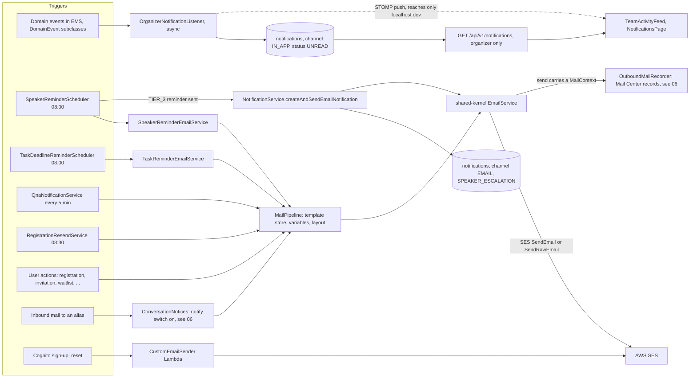
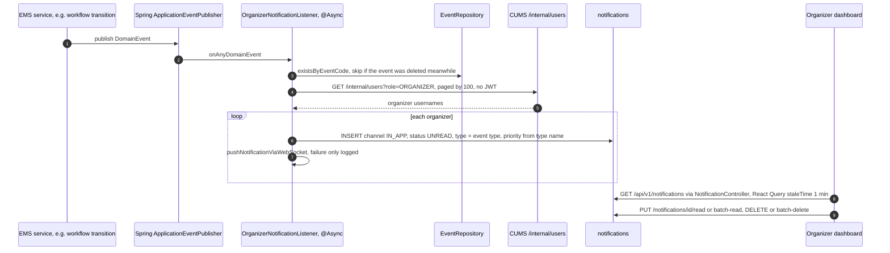
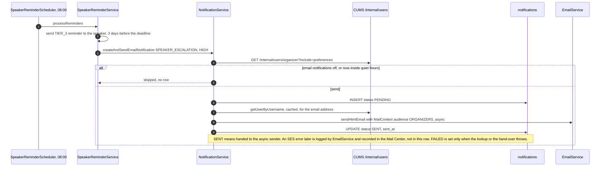
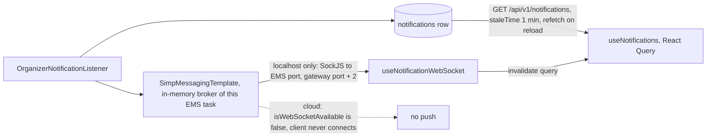
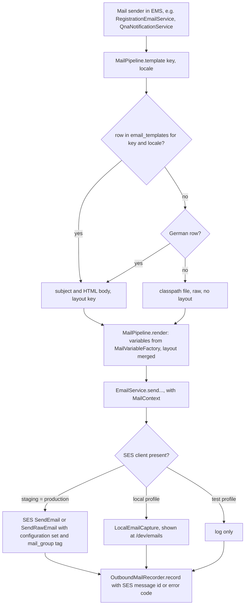
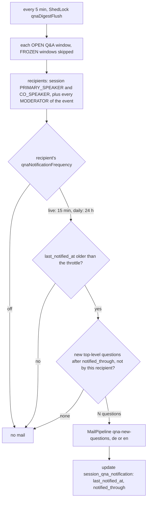

# Notification & Delivery System

This document outlines the notification and delivery system for the BATbern Event Management Platform: email notifications, in-app notifications for organizers, and delivery tracking.

## Overview

The notification system has two channels in use: **EMAIL** (AWS SES via the shared-kernel
`EmailService`) and **IN_APP** (organizer activity feed). Both are recorded in the `notifications`
table. There is no SMS channel: the `channel` column comment (V33, V34) and the entity still name
`SMS`, but no code path sends one.

The only escalation that exists is `SpeakerReminderService`: when a speaker has not responded or
not submitted content after the third reminder, it emails the assigned organizer (or the event's
organizer) a `SPEAKER_ESCALATION` notification. There is no rule engine (see
[Not implemented](#not-implemented)).

### Channels as built

Not every mail is a "notification" in the sense of the `notifications` table. The diagram shows
every path that tells a person something, and which of them write a `notifications` row.
Checked against the EMS, CUMS and shared-kernel sources on develop c4593449.



Only two arrows write to `notifications`: the IN_APP feed and the speaker escalation. Every
other mail is recorded, if at all, in the Mail Center tables (Story 16.1a), described in
[Backend Architecture](./06-backend-architecture.md).

**Implementation Pattern**: Single table in shared `public` schema, following Task System pattern (Story 5.5).

**Key Characteristics**:
- ✅ Single `notifications` table owned by Event Management Service
- ✅ Rows for both channels: email audit trail for `SPEAKER_ESCALATION`, and one IN_APP row per organizer per domain event (see the correction below)
- ✅ ADR-003 compliant (meaningful IDs: `recipient_username`, `event_code`)
- ✅ No cross-service aggregation (simple REST API queries)

## Database Schema

**Location**: `services/event-management-service/src/main/resources/db/migration/V33__Create_notifications_table.sql`

```sql
CREATE TABLE IF NOT EXISTS notifications (
    id UUID PRIMARY KEY DEFAULT uuid_generate_v4(),

    -- ADR-003: Meaningful IDs (NOT foreign keys)
    recipient_username VARCHAR(100) NOT NULL,
    event_code VARCHAR(50),  -- Nullable (non-event notifications)

    -- Notification details
    notification_type VARCHAR(50) NOT NULL,
    channel VARCHAR(20) NOT NULL,
    priority VARCHAR(20) DEFAULT 'NORMAL',
    subject VARCHAR(255) NOT NULL,
    body TEXT NOT NULL,

    -- Delivery tracking
    status VARCHAR(20) NOT NULL DEFAULT 'PENDING',
    sent_at TIMESTAMP,
    read_at TIMESTAMP,
    failed_at TIMESTAMP,
    failure_reason TEXT,

    -- Metadata
    metadata JSONB,

    -- Timestamps
    created_at TIMESTAMP NOT NULL DEFAULT NOW(),
    updated_at TIMESTAMP NOT NULL DEFAULT NOW()
);

-- Indexes (V33)
CREATE INDEX idx_notifications_recipient ON notifications(recipient_username);
CREATE INDEX idx_notifications_event ON notifications(event_code) WHERE event_code IS NOT NULL;
CREATE INDEX idx_notifications_status ON notifications(status);
CREATE INDEX idx_notifications_created ON notifications(created_at DESC);
CREATE INDEX idx_notifications_recipient_created ON notifications(recipient_username, created_at DESC);
CREATE INDEX idx_notifications_recipient_status ON notifications(recipient_username, status);
```

`V34__Add_in_app_notification_support.sql` adds a composite index for the organizer dashboard
query (`channel = 'IN_APP' AND status = 'UNREAD'`); the `channel` column needed no change.
Status values in use: `PENDING`, `SENT`, `FAILED` (email), `UNREAD`, `READ` (in-app).

**Ownership**: Event Management Service (by convention, follows Task System pattern)

## Notification Service

### Storage Strategy (as built)

**Email Notifications** (create records):
- One row per `SPEAKER_ESCALATION` email, written before the send and updated to `SENT` or `FAILED`
- Track delivery status (audit trail)
- The 2025 estimate of ~150,000 rows/year assumed every mail would go through this table; most
  mails do not (see the channel diagram). Real volume: not measured for this document.

**In-App Notifications** (create records too):
- The 2025 design planned a lazy model: no rows, computed on page load as "events published since
  last login". **That was never built** (see Not implemented). The organizer feed writes rows,
  as the correction below describes.

> **Correction (2026-10-25, #1068):** the organizer activity feed does NOT follow the lazy model
> above. `OrganizerNotificationListener` (event-management) writes one `IN_APP` row **per
> organizer per domain event**. On production that reached 6,365 rows for a single test organizer,
> almost all from nightly E2E runs. Rules for these rows:
> - **Initiator in every body.** `"{username} moved BATbern60 to Agenda Published"`, `"{username}
>   moved a speaker of BATbern60 from Contacted to Ready"`, `"{username} - Speaker Accepted"`.
>   Actors come from the security context (`SlotAssignmentController` used a literal `"organizer"`).
> - **Scoped to the event by `event_code`** (no FK, ADR-003). `SpeakerWorkflowStateChange` puts
>   the code into the domain event's metadata so it is scoped too.
> - **Deleted with the event.** `DELETE /events/{code}` deletes the event's notifications in the
>   same transaction, and the async listener skips events that no longer exist.
> - **Test runs sweep them.** `POST /api/v1/admin/test-fixtures/ems/cleanup` with `entityType=notifications`
>   deletes rows of every test event code (`BATbern{N>=10000}`, `BRUNO-TEST-*`) whatever their age,
>   plus pre-fix `SpeakerWorkflowStateChange` rows whose speaker_pool row is gone. The Playwright
>   global teardown and the Bruno `99d-posttest-cleanup-notifications` requests call it.

### Implementation

`services/event-management-service/src/main/java/ch/batbern/events/notification/`:

- **`NotificationService.createAndSendEmailNotification(NotificationRequest)`**: reads the
  recipient's preferences from CUMS (`UserApiClient.getPreferences`), skips the send when email
  notifications are disabled or the recipient is in quiet hours, saves a `PENDING` row, sends
  via `EmailService.sendHtmlEmail(...)` with a `MailContext` (so the send is recorded in the
  Mail Center, Story 16.1a), then sets `SENT` or `FAILED`. Its only caller in `src/main` is
  `SpeakerReminderService` (type `SPEAKER_ESCALATION`, priority `HIGH`).
- **`NotificationService.pushNotificationViaWebSocket(Notification)`**: sends the row to the STOMP
  destination `/topic/notifications/{username}`. Failures are logged and ignored.
- **`OrganizerNotificationListener`**: listens to domain events and writes one `IN_APP` row per
  organizer per event (see the correction above), with `notification_type` set to the domain
  event type and a priority derived from the event type name (`Cancelled`/`Failed`/`Error` HIGH,
  `Deadline`/`Urgent` URGENT, `Updated`/`Modified` LOW, else NORMAL). It then calls
  `pushNotificationViaWebSocket`.
- **`NotificationController`**: REST read and status API for the rows.

There is no `EventPublishedEvent` listener any more (#1179): publishing the agenda used to mail
every registration, cancelled ones included, without anyone deciding to.

### In-app feed: from domain event to the organizer's screen



Events are deleted with their notifications (`EventController`, `deleteByEventCode`); archiving
an event marks its unread rows `READ` (`dismissNotificationsForEvent`, Story 10.18).

### Escalation email: the one NotificationService send



## Escalation (as built)

There is one escalation, configured in `application.yml` under `batbern.reminders` (Story 6.5):

| Tier | Days before the speaker's deadline | Effect |
|---|---|---|
| `TIER_1` | 14 | reminder mail to the speaker |
| `TIER_2` | 7 | reminder mail to the speaker |
| `TIER_3` | 3 | reminder mail to the speaker, then `SPEAKER_ESCALATION` mail to the organizer when `escalate-after-tier3: true` |

Two deadlines are watched: the **response** deadline for speakers in `INVITED`, and the
**content** deadline for speakers in `ACCEPTED` without any `session_content_history` row. A
tier fires only on the exact day (`daysUntilDeadline == daysBeforeDeadline`); a missed day is
not caught up. Each reminder is logged in `speaker_reminder_log` (deduplication) and in the
outreach history before the mail goes out. The escalation goes to the speaker's assigned
organizer, else to the event's organizer. Organizers can also send a reminder manually
(`SpeakerReminderController`); the tier is then detected from the days left.

The escalation fires together with the third reminder, not after an unanswered third reminder:
the code does not wait to see whether the speaker reacts.

## Notification Types

`notification_type` is a free `VARCHAR(50)`; there is no backend enum. Values written by
`src/main` code today:

| Value | Channel | Written by |
|---|---|---|
| Domain event type (for example `SpeakerWorkflowStateChange`) | `IN_APP` | `OrganizerNotificationListener` |
| `SPEAKER_ESCALATION` | `EMAIL` | `SpeakerReminderService` (after three unanswered reminders) |

Task deadline reminders do not use this table: `TaskDeadlineReminderScheduler` delegates to
`TaskReminderEmailService` directly.

The frontend union in `web-frontend/src/types/notification.ts` lists more values (including
`VOTING_REQUIRED`), which `TeamActivityFeed` can display; the backend does not produce them.

## Not implemented

Earlier versions of this document described the following. None of it exists in the code
(checked by grep on develop c4593449, re-checked 2026-11-04); it is kept here, one line each,
so that nobody looks for it:

- an **SMS** channel;
- an **`EscalationRuleEngine`** with deadline-proximity, review-age and voting-stagnation rules,
  `EscalationLevel` / `EscalationNotification` types and automatic escalation to all organizers;
- a **`WorkflowNotificationEvent`** class and backend `NotificationType` / `NotificationPriority`
  enums (`VOTING_REQUIRED`, `OVERFLOW_DETECTED`, `SLOT_ASSIGNED`, ...). Overflow voting was
  removed from scope (ADR-009 replaced it with the slot-capacity gate);
- **dynamically computed** in-app notifications (`getInAppNotifications`, "events published since
  last login"), and the `getLastLogin` client call they needed;
- **Thymeleaf** notification templates under `resources/templates/notifications/`, including
  `event_published.html` (templates are HTML files in `email-templates/`, stored in the database);
- **real-time push in staging and production** (the WebSocket client connects on localhost only,
  see below);
- reading the `inAppNotifications`, `pushNotifications` and `notificationFrequency` preferences
  (stored, never evaluated).

## User Notification Preferences

**Storage**: one column per preference on `user_profiles` in CUMS (`pref_email_notifications`,
`pref_in_app_notifications`, `pref_push_notifications`, `pref_notification_frequency`,
`pref_quiet_hours_start`, `pref_quiet_hours_end`, `pref_qna_notification_frequency`, plus
`pref_language` and `pref_theme`). There is no `user_preferences` JSONB column. Users edit them
through `PUT /api/v1/users/me/preferences`.

**Fields** (API names):
- `emailNotifications` (boolean)
- `inAppNotifications` (boolean)
- `pushNotifications` (boolean)
- `notificationFrequency` (string: "realtime", "daily_digest", "weekly_digest")
- `qnaNotificationFrequency` (string: "live" | "daily" | "off", default "live") — Story 15.7;
  per-user cadence for the Q&A new-questions digest (see Scheduled Notification Jobs). Stored as
  `user_profiles.pref_qna_notification_frequency`.
- `quietHoursStart` (string: "22:00")
- `quietHoursEnd` (string: "07:00")

### Preferences Access

Which preferences are actually read (checked 2026-11-04):

| Preference | Read by |
|---|---|
| `emailNotifications`, `quietHoursStart/End` | `NotificationService.shouldSend`, so only the `SPEAKER_ESCALATION` mail |
| `qnaNotificationFrequency` | `QnaNotificationService` (Q&A digest) |
| `language` | most mail senders for the DE/EN choice, `LanguageSync` in the SPA |
| `inAppNotifications`, `pushNotifications`, `notificationFrequency` | nothing: stored and editable, no code path reads them |

Registration, reminder, waitlist and Mail Center mails do not consult `emailNotifications` or
quiet hours. The IN_APP feed ignores `inAppNotifications`.

```java
// NotificationService (EMS), as in the source
private boolean shouldSend(UserPreferences prefs, NotificationRequest request) {
    if ("EMAIL".equals(request.getChannel()) && !prefs.isEmailNotificationsEnabled()) {
        return false;
    }
    if (isInQuietHours(prefs)) {
        return false;
    }
    return true;
}

private boolean isInQuietHours(UserPreferences prefs) {
    if (prefs.getQuietHoursStart() == null || prefs.getQuietHoursEnd() == null) {
        return false;
    }
    LocalTime now = LocalTime.now();            // JVM clock, see the note on time zones below
    LocalTime start = LocalTime.parse(prefs.getQuietHoursStart());
    LocalTime end = LocalTime.parse(prefs.getQuietHoursEnd());
    if (start.isBefore(end)) {
        return now.isAfter(start) || now.isBefore(end);
    } else {
        return now.isAfter(start) && now.isBefore(end);
    }
}
```

> **Bug, kept as found (2026-11-04):** the two branches are swapped. For the usual overnight
> window 22:00-07:00 (`start` after `end`) the else branch requires `now > 22:00 AND now < 07:00`,
> which is never true, so overnight quiet hours never suppress anything. For a same-day window
> such as 12:00-14:00 the first branch is `now > 12:00 OR now < 14:00`, true at every time of
> day, so that user never gets the mail. The code comments carry the same mix-up. Impact today
> is limited to the escalation mail; the doc does not fix code.

### UserApiClient (HTTP Integration)

EMS reads users from CUMS over `RestTemplate` on the **internal** routes (`/internal/users/**`,
VPC-only, no JWT, never routed by the gateway; see ADR-008 and #1146). The relevant methods of
`ch.batbern.events.client.impl.UserApiClientImpl`, shortened:

```java
private static final String INTERNAL_USERS_PATH = "/internal/users";

@Cacheable(value = "userApiCache", key = "#username")
public UserResponse getUserByUsername(String username) {
    // GET {cums}/internal/users/{username}; empty username fails fast (2026-05-18 outage)
}

public UserPreferences getPreferences(String username) {
    // GET {cums}/internal/users/{username}?include=preferences  (not cached)
    // #1146: CUMS has no /api/v1/users/{username}/preferences
}

public List<String> getOrganizerUsernames() {
    // GET {cums}/internal/users?role=ORGANIZER&page=N&limit=100, page by page
    // (CUMS caps limit at 100 since #825; at most 100 pages)
}
```

> **Not implemented:** `getLastLogin` and the `/users/{username}/last-login` endpoint shown in
> earlier versions. They served the lazy in-app model, which was never built.

## Real-Time Notifications (WebSocket push: local development only)

What the code does: `OrganizerNotificationListener` calls
`NotificationService.pushNotificationViaWebSocket`, which publishes to
`/topic/notifications/{username}` via `SimpMessagingTemplate`. EMS registers the STOMP endpoint
`/ws` with Spring's **in-memory simple broker** (`WebSocketConfig`, `enableSimpleBroker`). On
the frontend, `EventManagementDashboard` subscribes through `useNotificationWebSocket`
(`web-frontend/src/hooks/useNotificationWebSocket.ts`, `services/notificationWebSocketClient.ts`)
and invalidates the notifications query when a message arrives.



In staging and production the push never reaches a browser: `isWebSocketAvailable()` returns
true only for `localhost`/`127.0.0.1`, and `getWebSocketUrl()` throws "WebSocket not available in
cloud environments" (checked in the source 2026-11-04). The organizer sees new rows when the
query refetches (stale after one minute, on focus or reload). Even if a cloud client connected,
the simple broker lives in one EMS task, so a push would reach only clients of that task; Story
15.1 replaced WebSockets with REST polling for the live agenda for that reason (V119 comment).

## Email Notification Templates

### Email Service (AWS SES Integration)

**Infrastructure**: AWS SES for email delivery, through the shared-kernel
`ch.batbern.shared.service.EmailService` (AWS SDK v2 `SesClient`), used by EMS, CUMS and PCS.

**Templates**: HTML files `email-templates/{key}-{de|en}.html` (layouts:
`layout-{key}-{de|en}.html`) on the EMS classpath, 54 files on develop c4593449.
`EmailTemplateSeedService` copies them into the `email_templates` table on every start (insert
only, an edited row is never overwritten), and organizers edit them under Administration, Email
templates. There are no Thymeleaf templates; `resources/templates/` holds only a `.docx` used for
name badges.



Locale rule in `MailPipeline`: `en` asks for English, **every other locale asks for German**;
a missing English row falls back to German. Some senders choose the locale themselves before
calling the pipeline (the Q&A digest maps `de*` to German and everything else to English).
CLAUDE.md states "fall back to English"; the pipeline code falls back to German (checked
2026-11-04).

Sends without a `MailContext` (CUMS mails such as additional-email verification and profile
claim, and the legacy overloads) are not recorded. Before every SES send `EmailService` checks
that the mail is not test-marked (`assertNotTestMarked`, the second wall after the 2026-07-01
newsletter incident).

#### Additional-email CC fan-out (Story 10.32)

As of Story 10.32 (Phase 4 + 6 + 7, 2026-05-22), the shared-kernel `EmailService` exposes CC-aware overloads on both the simple-HTML and attachment paths:

| Method | Signature | Used by |
|---|---|---|
| `sendHtmlEmail` (async) | `(to, subject, html)` — 3-arg, no CC | legacy / anonymous flows |
| `sendHtmlEmail` (async) | `(to, cc, subject, html)` — 4-arg | speaker invitation, speaker acceptance, speaker reminder, quality-review revision, waitlist promotion, waitlist confirmation |
| `sendHtmlEmailSync` | `(to, cc, subject, html, configSet)` — 5-arg | sync newsletter-bulk and inline-loop callers (newsletter itself does NOT use CC; remains primary-only by design) |
| `sendHtmlEmailWithAttachments` | `(to, cc, subject, html, attachments)` — 5-arg | event registration confirmation (ICS attachment); partner meeting calendar invite (ICS attachment) |
| `sendHtmlEmail`, `sendHtmlEmailSync`, `sendHtmlEmailWithAttachments` | same, with a leading `MailContext` (Story 16.1a) | every recorded send; the waitlist mails use this form today |
| `sendGroupHtmlEmailSync`, `sendGroupHtmlEmailWithAttachments` | `(context, toList, cc, ...)` | one mail to several To addresses |

The "Used by" column is from Story 10.32 and was not re-checked per caller (not verified 2026-11-04).

Each EMS service that delivers a user-addressed transactional message resolves the recipient via `UserApiClient.getUserByUsername(...)` (directly or through `PrimarySpeakerResolver`), flattens `UserResponse.additionalEmails[]` into a `List<String>`, and passes it as the `cc` argument. SES `Destination.ccAddresses` carries the list; CC entries matching `to` case-insensitively are dropped to avoid duplicate delivery. A null/missing `additionalEmails` field (e.g. rolling-deploy backwards-compat) is treated as an empty list — behaviour is identical to the 3-arg signature in that case.

**Verified or not:** CUMS returns every additional address with its `verifiedAt`, and the CC
helpers (for example `DeregistrationEmailService.additionalEmailsFor`,
`WaitlistPromotionEmailService.additionalEmailsFor`) do not filter on it, so an address that was
added but never verified also receives the CC (checked 2026-11-04). Only identity matching (SSO
linking, JIT) requires `verifiedAt`; see [User Lifecycle Sync](./06b-user-lifecycle-sync.md).

**Explicitly excluded** from additional-email fan-out:
- `NewsletterEmailService` — newsletter is email-keyed (Open Q#4); subscribers register addresses independently of user profiles.
- `InboundEmailConfirmationEmailService` (unsubscribe + cancel reply paths) — recipients are arbitrary external senders, not registered users.
- Alias forwarding of `batbern{N}-participants@` (`ForwardingRecipientResolver` → `DistributionListService.resolveParticipants`, AC15) — registrant distribution stays attendee-email-driven; a user's additional emails are used only when a registration has no captured `attendeeEmail`.

```java
// shared-kernel EmailService, shortened to the parts that matter for notifications
@Service
public class EmailService {

    @Autowired(required = false) private SesClient sesClient;            // only staging/production
    @Autowired(required = false) private LocalEmailCapture localEmailCapture;  // only 'local' profile
    @Autowired(required = false) private OutboundMailRecorder outboundMailRecorder; // EMS (JPA), PCS (HTTP to EMS)

    @Value("${app.email.from:noreply@batbern.ch}")      private String fromEmail;
    @Value("${app.email.from-name:BATbern Platform}")    private String fromName;
    @Value("${app.email.reply-to:replies@batbern.ch}")   private String replyToEmail;
    @Value("${batbern.ses.configuration-set-name:#{null}}") private String configurationSetName; // transactional set

    @Async
    public void sendHtmlEmail(MailContext context, String to, List<String> cc, String subject,
                              String htmlBody, String replyTo) {
        sendHtmlEmailSync(context, to, cc, subject, htmlBody, configurationSetName, replyTo);
    }
    // sendSyncTo: no SES client -> capture or log, then record; else assertNotTestMarked,
    // SES SendEmail with configuration set and mail_group tag, record message id or error code
}
```

The newsletter overrides the configuration set with its own (bounces to SQS,
`BounceProcessingService`); the transactional set feeds CloudWatch metrics and a per-recipient
SNS logger without auto-suppression (from the `configurationSetName` Javadoc; the CDK side is in
[Operations & Security](./08-operations-security.md), not re-verified here).

### Example Template: Q&A digest

The 2025 example `notifications/event_published.html` (Thymeleaf) never existed, and nothing
mails "event published" any more (#1179). A real template instead: `qna-new-questions-de.html`
and `qna-new-questions-en.html`, category `SPEAKER`, editable by organizers. The `<!-- subject:
... -->` comment on the first line becomes the stored subject (`EmailTemplateSeedService`).
Placeholders are filled by `MailRenderer` from the variable catalog (`MailVariable`), not by a
template engine.

## Notification Entity

### Domain Model

```java
@Entity
@Table(name = "notifications")
@Data
@Builder
@NoArgsConstructor
@AllArgsConstructor
public class Notification {

    @Id
    @GeneratedValue
    private UUID id;

    // ADR-003: Meaningful IDs (NOT foreign keys)
    @Column(name = "recipient_username", nullable = false, length = 100)
    private String recipientUsername;

    @Column(name = "event_code", length = 50)
    private String eventCode;  // Nullable for non-event notifications

    // Notification details
    @Column(name = "notification_type", nullable = false, length = 50)
    private String notificationType;

    @Column(name = "channel", nullable = false, length = 20)
    private String channel;  // EMAIL or IN_APP (the source comment still says "EMAIL, SMS"; SMS is never sent)

    @Column(name = "priority", length = 20)
    private String priority;  // LOW, NORMAL, HIGH, URGENT

    @Column(name = "subject", nullable = false)
    private String subject;

    @Column(name = "body", nullable = false, columnDefinition = "TEXT")
    private String body;

    // Delivery tracking
    @Column(name = "status", nullable = false, length = 20)
    private String status;  // PENDING, UNREAD, SENT, FAILED, READ

    @Column(name = "sent_at")
    private Instant sentAt;

    @Column(name = "read_at")
    private Instant readAt;

    @Column(name = "failed_at")
    private Instant failedAt;

    @Column(name = "failure_reason", columnDefinition = "TEXT")
    private String failureReason;

    // Metadata (flexible JSONB storage)
    @Type(JsonBinaryType.class)
    @Column(name = "metadata", columnDefinition = "jsonb")
    private Map<String, Object> metadata;

    // Timestamps
    @Column(name = "created_at", nullable = false)
    private Instant createdAt;

    @Column(name = "updated_at", nullable = false)
    private Instant updatedAt;

    @PrePersist
    protected void onCreate() {
        createdAt = Instant.now();
        updatedAt = Instant.now();
    }

    @PreUpdate
    protected void onUpdate() {
        updatedAt = Instant.now();
    }
}
```

### Repository

```java
@Repository
public interface NotificationRepository extends JpaRepository<Notification, UUID> {

    // Find notifications for user
    Page<Notification> findByRecipientUsername(String username, Pageable pageable);

    // Find by username and status
    Page<Notification> findByRecipientUsernameAndStatus(
        String username,
        String status,
        Pageable pageable
    );

    // Count unread notifications
    long countByRecipientUsernameAndStatus(String username, String status);

    // Find delivery history for user
    List<Notification> findByRecipientUsernameAndChannelOrderByCreatedAtDesc(
        String username,
        String channel
    );

    // Find failed deliveries
    List<Notification> findByStatusAndCreatedAtBefore(String status, Instant before);

    // Story 10.18: archiving an event marks its unread rows READ
    @Modifying(clearAutomatically = true)
    @Query("UPDATE Notification n SET n.status = 'READ' WHERE n.eventCode = :eventCode AND n.status != 'READ'")
    int dismissNotificationsForEvent(@Param("eventCode") String eventCode);

    // #1068: DELETE /events/{code} removes the event's notifications in the same transaction
    int deleteByEventCode(@Param("eventCode") String eventCode);
}
```

## Scheduled Notification Jobs

Every `@Scheduled` job in EMS and CUMS that sends mail or touches notification state, with the
default cron from the code or `application.yml` (checked 2026-11-04). All except
`PublishingScheduledService` run under ShedLock (`@SchedulerLock`), so one ECS task runs each job.
"No mail" means the job sends none itself; its state transitions still publish domain events,
which become IN_APP rows.

```mermaid
flowchart LR
    subgraph Night["Night"]
        J1["00:01 EventWorkflowScheduledService: AGENDA_PUBLISHED to EVENT_LIVE, no mail"]
        J2["01:00 PublishingScheduledService: auto-publish speakers and agenda, no mail, no lock"]
        J2b["02:00 EventWorkflowScheduledService: EVENT_COMPLETED to ARCHIVED, unread notifications marked READ"]
        J3["03:00 RegistrationCleanupService: delete never-confirmed registrations"]
        J4["03:15 and 03:30 Zurich: forwarding log and mail message retention"]
        J5["05:30 Zurich TaskActivationScheduler: activate due tasks, no mail"]
    end
    subgraph Morning["Morning mail window"]
        M1["08:00 SpeakerReminderScheduler: speaker reminders TIER_1-3 + organizer escalation"]
        M2["08:00 TaskDeadlineReminderScheduler: tasks due tomorrow, mail to assignee, German"]
        M3["08:15 CUMS CognitoConfirmationResendJob: new Cognito code to UNCONFIRMED sign-ups 48-96 h old"]
        M4["08:30 RegistrationResendService: new confirmation link, at most 2 times, 48 h apart"]
    end
    subgraph Continuous["All day"]
        C1["every 5 min QnaNotificationService.flushPending: Q&A digest"]
        C2["hourly at :05 SessionQnaScheduledService: freeze expired Q&A windows"]
    end
    subgraph Evening["Evening"]
        E1["23:59 EventWorkflowScheduledService: EVENT_LIVE to EVENT_COMPLETED"]
    end
    Night --> Morning --> Continuous --> Evening
```



**Time zone.** Only the jobs marked "Zurich" declare `zone = "Europe/Zurich"`. The others run on
the JVM clock. No `TZ` or `user.timezone` is set in the Dockerfiles (base image
`eclipse-temurin:21-jre-alpine`) or the CDK task definitions (checked by grep), so on ECS they
presumably run on UTC, one or two hours before the Swiss time the comments state (not verified
2026-11-04 on a running task). The `application.yml` comments saying "Europe/Zurich" for the
00:01 and 23:59 jobs describe the intent, not the configuration.

Attendee recovery runs in two steps: `CognitoConfirmationResendJob` (CUMS) re-triggers Cognito's
sign-up code, because Cognito's code expires after 24 h and cannot be extended, and
`RegistrationResendService` (EMS) mints a fresh registration confirmation link before
`RegistrationCleanupService` deletes the row (cleanup window 120 h, never shorter than token
validity 96 h + 24 h grace, measured from the last resend).


### Q&A New-Questions Digest Job (Story 15.7)



`QnaNotificationService.flushPending()` (Event Management Service) runs every 5 minutes
(`@Scheduled` + `@SchedulerLock(name = "qnaDigestFlush")`) and emails, when new **top-level**
questions arrive in a session's Q&A: that **session's own presenters** (`PRIMARY_SPEAKER` +
`CO_SPEAKER`) **plus the event's moderator(s)**. Per-recipient behaviour:

- **Recipients (event-2 fix):** the moderator is resolved **event-wide**, not per session —
  `SessionUserRepository.findModeratorUsernamesByEventCode(eventCode)` returns every `MODERATOR`
  across the event. BATbern's moderator is an event-level role (assigned to the moderation
  bookend sessions), so a per-session lookup never reached them for content-session Q&A.
- **Cadence** comes from each recipient's `qnaNotificationFrequency` preference: `live` → at most
  one digest per **15 min** per window; `daily` → at most one per **24 h**; `off` → never.
- **Freeze wins**: only `OPEN` Q&A windows are scanned — a `FROZEN` window never produces a digest.
- **Exclusions**: replies (non-top-level) and a recipient's own posts never notify that recipient;
  `PANELIST`s are not recipients.
- State is kept per `(window, recipient)` in `session_qna_notification` (`last_notified_at` throttle
  anchor + `notified_through` high-water mark, so each email counts only genuinely new questions).
- Recipient email + locale + cadence are resolved at send time via the cached `UserApiClient`
  (ADR-004). **Email is read off the user entity** — `getUserByUsername(username).getEmail()`
  (`GET /internal/users/{username}` on CUMS, VPC-only and without JWT, which suits the no-JWT
  scheduled context; earlier text named `/api/v1/users/{username}`, which the client no longer
  calls); there is **no** dedicated `/users/{username}/email` endpoint.
  Email body is **DE + EN only** (`qna-new-questions-{de,en}.html`); non-DE/EN → EN. The template
  is categorised `SPEAKER` (admin-editable under the Speakers tab).

### No automatic mail to a whole audience (#1179)

`DeadlineReminderJob` (registration deadline reminder) and `NotificationService.onEventPublished`
were **removed on 2026-11-02**. Both sat dormant from January, because every send on their path
failed on a wrong preferences URL. #1159 fixed that URL on 2026-10-29, and the next morning the
deadline job mailed all 267 BATbern60 registrations, cancelled and waitlisted included, in English,
with a raw ISO timestamp.

The rule since then: **a mail to many people goes out only when an organizer sends it from the Mail
Center.** Automatic triggers may mail one person about their own case (their confirmation link,
their speaker deadline, their task) or organizers. `AutomaticTriggerAudienceGuardTest` lists every
`@Scheduled`, `@EventListener`, `@TransactionalEventListener` and `@SqsListener` method in EMS with
the audience it can reach. A new trigger fails the build until it is added there.

The `DEADLINE_WARNING` and `EVENT_PUBLISHED` values stay valid in the `notifications` table because
the 2026-11-02 rows carry them.

### Task Deadline Reminder (Integration with Task System)

**Note**: This scheduler bypasses `NotificationService` entirely; it delegates directly to `TaskReminderEmailService`, so **no record is written to the notifications table** for task reminders. The mail itself carries a `MailTrigger` and is recorded in the Mail Center.

**Schedule**: daily at **08:00** by default (`batbern.task-reminders.cron`, JVM clock; earlier
versions of this document said 09:00).

**Locale**: All task reminder emails are rendered in `Locale.GERMAN`; user language preference is not consulted.

**Timezone**: The tomorrow-only window is computed in `Europe/Zurich` timezone.

**Error handling**: The scheduler catches and logs any `Exception`; the job does not fail the Spring scheduler thread.

```java
@Component
@RequiredArgsConstructor
@Slf4j
public class TaskDeadlineReminderScheduler {

    private static final ZoneId SWISS_ZONE = ZoneId.of("Europe/Zurich");

    private final EventTaskRepository eventTaskRepository;
    private final TaskReminderEmailService taskReminderEmailService;

    @Scheduled(cron = "${batbern.task-reminders.cron:0 0 8 * * *}")
    @SchedulerLock(name = "TaskDeadlineReminderScheduler_processReminders",
            lockAtLeastFor = "PT5M", lockAtMostFor = "PT30M")
    public void processReminders() {
        try {
            Instant startOfTomorrow = LocalDate.now(SWISS_ZONE).plusDays(1).atStartOfDay(SWISS_ZONE).toInstant();
            Instant endOfTomorrow = LocalDate.now(SWISS_ZONE).plusDays(2).atStartOfDay(SWISS_ZONE).toInstant();

            List<EventTask> tasksDueTomorrow =
                    eventTaskRepository.findTasksDueForReminder(startOfTomorrow, endOfTomorrow);
            if (tasksDueTomorrow.isEmpty()) {
                return;
            }
            MailTrigger run = MailTrigger.system();
            for (EventTask task : tasksDueTomorrow) {
                taskReminderEmailService.sendTaskDeadlineReminder(task, Locale.GERMAN, run);
            }
        } catch (Exception e) {
            log.error("Task deadline reminder processing failed", e);
        }
    }
}
```

## Related Documentation

### Architecture

- [Backend Architecture Overview](./06-backend-architecture.md) - Overall system architecture
- [Data Architecture](./03-data-architecture.md) - Database design patterns and shared schema approach
- [ADR-003: Meaningful Identifiers](./ADR-003-meaningful-identifiers-public-apis.md) - Why we use `username` and `event_code`
- [Workflow State Machines](./06a-workflow-state-machines.md) - Event-driven notification triggers
- [User Lifecycle Sync Patterns](./06b-user-lifecycle-sync.md) - User preference integration

### Stories

- [Story 1.15a.10: Notifications API Consolidation](../stories/archived/epic-1/1.15a.10.notifications-api-consolidation.md) - **This story** - implementation details
- [Story 5.5: Task System](../stories/archived/epic-5/5.5-speaker-content-quality-review-task-system.md) - **Reference pattern** - single table in shared schema with ADR-003 compliance

### Implementation Patterns

**This notification system follows the exact same pattern as the Task System (Story 5.5)**:
- ✅ Single table in shared `public` schema
- ✅ Owned by Event Management Service (by convention)
- ✅ ADR-003 compliant (meaningful IDs: `recipient_username`, `event_code`)
- ✅ Cross-service access via HTTP APIs
- ✅ No foreign key constraints across service boundaries
- ✅ Rows for email escalations and for the in-app feed (the lazy in-app half of the original hybrid plan was not built)
