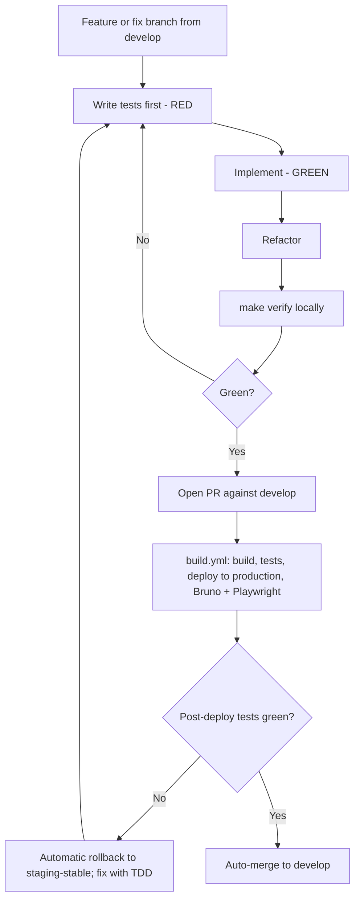

# Development Standards

This document consolidates development standards and workflow guidelines for the BATbern Event Management Platform. For detailed specifications, see the individual documents below.

## Core Standards Documents

The development standards are organized into three core documents:

### [📋 Coding Standards](./coding-standards.md)
Comprehensive coding standards, naming conventions, and quality guidelines:
- Critical fullstack rules and conventions
- Git workflow and commit message formats
- Code review checklist and testing standards
- Documentation requirements and performance targets

### [🛠️ Technology Stack](./tech-stack.md)
Complete technology stack specifications with versions and rationale:
- Frontend, backend, and infrastructure technology choices
- Development tools and testing frameworks
- Browser support and IDE recommendations
- Technology decision rationale and alternatives

### [📁 Source Tree Structure](./source-tree.md)
Project organization and directory structure:
- Single monorepo: Gradle multi-project (shared kernel, gateway, services) plus npm projects
  (web frontend, infrastructure)
- Service, frontend, infrastructure and test layouts
- Where scripts, hooks and documentation live

## Development Workflow

The authoritative, maintained setup guide is
[docs/guides/local-development-setup.md](../guides/local-development-setup.md). The summary below
uses only targets and scripts that exist in the repository.

### Local Development Setup

#### Prerequisites
```bash
java --version          # Java 21 LTS
node --version          # Node.js 22 (the version CI uses)
docker --version        # Docker (local PostgreSQL, Testcontainers)
aws --version           # AWS CLI v2 (local dev authenticates against the shared Cognito)
./gradlew --version     # Gradle 9.x via the wrapper; no global Gradle needed
```

#### Initial Setup
```bash
make install                                   # Java + Node dependencies and the git hooks in .githooks/
cp .env.example .env                           # backend/local configuration, see the comments in the file
docker compose -f docker-compose-dev.yml up -d # local PostgreSQL
make dev-native-up                             # all services natively, plus the Vite dev server
```

With the default `BASE_PORT=8000` the API gateway listens on 8000, the services on 8001
(company-user-management), 8002 (event-management) and 8004 (partner-coordination), and the
frontend on 8100. 8003 and 8005 stay unused since the stub services were removed (Story 17.2). `make dev-native-up-instance BASE_PORT=9000`
starts a second, parallel environment. Logs go to `/tmp/batbern-1-*.log`.

#### Development Commands
```bash
make dev-native-status                                   # what is running
make dev-native-restart-service SERVICE=event-management # restart one service
make dev-native-down                                     # stop everything

make test            # Java (Testcontainers, needs Docker) + Node tests with coverage
make test-java       # Java only
make test-node       # Node projects only
./gradlew :services:event-management-service:test --tests SomeIntegrationTest
cd web-frontend && npm run test:e2e   # Playwright
./scripts/ci/run-bruno-tests.sh       # Bruno API contract tests

make verify          # lint + generated-types check + tests
```

All Gradle commands run from the repository root. Run one heavy build or test suite at a time on a
shared machine.

### Environment Configuration

- **Backend and local services:** copy `.env.example` (repository root) to `.env`. The file lists
  every variable with its purpose.
- **Frontend:** runtime configuration comes from the `config` module
  (`import { config } from '@/config'`), never from `process.env` directly. The Vite dev server
  is wired by `make dev-native-up`; there are no feature-flag `VITE_*` variables to set.
- **Test credentials:** `.env.test.local.example` → `.env.test.local`, then
  `make setup-test-users`.

## Quick Reference Links

### For New Developers
1. **Start Here**: [Technology Stack](./tech-stack.md) - Understand the technology choices
2. **Setup**: [Local development setup guide](../guides/local-development-setup.md)
3. **TDD Practice**: [Coding Standards - Test-Driven Development](./coding-standards.md#test-driven-development-standards) - mandatory for all development
4. **Coding**: Review [Coding Standards](./coding-standards.md) for conventions
5. **Structure**: See [Source Tree Structure](./source-tree.md) for project organization

### For Code Reviews
- [Coding Standards - Code Review Checklist](./coding-standards.md#code-review-checklist)
- [Coding Standards - Testing Standards](./coding-standards.md#testing-standards)
- [Coding Standards - Performance Standards](./coding-standards.md#performance-standards)

### For Architecture Decisions
- [Technology Stack - Technology Decision Rationale](./tech-stack.md#technology-decision-rationale)
- [Source Tree Structure - Integration Points](./source-tree.md#integration-points)
- [Source Tree Structure - Key Directory Conventions](./source-tree.md#key-directory-conventions)

## Test-Driven Development Process

### TDD is Mandatory
All new features and bug fixes MUST follow Test-Driven Development practices. See
[Coding Standards - Test-Driven Development Standards](./coding-standards.md#test-driven-development-standards).

### TDD Quick Reference
1. **RED**: Write failing tests first
2. **GREEN**: Write minimal code to pass tests
3. **REFACTOR**: Improve code while keeping tests green

### Coverage Requirements
- Unit Tests: 90% for business logic
- Integration Tests: 80% for APIs
- Overall: 85% line coverage

Details: [Coding Standards - Coverage Requirements](./coding-standards.md#coverage-requirements).

## Development Process Overview



**Opening a PR against `develop` deploys that branch to production** (www.batbern.ch), before
review and before merge. See [02-infrastructure-deployment.md](./02-infrastructure-deployment.md#cicd-pipeline).
