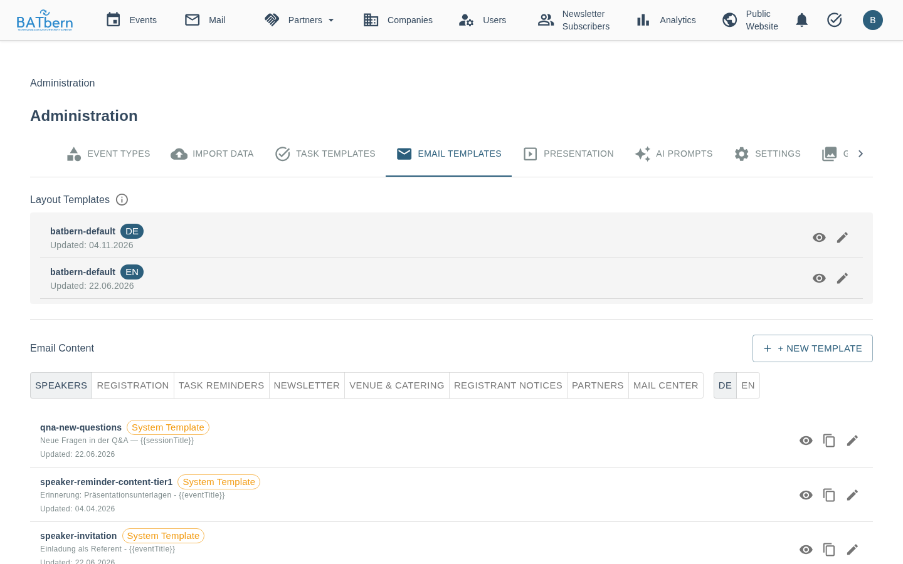

# Email Templates

> Implemented — Email-template management (Story 10.2) is live. Content templates use a TinyMCE WYSIWYG editor; layout templates use a Monaco source editor. Templates are authored in German and English.

**Last Updated:** 2026-06-13

## Overview

The **Email Templates** tab lets organizers view and edit the subject lines and body content of every email the platform sends — without requiring a code deployment. It is **Tab 3** of the Administration page.

**Navigation**: Administration → Tab 3 (Email Templates)

---

## Template Architecture

BATbern uses a two-layer template system that separates **layout** from **content**:

| Layer | Role | Editor |
|-------|------|--------|
| **Layout Template** | HTML shell: CSS styles, BATbern logo header, footer, unsubscribe links | Monaco (source code) |
| **Content Template** | Email-specific body copy: subject, intro paragraph, CTA button | TinyMCE (WYSIWYG) |

When an email is sent, the platform merges the content template into the layout template at the `{{content}}` placeholder, producing a fully branded HTML email.

This means content editors only ever touch body copy — the branding, CSS, and legal footer are controlled once in the layout template.

---

## Template Inventory

On startup, **24 templates** are seeded automatically from classpath files:

- **2 layout templates** — `batbern-default-de` and `batbern-default-en` (the BATbern HTML shell in German and English)
- **22 content templates** — one per email type, per language (11 types × 2 languages)

### Categories

Content templates are organised into categories for easier navigation:

| Category | What it covers |
|----------|---------------|
| **Speaker** | Invitations, acceptance confirmations, deadline reminders (3-tier), material received |
| **Registration** | Attendee registration confirmation + QR code email |
| **Task Reminders** | Organiser task deadline reminder (day before due date) |
| **Newsletter** | Event newsletter and reminder (managed separately — see below) |

A **DE/EN toggle** lets you switch between the German and English version of any template.

---

## Layout Templates Section

Layout templates are listed at the top of the tab. Currently there is one layout:

**`batbern-default`** (DE + EN)

Owns the full HTML email shell:
- BATbern logo header
- CSS styling and colour palette
- Main content area (`{{content}}` injection point)
- Footer with organisation details and unsubscribe link

**Editor**: Monaco (source-code editor). This is the only template type that requires HTML knowledge to edit safely.

Layout templates are **system templates** — they can be edited but not deleted.

---

## Content Templates Section

### Filtering

Use the **category filter** (Speaker | Registration | Task Reminders | Newsletter) and **DE/EN toggle** to narrow the list.

### Editing a Content Template

1. Click a template row to open the editor panel
2. Edit the **Subject** field (plain text)
3. Edit the **Body** in the TinyMCE WYSIWYG editor (paragraphs and CTA buttons only — no raw HTML required)
4. Click **Save**

Changes take effect immediately for the next email sent using that template.

### Previewing a Template

Click **Preview** on any content template to see the fully merged result — your content template injected into the `batbern-default` layout — rendered as a real branded email. This is exactly what recipients will see.

---

## System vs. Custom Templates

| | System Templates | Custom Templates |
|-|-----------------|------------------|
| Seeded on startup | ✅ | ❌ |
| Editable | ✅ | ✅ |
| Deletable | ❌ | ✅ |
| Layout key | `batbern-default` | `batbern-default` (default) |

### Creating a Custom Template

1. Click **New Template** (top-right of the content templates section)
2. Choose a category
3. Select a language (DE or EN)
4. Enter a template name, for example "Partner Info". The page shows the key it is saved under (`partner-info`): lowercase, digits and hyphens, umlauts written as ae/oe/ue
5. Fill in subject and body
6. Save

Custom templates automatically use the `batbern-default` layout.

---

## Variable Substitution

Templates use `{{variableName}}` placeholders that are substituted at send time. Every mail gets
the same set of variables from one catalog: the **system** and **event** variables are in every
mail about an event, the others only where the mail has that data (a speaker reminder has no
unsubscribe link, a newsletter has no registration code). A placeholder whose value a mail does not
have stays empty.

| Group | Variables | Available in |
|-------|-----------|-------------|
| System | `currentYear`, `logoUrl`, `baseUrl`, `supportUrl` (the support page, `https://batbern.ch/support`), `organizerName`, `organizerEmail` | Every mail |
| Event | `eventCode`, `eventNumber`, `eventTitle`, `eventType`, `eventDate`, `eventTime`, `venueName` (also `venue`), `venueAddress`, `venueDirectionsUrl`, `eventUrl` (also `eventDetailLink`), `registrationLink`, `conferenceLanguage`, `topicTitle`, `agenda`, `speakersSection`, `upcomingEventsSection` | Every mail about an event |
| Recipient | `recipientName`, `salutation`, `dashboardLink` | Mails to one person or one venue contact |
| Registration | `attendeeFirstName`, `attendeeLastName`, `attendeeName`, `registrationCode`, `confirmationUrl`, `deregistrationUrl` (also `deregistrationLink`), `waitlistPosition`, `createAccountUrl` | Registration, waitlist and registrant mails |
| Speaker | `speakerName`, `sessionTitle`, `sessionDescription`, `deadline`, `daysRemaining`, `responseDeadline`, `contentDeadline`, `portalLink`, `profileUrl`, `contentUrl`, `loginUrl`, `usernameForLogin`, `temporaryPassword`, `tempPasswordValidityDays`, `useExistingPassword` | Speaker invitation, acceptance and reminders |
| Newsletter | `unsubscribeLink`, `preferencesLink`, `reminderPrefix` | Newsletter |
| Venue | `notes`, `organizerSignature` | Venue and catering mails |
| Task | `taskName`, `dueDate`, `taskNotes`, `taskBoardLink` | Task reminder |
| Q&A | `count`, `isSingle`, `isMultiple`, `qnaLink` | Session Q&A digest |
| Layout | `content` | Layout templates only |

`eventDate` is always the long form in the recipient's language: "Freitag, 5. März 2027" or
"Friday, 5 March 2027". Links that act on the recipient's behalf (`deregistrationUrl`,
`confirmationUrl`, `unsubscribeLink`, `registrationCode`, `temporaryPassword`) are replaced by
dummies in a test send.

> **Caution**: Do not remove `{{unsubscribeLink}}` from layout templates. This link is required for GDPR compliance and is automatically injected into every sent email.

---

## Classpath Fallback

If a template cannot be loaded from the database (e.g., a new deployment before seeding runs), the platform falls back to the original classpath HTML file. This ensures emails are never silently lost due to a missing DB record.

---

## Related

- **[Notification System](../features/notifications.md)** — overview of all emails the platform sends
- **[Task Templates](task-templates.md)** — task reminder scheduling
- **[Speaker Portal: Invitation & Response](../speaker-portal/invitation-response.md)** — speaker invitation emails
- **[Administration Overview](README.md)** — back to admin hub
