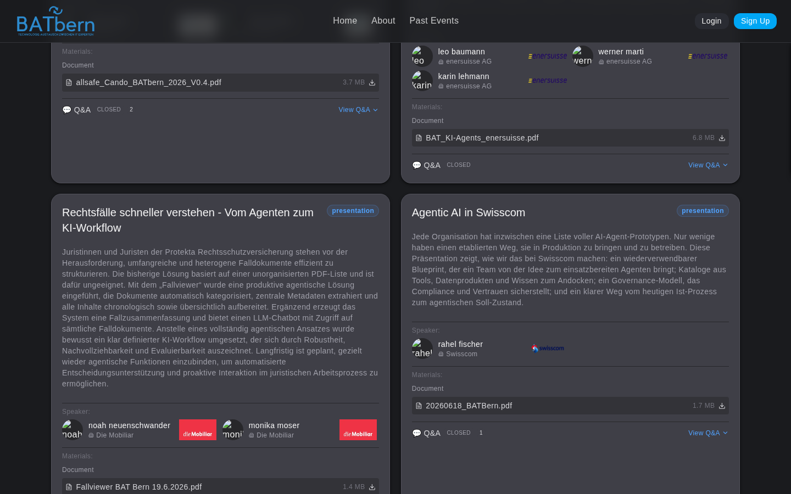

# Post-Event Q&A — "The Apéro Continues"

> A time-boxed per-session Q&A after each event — the digital afterglow that freezes into the archive forever

> **Last Updated**: 2026-11-04 — per-event Q&A settings (Details → Settings → Session Q&A)

<span class="feature-status implemented">Implemented</span> — Epic 7.5

## Overview

The open questions that the apéro never had time for currently have nowhere to live. **The Apéro Continues** gives each session a time-boxed Q&A after the event: logged-in attendees post open questions and answer one another asynchronously, and when the window closes the whole thread **freezes into that session's archive page permanently**.

<div class="alert info">
ℹ️ <strong>This is the digital afterglow — not the apéro itself.</strong> It explicitly does <em>not</em> digitize or intrude on the physical apéro, which stays unstructured. It is also <em>not</em> an always-on forum — the time-box is the point; an always-on feed would die at this cadence.
</div>

## The window

By default the Q&A window **opens automatically when an event completes** and closes **14 days after the event date**. The close is handled automatically by the platform's scheduler — there is nothing to remember.

### Per-event settings

Each event has its own Q&A settings under **Details → Settings → Session Q&A**:

| Setting | Values | Default |
|---------|--------|---------|
| **Enable per-session Q&A for this event** | on / off | on |
| **Open the Q&A** | **After the event (afterglow)** — when the event reaches `EVENT_COMPLETED`; or **When speakers are published (pre-event)** — as soon as the speakers are published, for discussion before the event | After the event |
| **Open for (days after the event)** | 1–365. Windows close this many days after the event date, then freeze into the archive | 14 |

Click **Save** to apply. Two buttons act on all session windows of the event at once:

- **Open Q&A** — opens the windows now, independent of the configured trigger (it also creates windows for sessions that have none yet). Use it to open early or to reopen.
- **Close Q&A now** — closes and freezes the windows immediately.

The pre-event option is a deliberate exception to the afterglow idea below; choose it per event when a discussion before the event makes sense.

```
Event completes (EVENT_COMPLETED) — or speakers published, if chosen per event
        │  → a Q&A window opens for each session  (closes at event date + days setting, default 14)
        ▼
Window OPEN
        │  logged-in attendees post questions / answers (attendees + speakers)
        │  organizers: take down a post, or Close Q&A now
        ▼
Scheduler closes the window at closes_at
        │  → status FROZEN (read-only)
        ▼
Frozen Q&A attached to the session's public archive page — permanent
```

## Who can do what



| Action | Who | When |
|--------|-----|------|
| Post a question / answer | Logged-in attendees and speakers | While the window is **open** |
| Read the Q&A | **Anyone** (public) — including the frozen archive | Always |
| Take down a post | Organizers | While open — removed posts are dropped entirely from the thread |
| Open Q&A / Close Q&A now, change settings | Organizers | Any time (Details → Settings → Session Q&A) |

- **Posting is login-gated.** An anonymous attempt to post a question or answer is rejected with **401**.
- **Reading is public.** Browsing the frozen Q&A in the archive needs no login.
- **Visitors who are not logged in are invited to join.** On an open session without questions yet, the Q&A line under the session reads "Anmelden, um eine Frage zu stellen oder mitzudiskutieren" and links to the login, which brings them back to the same page. Once there are questions, they read the thread and see the login hint below it.

## Moderation

The Q&A ships on a deliberately simple moderation floor: **login accountability + organizer takedown**. Every post is attributable to a logged-in user, and you can **remove any post**. Removed posts are dropped entirely from the thread (not shown as tombstones); removing a question also drops its answers. Posts stay soft-deleted in the database for audit. Changes (takedown, Open Q&A, Close Q&A now) take effect immediately. Agent-assisted curation is a possible later layer — it is not a launch dependency.

## When the window closes

When the close time passes, the scheduler **freezes the Q&A to read-only** — no further posts are accepted — and the thread is **attached permanently to that session's archive page**, enriching the public record of the event.

## What's in scope (and what isn't)

| In scope | Not in scope |
|----------|--------------|
| Per-session window (default 14 days after the event), configurable per event | An always-on forum |
| Logged-in post/answer; public read; organizer takedown | Anything touching/digitizing the in-person apéro |
| Auto open on completion, auto close via scheduler | Agent-assisted moderation / summarisation (a later layer) |
| Frozen thread attached to the session archive | |

## Related

- [Thank the Organizers →](thank-the-organizers.md) — the companion post-event touchpoint
- [Attendee Experience Overview →](README.md)
