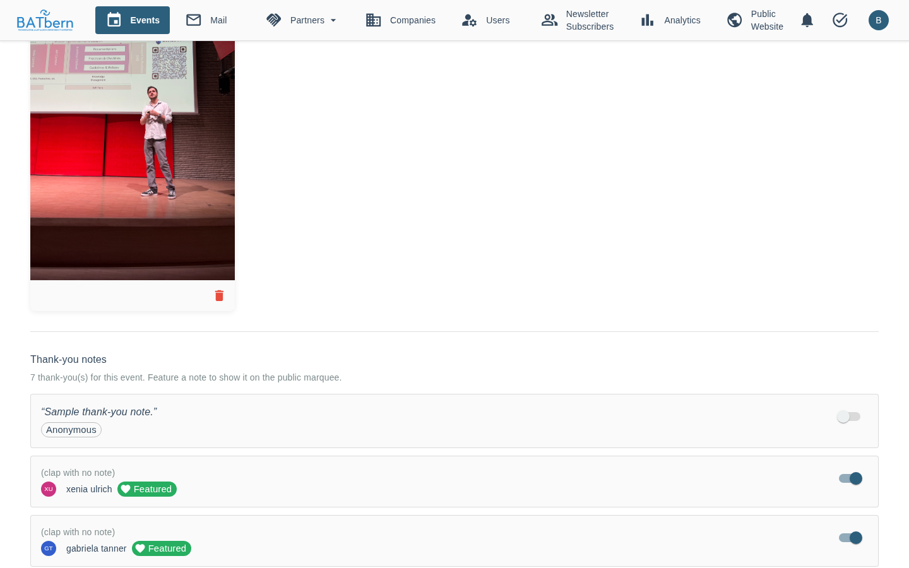

# Thank the Organizers

> One-click gratitude for the volunteers who have run BATbern — free, ad-free, on their own time — for 20 years

> **Last Updated**: 2026-11-04 — curated thank-you marquee (Story 7.7) live

<span class="feature-status implemented">Implemented</span> — Epic 7.4

## Overview

Attendees said they had no way to say thank you. After an event, **any** attendee can send a one-click thank-you to the volunteer organizers, optionally with a short note. It is the one contribution where friction hurts most — so it is the one contribution that is deliberately **not login-gated**.

## Gating — anonymous allowed

Unlike the other contribution features, the thank-you is **open to anyone**, logged in or not. Instead of a login, it is protected by an abuse guard:

- **Anonymous** thank-yous increment a clap-style counter and are protected by **Turnstile + a rate-limit** (per session / IP) to prevent inflation.
- **Logged-in** attendees are **deduped to one thank-you per event** (submitting again does not double-count; an existing note may be updated).

## How it works

```
Any attendee, after an event (live / completed)
        │  POST  { note? }  (+ Turnstile token if anonymous; JWT if logged in)
        ▼
event-management-service
        │  logged in → upsert (unique: event + username)
        │  anonymous → validate Turnstile + rate-limit → increment counter
        ▼
Aggregate appreciation counter (public)  +  notes (organizer-visible)
```

The thank-you lives on the **public event / archive page**. A missing or invalid Turnstile token, or exceeding the rate limit, is rejected without incrementing the counter.

## What attendees and the public see

- A **public aggregate appreciation counter** — how many thank-yous an event received.
- Free-text **notes are organizer-visible only**. There is no public note wall and no approval queue.

## For organizers



Open the event's **Wrap-up** tab. Under **Thank-you notes** you see the **aggregate count** for the event and **every note** attendees submitted (a thank-you without text shows as "(clap with no note)"). There is nothing to moderate or approve for the count itself — it just accumulates.

## Story 7.7 — Curated Thank-You Marquee

<span class="feature-status implemented">Implemented</span> (#785)

You can **feature selected thank-you notes** so they intermingle into the **public homepage partner marquee** — surfacing genuine attendee gratitude alongside partner logos. In the **Wrap-up** tab, switch **Feature on public marquee** on for a note; it is then marked **Featured**. You curate which notes appear: nothing is auto-published. Anonymous thank-yous cannot be featured, because they carry no name.

## What's in scope (and what isn't)

| In scope | Not in scope |
|----------|--------------|
| One-click thank-you, optional note | Per-organizer targeting or rating |
| Anonymous allowed (Turnstile + rate-limit) | Public leaderboards / gamification |
| Logged-in deduped to one per event | Identity verification beyond the abuse guard |
| Public aggregate counter; organizer-visible notes | A public note wall / approval queue |

## Related

- [Post-Event Q&A →](post-event-qna.md) — the companion post-event touchpoint
- [Attendee Experience Overview →](README.md)
