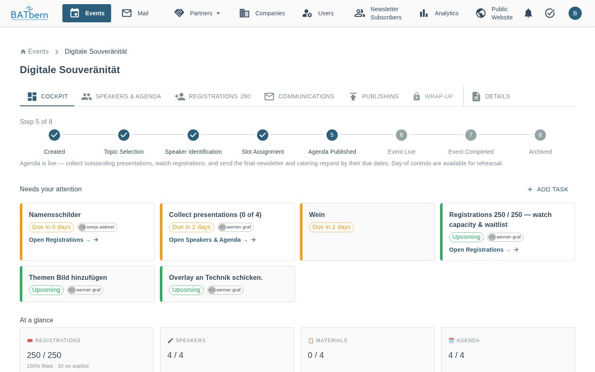
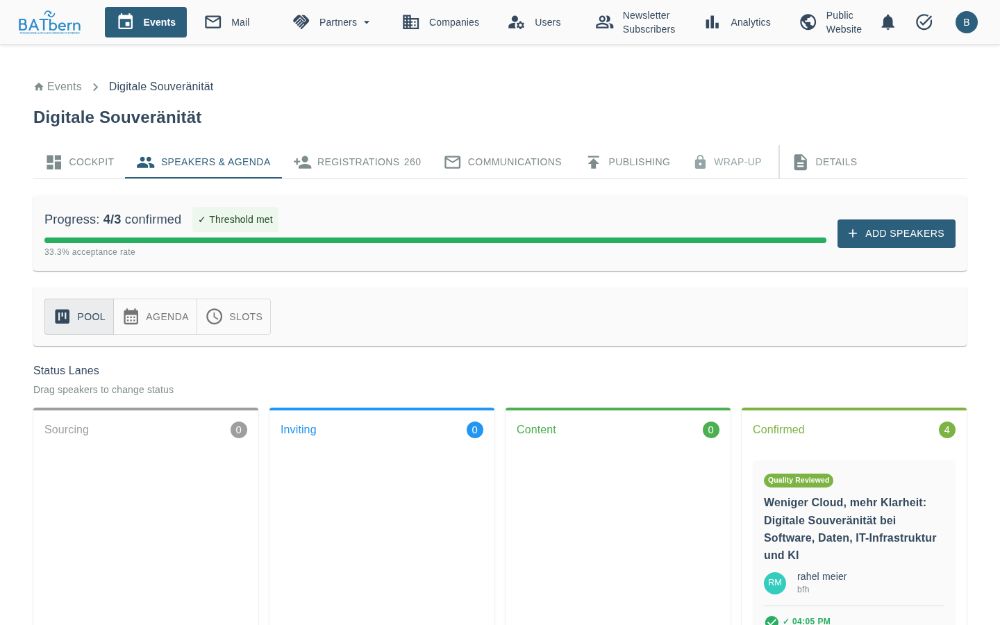
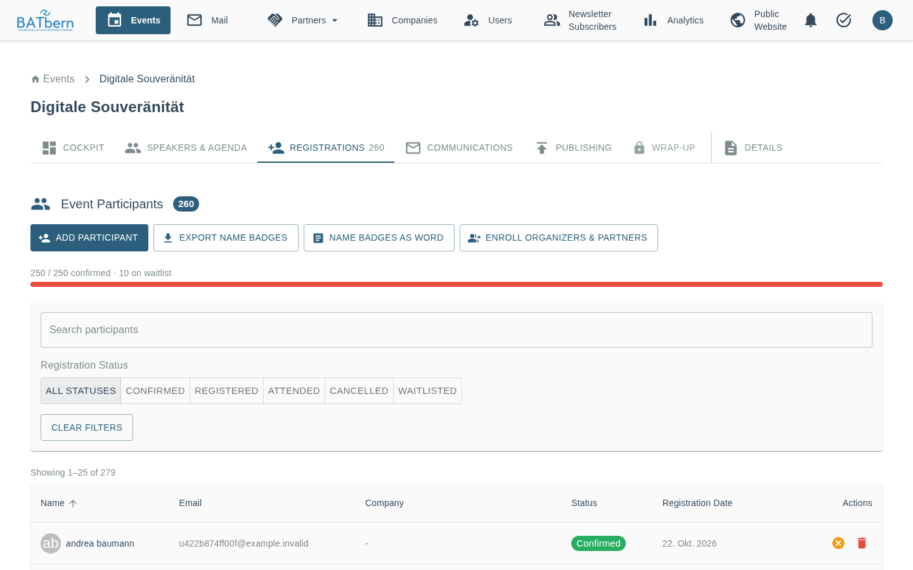
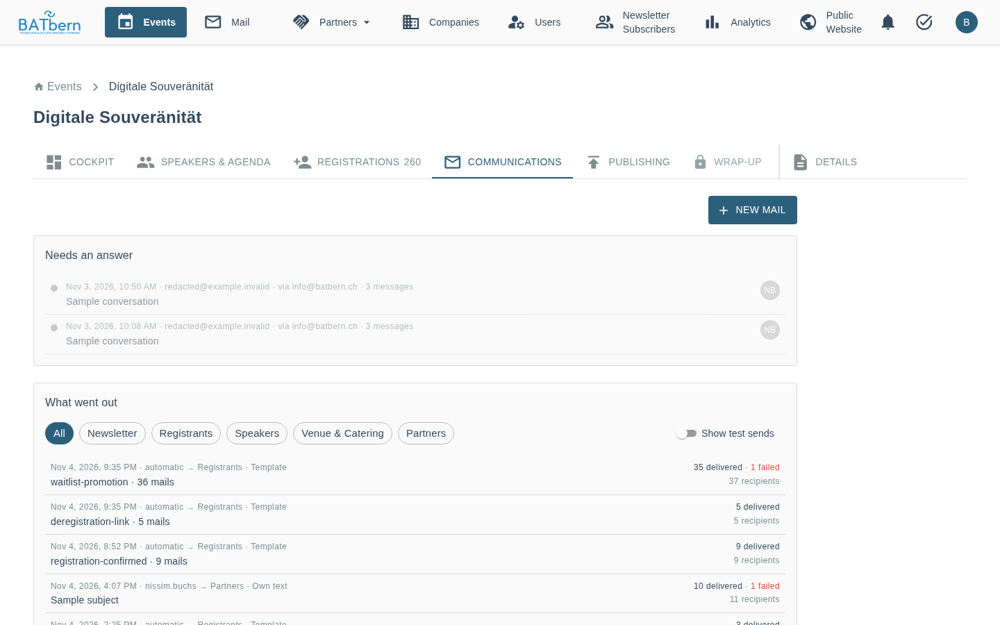
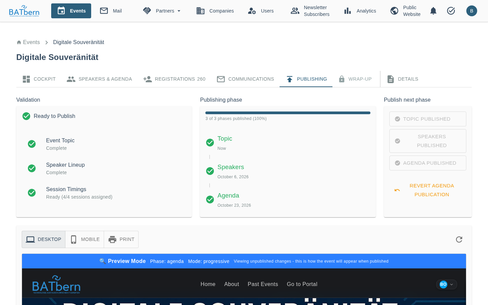
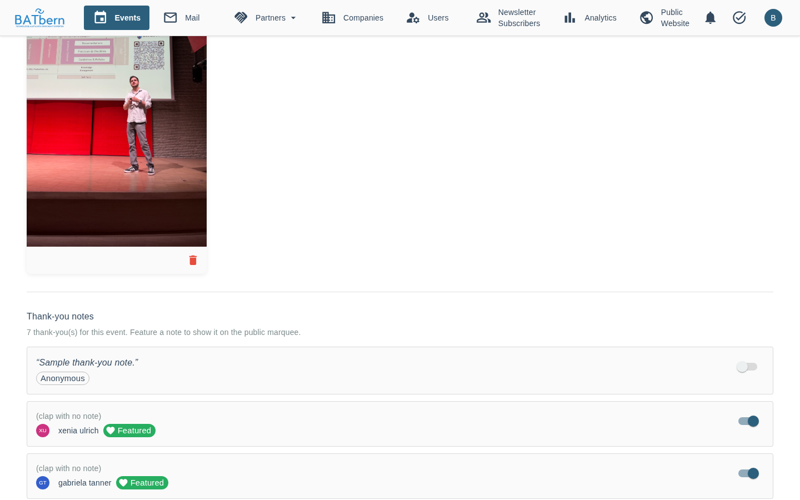
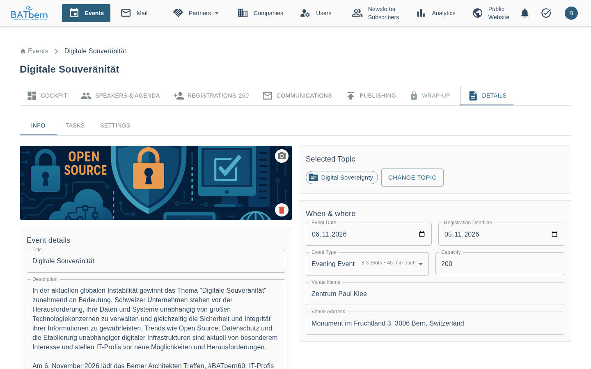
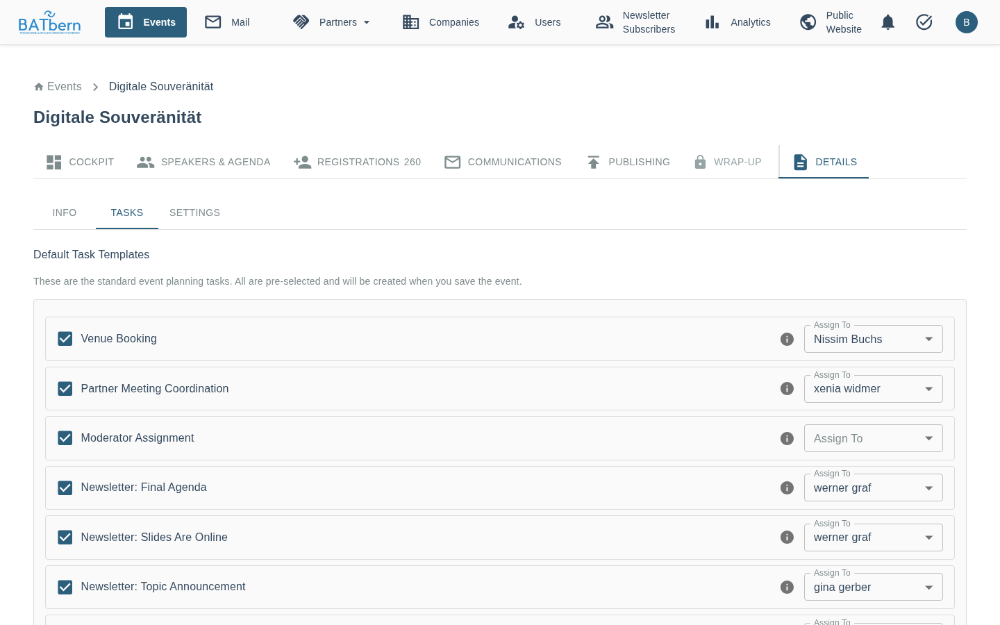
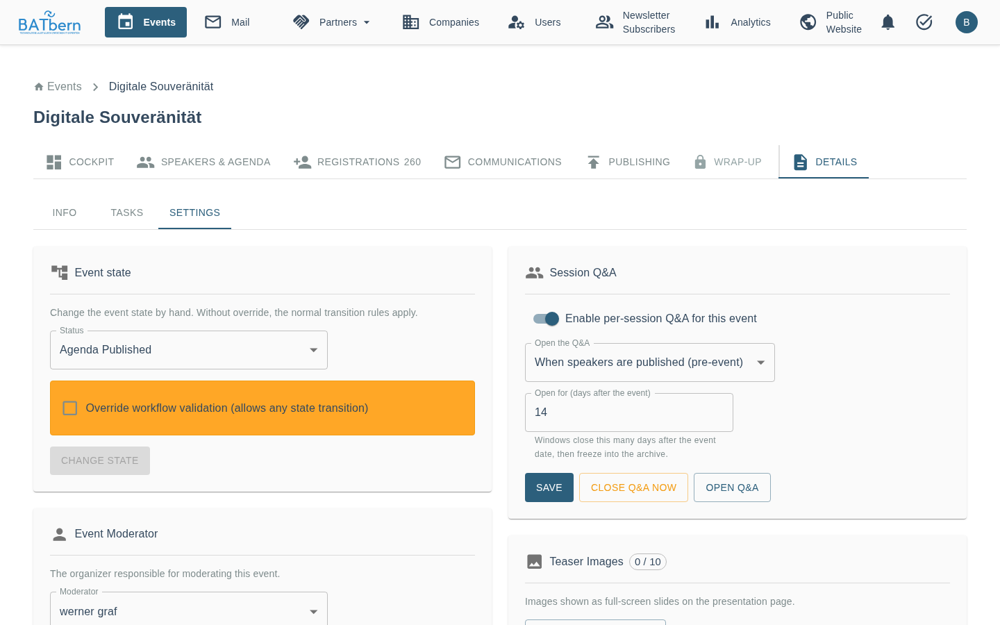

# The Event Page

> One page per event, with everything an organizer does for it

Implemented

> **Last Updated:** 2026-11-04

## Overview

Click an event in the **Events** list to open its page at `/organizer/events/{eventCode}`
(for example `/organizer/events/BATbern60`). The event title stays at the top on every tab. The page
opens on the **Cockpit**.

The tabs come in two groups:

| Tab | What it is for | `?tab=` |
|-----|----------------|---------|
| **Cockpit** | What needs doing now: lifecycle, attention cards, key figures, event-day controls | *(default)* |
| **Speakers & Agenda** | Speaker pool (kanban), agenda, slot assignment | `speakers` |
| **Registrations** | Participants, waitlist, name badges | `registrations` |
| **Communications** | The event's mail page: what went out, what needs an answer, **+ New mail** | `communications` |
| **Publishing** | Publish topic, speakers and agenda to the public website | `publishing` |
| **Wrap-up** | Event photos and thank-you notes after the event | `wrapup` |
| **Details** | Sub-tabs **Info**, **Tasks**, **Settings** | `details` |

**Details** is set apart from the work tabs by a divider. You can link straight to a tab, for example
`/organizer/events/BATbern60?tab=registrations`.

### Tabs follow the event state

The work tabs change emphasis with the [event state](events.md#event-workflow-states):

- A tab that is not yet the focus is shown **dimmed**, but still works.
- **Wrap-up** is **locked** (🔒, not clickable) until the event reaches `EVENT_LIVE`. A link to a
  locked tab opens the Cockpit instead.
- **Cockpit** and **Details** are always available.

### Tab badges

- **Speakers & Agenda** shows a number: sessions that still need a slot plus speakers whose
  material waits for review.
- **Publishing** shows a red dot when the next phase passes validation and is ready to publish.
- **Communications** shows a red dot when a newsletter or registrant-notice task is overdue.
- **Registrations** shows the number of active registrations (confirmed plus waitlist) in grey next
  to the label.

### On a phone

Below 900 px width the tabs move to a bar at the bottom of the screen: **Cockpit**, **Speakers &
Agenda**, **Registrations**, **Communications** and **⋯ More**. **More** opens a sheet with
**Publishing**, **Wrap-up** and **Details**.

---

## Cockpit

The landing tab: where the event stands, what needs your attention, and the key figures. It also
carries the event-day controls (**Start the presentation**, **Open Live Control**).

See **[Cockpit and Event Day](../features/cockpit-and-event-day.md)** for the attention cards, the
rehearsal links and the event-day walkthrough.

---

## Speakers & Agenda

Three views, switched with the buttons at the top of the tab:

| View | Content |
|------|---------|
| **Pool** | The speaker kanban: every speaker of this event and their status. **Add Speakers to Pool** adds candidates. |
| **Agenda** | Sessions with their content and quality review |
| **Slots** | Assigning sessions to time slots |

How the speaker workflow works is described in the
[Workflow System](../workflow/README.md) and the phase pages
([Outreach](../workflow/phase-b-outreach.md), [Quality Review](../workflow/phase-c-quality.md),
[Slot Assignment](../workflow/phase-d-assignment.md)).

---

## Registrations

The participant list of the event, with the waitlist and the name-badge exports.

### The header

Next to the title **Event Participants** a chip shows the number of active registrations
(confirmed plus waitlist, without cancelled). Below it are four buttons:

| Button | What it does |
|--------|--------------|
| **Add participant** | Adds an existing BATbern user as a confirmed participant (see below) |
| **Export name badges** | Downloads `{eventCode}-namensschilder.xlsx` |
| **Name badges as Word** | Downloads `{eventCode}-namensschilder.docx`, ready to print |
| **Enroll Organizers & Partners** | Registers every organizer and partner user for this event |

### Capacity bar

When the event has a registration capacity (Details → Settings), a bar shows
**"{confirmed} / {capacity} confirmed · {waitlist} on waitlist"**. It turns red when the event is
full.

### Filtering the list

- **Search participants** filters by name or email.
- **Registration Status** filters by **All Statuses**, **Confirmed**, **Registered**, **Attended**,
  **Cancelled** or **Waitlisted**.
- **Clear Filters** resets both.

The table shows Name, Email, Company, Status, Registration Date and Actions. On a phone the rows
become cards and the actions move into a **⋯** menu.

### Row actions

| Action | When it is offered | Effect |
|--------|--------------------|--------|
| **Resend Confirmation Email** | Status **Registered** | Sends the confirmation mail again |
| **Cancel Registration** | Every status except **Cancelled** | Sets the registration to **Cancelled** (grey chip). The row stays in the list. |
| **Delete Registration** | Always | Removes the registration permanently, after a confirmation dialog |

Cancelling a registration frees a place, which goes to the waitlist (see below).

### Add participant

1. Click **Add participant**.
2. Pick the person in **User**. Only people who already have a BATbern account can be chosen; there
   is no way to add someone by email address.
3. Leave **Notify the participant by email** ticked if the person should get a mail that the
   organizing team has added them with a confirmed place.
4. Click **Add participant**.

The person is added as **Confirmed** right away, without a confirmation step, and counts toward the
capacity.

- **Event full:** the dialog shows *"This event is full. Add this participant over capacity anyway?"*
  and the button becomes **Add anyway**. Clicking it adds the person above the capacity.
- **Already registered:** *"This user is already registered for this event."* A person with a
  cancelled registration can be added again.
- Adding a participant also works after the registration deadline, which only closes the public
  sign-up.

### Name badges

Both exports contain the same people in the same order:

- every organizer,
- every speaker and co-speaker of the event's sessions,
- every registration with status registered, confirmed or attended (not waitlisted, not cancelled).

A person appears once, with the highest role: **Organisator**, then **Referent**, then
**Teilnehmer**. The list is sorted by role, then by last name, then by first name.

- **Export name badges** (XLSX) has the columns `Vorname`, `Name`, `Firma`, `Rolle`. Use it to check
  the list or for a mail merge.
- **Name badges as Word** (DOCX) is laid out for **Avery Zweckform L4784** sheets with the BAT logo:
  27 badges per page, each with name, company and role. Print it on the label sheets directly; empty
  slots on the last page stay blank.

The default task **Namensschilder** is due two days before the event, and its Cockpit card opens
this tab (see [Task Templates](../administration/task-templates.md)).

### Enroll Organizers & Partners

Registers every user with the organizer or partner role as a **confirmed** participant, without
sending them a mail. People who are already registered are skipped; the message says how many were
enrolled and how many skipped.

New events do this automatically when they are created. Use the button for organizers or partners
who got their role after the event was created. Enrolled organizers and partners count toward the
capacity.

### Waitlist and capacity

When the capacity is reached, new public sign-ups go onto the **waitlist** and get a waitlist mail.
Places on the event are filled from the waitlist **in waitlist order**:

- **When you save the capacity** in **Details → Settings → Registration Capacity**, every free place
  is filled from the waitlist at once. Free places are the capacity minus the registrations with
  status registered or confirmed. Saving the same value again also fills places that are already
  free.
- **When a registration is cancelled**, the next person moves up, as long as a place is free. A
  person added over capacity with **Add anyway** does not pull anyone in.
- **By hand:** filter on **Waitlisted**. The list then shows the waitlist position (**#**) and a
  **Promote to Registered** button per row. After you confirm *"Promote from waitlist?"* the person
  moves to **Registered**, regardless of capacity.

Everyone who moves up gets the waitlist-promotion mail. The remaining waitlist positions are not
renumbered.

⚠️ <strong>Saving the capacity sends mail.</strong> If people are waiting and places are free, every
save of the capacity field promotes them and mails them immediately. The field's help text says so:
"Saving moves people from the waitlist into free places, and they get a confirmation mail."

---

## Communications

The event's mail page: **Needs an answer**, **What went out**, **Handled automatically**, and the
**+ New mail** button, which writes to **Newsletter**, **Registrants**, **Speakers**, **Venue &
Catering** or **Partners**. Newsletters are sent from here too.

See **[Event mail page](../features/event-mail.md)**.

---

## Publishing

Publishes the event to the public website in phases: **Topic**, then **Speakers**, then **Agenda**.
Each phase needs the previous one. The tab has three sections, **Validation** (what still blocks the
next phase), **Publishing phase** (where the event stands) and **Publish next phase** (the publish
buttons), followed by a preview of the public page.

If you do nothing, a nightly job publishes the speakers 30 days and the agenda 14 days before the
event. The agenda is only published automatically once the speakers are published and every session
has a time slot.

See [Phase D: Slot Assignment & Publishing](../workflow/phase-d-assignment.md).

---

## Wrap-up

Available from `EVENT_LIVE` on. It holds **Event Photos** (upload and manage the photo gallery) and
**Thank-you notes** (the notes attendees left for the organizers).

See [Media & Content](../features/media-and-content.md) and
[Thank the Organizers](../attendee-experience/thank-the-organizers.md).

---

## Details

### Info

The event's identity, edited in place and stored with **Save changes**: title, description, the
topic (**Change topic**), **When & where** (event date, registration deadline, venue, venue address,
venue capacity) and the theme image, which can be uploaded or generated with **✨ Generate (AI)**.

The **Capacity** field here is the venue's capacity. The number of places people can book is the
**Registration Capacity** under Settings.

### Tasks

The event's tasks, live:

- The list of task templates: ticking a template creates its task for this event immediately,
  unticking deletes it. Unticking a task that has notes or is in progress or completed asks first.
- The assignee of each task can be changed here.
- Custom tasks for this event can be added, edited and deleted.

Use this sub-tab to add a default task that an older event lacks, for example **Namensschilder** or
**Wein** (see [Task Templates](../administration/task-templates.md#events-created-before-24-october-2026)).

### Settings

| Section | What it does |
|---------|--------------|
| **Event state** | Changes the event state by hand. **Override workflow validation** allows any transition, with an optional reason. |
| **Event Moderator** | The organizer who moderates the event. Cockpit cards without their own task are shown with this person. |
| **Registration Capacity** | Maximum number of places. Leave it blank for unlimited. Saving fills free places from the waitlist (see [Waitlist and capacity](#waitlist-and-capacity)). |
| **Session Q&A** | Per-session Q&A: on/off, when it opens, how many days it stays open, **Close Q&A now** |
| **Teaser Images** | Extra slides for the moderator presentation of this event |
| **Danger Zone** | **Delete Event**, only possible while the event has no attendee registrations |

⚠️ <strong>Cancel Event does not cancel the event.</strong> The <strong>Cancel Event</strong> button
in the Danger Zone opens a confirmation dialog, but confirming it changes nothing and sends no mail.

---

## Related

- [Events](events.md) - creating events, event types, the event states
- [Cockpit and Event Day](../features/cockpit-and-event-day.md) - attention cards, Live Control
- [Event mail page](../features/event-mail.md) - the Communications tab
- [Task Templates](../administration/task-templates.md) - the default tasks and when they appear
