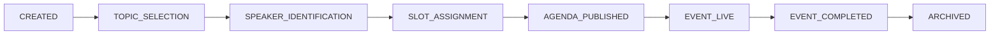

# Event Management

> Plan and coordinate BATbern conferences

<span class="feature-status implemented">Implemented</span>

> **Last Updated:** 2026-11-04

## Overview

Events are BATbern conferences - the central entity that organizes all other platform activities. Each event represents a single conference occurrence (e.g., "BATbern 2025") with its own timeline, speakers, sessions, and partners.

## Event Types

<span class="feature-status implemented">Implemented</span>

BATbern supports 3 distinct event formats:

### 🌞 Full-Day Conference

<span style="background: #2C5F7C; color: white; padding: 4px 12px; border-radius: 12px; font-weight: 500;">FULL_DAY</span>

**Duration**: 8+ hours (e.g., 9:00 - 18:00)

**Typical Structure**:
- Morning keynote
- Multiple parallel tracks
- Lunch break
- Afternoon workshops
- Evening networking reception

**Sessions**: 8-12 presentations
**Speakers**: 10-15 speakers
**Capacity**: 200-500 attendees

**Best For**: Annual flagship conferences

### 🌤️ Afternoon Workshop

<span style="background: #4A90B8; color: white; padding: 4px 12px; border-radius: 12px; font-weight: 500;">AFTERNOON</span>

**Duration**: 3-4 hours (e.g., 14:00 - 18:00)

**Typical Structure**:
- Introduction
- 2-3 focused presentations
- Q&A and discussion
- Networking coffee

**Sessions**: 2-4 presentations
**Speakers**: 3-5 speakers
**Capacity**: 50-100 attendees

**Best For**: Specialized topics, workshops, training

### 🌙 Evening Lecture

<span style="background: #E67E22; color: white; padding: 4px 12px; border-radius: 12px; font-weight: 500;">EVENING</span>

**Duration**: 2-3 hours (e.g., 18:00 - 21:00)

**Typical Structure**:
- Welcome reception
- Keynote presentation
- Panel discussion or Q&A
- Networking drinks

**Sessions**: 1-2 presentations
**Speakers**: 1-3 speakers
**Capacity**: 30-80 attendees

**Best For**: Guest speakers, networking events, launch events

## Creating an Event

<div class="step" data-step="1">

**Open the Events page**

Click **Events** in the top navigation (`/organizer/events`).
</div>

<div class="step" data-step="2">

**Click "New Event"**

Click **New Event** under **Quick Actions**. The dialog **Create New Event** opens.
</div>

<div class="step" data-step="3">

**Fill in the Info tab**

- **Event Number** and **Title**
- **Description**
- **Event Date** and **Registration Deadline**
- **Event Type** - Full-Day, Afternoon or Evening
- **Capacity** - the venue's capacity (required). The number of places people can book is set
  later as **Registration Capacity** in Details → Settings of the event page.
- **Venue** and **Venue Address**
</div>

<div class="step" data-step="4">

**Check the Tasks tab**

All default task templates are ticked. Untick what this event does not need and pick an organizer
for each task. See [Task Templates](../administration/task-templates.md).
</div>

<div class="step" data-step="5">

**Save**

Click **Save & Create**, or **Save as Draft**.

The event starts in state **CREATED**. All organizers and partners are registered for it
automatically (see [Registrations](event-page.md#registrations)).
</div>

## Event Workflow States

<span class="feature-status implemented">Implemented</span>

Events progress through an **8-state workflow** that tracks the high-level event lifecycle.

### State Machine Overview



### State Descriptions

| State | Description | How Reached |
|-------|-------------|-------------|
| **CREATED** | Event record created | Event creation |
| **TOPIC_SELECTION** | Topic being chosen, e.g. with the heat map | Workflow |
| **SPEAKER_IDENTIFICATION** | Building the speaker pool, outreach ongoing | Workflow |
| **SLOT_ASSIGNMENT** | Assigning speakers to time slots | Workflow |
| **AGENDA_PUBLISHED** | Public agenda live, accepting registrations | Agenda published (by hand on the Publishing tab, or automatically 14 days before the event) |
| **EVENT_LIVE** | Event day | Automatically, by a nightly job on the event day |
| **EVENT_COMPLETED** | Event over, wrap-up | Automatically, by a job at the end of the event day |
| **ARCHIVED** | Event archived for historical reference | Manual archival |

There is no separate "agenda finalized" step any more: it was removed in March 2026 (migration V84,
#552) because, when nobody set it by hand, the event never went live automatically. Events that
were in that state were moved back to `AGENDA_PUBLISHED`, and tasks triggered by it now trigger on
`AGENDA_PUBLISHED`.

The state can also be changed by hand in **Details → Settings → Event state** on the
[event page](event-page.md#settings), with **Override workflow validation** for any transition.

**Note**: Speakers progress through their own independent workflow (identified → contacted → ready → accepted → content_submitted → quality_reviewed → confirmed) in parallel with the event workflow.

See [Workflow System](../workflow/README.md) for complete workflow documentation.

## Event Timeline Management

### Date & Time Fields

**Event Date & Time**:
- Primary conference date and time
- Used for countdown timers
- Displayed on event landing pages — the resolved start **and** end times are shown on the public event page so that prospective attendees see the full duration at a glance

**Registration Window**:
- **Registration Opens**: When public can register
- **Registration Closes**: Cutoff for new registrations
- Automatic validation: `Opens` must be before `Closes`

**Recommended Lead Time**:
- Full-Day: 3-4 months advance registration
- Afternoon: 4-6 weeks advance registration
- Evening: 2-4 weeks advance registration

### Timeline Validation

The system validates timeline logic:

```
Registration Opens: 2025-01-15
Registration Closes: 2025-03-10
Event Date: 2025-03-15

✅ Valid timeline
```

```
Registration Opens: 2025-03-01
Registration Closes: 2025-02-28  ❌ Error
Event Date: 2025-03-15

Error: Registration closes before it opens
```

```
Registration Opens: 2025-01-15
Registration Closes: 2025-03-20  ❌ Error
Event Date: 2025-03-15

Error: Registration closes after event date
```

## Event Sessions

<span class="feature-status implemented">Implemented</span>

Events contain **sessions** - individual presentations or activities.

### Session Structure

Each session has:
- **Topic** - Subject matter (selected in Phase A)
- **Title** - Specific presentation title
- **Speaker(s)** - One or more presenters
- **Time Slot** - Scheduled time (assigned in Phase D)
- **Description** - Session overview (≤1000 chars)
- **Track** - Parallel track (for multi-track events)

### Session Types

**Main Presentations**:
- 45-60 minute talks
- Single speaker or panel

**Workshops**:
- 90-120 minute interactive sessions
- Multiple facilitators

**Keynotes**:
- 60-90 minute flagship presentations
- Prominent speakers

**Networking**:
- Break periods
- Coffee, lunch, reception

### Managing Sessions

Sessions are managed throughout the workflow:

1. **Phase A (Setup)**: Topics selected (becomes session topics), speakers brainstormed
2. **Phase B (Outreach)**: Speakers contacted and accept invitations
3. **Phase B (Content)**: Speakers submit presentation titles and content
4. **Phase C (Quality)**: Content reviewed and approved
5. **Phase D (Assignment)**: Sessions assigned to time slots, agenda published

See [Phase D: Assignment](../workflow/phase-d-assignment.md) for session slot assignment details.

## Event Speakers

### Speaker Assignment

Speakers are linked to events through sessions:

```
Event: BATbern 2025
├─ Session 1: Sustainable Building Materials
│  └─ Speaker: Hans Müller (Müller Architekten AG)
├─ Session 2: Digital Transformation
│  └─ Speaker: Anna Schmidt (Schmidt & Partner)
└─ Session 3: Urban Planning
   └─ Speakers: Peter Meier, Lisa Weber (Panel)
```

### Speaker Status Tracking

<span class="feature-status implemented">Implemented</span>

Each speaker progresses through their own workflow independently:

| Status | Description | Next Action |
|--------|-------------|-------------|
| **identified** | Potential speaker brainstormed | Contact speaker |
| **contacted** | Initial outreach recorded | Await response |
| **ready** | Speaker ready to accept/decline | Get acceptance |
| **accepted** | Speaker committed to presenting | Collect content |
| **declined** | Speaker not available | Contact backup |
| **content_submitted** | Presentation details submitted | Review quality |
| **quality_reviewed** | Content approved by organizer | Assign time slot |
| **confirmed** | Quality reviewed AND slot assigned | Ready for publication |
| **overflow** | Accepted but no slot available | Backup speaker |
| **withdrew** | Speaker dropped out after accepting | Find replacement |

**Note**: Speakers reach **confirmed** automatically when both quality_reviewed AND session.startTime exist (can happen in any order).

See [Phase B: Outreach](../workflow/phase-b-outreach.md) for speaker tracking details.

## Event Partners

<span class="feature-status implemented">Implemented</span>

Events can have **partners** - organizations providing sponsorship or collaboration.

### Partner Tiers

Partners are assigned tiers based on contribution level:

- 💎 **Diamond** - Highest tier, prominent placement
- 🥈 **Platinum** - Premium tier
- 🥇 **Gold** - Standard sponsorship
- 🥈 **Silver** - Supporting sponsorship
- 🥉 **Bronze** - Basic sponsorship

### Partner Benefits

Partners receive:
- Logo placement on event materials
- Booth/table at event venue
- Attendee list access (GDPR compliant)
- Speaking opportunities (higher tiers)
- Meeting coordination with attendees

See [Partner Management](partners.md) for details.

## Viewing Event Details

Click an event in the list to open its event page. It has these tabs:

| Tab | Content |
|-----|---------|
| **Cockpit** | Lifecycle, attention cards, key figures, event-day controls |
| **Speakers & Agenda** | Speaker pool (kanban), agenda, slot assignment |
| **Registrations** | Participants, waitlist, capacity, name-badge exports |
| **Communications** | The event's mail page and **+ New mail** |
| **Publishing** | Publishing topic, speakers and agenda to the public website |
| **Wrap-up** | Event photos and thank-you notes (from `EVENT_LIVE` on) |
| **Details** | Sub-tabs **Info**, **Tasks**, **Settings** |

See **[The Event Page](event-page.md)** for every tab, and
**[Cockpit and Event Day](../features/cockpit-and-event-day.md)** for the Cockpit and Live Control.

## Editing an Event

Edit the event on its event page:

- **Details → Info** - title, description, topic, date, registration deadline, venue, theme image
  (**Save changes**)
- **Details → Settings** - event state, moderator, registration capacity, Session Q&A, teaser images
- **Details → Tasks** - the event's tasks

## Deleting an Event

**Details → Settings → Danger Zone → Delete Event** deletes the event permanently, after a
confirmation. It is only possible while the event has no attendee registrations; otherwise the page
says *"Cannot delete event with attendee registrations. Cancel the event instead."* Organizers and
partners enrolled automatically do not count as attendee registrations.

<div class="alert warning">
⚠️ The <strong>Cancel Event</strong> button next to it does not cancel the event: confirming the
dialog changes nothing and sends no mail.
</div>

## Resource Expansion

<span class="feature-status implemented">Implemented</span>

Optimize API requests by expanding related entities:

```
GET /api/events/123?expand=speakers,partners,sessions

{
  "id": "123",
  "name": "BATbern 2025",
  "eventType": "FULL_DAY",
  "eventDate": "2025-03-15",
  "speakers": [
    { "id": "456", "name": "Hans Müller", "status": "CONFIRMED" },
    { "id": "789", "name": "Anna Schmidt", "status": "CONFIRMED" }
  ],
  "sessions": [
    { "id": "101", "topic": "Sustainable Building", "speaker": "456" }
  ],
  "partners": [
    { "id": "202", "name": "Partner AG", "tier": "GOLD" }
  ]
}
```

Returns event with all related data in a single request.

## Event Dashboard Widget

<span class="feature-status implemented">Implemented</span>

Active events appear as cards on the organizer dashboard:

```
┌────────────────────────────────────────┐
│ BATbern 2025                           │
│ [FULL_DAY] [SPEAKERS_IDENTIFIED]       │
├────────────────────────────────────────┤
│ 📅 March 15, 2025                      │
│ ⏰ 45 days until event                 │
│ 🎤 8 of 12 speakers confirmed          │
│ 🎫 237 registrations (of 500)          │
├────────────────────────────────────────┤
│ [Continue Workflow] [View Details]     │
└────────────────────────────────────────┘
```

Click **Continue Workflow** to jump to the current workflow step.

## Common Issues

### "Registration opens after event date"

**Problem**: Invalid timeline configuration.

**Solution**:
- Ensure Registration Opens < Registration Closes < Event Date
- Adjust dates to maintain logical sequence

### "Cannot change event type after sessions created"

**Problem**: Changing event type affects session structure.

**Solution**:
- Delete existing sessions first (if needed)
- Or create a new event with the correct type
- Contact support if you need to migrate sessions

### "Event stuck in CREATED state"

**Problem**: Event not progressing through workflow.

**Solution**:
- Navigate to the event in Phase A workflow
- Select topics to advance to TOPIC_SELECTION state
- Add speaker candidates to reach SPEAKER_IDENTIFICATION
- See [Workflow System](../workflow/README.md)

## Related Topics

- [Workflow System →](../workflow/README.md) - 8-state event workflow, per-speaker workflow, task system
- [Phase A: Setup →](../workflow/phase-a-setup.md) - Event creation and initial configuration
- [Speaker Management →](speakers.md) - Manage event speakers
- [Partner Management →](partners.md) - Coordinate event partners
- [Topic Heat Map →](../features/heat-maps.md) - Select event topics

## API Reference

### Endpoints

```
POST   /api/events                 Create event
GET    /api/events                 List events (paginated)
GET    /api/events/{id}            Get event by ID
PUT    /api/events/{id}            Update event
DELETE /api/events/{id}            Delete event
GET    /api/events/{id}/sessions   Get event sessions
GET    /api/events/{id}/speakers   Get event speakers
GET    /api/events/{id}/partners   Get event partners
POST   /api/events/{id}/workflow   Advance workflow state
```

See [API Documentation](../../api/) for complete specifications.
