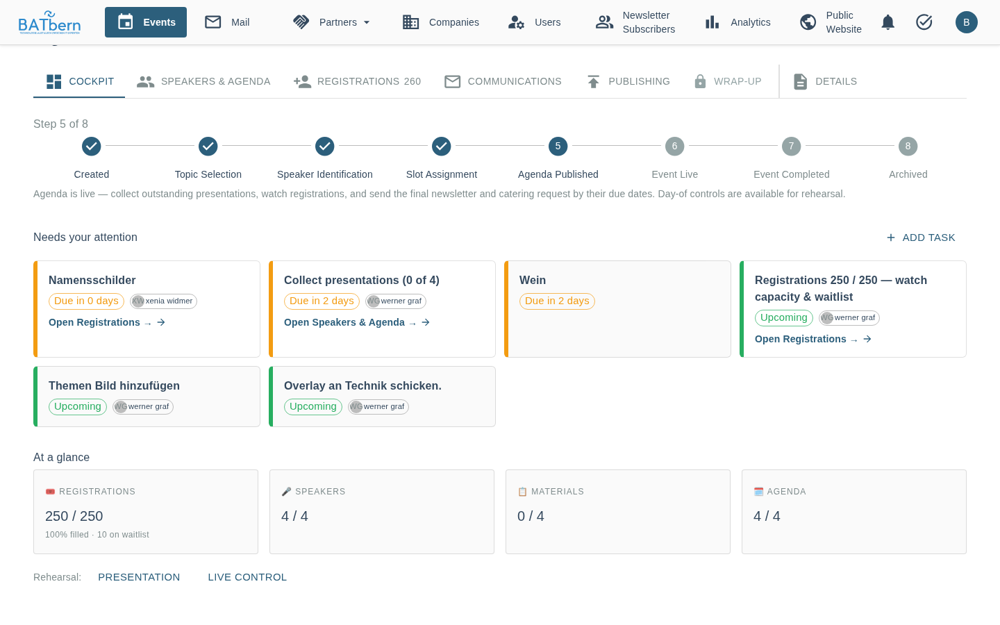

# Cockpit and Event Day `[IMPLEMENTED]`

> **Last Updated:** 2026-11-04 · Epic 14 Phase B, cockpit attention cards (#1105), Live Control (Story 15.1)

## Overview

The **Cockpit** is the first tab of every [event page](../entity-management/event-page.md). It answers
"what do I have to do for this event now?" and, on the event day, it is where the presentation and
Live Control are started.

The Cockpit has three parts, top to bottom:

1. **Lifecycle spine**: the eight event states with the current one highlighted ("Step 5 of 8" on a
   phone), and one sentence on what this state is about.
2. **Needs your attention**: the open work as cards, most urgent first, with **Add task**.
3. **At a glance**: four tiles (**Registrations**, **Speakers**, **Materials**, **Agenda**). Each
   tile opens the matching tab. Before the event day, the rehearsal links sit here too.

---

## Needs your attention

Each card shows what to do, a due chip, the person it belongs to, and a button that opens the place
where the work is done (**Open {tab} →** or **Open →**). When nothing is open the list says
*"You're all caught up — nothing needs your attention right now."*

**Order:** event-day cards first, then overdue (red), due within 7 days, upcoming; within each group
the soonest due date first.

**Due chips:** *Overdue · n days*, *Due in n days*, *Upcoming*, *Event day · {date}*,
*Now · event is live*.

**Add task** creates a custom task for this event.

The cards come from two sources: the event's tasks, and checks on the event's data.

### Task cards

Every task of the event (see [Task Templates](../administration/task-templates.md)) appears as a card
while it is open (**To Do** or **In Progress**). A task disappears from the Cockpit when it is
completed or cancelled.

A task whose trigger has not been reached yet (**Pending**) is not shown, with one exception: once
its due date has passed it appears anyway, with the note **"Trigger not reached yet"**, so that a
missed workflow step cannot hide overdue work.

Complete a task on the **Task Board** (tasks icon in the top bar, `/organizer/tasks`) with
**Mark Complete**. The card's button only takes you to the place where the work is done.

The button target is derived from the task name. For the default tasks:

| Task | Button opens |
|------|--------------|
| Moderator Assignment | Details |
| Newsletter: Speaker Lineup | Speakers & Agenda → Pool |
| Namensschilder | Registrations (name-badge exports) |
| Venue Booking, Partner Meeting Coordination, Catering Coordination, Newsletter: Topic Announcement, Newsletter: Final Agenda, Newsletter: Slides Are Online | Communications |
| Wein | no button |

Custom tasks get a button when their name contains a matching word (for example *photo* → Wrap-up,
*publish* → Publishing, *slot* → Slots); otherwise the card has no button.

### Cards from the event's data

These cards have no task behind them. They disappear by themselves once the condition is met. They
are shown with the event moderator (Details → Settings → **Event Moderator**).

| Card | Shown in state | Disappears when | Opens |
|------|----------------|-----------------|-------|
| **Add event details & pick a topic** | `CREATED` | a topic is set | Details |
| **Confirm the topic** | `TOPIC_SELECTION` | the event leaves this state | Details |
| **Fill the speaker pool — {confirmed} / {min} confirmed** | `TOPIC_SELECTION`, `SPEAKER_IDENTIFICATION` | confirmed speakers reach the minimum number of slots of the event's agenda configuration | Speakers & Agenda → Pool |
| **{count} sessions still need a slot** | `SPEAKER_IDENTIFICATION` to `AGENDA_PUBLISHED` | every speaker session has a start time (breaks and moderation do not count) | Speakers & Agenda → Slots |
| **Review speaker submissions** | `SPEAKER_IDENTIFICATION`, `SLOT_ASSIGNMENT`, while speaker names are not yet public | no speaker waits for a quality review | Speakers & Agenda → Agenda |
| **Speakers not yet quality-reviewed: {n} waiting for content, {m} waiting for review** | from the publication of the speakers up to `EVENT_LIVE` | every speaker has submitted and been reviewed | Speakers & Agenda → Pool |
| **Finalize & publish the agenda** | `SLOT_ASSIGNMENT` | the event leaves this state | Publishing |
| **Collect presentations ({collected} of {total})** | `AGENDA_PUBLISHED` | every session has its material, or the event has no sessions | Speakers & Agenda → Agenda |
| **Registrations {confirmed} / {capacity} — watch capacity & waitlist** | `AGENDA_PUBLISHED` | see below | Registrations |

Notes:

- **Speakers not yet quality-reviewed** is always red: the names are already public, so anything not
  reviewed is overdue. It replaces **Review speaker submissions** once the speakers are published,
  so a speaker is never counted twice.
- **Collect presentations** is due on the event day: the slides are needed then at the latest.
- **Registrations** only appears when there is something to decide: confirmed registrations reach
  **90 %** of the registration capacity, or anyone is on the waitlist. Without a capacity it only
  appears when someone is waiting. The plain count is always in the **Registrations** tile under
  *At a glance*. What to do: [Waitlist and capacity](../entity-management/event-page.md#waitlist-and-capacity).

### Event-day cards

| Card | Opens |
|------|-------|
| **🔴 Start the presentation** | The moderator presentation `/present/{eventCode}`, in a new browser tab |
| **📡 Open Live Control** | Live Control `/organizer/events/{eventCode}/live-control` |

They are shown on the event day itself (the calendar day in Bern) once the agenda is published, and
for as long as the event is `EVENT_LIVE`. They are pinned to the top of the list and have no done
state.

### Rehearsal links before the event day

While the event is `AGENDA_PUBLISHED` and it is not yet the event day, the event-day cards are not
shown. Instead, under *At a glance*, a small line **Rehearsal: Presentation · Live Control** opens
the same two pages, so you can try them out on the projector laptop and on your phone beforehand.

---

## Live Control

`/organizer/events/{eventCode}/live-control` is a full-screen, dark page made for a phone. It shows
the running session and lets you move the schedule while the event is on. Changing times requires an
organizer login.

ℹ️ Live Control is in German only. The labels below are quoted as they appear on screen.

### What it shows

- **Header:** *Live Steuerung*, the event code, and the connection state: *Verbunden* (connected),
  *Verbinde...* (connecting) or *Offline*. When offline, the page says *"Live-Updates nicht
  verfügbar. Bitte Seite neu laden."*: reload the page.
- **The active session** is the one whose scheduled time includes the current time. The card shows
  *LIVE*, the scheduled start and end, the title, and the speakers with their company logos.
- **Countdown** of the remaining time (mm:ss) with a status line and colour:
  - *IM PLAN* (on schedule), blue
  - *5 MIN NOCH* (5 minutes or less left), blue
  - *2 MIN NOCH* (2 minutes or less), orange; under one minute it pulses
  - *ÜBERZEIT* (overtime), red, counting up as `+mm:ss`
- A progress bar for the session.
- **No session running:** *Keine aktive Session*, with the next session (*Nächste Session*), its
  speakers and its start time.
- **The agenda** below, with ✓ for finished sessions and ▶ for the running one.

The page refreshes every few seconds while a session is running, and less often when nothing is
running or the browser tab is in the background.

### Changing the schedule

Two buttons on the active session:

**↔ Zeit anpassen** (adjust time), always available while a session runs. It opens *Session Zeit
anpassen* with:

- *Kürzen* (shorten): −20, −15, −10, −5 min
- *Verlängern* (extend): +5, +10, +15, +20 min

The end of the running session moves by that amount, and **every later session moves by the same
amount**. You can tap more than once.

**← Verzögern** (delay), only in the first 10 minutes of a session. It is for "the previous talk is
still running": *Vorherige Session mehr Zeit geben?* with +5, +10, +15 or +20 min. The previous
session gets that much more time and becomes the running one again; the current session and all
later ones move back by the same amount. On the first session of the day it simply moves all
sessions back.

The new times are saved for the event, so every device that has Live Control open shows them. If
your phone is offline when you tap, the change is sent on the next successful refresh.

---

## Event day walkthrough

A checklist for the organizer team, from the week before to the day after.

### In the week before (event state `AGENDA_PUBLISHED`)

1. **Open the event's Cockpit** and work down *Needs your attention*. Typical cards now:
   **Catering Coordination** (due 5 days before), **Namensschilder** (2 days before),
   **Collect presentations (n of m)**, **Wein** (event day), and **Registrations** if the event is
   nearly full or people are waiting.
2. **Registrations and waitlist.** If places become free or the capacity can be raised, change the
   **Registration Capacity** in Details → Settings. Saving fills the free places from the waitlist
   and mails everyone who moves up. See
   [Waitlist and capacity](../entity-management/event-page.md#waitlist-and-capacity).
3. **Name badges.** The **Namensschilder** card opens **Registrations**. Check the list with
   **Export name badges** (XLSX), then print **Name badges as Word** on Avery Zweckform L4784
   sheets. Late sign-ups need a second print. Both list organizers first, then speakers, then
   partners (everyone with the partner role who is registered), then the other participants,
   each group by last name; the role line reads Organisator, Referent, Partner or Teilnehmer.
   Someone with two roles gets one badge with the higher one. Events created before 24 October 2026 have no
   Namensschilder or Wein task; see
   [Task Templates](../administration/task-templates.md#events-created-before-24-october-2026).
4. **Presentations.** **Collect presentations (n of m)** opens the agenda view; it counts sessions
   with material.
5. **Rehearse.** Under *At a glance*, open **Rehearsal: Presentation** on the projector laptop and
   **Live Control** on the phone you will use. Check the presentation slides (see
   [Moderator Presentation Page](media-and-content.md)) and log in on the phone.

### On the event day

6. **The event goes live by itself.** A nightly job moves the event from `AGENDA_PUBLISHED` to
   `EVENT_LIVE` on the event day; nobody has to do anything. The event-day cards are already
   shown on the day even before that switch.
7. **Projector laptop:** Cockpit → **🔴 Start the presentation**. It opens in a new tab; press `F`
   for full screen and drive it with the arrow keys or a presenter remote. Details:
   [Moderator Presentation Page](media-and-content.md).
8. **Phone:** Cockpit → **📡 Open Live Control**. Keep it open during the sessions.
9. **During the sessions:** watch the countdown. If a talk runs long, use **↔ Zeit anpassen** →
   *Verlängern*; to catch up, *Kürzen*. If the next talk was started too early, use
   **← Verzögern** in its first 10 minutes.

### After the event

10. A job at the end of the event day moves the event to `EVENT_COMPLETED`. The **Wrap-up** tab is
    open from `EVENT_LIVE` on for photos and thank-you notes.
11. The task **Newsletter: Slides Are Online** becomes due one day after the event: send the
    slides mail from Communications → **+ New mail** → **Registrants** (see
    [Slides-Online Email](../attendee-experience/slides-online-email.md)).

---

## Related Features

- [The Event Page](../entity-management/event-page.md) - all tabs, Registrations in detail
- [Media & Content](media-and-content.md) - the moderator presentation page
- [Task Templates](../administration/task-templates.md) - default tasks and when they appear
- [Event mail page](event-mail.md) - the Communications tab
