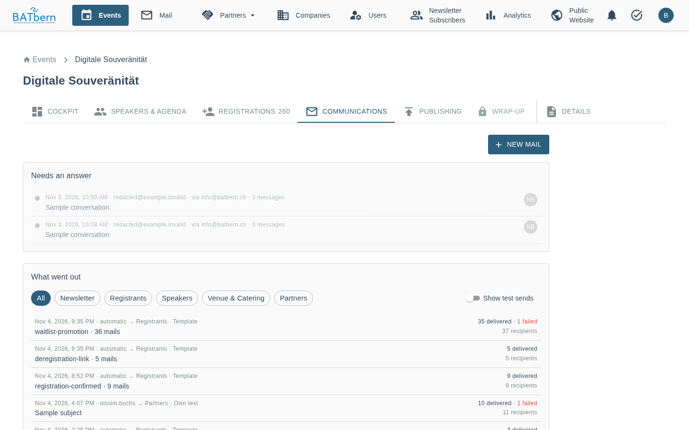
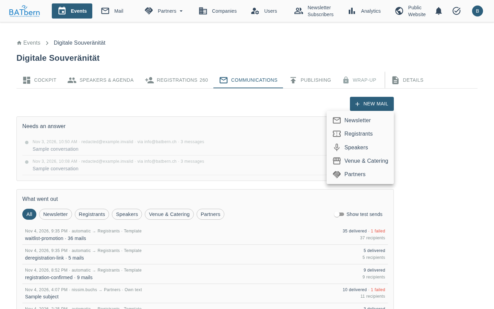
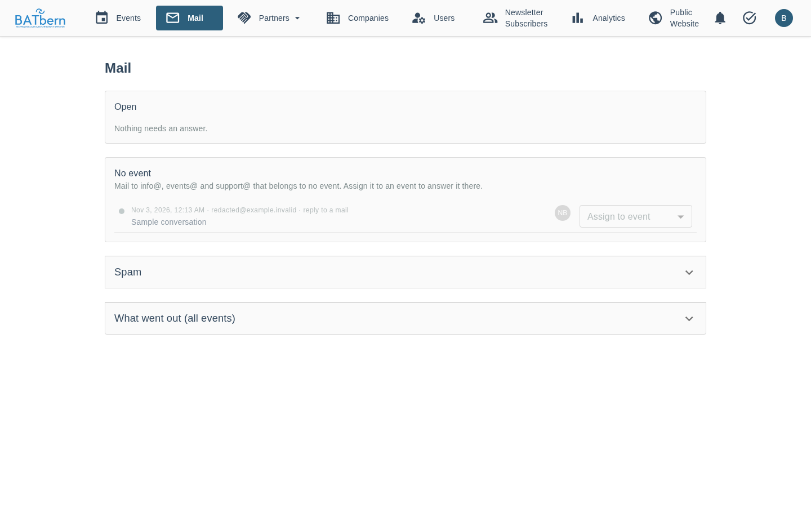

# Event mail page (Communications tab)

> **Last Updated:** 2026-11-02 · Epic 16, Stories 16.3, 16.4, 16.8a, 16.8b, 16.2a, 16.7, 16.10

The **Communications** tab of an event is its mail page. It answers "did the speakers get the
slides mail?" without asking the team.

## Needs an answer

What speakers wrote to the team for this event, so everyone sees the question and who answers it,
instead of it sitting in one private inbox (Story 16.2a).

- **What lands here:** a speaker's mail to the event's moderator address
  (`batbern{N}-moderator@batbern.ch`, the Reply-To of every speaker mail), replies to registration
  mails and newsletters, and mail to `info@`, `events@` or `support@` that belongs to the event (it
  answers one of the event's mails, or its subject names the event, e.g. "BATbern60"). Contact mail
  that belongs to no event is listed on the **Mail** page (below), where you can put it on an event. An
  organizer's mail to `info@` counts like anyone's; organizer mail to the moderator address or to
  `ok@` does not. A row says where the mail came from: "via info@batbern.ch", "reply to a registrant
  mail", "reply to the newsletter".
- **Broadcasts are sends:** an organizer's mail to `batbern{N}-participants@` or `partner@` appears
  under "What went out" as one mail to all recipients.
- **Forwarding is unchanged** until the owner switches an address group to the Mail Center. Then the
  people who got the forwarded copy get a short notice with a link to the conversation instead.
  The switch is in Administration → Settings, "Mail Center: notice instead of forwarding", one
  checkbox per group: speaker mail (`batbern{N}-moderator@`), replies (`replies@`), general mail
  (`info@`, `events@`, `support@`).
- **Each row:** a status dot, date, who wrote, where it arrived, the subject, and the avatar of the
  organizer who answers. Open and waiting first, newest first; done ones below, greyed. The number
  beside the heading counts the open ones.
- **Who answers:** the event's lead organizer at first. **I'll take it** on an unassigned row makes
  it yours; inside the conversation you can pick any organizer or nobody.
- **Status:** *Open* (needs an answer), *Waiting* (answered, waiting for the speaker), *Done*. A new
  mail from the speaker sets it back to *Open*. Changing the status sends no mail.
- **Answering:** below the messages, write your answer and click **Send answer**, then confirm. The
  mail goes out as "{your name} via BATbern" from `info@batbern.ch` and quotes the speaker's last mail. When the speaker
  replies, the reply lands in the same conversation, not in your inbox. Sending sets the
  conversation to *Waiting*; tick **Mark as done** first if nothing more is expected. Your answer
  appears in the conversation for every organizer; it is not listed again under "What went out".
- **Reassigning:** when you give a conversation to another organizer, they get one short mail with a
  link to it. Taking it yourself, clearing the assignee, or choosing the same organizer again sends
  nothing.
- **A click** opens the conversation below its row (on a phone: full screen). The newest mail is
  on top and open; older ones are one line each with sender, time and the start of the text. Click a
  line to open it, or **Show all** to open every mail. Each open mail shows sender, time, text and
  attachments. Attachments up to 25 MB open with a click; larger
  ones show their name only ("name only") and are in the forwarded copy. Images and formatting from the sender's mail are
  not shown, so opening a mail never loads anything from outside.
- **Link to a conversation:** the address bar shows `?conversation=conv-…` while one is open; that
  link opens it directly.
- **Nothing yet?** The section shows one line, "Nothing open."
- Conversations are kept like the rest of the event's mail: 12 months after the event.

## What went out

Every mail sent for the event, newest first, the newsletter included.

- **Each row:** date · sender → audience · *Template* or *Own text*, the subject, and on the right
  how many were delivered and how many failed. "automatic" means no organizer sent it (a
  scheduler or a registration).
- **Filters:** All · Newsletter · Registrants · Speakers · Venue & Catering · Partners.
- **A mail an organizer sends to `batbern{N}-speaker@`** is listed as own text to the speakers, sent
  by that organizer (since 2 November 2026).
- **Automatic mails** (confirmations, reminders) are collapsed per template and day
  ("registration-confirmation · 14 mails"). A click expands them into single mails.
- **A click on a mail** opens it below its row, exactly as it was sent, with its recipients beside
  it (on a phone: full screen). A second click closes it. Failed recipients
  come first, with the reason: the bounce type (`Permanent/NoEmail`), `complaint`, or the reason
  SES refused it.
- **Links and codes are not shown.** One-click links, registration codes and temporary passwords
  were replaced by `[redacted]` when the mail was recorded.
- **A newsletter that is still sending** shows its progress and refreshes by itself.
- **A newsletter that left recipients out** (ended partial or failed) has **Retry** on its row: it
  sends again to the failed recipients only.
- **Test sends are hidden.** A test to the organizers is recorded with a TEST mark but hidden from
  the list; switch on **Show test sends** to see them.

Limits:
- Mails sent before 30 October 2026 are not listed, except newsletters and registrant notices,
  which come from the newsletter history. Their text was not recorded, so the mail says so.
- For the newsletter, "delivered" means sent and not bounced: SES reports no deliveries for the
  newsletter. For all other mail it is SES's delivery report.
- Mail is kept for 12 months after the event (see the privacy rules in
  `docs/architecture/08-operations-security.md`).

## Handled automatically

Collapsed, counts only. Failed deliveries for the event (bounces, complaints, rejects, sends SES
refused), and since Story 16.2a every mail that came back without needing a person, each kind on
its own line when there is at least one:

- out-of-office replies;
- bounce messages that arrived as mail;
- calendar acceptances and declines of the registration invite;
- replies "accept" that confirmed a registration, and replies "cancel" that sent the cancellation
  link;
- newsletter unsubscribes by reply.

These mails are only counted: no sender, subject or text is kept. A mail counts for this event when
it answers one of the event's mails, names the event code in its subject, or (calendar replies)
belongs to one of its registrations.

## + New mail

The button sits at the top right of the communication tab, above all sections.

The menu offers **Newsletter, Registrants, Speakers, Venue & Catering, Partners**. All five open the
same composer at the top of the page (full screen on a phone), with the same steps:

1. **Template or own text.** See "Own text" below.
   - Newsletter: `newsletter-event` is preselected; *Send as reminder* adds the reminder prefix.
   - Registrants: a registrant notice (for example `slides-online`).
   - Speakers: *Automatic* or one of the six reminder templates. Automatic picks each speaker's
     tier from that speaker's deadline, so one send can mix tiers; choose which speakers (invited
     without an answer, or accepted without content). A chosen template decides that itself.
   - Venue & Catering: the template, the roles (venue, catering: the first is To, the other Cc) and
     optional notes.
   - Partners: the partner meeting invite (calendar entry, fixed text) or a template of category
     Partner. Every partner gets the mail as their own; nobody sees the others' addresses.
2. **Language.** Newsletter and venue: DE or EN for everyone. Registrants and speakers each get
   their own language; the preview shows the language of the recipient shown.
3. **Recipients**, counted by the server, with up to eight names, and who is left out and why
   (unsubscribed, reminders turned off, no address, duplicate).
4. **Preview** of the mail exactly as one real recipient gets it. Registrants and speakers step
   through the recipients with ‹ › ("2/14"). Links and codes are shown as `[redacted]`. An unknown
   placeholder is shown in red and blocks sending.
5. **Where replies go.**
6. **Send to organizers (test)** sends the mail shown to every organizer, subject `[TEST] `, with
   dummy links. The composer stays open. **Send to N recipients** asks once more ("Really send to
   …?"), then sends.

After a real send the composer closes, a message confirms it, and the new mail is highlighted on top
of "What went out" ("sending …" first, then the counts). If the send cannot happen (the registrant
notice was already sent, a newsletter is still running), the composer says why.

### Own text

Switch from *Template* to *Own text* to write the subject and the text yourself, for any audience.

- **Placeholders.** The chips above the text insert a placeholder such as `{{speakerName}}` at the
  cursor of the subject or the text. Each audience offers what it has: speakers their name, talk
  title (`sessionTitle`), deadline and days left; registrants their name and cancel link;
  newsletter and venue only event values, because everyone gets the same text. Every placeholder a
  template of that audience can use also works when typed.
- **Preview.** The values of the recipient shown are marked yellow. A placeholder the audience does
  not have (a typo such as `{{deadlin}}`, or spaces inside the braces) is marked red and both send
  buttons stay off; the server refuses such a mail too.
- **Language.** Everyone gets the text as written; the chosen language sets the BATbern frame
  around it (registrants and speakers included).
- **Newsletter.** If your text has no `{{unsubscribeLink}}`, the standard unsubscribe line is added
  at the end, with each subscriber's own link.
- **Registrants.** Own text with the same subject goes to an event's registrants once. Sending it
  again asks "Already sent on … Send again?".
- **Speakers.** Choose by status: invited, accepted, content submitted, quality reviewed. Each
  speaker gets their own values; replies go to the moderator. The speaker's history notes "Own text:
  {subject}". It is not a reminder: no reminder log, no escalation, and it also reaches speakers who
  turned reminders off.
- **Starting point.** *Use template as starting point* copies a template's subject and text into
  own text; the template stays as it is.
- **Save as template** stores your text as a new template of the audience (not for speakers, whose
  templates are the six reminders). It then appears in the template list. You type a name such as
  "Partner Info"; the dialog shows the key it is saved under (`partner-info`).

"What went out" shows such a mail as own text, without a template name.

**Partners** also lists the event's partner meeting with its calendar invite. Without a meeting it
links to the partner meetings page.

Partner meeting invites and cancellations appear in "What went out" like every other mail: audience
Partners, the organizer who clicked as sender, every partner and organizer address as a recipient
with its own delivery status. An invite row also shows the meeting's answers (accepted, declined,
tentative, no answer). Every partner and organizer gets the invite as their own mail, with a
calendar entry that lists only them, so nobody sees the other addresses. The same holds for the
cancellation and for a plain mail to all partners.

In **Partner meetings**, the open meeting lists its own mails under "Mails of this meeting".

Esc closes the composer; the focus goes back to "+ New mail".

## The Mail page (all events)

**Mail** in the top navigation, right after Events, shows everything across events (Story 16.7). The
number on the entry counts the open conversations of all events and of mail without an event; it
disappears at zero and refreshes every minute.

- **Open:** every open or waiting conversation, of every event. Each row names its event. A click
  opens it below the row, exactly as on the event page.
- **No event:** mail to `info@`, `events@` or `support@` that belongs to no event. **Assign to event**
  beside a row puts the conversation and all its mails on that event: it then shows in that event's
  "Needs an answer". Choosing "(no event)" takes it off again. Inside any conversation the **Event**
  field does the same.
- **Spam (collapsed):** mail the mail server flagged as spam. It is not forwarded to anyone and never
  shows as open. **Not spam** moves it where it belongs, as if it had just arrived: to an event's
  "Needs an answer" or to "No event". Spam is deleted after 30 days. Mail with a virus is not kept at
  all and never reaches anyone.
- **What went out (all events, collapsed):** the "What went out" list of every event together, each
  row with its event; pick an event to narrow it.

## Mail of one person or partner

The **Mail** tab on a user's page (Users → a user) and on a partner's page (Partners → a partner)
lists every mail we sent to that person, or to the partner's contacts, and every mail they sent us,
across all events, newest first (Story 16.10).

- All their addresses count: the main one and every additional one.
- A sent mail shows that person's delivery status; a received one shows who wrote it and, when it is
  part of a conversation, a link to it.
- Not listed: newsletters, mail from before the Mail Center recorded it (sent mail since 31 Oct 2026,
  received mail since 2 Nov 2026), and mail to an address the person no longer has.
- Partners do not see the tab on their own company page.
