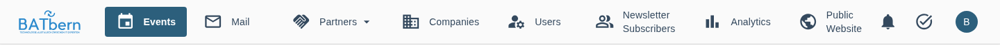
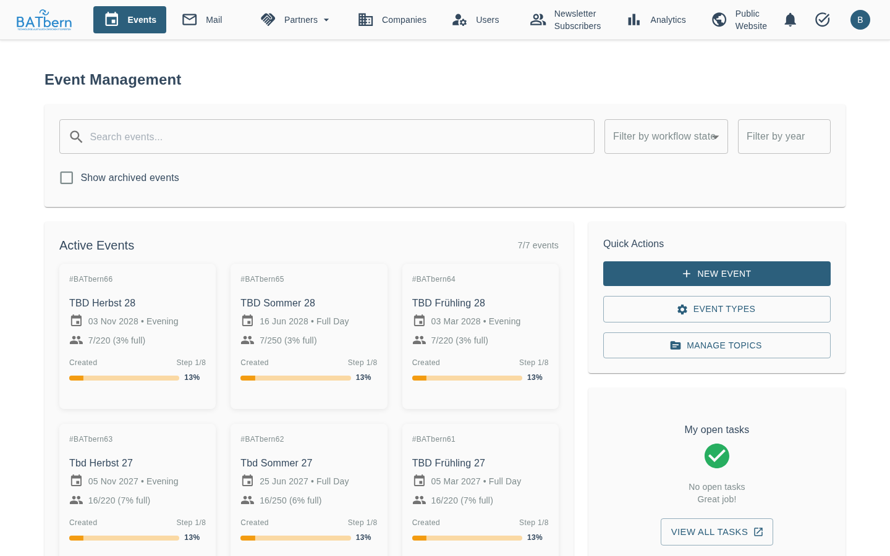

# Dashboard Navigation

> Navigate the BATbern organizer interface

<span class="feature-status implemented">Implemented</span>

> **Last Updated**: 2026-11-04

## Overview

After login, organizers land in the organizer interface: a top bar with the navigation, and the page
content below it. There is no left sidebar.

> **Organizer and partner in one account**: if your account holds both roles, a role selector next
> to the logo switches the navigation between the organizer and the partner items. Speaker and
> attendee features live on the public website, so they do not appear there. See
> [Multi-Role Navigation](navigation.md#multi-role-single-session-navigation).

## The Top Bar



```
┌──────────────────────────────────────────────────────────────────────────────────────────┐
│ BATbern  Events  Mail(3)  Partners ▾  Companies  Users  Newsletter Subscribers           │
│          Analytics  Public Website                              🔔   ✓   (N)            │
└──────────────────────────────────────────────────────────────────────────────────────────┘
```

### Navigation items

| Item | Opens |
|------|-------|
| **Events** | The events page `/organizer/events` (see below) |
| **Mail** | The Mail page `/organizer/mail`, all conversations across events. A badge shows the number of open conversations; it is hidden at zero and refreshes every minute. See [Event mail page](../features/event-mail.md). |
| **Partners ▾** | A menu with **Partners**, **Partner Topics** and **Partner Meetings** |
| **Companies** | `/organizer/companies` |
| **Users** | `/organizer/users` |
| **Newsletter Subscribers** | `/organizer/newsletter-subscribers` |
| **Analytics** | `/organizer/analytics` |
| **Public Website** | The public website `/` |

### Right side

- **🔔 Notifications** opens the Notifications page (`/organizer/notifications`): the in-app
  notifications the platform creates for organizers when something changes, with **Hide read**,
  **Mark all as read**, and per notification mark-as-read and delete. The bell itself shows no
  unread count.
- **✓ Tasks** (organizer only) opens the **Task Board** (`/organizer/tasks`): all tasks as columns
  **Pending**, **To Do**, **In Progress**, **Completed**, filter **My Tasks** / **All Tasks**,
  **Mark Complete**, **Add Custom Task**.
- **Avatar** (the first letter of your email address) opens the user menu: your email and roles,
  then **Profile**, **Settings**, **Administration** (organizers only, see
  [Administration](../administration/README.md)), the language selector, **Help** and **Logout**.

### Screen width

| Width | Top bar |
|-------|---------|
| 1440 px and wider | Icons with labels |
| 900 to 1439 px | Icons only; the name appears as a tooltip on hover |
| below 900 px | A ☰ menu button opens the navigation as a drawer |

The BATbern logo is not a link; use **Events** to get back to the start.

## The Events Page



**Events** (`/organizer/events`) is the organizer start page, titled **Event Management**:

- **Search and filters** for the event list at the top.
- **Active Events**: the event list, paginated. Click an event to open its
  [event page](../entity-management/event-page.md).
- **Quick Actions**: **New Event**, **Event Types**, **Manage Topics**.
- **My open tasks**: your open tasks across all events, with **View All Tasks** (the Task Board).
- **Notifications**: the latest in-app notifications, with **Mark all as read**, **Reload** and
  **View All**.

## Entity List Views

Clicking an entity in the top bar navigates to the list view:

### Table Features

<span class="feature-status implemented">Implemented</span>

All entity tables support:

- **Search**: Global search across all columns
- **Filtering**: Advanced filters with JSON syntax <span class="feature-status implemented">Implemented</span>
- **Sorting**: Click column headers to sort ascending/descending
- **Pagination**: Navigate through large datasets (10/25/50 per page)
- **Bulk Actions**: Select multiple rows for batch operations <span class="feature-status planned">Planned</span>

### Table Example: Events

| Event Name | Type | Date | State | Speakers | Actions |
|------------|------|------|-------|----------|---------|
| BATbern 2025 | Full-Day | 2025-03-15 | SPEAKER_IDENTIFICATION | 8 | View • Edit • Delete |
| BATbern 2024 | Afternoon | 2024-03-20 | ARCHIVED | 6 | View |

**Actions**:
- **View** (👁️) - Read-only details
- **Edit** (✏️) - Modify entity
- **Delete** (🗑️) - Remove entity (with confirmation)

## Entity Detail Views

Clicking "View" or "Edit" navigates to the detail view:

### Form Layout

Forms follow a consistent pattern:

<div class="step" data-step="1">

**Header Section**
- Entity type (e.g., "Event Details")
- Status badge (e.g., "ACTIVE")
- Last modified timestamp
</div>

<div class="step" data-step="2">

**Form Tabs** (for complex entities)
- **General** - Basic information
- **Timeline** - Dates and schedules (Events)
- **Relationships** - Associated entities (Events ↔ Speakers)
- **History** - Audit log <span class="feature-status planned">Planned</span>
</div>

<div class="step" data-step="3">

**Form Fields**
- Required fields marked with red asterisk (*)
- Validation errors shown inline
- Help text for complex fields
</div>

<div class="step" data-step="4">

**Action Buttons**
- **Save** - Commit changes
- **Save & Continue** - Save and stay on page
- **Cancel** - Discard changes and return to list
</div>

## Keyboard Shortcuts

<span class="feature-status planned">Planned</span>

Speed up your workflow with keyboard shortcuts:

| Shortcut | Action |
|----------|--------|
| `Ctrl/Cmd + K` | Global search |
| `Ctrl/Cmd + S` | Save current form |
| `Ctrl/Cmd + N` | Create new entity |
| `Esc` | Close modal/cancel |
| `?` | Show keyboard shortcuts help |

See [Keyboard Shortcuts Reference](../appendix/keyboard-shortcuts.md) for the complete list.

## Responsive Design

- **1440 px and wider**: top bar with labels.
- **900 to 1439 px**: top bar with icons only.
- **Below 900 px**: ☰ menu drawer. On an event page the tabs move to a bottom bar (Cockpit,
  Speakers & Agenda, Registrations, Communications, ⋯ More); see
  [The Event Page](../entity-management/event-page.md#on-a-phone).

## Workflow-Specific Views

The workflow system includes specialized interfaces:

### Topic Heat Map

<span class="feature-status implemented">Implemented</span>

Visualize 20+ years of historical topic data:
- Color-coded frequency (dark blue = frequent, light = rare)
- Interactive hover for details
- Click to select topics for current event

See [Topic Heat Map Feature](../features/heat-maps.md) for details.

### Speaker Outreach Tracker

<span class="feature-status implemented">Implemented</span>

Track speaker contacts and status:
- Kanban-style board on the 8-state model (IDENTIFIED → CONTACTED → READY → ACCEPTED → CONTENT_SUBMITTED → QUALITY_REVIEWED → CONFIRMED, plus a declined/closed terminal state)
- Guided drag-and-drop status updates between columns
- Contact history and notes
- Parallel speaker workflow (each speaker progresses independently)
- A Cognito account is provisioned for the speaker at the `READY` transition (replacing the retired magic-link flow)

See [Phase B: Outreach](../workflow/phase-b-outreach.md) for details.

### Slot Assignment Interface

<span class="feature-status implemented">Implemented</span>

Drag-and-drop speakers to event slots:
- Visual timeline with time slots
- Speaker availability indicators
- Conflict detection (double-booking prevention)
- Auto-confirmation when quality_reviewed speakers assigned to slots

See [Phase D: Assignment](../workflow/phase-d-assignment.md) for details.

## Tips for Efficient Navigation

### Bookmark Common Views

Bookmark frequently used pages in your browser:
- Events: `/organizer/events`
- Mail: `/organizer/mail`
- Task Board: `/organizer/tasks`
- An event page: `/organizer/events/{eventCode}`, for example `/organizer/events/BATbern60`
- A tab of it: `/organizer/events/{eventCode}?tab=registrations`
- Live Control on the event day: `/organizer/events/{eventCode}/live-control`

### Resource Expansion

<span class="feature-status implemented">Implemented</span>

API responses support resource expansion for efficiency:

```
GET /api/events/123?expand=speakers,partners
```

Returns event with embedded speaker and partner data in a single request.

See [API Documentation](../../api/) for details.

## What's Next?

- [UI Conventions →](navigation.md) - Learn common patterns and shortcuts
- [Entity Management →](../entity-management/README.md) - Start managing entities
- [Workflow System →](../workflow/README.md) - Master the 3 workflow systems

## Related Topics

- [Login & Authentication](login.md) - Access your account
- [Companies Management](../entity-management/companies.md) - Manage architectural firms
- [Events Management](../entity-management/events.md) - Plan conferences
