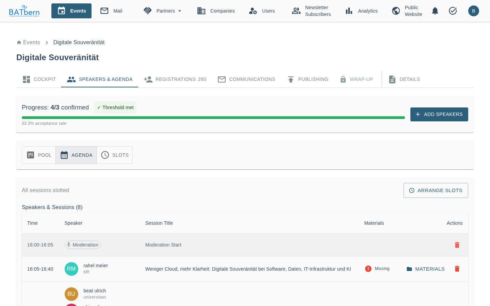
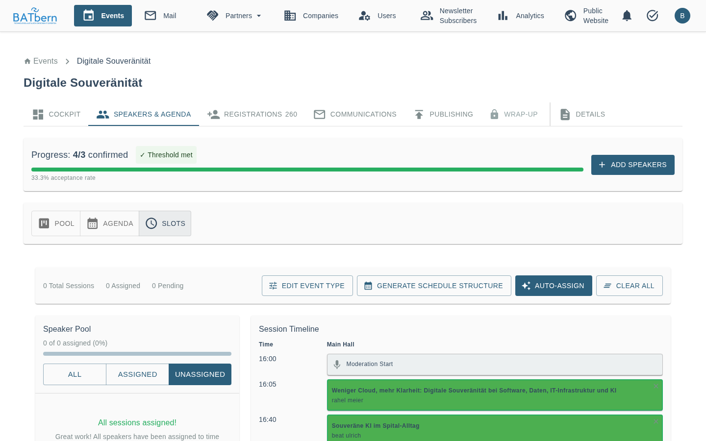
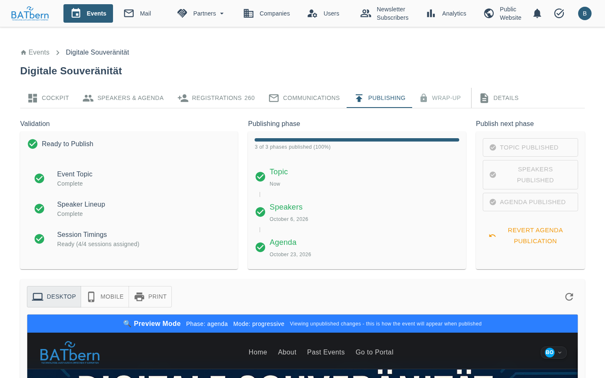

# Phase D: Slot Assignment & Publishing

> Assign speakers to time slots and publish the agenda

> **Last Updated:** 2026-11-04 — insert / swap with live preview, remove from slot, tap-to-assign on mobile (Story 15.3, #806); per-event **Edit event type** (Story 15.2, #805).
>
> **2026-06-13** — Speaker states aligned to the 8-state model (ADR-009 / Epic 11); the removed `slot_assigned` / `confirmed` states replaced by derived `is_slot_assigned` / `is_publishable` flags.

<div class="workflow-phase phase-d">
<strong>Phase D: Assignment</strong><br>
Status: <span class="feature-status implemented">Implemented</span><br>
Duration: 1 week<br>
Event State Transitions: SPEAKER_IDENTIFICATION → SLOT_ASSIGNMENT → AGENDA_PUBLISHED<br>
Speaker States: QUALITY_REVIEWED stays; assigning a slot sets the derived <code>is_slot_assigned</code> / <code>is_publishable</code> flags
</div>

## Overview

Phase D assigns approved speakers to specific time slots and publishes the finalized agenda.

**Key Concept**: Slot assignment does **not** change the speaker's workflow state. When you assign a `QUALITY_REVIEWED` speaker to a time slot (sets `session.start_time`), the derived flag **`is_slot_assigned`** becomes true, which makes **`is_publishable`** (`QUALITY_REVIEWED AND is_slot_assigned`) true. There is no separate `slot_assigned` or `confirmed` state under ADR-009 — those are read-time derived flags.

**Key Deliverable**: Published event agenda with complete schedule and all assigned speakers publishable

### Slot Assignment

Open **Speakers & Agenda** on the event page and switch to **Agenda**.



Click **Arrange slots** (or switch to **Slots**) to open the assignment view.



On a phone the Slots view stacks the speaker pool above the session timeline:


Use the **Auto-Assign** feature to automatically assign presentations to available slots.

### Publishing the Agenda

After assigning all sessions to slots, navigate to the Publishing tab.

Click **Publish Agenda** to make the schedule public. Afterwards all three phases show as published:



## Step 9: Assign Speakers to Time Slots

<span class="feature-status implemented">Implemented</span>

### Purpose

Assign approved presentations to available event time slots using the auto-assign feature.

### Acceptance Criteria

- ✅ All approved presentations assigned to slots
- ✅ Schedule conflicts resolved automatically
- ✅ Event ready for agenda publication

### How to Use Auto-Assign

The system automatically assigns presentations to available slots, balancing the schedule and avoiding conflicts.

<div class="step" data-step="1">

**Open Slot Assignment Interface**

From the Speakers tab, switch to Sessions view and click **Manage Slot Assignments**.

The slot assignment page shows all available time slots and unassigned presentations.

</div>

<div class="step" data-step="2">

**Use Auto-Assign Feature**

Click **Auto-Assign** to open the automatic assignment modal.

The system will:
- Distribute presentations across available time slots
- Balance topics across parallel tracks (if applicable)
- Avoid scheduling conflicts
- Optimize for speaker preferences (if configured)

Review the proposed assignments and confirm.

</div>

<div class="step" data-step="3">

**Manual Adjustments** (Optional)

After auto-assignment, you can manually adjust the schedule. What a drop does depends on the target slot:

| You drop… | onto… | Result |
|-----------|-------|--------|
| a session from the speaker pool | an empty slot | **Assign** — the session takes the slot |
| a session from the speaker pool | an occupied slot | **Insert** — "↓ Insert — later talks shift down": the occupant and all later talks move one slot later and their times are recalculated |
| a session already in a slot | another occupied slot | **Swap** — "⇅ Swap with this session": the two sessions exchange slots |

- **Live preview** — while you drag over a slot, the agenda shows the result before you drop: the dropped session in its target and the talks that would move, marked as moved.
- **Full agenda** — an insert that would push a talk past the last slot is refused; free a slot first.
- **Remove from slot** — the ✕ on an assigned slot sends the session back to the speaker pool.
- **Mobile** — dragging does not work on touch screens. Tap a session in the pool (or in a slot), then tap a highlighted slot to place it ("↓ Now tap a highlighted slot to place it"). The same assign / insert / swap rules apply.

Each change is saved in one step; if it fails, the agenda returns to its previous state.

**Changing the agenda shape for this event only — Edit event type**

Click **Edit event type** above the slot grid to change this event's slot count and duration, breaks, lunch and apéro without touching the shared event-type template in Administration. The dialog shows a live schedule preview. The first save creates a per-event copy; from then on the event uses its own copy, and later changes to the template no longer reach it. If speakers are already assigned, the dialog warns: "Changing the structure may move them — review the agenda after saving." 

</div>

<div class="step" data-step="4">

**Complete Slot Assignment**

Once satisfied with the schedule, save the assignments.

Event state: SPEAKER_IDENTIFICATION → **SLOT_ASSIGNMENT**

**Derived publish-readiness**: Assigning a slot sets `session.start_time`, which makes the derived flag `is_slot_assigned` true. Any `QUALITY_REVIEWED` speaker with an assigned slot is then `is_publishable` (`QUALITY_REVIEWED AND is_slot_assigned`). These flags are computed at read time — no workflow-state write happens on slot assignment.

> **No `slot_assigned` state (ADR-009).** Slot assignment no longer moves the speaker to an intermediate `slot_assigned` state — that state was removed. A speaker who drops out after being scheduled is moved to terminal **`DECLINED`** (reason recorded in `speaker_status_history`).

</div>

## Step 10: Publish the Agenda

<span class="feature-status implemented">Implemented</span>

### Purpose

Make the finalized event agenda publicly available to attendees and stakeholders.

### How to Publish

<div class="step" data-step="1">

**Navigate to Publishing Tab**

From the event management interface, open the Publishing tab.

This tab shows all publishable content for the event (topics, speakers, agenda).

</div>

<div class="step" data-step="2">

**Publish Agenda**

Click **Publish Agenda** to make the schedule publicly visible.

The agenda publication includes:
- Complete session schedule with time slots
- Speaker assignments for each session
- Session titles and descriptions
- Track information (for multi-track events)

</div>

<div class="step" data-step="3">

**Verify Publication**

Check that the agenda appears on the public event page.

Attendees can now view:
- Full event schedule
- Session details
- Speaker information
- Track assignments

Event state: SLOT_ASSIGNMENT → **AGENDA_PUBLISHED**

**Auto-created Tasks**:
- Newsletter: Speakers (due: 30 days before event)

Phase D complete! ✅

</div>

## Phase D Completion

### Success Criteria

- ✅ All approved presentations assigned to time slots
- ✅ Schedule conflicts resolved
- ✅ Agenda published successfully
- ✅ Event state = **AGENDA_PUBLISHED**

### Late Withdrawals by Publishable Speakers

A speaker who is already `QUALITY_REVIEWED` and scheduled (i.e. `is_publishable`) can still drop out. Move them to terminal **`DECLINED`** (the previous state + reason are recorded in `speaker_status_history`) to free the slot. Freeing a slot lets the slot-capacity gate admit another `READY → INVITED`, so you can promote and invite a backup candidate.

### What Happens Next

**Phase E: Archival** (post-event):
- Event archival process
- Historical data preservation
- Reporting and analytics

See [Phase E: Publishing →](phase-e-publishing.md) for archival procedures.

## Troubleshooting Phase D

### "Auto-assign fails with scheduling conflicts"

**Problem**: Auto-assign cannot find valid assignment for all presentations.

**Solution**:
- Check for over-booking (more presentations than available slots)
- Review speaker availability constraints that may conflict
- Manually assign problematic presentations first, then auto-assign remainder
- Consider adding more time slots or removing lower-priority presentations

### "Cannot publish agenda - missing slot assignments"

**Problem**: Agenda publication blocked due to unassigned presentations.

**Solution**:
- Return to slot assignment interface
- Ensure all approved presentations have time slots
- Use auto-assign to fill remaining slots
- Verify all assignments saved before attempting publication

### "Published agenda shows incorrect schedule"

**Problem**: Public agenda doesn't match assigned slots.

**Solution**:
- Clear browser cache and refresh event page
- Verify assignments were saved correctly in slot management
- Re-publish agenda from Publishing tab
- Check that no manual edits were lost during save

## Related Topics

- [Phase C: Quality →](phase-c-quality.md) - Previous phase
- [Phase E: Publishing →](phase-e-publishing.md) - Next phase
- [Event Management →](../entity-management/events.md) - Event sessions

## API Reference

```
POST /api/events/{id}/workflow/step-9         Complete Step 9 (Slot Assignment)
POST /api/events/{id}/workflow/step-10        Complete Step 10 (Publish Agenda)
POST /api/events/{id}/sessions/auto-assign    Auto-assign presentations to slots
PUT  /api/events/{id}/sessions/{sid}/assign   Manually assign presentation to slot
GET  /api/events/{id}/schedule                 Get current schedule
POST /api/events/{id}/agenda/publish           Publish agenda
```

See [API Documentation](../../api/) for complete specifications.
