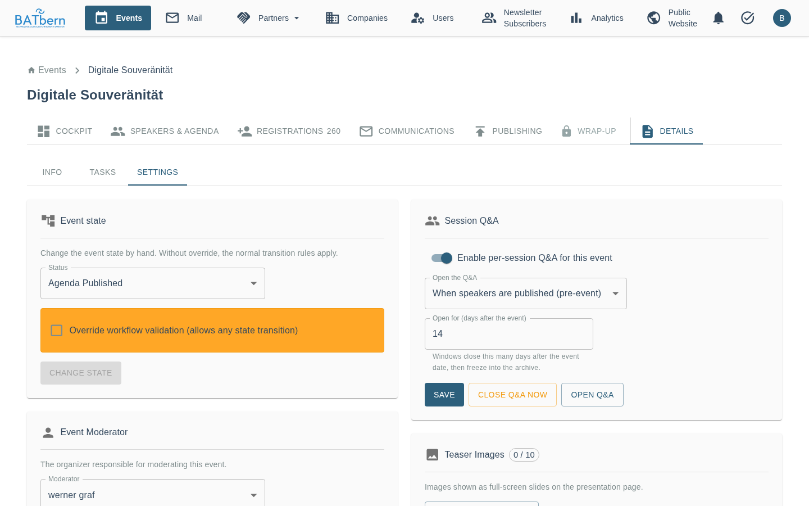

# Phase E: Archival & Publishing

> Archive completed events and manage publication workflows

> **Last Updated:** 2026-11-10 — per-event auto-publish schedule in the Publishing tab, one state-change endpoint (Story 4.9b). 2026-11-04 — 8-state EVENT workflow: `AGENDA_FINALIZED` and the "Finalize Agenda" step were removed (V84, #552); state changes and archiving now live in **Details → Settings → Event state**; automatic archiving after 14 days.
>
> **2026-06-13** — Speaker publish-readiness now uses the derived `is_publishable` flag (ADR-009 / Epic 11) rather than a `confirmed` state.

<div class="workflow-phase phase-e">
<strong>Phase E: Event Lifecycle & Archival</strong><br>
Status: <span class="feature-status implemented">Implemented</span><br>
Event State Transitions: AGENDA_PUBLISHED → EVENT_LIVE → EVENT_COMPLETED → ARCHIVED<br>
Auto-Publishing: Implemented (30-day speaker publish, 14-day agenda publish)<br>
Auto-Transitions: Implemented (EVENT_LIVE on event day, EVENT_COMPLETED after event ends, ARCHIVED 14 days after the event)
</div>

## Overview

Phase E manages the event lifecycle from the published agenda through execution to archival. The system includes automated publishing (speakers @ 30 days, agenda @ 14 days) and automated state transitions (EVENT_LIVE on event day, EVENT_COMPLETED after event ends, ARCHIVED 14 days after the event).

**Key Deliverable**: Executed event with complete historical archive and automated lifecycle management

## Event Archival (Implemented)

<span class="feature-status implemented">Implemented</span>

### Purpose

Archive completed events to preserve historical data and free up the active event list for current planning.

### When to Archive

You normally do not need to archive by hand: a nightly job archives every event in `EVENT_COMPLETED` whose date is more than 14 days in the past. Archive manually only when an event must leave the active list earlier, for example a cancelled event.

### How to Archive an Event Manually



<div class="step" data-step="1">

**Open the Event State Settings**

Open the event and go to **Details → Settings**. The first card is **Event state**.

</div>

<div class="step" data-step="2">

**Select Archived**

In the **Status** dropdown, select **Archived**.

If the event has not reached `EVENT_COMPLETED`, the normal transition rules reject the change and an error is shown.

</div>

<div class="step" data-step="3">

**Override Workflow Validation**

To archive an event that has not completed all workflow steps, tick **Override workflow validation (allows any state transition)** and enter a reason. The reason is required: **Change state** stays disabled until it is filled in.

This allows archival regardless of workflow state, useful for cancelled events or special circumstances.

</div>

<div class="step" data-step="4">

**Change State and Verify**

Click **Change state**. The card confirms with "Event state changed." and the event shows the Archived state.

Archived events are:
- Moved to archived events section
- Preserved for historical reference
- Excluded from active event workflows
- Available for reporting and analytics

Event state: Any workflow state → **ARCHIVED**

**Note**: Events can be archived from any state using the override checkbox (useful for cancelled events).

</div>

## Automated Publishing (Implemented)

<span class="feature-status implemented">Implemented</span>

### Auto-Publishing Schedule

BATbern automatically publishes event content on a schedule to reduce manual work and ensure timely publication. Each event has its own schedule: **Publishing tab → Auto-publish schedule** switches the speakers and the agenda publish on or off and sets how many days before the event each one runs (1 to 365). Without a change the defaults apply: speakers 30 days, agenda 14 days before the event, both on. Since 2026-11 (Story 4.9b) the job reads this schedule; before, it always used 30 and 14 days.

**Speaker Profiles** (default 30 days before event):
- Scheduled job runs daily at 01:00, skipped for an event whose speakers auto-publish is off
- Checks all events where `currentPublishedPhase` has not yet reached "speakers" (i.e. speakers not yet published), regardless of event workflow state
- For events exactly the scheduled number of days away (a missed day is not caught up):
  - Publishes all **publishable** speaker profiles (`is_publishable` = `QUALITY_REVIEWED AND is_slot_assigned`) to the public website
  - Sets speaker.publishedAt timestamp
  - Activates the "Newsletter: Speaker Lineup" task

**Full Agenda** (default 14 days before event):
- Scheduled job runs daily at 01:00, skipped for an event whose agenda auto-publish is off
- Checks all events where `currentPublishedPhase = "speakers"` (speakers already published) **and** all sessions have timing configured
- For events exactly the scheduled number of days away (a missed day is not caught up):
  - Publishes complete session schedule with time slots
  - Transitions an event before AGENDA_PUBLISHED to **AGENDA_PUBLISHED** and sets its `publishedAt`
    (never moves a live or completed event backwards)
  - Generates the structural slots (moderation, breaks, lunch, apéro) from the event type's agenda
    config if none are stored yet. Manual and automatic publishing both do this; an existing,
    edited structure is never overwritten. Before this, the website showed the talks only until
    someone pressed **Generate structure** in the Slots view (#1108).
  - Activates the default tasks triggered on AGENDA_PUBLISHED (see [Task Templates](../administration/task-templates.md))

**Manual Override**:
- Organizers can manually publish speakers/agenda before auto-publish dates
- Use Publishing tab → **Publish Speakers** or **Publish Agenda**
- Prevents duplicate auto-publishing: the job skips a phase that is already published
- Publishing the agenda checks that the event has a title and a date, that every session has a
  time and, when the publish moves the event into AGENDA_PUBLISHED, that the date is in the
  future. When something is missing, nothing is published and the Publishing tab lists every
  reason.

### Automated State Transitions (Implemented)

<span class="feature-status implemented">Implemented</span>

**EVENT_LIVE Transition** (on event day):
- Nightly job, shortly after midnight on event day
- Checks all events in AGENDA_PUBLISHED state whose event date is today
- Automatically transitions each of them to EVENT_LIVE state
- No organizer action needed: there is no separate "finalize agenda" step

**EVENT_COMPLETED Transition** (after all sessions end via Watch mode):
- Primary mechanism: organizer uses the live **Watch feature** to call `endSession()` for each completeable session
- When the last completeable session is ended, the system automatically transitions the event to EVENT_COMPLETED state
- Only session types that count toward completion: **keynote**, **presentation**, **workshop**, **panel_discussion**
- Excluded from completion check: **break**, **lunch**, **networking** — these do not need to be ended by the organizer
- **Fallback**: a nightly job transitions every EVENT_LIVE event whose date has passed to EVENT_COMPLETED. The same job catches up an event still in AGENDA_PUBLISHED after its date.

See [Live Event Management (Watch Mode)](#live-event-management-watch-mode) below for full details.

**EVENT_COMPLETED → ARCHIVED** (14 days after the event):
- Nightly job archives every EVENT_COMPLETED event whose date is more than 14 days in the past
- Keeps the public homepage clear of past events

**Configuration**:
- The EVENT_LIVE and EVENT_COMPLETED jobs compare the event date with the current day in Swiss time (Europe/Zurich)

### Live Event Management (Watch Mode)


<span class="feature-status implemented">Implemented</span>

The **Watch** feature lets organizers manage the event in real time on the event day. It is the primary mechanism that drives the `EVENT_LIVE → EVENT_COMPLETED` transition.

**How it works:**

1. While the event is in `EVENT_LIVE` state, open the Watch view from the event dashboard.
2. As each session concludes, click **End Session** for that session in the Watch view.
3. When the last *completeable* session has been ended, the system automatically transitions the event to `EVENT_COMPLETED`.

**Completeable session types** (must be ended to trigger completion):
- keynote
- presentation
- workshop
- panel_discussion

**Non-completeable session types** (never required to be ended):
- break
- lunch
- networking

If organizers do not use Watch mode, the nightly job transitions the event to `EVENT_COMPLETED` once the event date has passed.

---

### CDN Delivery (CloudFront)

Published content is served through **AWS CloudFront CDN** for low-latency delivery:

- Speaker photos, presentation materials, and event assets are stored in S3 and delivered via CloudFront (< 50 ms typical latency)
- Cache invalidation is triggered automatically when new content is published — on the auto-publish schedule and on manual publish
- Changes to speaker profiles or the agenda reach the public website within seconds of the publish job completing

### Archival Best Practices

**When to Archive**:
- Automatic: 14 days after the event date
- Manually earlier only for special cases (for example a cancelled event)

**What Gets Preserved**:
- Complete event configuration
- All speaker and presentation data
- Slot assignments and schedule
- Participant lists and attendance records
- Quality reviews and ratings

**Archival vs. Deletion**:
- ✅ Archive: Preserves all data, supports historical analysis
- ❌ Delete: Permanent removal, loses historical context
- Prefer archival to maintain 20+ year event history

---

## Final Agenda Check

<span class="feature-status implemented">Implemented</span>

### Purpose

About 2 weeks before the event, check that the published agenda is complete before final communications go out. This is a check only: there is no "Finalize Agenda" action and no state change. The former `AGENDA_FINALIZED` state was removed (migration V84) because, if nobody set it, the event never went live automatically. The event stays in `AGENDA_PUBLISHED` until it moves to `EVENT_LIVE` by itself on event day, and the agenda stays editable until then.

### What to Check

Typically 14 days before the event:
- All speakers confirmed and reconfirmed
- All slot assignments complete
- Any last-minute dropouts resolved

<div class="step" data-step="1">

**Review Agenda Completeness**

Verify all slots are filled and all speakers are **publishable** (`is_publishable` = `QUALITY_REVIEWED AND is_slot_assigned`). The event-workflow gate `validateAllSpeakersConfirmed` checks this derived flag — there is no separate `confirmed` speaker state.

</div>

<div class="step" data-step="2">

**Check the Agenda Is Published**

If the agenda has not been published yet, the system auto-publishes it 14 days before the event (once speakers are published and all sessions have a time slot). You can also publish immediately via the Publishing tab.

</div>

<div class="step" data-step="3">

**Check the Pre-Event Tasks**

The final-agenda newsletter, catering, name badge and wine tasks are default tasks triggered on `AGENDA_PUBLISHED` (or activated 14 days before they are due). Their due dates are listed in [Task Templates](../administration/task-templates.md).

</div>

## Progressive Publishing

The auto-publishing schedule (speakers at 30 days, agenda at 14 days) handles the standard release timeline automatically. The controls below allow organizers to publish earlier or override the default schedule for special cases.

### Purpose

Control publishing timing when the automated 30/14-day schedule doesn't fit — for example, publishing speakers sooner to build anticipation, or delaying if late-breaking changes are expected.

### Manual Publishing Options

### Publishing Strategy

**Progressive Release Timeline**:

| When | What Published | Why |
|------|----------------|-----|
| **4 weeks before** | Event date, venue, registration | Open registration early |
| **3 weeks before** | Topic list | Build interest, no speaker commitment yet |
| **2 weeks before** | Speaker names and bios | Confirm speakers before announcing |
| **1 week before** | Complete schedule | Final agenda with time slots |

**Benefits**:
- Speakers have time to withdraw before public announcement
- Organizers can adjust topics if needed
- Marketing can build gradually
- Reduces last-minute changes to published agenda

### How to Complete

<div class="step" data-step="1">

**Stage 1: Event Basics** (4 weeks before)

Publish core event information:

```
[Publish Event Basics]

Public Information:
✅ Event name: "BATbern 2025"
✅ Date: March 15, 2025
✅ Time: 9:00 - 18:00
✅ Venue: Kursaal Bern
✅ Event type: Full-Day Conference
✅ Registration link: Active

Hidden:
⏸️ Topics (not yet published)
⏸️ Speakers (not yet published)
⏸️ Schedule (not yet published)

[Publish to Website]
```

Event landing page goes live at: `https://www.batbern.ch/events/batbern-2025`
</div>

<div class="step" data-step="2">

**Stage 2: Topics** (3 weeks before)

Publish selected topics:

```
[Publish Topics]

Topics for BATbern 2025:
✅ Sustainable Building Materials
✅ Digital Transformation in Architecture
✅ Urban Planning Innovations
✅ Heritage Adaptive Reuse
... (8 more)

Speakers: "Coming soon - Stay tuned!"

[Publish Topics]
```

Topics appear on event page, no speaker names yet.
</div>

<div class="step" data-step="3">

**Stage 3: Speakers** (2 weeks before)

Publish speaker profiles:

```
[Publish Speaker Profiles]

Confirm all speakers before publishing:
✅ Hans Müller - Last confirmation: 2 days ago
✅ Anna Schmidt - Last confirmation: 1 day ago
✅ Peter Weber - Last confirmation: 3 days ago
... (9 more)

⚠️ All speakers must confirm availability within 7 days

[Publish All Speakers]
```

Speaker directory goes live with photos, bios, and session titles.
</div>

<div class="step" data-step="4">

**Stage 4: Complete Agenda** (1 week before)

Publish full schedule:

```
[Publish Complete Agenda]

Full Schedule:
────────────────────────────────────────────────
09:00-09:45
Track A: Hans Müller - Sustainable Materials
Track B: Anna Schmidt - Digital Transformation

10:00-10:45
Track A: Peter Weber - Urban Planning
Track B: Martin Fischer - Heritage Reuse

[Continue for all sessions...]

[Publish Full Agenda]
```

Complete schedule with time slots appears on event page.

Event state: SLOT_ASSIGNMENT → **AGENDA_PUBLISHED**
</div>

### Website Preview

Public event page shows:

```
════════════════════════════════════════════════
BATbern 2025
Full-Day Conference | March 15, 2025 | Kursaal Bern
════════════════════════════════════════════════

[Register Now] - 45 days until event

────────────────────────────────────────────────
About This Event

Join 300+ architects for a full day of insights on...

Topics:
• Sustainable Building Materials
• Digital Transformation
• Urban Planning Innovations
• Heritage Adaptive Reuse
... and 8 more

────────────────────────────────────────────────
Speakers (12)

[Photo] Hans Müller
        Müller Architekten AG
        "Innovations in Sustainable Building Materials"
        [View Profile]

[Photo] Anna Schmidt
        Schmidt & Partner
        "Digital Transformation in Architecture"
        [View Profile]

... (10 more speakers)

────────────────────────────────────────────────
Schedule

09:00-09:45  Opening Sessions
[Track A] Hans Müller - Sustainable Materials
[Track B] Anna Schmidt - Digital Transformation

10:00-10:45  Morning Sessions
[Track A] Peter Weber - Urban Planning
[Track B] Martin Fischer - Heritage Reuse

[View Full Schedule]

────────────────────────────────────────────────
[Register Now]
````
</div>

### Publishing Notifications

Stakeholder communication at each publishing stage is handled through the **Task System** — the newsletter task templates (Newsletter: Topic, Newsletter: Speakers, Newsletter: Final) are automatically created at the relevant event state transitions and assigned to organizers for action. See [Task Templates](../administration/task-templates.md) for configuration.

Notify stakeholders at each stage:

**Registration Opened** (Stage 1):
- Email to all users: "Registration now open!"
- Social media announcement
- Partner notification

**Topics Announced** (Stage 2):
- Email to registered attendees
- Social media teaser
- Blog post

**Speakers Revealed** (Stage 3):
- Email to all with speaker highlights
- Social media speaker spotlights (1 per day)
- Press release

**Full Agenda Published** (Stage 4):
- Final email with complete schedule
- Downloadable PDF agenda
- Mobile app update (if available)

## Dropout Handling

### Purpose

Keep the published agenda correct while managing any last-minute speaker withdrawals.

### Acceptance Criteria

- ✅ All speakers reconfirmed within 1 week of event
- ✅ Dropout procedures executed (if needed)
- ✅ Published agenda reflects all changes
- ✅ Event state = **AGENDA_PUBLISHED** (moves to EVENT_LIVE automatically on event day)

### Reconfirmation Process

<div class="step" data-step="1">

**Send Reconfirmation Request** (1 week before)

Email all speakers:

```
To: hans.mueller@example.com
Subject: Final Confirmation - BATbern 2025 (1 week away!)

Hi Hans,

BATbern 2025 is one week away! Please confirm you're ready:

Your Session:
- Date: March 15, 2025
- Time: 09:00-09:45 (Track A)
- Topic: "Innovations in Sustainable Building Materials"
- Duration: 45 minutes (30 min talk + 15 min Q&A)

Please confirm by clicking:
[Yes, I'm Ready!] [I Need to Withdraw]

If confirming, please also confirm:
☐ Presentation slides ready (send by March 13)
☐ Technical requirements submitted
☐ Travel/accommodation arranged

See you next week!
Anna Schmidt
```
</div>

<div class="step" data-step="2">

**Track Confirmations**

Monitor response status:

```
Final Confirmation Status
────────────────────────────────────────
Deadline: March 8, 2025 (7 days before event)

Confirmed: 10 / 12 (83%) ✅
Pending: 2 / 12 (17%) ⚠️
  - Peter Weber (last contact: 3 days ago)
  - Lisa Meier (last contact: 5 days ago)

Dropout: 0

[Send Reminder to Pending]
```
</div>

<div class="step" data-step="3">

**Handle Dropouts** (if occur)

If speaker withdraws after publication:

```
⚠️ Dropout Alert

Martin Fischer withdrew (March 8, 2025)
Session: Heritage Adaptive Reuse (11:00-11:45 Track B)
Reason: "Family emergency"

Impact: 1 session affected, 1 week before event

Options:
1. [Promote Waitlist Speaker]
   Sophie Keller - Similar topic available

2. [Reassign Existing Speaker]
   Hans Müller could present second session

3. [Cancel Session]
   Reduce to 11 sessions, adjust schedule

4. [Merge Sessions]
   Combine with similar topic, extend duration

[Choose Option]
```
</div>

<div class="step" data-step="4">

**Option 1: Promote Waitlist Speaker**

Contact waitlist speaker immediately:

```
To: sophie.keller@example.com
Subject: URGENT: Speaker Slot Available - BATbern 2025

Hi Sophie,

A speaker slot has opened for BATbern 2025 (March 15).

Session Details:
- Topic: Heritage Adaptive Reuse
- Time: 11:00-11:45 (Track B)
- Notice: 6 days (expedited preparation)

Your waitlisted presentation "Circular Economy in Construction"
fits well. Are you available?

Please respond within 24 hours.

Urgently,
Anna Schmidt
```

If accepted:
- Update agenda immediately
- Notify registered attendees of change
- Update printed materials if not yet produced
</div>

<div class="step" data-step="5">

**Option 2/3/4: Adjust Schedule**

If no replacement available:

**Cancel Session**:
- Update online agenda
- Send attendee notification
- Adjust printed programs
- Offer partial refund if significant change

**Reassign or Merge**:
- Adjust affected speaker's content
- Update agenda and notify attendees
- Ensure quality maintained
</div>

<div class="step" data-step="6">

**Confirm the Agenda Is Current**

Once all speakers are confirmed and dropouts resolved, check that the public agenda shows the final line-up. There is no lock step: the agenda stays editable until the event, and the event state stays **AGENDA_PUBLISHED**.

Phase E complete! ✅ The event will automatically transition to EVENT_LIVE when the event day arrives.
</div>

### Dropout Communication

**To Registered Attendees**:
```
Subject: Schedule Update - BATbern 2025

Hi [Attendee],

A schedule update for BATbern 2025:

Changed Session:
- Was: Martin Fischer - "Heritage Adaptive Reuse"
- Now: Sophie Keller - "Circular Economy in Construction"
- Time: 11:00-11:45 Track B (unchanged)

All other sessions remain as published.

See updated schedule: [link]

Thank you for your understanding!
BATbern Team
```

**To Dropout Speaker**:
```
Subject: Thank You - BATbern 2025

Hi Martin,

Thank you for letting us know about your situation.
We completely understand and hope everything is okay.

We'd love to have you present at a future BATbern event.
I'll reach out in a few months about BATbern 2026.

Best wishes,
Anna
```

## Phase E Completion

### Success Criteria (Complete Lifecycle)

- ✅ Agenda published (AGENDA_PUBLISHED state)
- ✅ Auto-publishing configured (speakers @ 30 days, agenda @ 14 days)
- ✅ Event executed successfully (EVENT_LIVE → EVENT_COMPLETED auto-transitions)
- ✅ Post-event activities completed
- ✅ Event archived (ARCHIVED state)
- ✅ Historical data preserved

### What Happens Next

After archival:
- Event removed from active workflows
- Data available for historical reporting
- Heat map data updated with event statistics
- Event serves as reference for future planning

## Troubleshooting Phase E

### "Cannot archive - workflow validation error"

**Problem**: System prevents archiving because workflow steps incomplete.

**Solution**:
- Open **Details → Settings → Event state** and tick **Override workflow validation (allows any state transition)**, with a reason
- This allows archival for cancelled events or special cases
- Verify all important data is preserved before archiving

### "Archived event still appears in active list"

**Problem**: Event shows ARCHIVED badge but remains in active events.

**Solution**:
- Refresh the page to update the event list
- Check that the state was saved correctly (**Details → Settings → Event state**)
- Clear browser cache if issue persists
- Verify event state in database if problem continues

### "Need to un-archive an event"

**Problem**: Event was archived prematurely or by mistake.

**Solution**:
- Open **Details → Settings → Event state**
- Select the appropriate workflow state (e.g., EVENT_COMPLETED) in the **Status** dropdown
- Tick **Override workflow validation (allows any state transition)** and enter a reason if the normal rules reject the change
- Click **Change state** to restore the event to active status
- Note: an EVENT_COMPLETED event more than 14 days past its date is archived again by the nightly job

## Related Topics

- [Phase D: Assignment →](phase-d-assignment.md) - Previous phase
- [Event Management →](../entity-management/events.md) - Event configuration and status
- [Screenshot Index →](../appendix/screenshot-index.md) - All workflow screenshots

## API Reference

```
POST  /api/v1/events/{eventCode}/transition                 Change event state (including ARCHIVED; optional override + reason)
GET   /api/v1/events/{eventCode}/workflow/status            Current workflow state
POST  /api/v1/events/{eventCode}/phases/{phase}/publish     Publish topic, speakers or agenda
POST  /api/v1/events/{eventCode}/phases/{phase}/unpublish   Revert to the phase before
GET   /api/v1/events/{eventCode}/publishing                 Published phases, validation, auto-publish schedule
PATCH /api/v1/events/{eventCode}/publishing                 Set the auto-publish schedule
```

Since Story 4.9b (2026-11) the event state changes only through `…/transition` (the event's PUT
and PATCH carry no state) and the former `…/publish`, `…/publish/{phase}`, `…/publish/schedule`,
`…/publish/status` and `…/workflow/transition` are gone, without aliases.

See [API Documentation](../../api/) for complete specifications.
